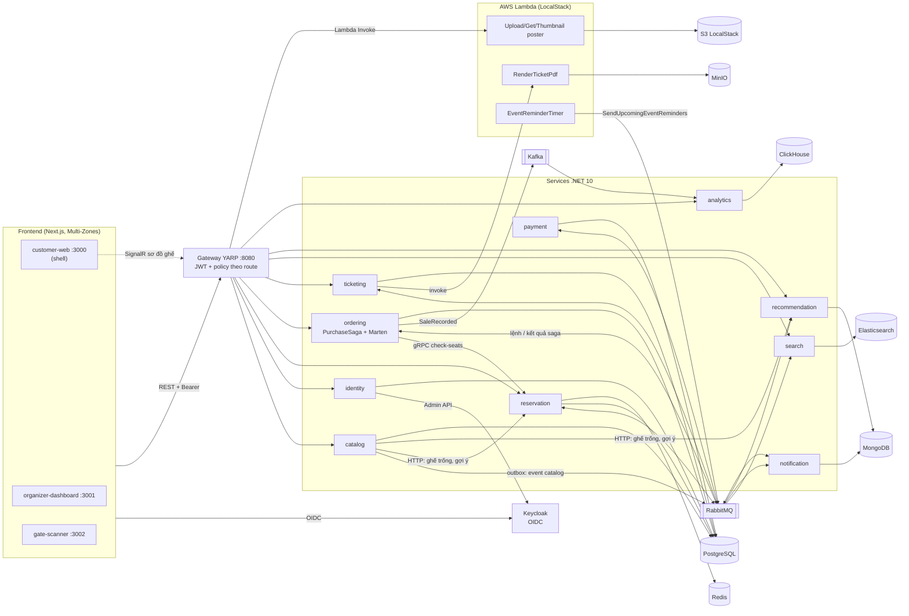
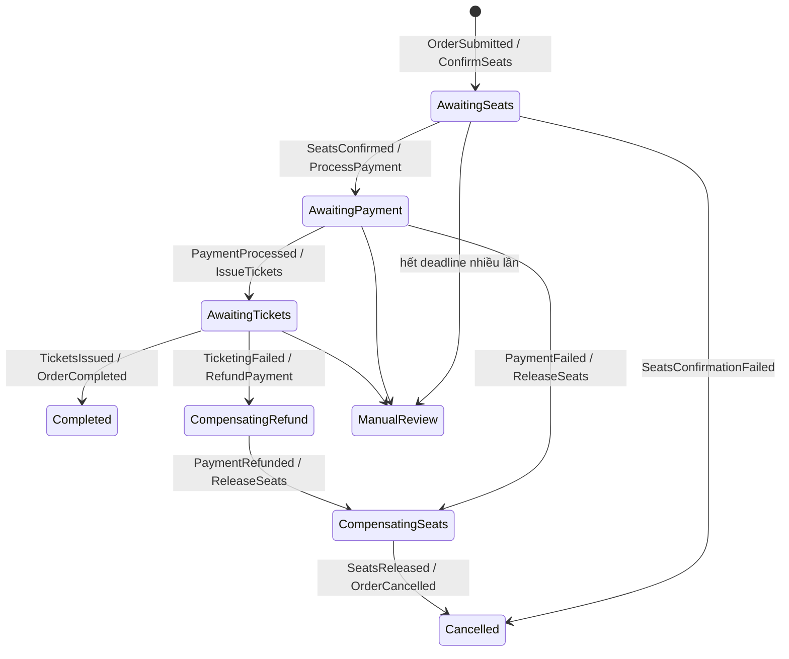

# TicketFlow

Hệ thống bán vé sự kiện (concert, thể thao) xây bằng **.NET 10 microservices** và **Next.js 16**.
Dự án cá nhân để học và thực hành các pattern microservices trên một bài toán có tranh chấp thật:
nhiều người cùng giành một ghế.

Đây là dự án học tập chạy trên máy local (Docker Compose hoặc cluster kind), **chưa triển khai ở môi trường thật**.
Cổng thanh toán là giả lập, thông báo chỉ ghi log, "serverless" chạy trên LocalStack.

## Tính năng có trong code

**Khách hàng (customer-web)**
- Đăng nhập qua Keycloak (OIDC, PKCE), tự làm mới access token.
- Xem danh sách sự kiện, trang chi tiết gộp 3 nguồn: thông tin catalog, tình trạng ghế, gợi ý.
- Sơ đồ ghế cập nhật real-time qua SignalR khi người khác giữ/mua ghế.
- Giữ ghế có thời hạn 10 phút (giới hạn số hold và số ghế mỗi người), đặt đơn với idempotency key, xem "đơn của tôi", tải vé PDF có mã QR (chỉ chủ vé tải được).
- Sơ đồ ghế tự đồng bộ lại khi mất kết nối SignalR và chuyển sang polling nếu hub không lên.

**Ban tổ chức (organizer-dashboard)**
- Tạo venue, sự kiện, sơ đồ ghế theo khu, hạng giá, cấp inventory ghế và publish trong một form; phía server chạy thành một onboarding workflow, lỗi giữa chừng thì tiếp tục (resume) được thay vì tạo trùng.
- Hủy sự kiện: workflow dừng thanh toán, hoàn tiền đơn đã trả, nhả ghế và thu hồi vé.
- Organizer chỉ thao tác trên sự kiện của mình.
- Xem doanh số (truy vấn ClickHouse).
- Upload poster qua API gateway `POST /media/posters` (role organizer, chưa có UI); S3 notification kích hoạt Lambda tạo thumbnail.

**Soát vé (gate-scanner)**
- Chọn sự kiện và cổng được phân công, quét QR bằng camera (`jsQR`) hoặc ảnh, trả về `Valid` / `AlreadyCheckedIn` / `NotFound` / `WrongEvent` / `Revoked`. Check-in là một lệnh cập nhật có điều kiện nên hai máy quét cùng lúc không cùng cho vào.

**Backend**
- Chống bán trùng: giữ ghế bằng Lua script nguyên tử trên Redis (all-or-nothing, TTL). Ghế đã bán ghi thành `SeatAllocation` bền vững trên Postgres (chủ sở hữu + generation); Redis dựng lại được từ đó, có worker đối soát định kỳ.
- Giá do server quyết: khi giữ ghế, reservation trả về báo giá (quote) lấy từ snapshot giá của catalog; checkout chỉ gửi `holdId` và idempotency key, không gửi số tiền. Sự kiện chưa mở bán, đã hủy hay đã qua thì không giữ ghế được.
- Đặt đơn idempotent: cùng key thì trả lại đúng đơn cũ; đơn và message khởi tạo saga ghi trong cùng transaction Marten rồi relay lên broker.
- `PurchaseSaga` (MassTransit state machine trên RabbitMQ): chốt ghế, thanh toán, phát vé, thông báo; bù trừ khi lỗi (hoàn tiền, nhả ghế, hủy đơn). Saga dựa trên các mốc đã nhận chứ không phụ thuộc thứ tự message đến; mỗi bước chờ có deadline, quá hạn thì gửi lại lệnh, quá số lần thì chuyển `ManualReview` (runbook trong `docs/runbook-stuck-orders.md`).
- Đơn hàng lưu bằng event sourcing (Marten), một writer cho mỗi đơn với expected stream version và inbox chống trùng; read model "đơn của tôi" tách riêng (CQRS).
- Transactional outbox: EF Core cho catalog, reservation, payment và ticketing; ordering ghi đơn và lệnh khởi tạo saga cùng transaction Marten rồi relay lên RabbitMQ; sự kiện bán sang Kafka (`SaleRecorded`) đi qua một consumer riêng có marker bền vững, nằm ngoài đường đi chính của saga, nên Kafka chết không làm kẹt đơn đã trả tiền. Notification ghi trạng thái giao từng thông báo trên MongoDB để không gửi trùng.
- Payment idempotent theo đơn: claim lần thử trước khi gọi cổng, kết quả mơ hồ ghi `Unknown` rồi worker đối soát; hoàn tiền cũng idempotent. Bọc Polly: retry, circuit breaker, timeout.
- Phát vé ghi job phát hành trước khi render PDF; worker đối soát dọn file mồ côi và chạy lại job treo.
- Tìm kiếm sự kiện (Elasticsearch), gợi ý theo nghệ sĩ/venue/phổ biến (MongoDB), doanh số qua Kafka sang ClickHouse.
- Lambda (LocalStack): render PDF vé, thumbnail poster, nhắc lịch trước 24h theo EventBridge.
- Gateway YARP kiểm JWT và phân quyền theo route (customer / organizer / admin); service tự kiểm quyền sở hữu (đơn, vé, sự kiện của organizer), gọi nội bộ giữa service dùng service token. Compose chỉ mở cổng gateway ra host.
- Observability: trace OpenTelemetry sang Jaeger, metric Prometheus + dashboard và alert Grafana, log Serilog sang Elasticsearch/Kibana.
- Helm chart chạy toàn bộ trên kind, có profile production với hạ tầng stateful bền vững (StatefulSet + PVC); runbook khôi phục trong `docs/runbook-stateful-recovery.md`.
- GitHub Actions: test backend, lint/typecheck/test/build frontend, test hardening trên hạ tầng thật, E2E Playwright full stack, load test flash sale, gate khôi phục trạng thái chạy hằng đêm.

## Kiến trúc

Sơ đồ vẽ từ `docker-compose.yml`, cấu hình gateway và các consumer trong code.



Luồng `PurchaseSaga` (lấy từ `src/Services/Ordering/TicketFlow.Ordering.Application/Sagas/PurchaseSaga.cs`, rút gọn):



Mỗi trạng thái chờ có deadline: hết hạn thì gửi lại đúng lệnh đang chờ (mọi lệnh đều idempotent), quá số lần thì vào `ManualReview` và không tự hủy đơn (đơn có thể đã được trả tiền). Instance đã xong được giữ lại để nhận ra message gửi lại.

Không có ảnh chụp màn hình trong README: ảnh chỉ có ý nghĩa khi chụp từ stack đang chạy thật, và môi trường
dùng để soạn README này không dựng được toàn bộ stack (xem "Hạn chế đã biết").

## Công nghệ

| Nhóm | Dùng |
|---|---|
| Backend | .NET 10, ASP.NET Core Minimal API, gRPC, EF Core 10 + Npgsql, Marten, MassTransit 8 (RabbitMQ, Kafka Rider), Polly, YARP, SignalR, QuestPDF |
| Frontend | Next.js 16.4 (App Router, Multi-Zones), React 19, Auth.js (next-auth 5 beta), Tailwind CSS 4, `@microsoft/signalr`, `jsQR`, pnpm workspace |
| Dữ liệu | PostgreSQL 16, Redis 7, MongoDB 7, Elasticsearch 8, ClickHouse 24, MinIO |
| Hạ tầng | Docker Compose, Kubernetes (kind) + Helm, LocalStack (Lambda, S3, EventBridge), Keycloak 26 |
| Observability | OpenTelemetry, Jaeger, Prometheus, Grafana, Serilog, Kibana |
| Test | xUnit, MassTransit test harness, Testcontainers (Redis, Postgres, RabbitMQ, MongoDB, Elasticsearch), NBomber (load test), Vitest + `node --test` (frontend), Playwright (E2E) |
| CI | GitHub Actions |

## Cấu trúc repo

```
src/BuildingBlocks/   Domain, Messaging, Web (auth, middleware), Observability, Contracts.Messaging
src/Services/<Tên>/   10 service, mỗi service: Api / Application / Domain / Infrastructure (+ *.Tests)
src/Gateway/          YARP gateway
src/Functions/        AWS Lambda .NET
apps/                 customer-web, organizer-dashboard, gate-scanner
packages/             types (type + validator runtime), http-client, web-auth dùng chung
infrastructure/       compose hạ tầng + monitoring, Postgres init, Keycloak realm, LocalStack init, Helm chart
tests/                test hardening Phase 12, E2E Playwright, load test flash sale, script CI
docs/                 kế hoạch từng phase, runbook, AUDIT.md, SECURITY-AUDIT.md
PROBLEMS.md           danh sách lỗi đã khảo sát và hướng sửa (Phase 12)
```

## Yêu cầu

| Công cụ | Phiên bản đã kiểm | Dùng cho |
|---|---|---|
| .NET SDK | 10.0.x | build, test, chạy service |
| Node.js | 22.x | 3 app frontend |
| pnpm | 10.28+ hoặc 11 (lockfile tạo bằng pnpm 11, CI dùng 11) | monorepo frontend |
| Docker + Docker Compose v2 | Docker 29 | hạ tầng và service; test Redis dùng Testcontainers |
| RAM trống cho Docker | khoảng 8 GB | full stack khoảng 21 container (Elasticsearch riêng đã 1 GB) |
| `jq` | bất kỳ | chỉ để đọc secret/mật khẩu dev từ realm-export |

Tùy chọn (chỉ khi chạy full stack có Lambda): `Amazon.Lambda.Tools` và một token LocalStack miễn phí.

## Build và test

```bash
git clone https://github.com/KingChen711/ticket-flow.git
cd ticket-flow

# Backend .NET
dotnet restore TicketFlow.slnx
dotnet build TicketFlow.slnx -c Release --no-restore
dotnet test TicketFlow.slnx -c Release --no-build

# Frontend
pnpm install --frozen-lockfile
pnpm lint
pnpm typecheck
pnpm test:web   # package dùng chung (node --test)
pnpm test       # Vitest của 3 app
pnpm build
```

`dotnet test` chạy cả `TicketFlow.Reservation.IntegrationTests`, project này cần Docker đang chạy (Testcontainers
tự kéo image `redis:7`). Không có Docker thì riêng project đó báo lỗi, các project còn lại vẫn chạy.
Chỉ chạy test không cần Docker:

```bash
dotnet test TicketFlow.slnx -c Release --filter "FullyQualifiedName!~IntegrationTests"
```

Chạy riêng test của luồng mua vé:

```bash
dotnet test src/Services/Reservation/TicketFlow.Reservation.IntegrationTests    # Redis thật, chống bán trùng (cần Docker)
dotnet test src/Services/Ordering/TicketFlow.Ordering.Application.Tests         # đặt đơn + PurchaseSaga
dotnet test tests/TicketFlow.Phase12.HardeningTests                             # tiền / ghế / thứ tự message trên hạ tầng thật (cần Docker)
```

Test hardening (`tests/TicketFlow.Phase12.HardeningTests`) không nằm trong `TicketFlow.slnx`, CI chạy riêng.
E2E Playwright và gate phát hành: xem `docs/runbook-phase-12-release-gates.md`.

### Test đang có

| Project | Kiểm cái gì | Số test |
|---|---|---|
| `Catalog.Domain.Tests` | aggregate sự kiện, venue, sơ đồ ghế, giá | 35 |
| `Reservation.Application.Tests` | domain ghế (giữ, bán, nhả) | 6 |
| `Reservation.IntegrationTests` | Lua script trên Redis thật, nhiều người giành 1 ghế | 12 |
| `Ordering.Domain.Tests` | dựng đơn hàng từ event | 9 |
| `Ordering.Application.Tests` | handler đơn hàng và các nhánh của `PurchaseSaga` | 14 |
| `Payment.Domain.Tests`, `Payment.Infrastructure.Tests` | trạng thái giao dịch, pipeline Polly | 9 + 3 |
| `Ticketing.Domain.Tests` | vé, check-in | 6 |

Tổng 94 test trong `TicketFlow.slnx`, cộng 224 test hardening (đếm bằng `--list-tests`). Load test NBomber (`src/Services/Reservation/TicketFlow.Reservation.LoadTests`,
`tests/TicketFlow.FlashSale.LoadTests`) chạy tay với stack đang chạy, xem README trong thư mục đó.
Frontend: 13 test `node --test` cho package dùng chung và 21 test Vitest cho server action / route của 3 app (giữ ghế, soát vé, tạo sự kiện), cộng E2E Playwright (multi-zone và full stack). CI: `.github/workflows/ci.yml`.

## Chạy backend bằng Docker Compose

```bash
cp .env.example .env          # điền LOCALSTACK_AUTH_TOKEN nếu có (xem bên dưới)

# Chỉ cần khi muốn có PDF vé / poster / nhắc lịch (Lambda trên LocalStack):
dotnet tool install -g Amazon.Lambda.Tools
(cd src/Functions/TicketFlow.Functions && dotnet lambda package -c Release -o function.zip)

docker compose up -d --build
```

Lần đầu mất vài phút để kéo image và build 11 image .NET. Kiểm nhanh:

```bash
curl http://localhost:8080/health          # gateway
curl http://localhost:8080/catalog/events  # danh sách sự kiện (route ẩn danh)
```

Các service tự chạy migration và catalog tự seed dữ liệu mẫu khi khởi động. Các database được tạo bởi
`infrastructure/postgres/init/01-create-databases.sql` khi volume Postgres còn mới. Nếu đã có volume cũ (script không
chạy lại), chạy script đó một lần; nó chỉ tạo database còn thiếu, không đụng dữ liệu đang có:

```bash
docker compose exec -T postgres psql -U ticketflow -d postgres < infrastructure/postgres/init/01-create-databases.sql
```

Các service backend không mở cổng ra host, chỉ gateway `:8080`. Cần gọi thẳng một service khi debug thì thêm
`-f docker-compose.debug-ports.yml` vào lệnh `docker compose`.

Không có `LOCALSTACK_AUTH_TOKEN` thì container LocalStack không lên; mọi thứ khác vẫn chạy, nhưng bước phát vé của
saga gọi Lambda sẽ lỗi nên đơn hàng đi vào nhánh bù trừ (hoàn tiền, nhả ghế, hủy đơn) thay vì `Confirmed`.

| Thành phần | URL |
|---|---|
| API gateway | http://localhost:8080 |
| Keycloak (admin console) | http://localhost:8180 |
| RabbitMQ management | http://localhost:15672 |
| Jaeger (trace) | http://localhost:16686 |
| Grafana | http://localhost:3300 |
| Kibana (log) | http://localhost:5601 |
| Prometheus | http://localhost:19090 |
| MinIO console | http://localhost:19001 |

Mật khẩu dev của hạ tầng nằm trong `infrastructure/docker/*.yml`, chỉ dành cho máy local.

**Tài khoản mẫu** (realm `ticketflow`): `customer1` (customer), `organizer1` (organizer), `admin1` (admin).
Mật khẩu dev nằm trong `infrastructure/keycloak/realm-export.json`:

```bash
jq -r '.users[] | "\(.username): \(.credentials[0].value)"' infrastructure/keycloak/realm-export.json
```

## Chạy frontend

Frontend không nằm trong Compose, chạy trên máy host và gọi gateway ở `localhost:8080`.

```bash
for app in customer-web organizer-dashboard gate-scanner; do
  cp apps/$app/.env.example apps/$app/.env.local
done
# Điền AUTH_SECRET (openssl rand -base64 32) và AUTH_KEYCLOAK_SECRET (lệnh jq có trong từng file) cho mỗi app.

pnpm dev
```

| App | URL | Đăng nhập bằng |
|---|---|---|
| customer-web | http://localhost:3000 | customer1 |
| organizer-dashboard | http://localhost:3001/organizer (hoặc qua shell http://localhost:3000/organizer) | organizer1 |
| gate-scanner | http://localhost:3002/scanner (hoặc qua shell http://localhost:3000/scanner) | organizer1 |

Biến môi trường: `.env.example` (gốc, cho Compose) và `apps/<app>/.env.example` (cho từng app Next.js).
Cấu hình .NET nằm trong `appsettings.json` (chạy trong Docker) và `appsettings.Development.json` (chạy `dotnet run` trên host).

Dừng: `docker compose down` (giữ dữ liệu) hoặc `docker compose down -v` (xóa volume).

Chạy trên Kubernetes (kind + Helm): xem `infrastructure/k8s/` và job `deploy-kind` trong `.github/workflows/ci.yml`.

## Hạn chế đã biết

- **Đơn kẹt ở `ManualReview` cần người xử lý**: saga không tự hủy đơn khi participant im lặng; xem `docs/runbook-stuck-orders.md`. Instance saga đã xong được giữ lại nên bảng saga lớn dần theo số đơn.
- **Thanh toán giả lập, thông báo chỉ ghi log**, không gửi email/SMS thật.
- **Docker Compose vẫn cần Elasticsearch để khởi động service**: mọi service `depends_on` `es-ilm-init`, mà `es-ilm-init` chờ Elasticsearch healthy. Service chạy trực tiếp (`dotnet run`, Helm) thì vẫn lên khi Elasticsearch chết, chỉ mất log trên Kibana.
- **Full stack nặng** (khoảng 21 container, cần khoảng 8 GB RAM cho Docker) và phần Lambda cần token LocalStack.
- **Còn 6 lỗ hổng high trong dependency bắc cầu chỉ dùng lúc lint/build** (`brace-expansion` qua eslint, `browserslist` qua next), bị khóa bởi range của package cha, xem `docs/SECURITY-AUDIT.md`.
- **Secret dev nằm trong repo** (realm Keycloak, Helm values, appsettings). Không dùng lại cho môi trường thật.
- **Chưa có test component giao diện**; luồng UI chỉ được kiểm qua E2E Playwright, mà E2E full stack chỉ chạy trong CI hoặc khi tự dựng stack.
- CI chưa có bước lint định dạng .NET (`dotnet format`).
- README chưa kèm ảnh chụp màn hình.

Chi tiết khảo sát: `docs/AUDIT.md` (bản trước Phase 12) và `PROBLEMS.md`. Kế hoạch và nhật ký từng phase: `scope.md`, `docs/phase-*.md`.
