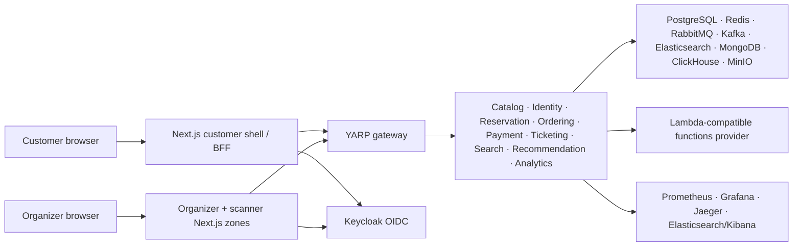
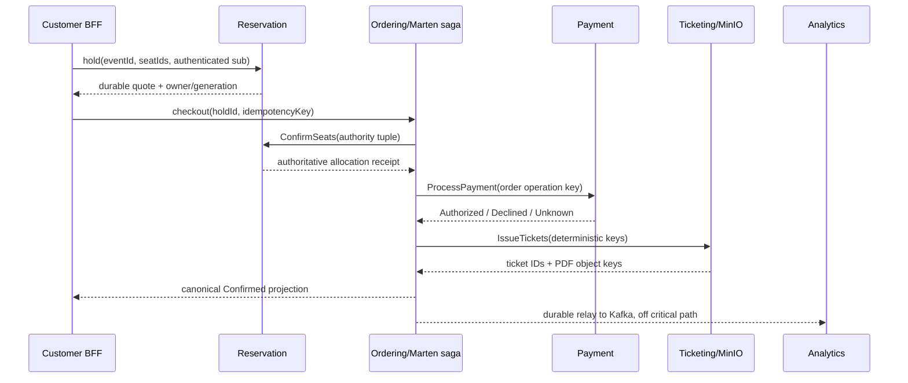

# TicketFlow architecture

This document describes the system that exists after Phase 12. It is deliberately narrower than
the aspirational diagrams in the original scope: every component below has a source directory,
deployment manifest and verification boundary.

## System context

The public boundary is the gateway plus the three Next.js BFFs. Backend containers have no host
ports in the normal Compose profile, and Kubernetes NetworkPolicy restricts direct access. Every
service still validates its own JWT audience, role and resource ownership; the gateway is routing,
not an authorization substitute.

## Authoritative state and delivery boundaries

| Concern | Source of truth | Cache/projection | Durable delivery boundary |
|---|---|---|---|
| Event lifecycle, price revision, organizer owner | Catalog PostgreSQL | Search ES, downstream owner projections | EF outbox → RabbitMQ |
| Seat hold/allocation | Reservation PostgreSQL `seat_allocations` | Redis owner + generation | EF outbox; Redis repaired from PostgreSQL |
| Checkout/order | Marten event stream + `CheckoutOperation` | `MyOrderView` inline projection | local Marten dispatch record → RabbitMQ |
| Charge/refund | Payment PostgreSQL attempt/refund state machines | provider idempotency ledger | EF inbox/outbox + reconciliation worker |
| Ticket/PDF/check-in | Ticketing PostgreSQL + MinIO object | none | issuance job + deterministic object key |
| Notification | Mongo delivery operation | provider reference | delivery outbox/retry |
| Revenue | canonical `OrderCompleted` | ClickHouse `sales FINAL` | RabbitMQ relay record → Kafka |

No client-provided price, currency, owner or seat list can become order authority. Reservation's
durable quote/allocation is read during checkout. A transport timeout is never treated as a
business decline: `Unknown` waits for provider lookup, and exhausted recovery becomes explicit
`ManualReview`.

## Purchase and cancellation flow

Event cancellation first closes the Catalog sale, invalidates holds, snapshots affected orders,
then drives stop/refund, ticket revocation and allocation release with per-order receipts. Replays
join the same workflow; stale compensation cannot free a newer owner's seat.

## Runtime and release topology

- Development: Compose uses persistent named volumes and a deterministic test-only Functions
  contract adapter for E2E. Normal development can still use the external LocalStack provider.
- Kubernetes: Helm provisions stateful dependencies, migrations and Kafka topics before application
  readiness. Production values require external secrets, TLS, dedicated broker credentials,
  resource limits and no seeded realm.
- CI: configuration + unit/contract and frontend gates run first; Testcontainers concurrency runs
  next; authenticated full-stack Playwright/flash-sale follows; stateful restart chaos is nightly or
  explicitly dispatched. Failure artifacts contain logs, traces, alert state, invariant queries and
  seed IDs.

Operational procedures live in [Phase 12 release gates](runbook-phase-12-release-gates.md),
[stuck orders](runbook-stuck-orders.md) and [stateful recovery](runbook-stateful-recovery.md).
The main hardening decision is recorded in
[ADR 001](adr/001-phase-12-authoritative-state-and-durable-relays.md).

## Known limits

The local/kind topology proves restart durability, not multi-zone HA. Scanner validation is online,
not an offline cryptographic admission system. Provider adapters use idempotency/reconciliation but
the project does not claim PCI scope, 3DS/SCA or multi-region seat allocation. Those remain explicit
backlog rather than hidden production claims.
