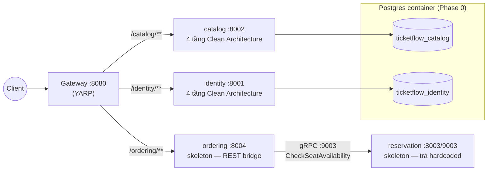
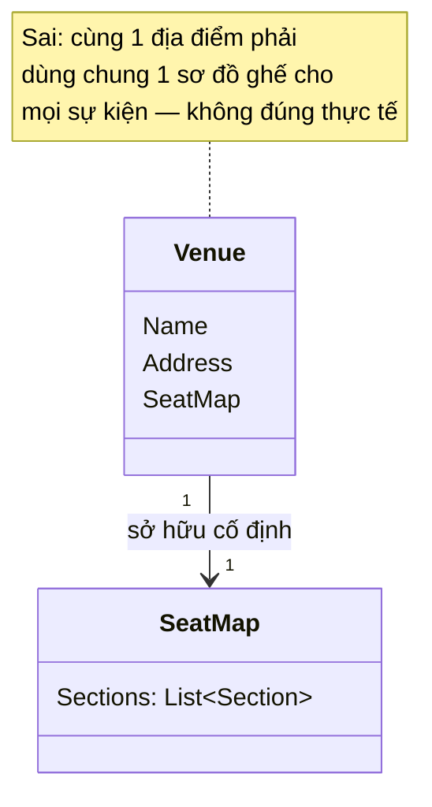
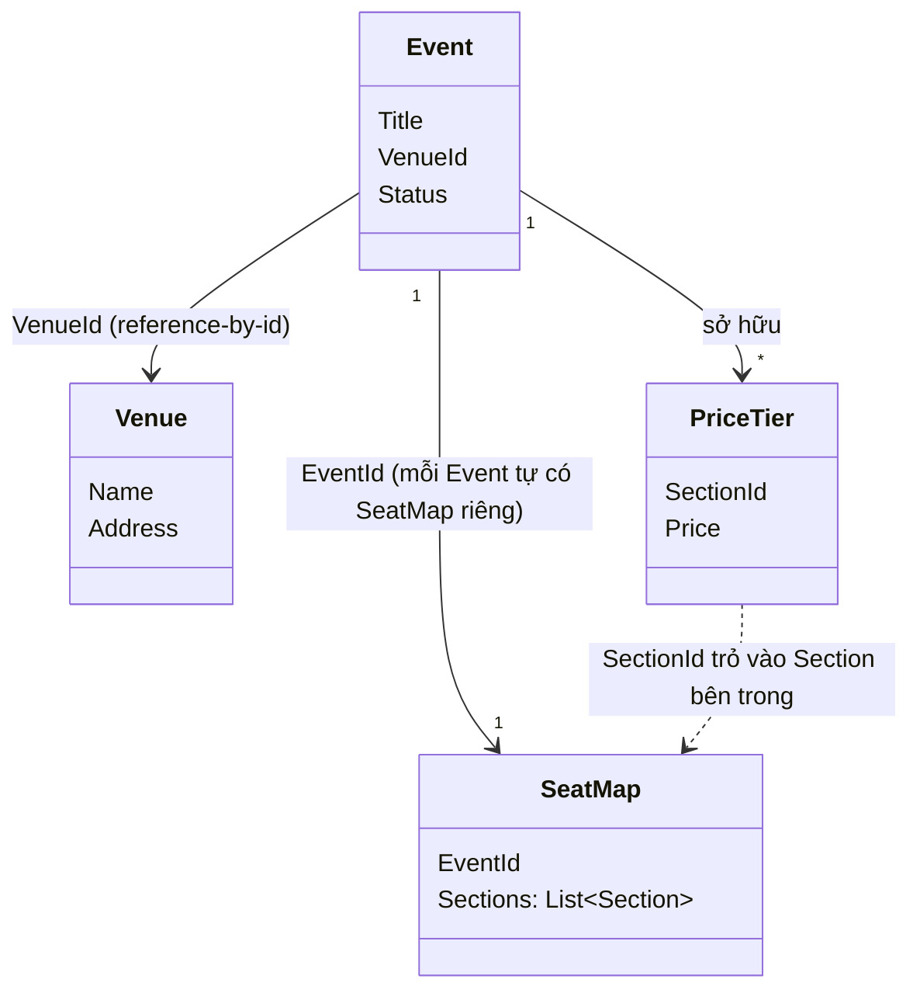

# Phase 1 — Kế hoạch chi tiết theo commit

> **Mục tiêu (từ scope mục 10):** DDD tactical patterns + giao tiếp sync (gRPC) + DB-per-service.
> **DoD:** CRUD sự kiện qua gateway; mỗi service DB riêng; 1 lời gọi gRPC nội bộ chạy được.

## Quyết định kiến trúc cho Phase 1

- **Layering:** `catalog` và `identity` tách 4 project theo Clean Architecture (`Domain` → `Application` → `Infrastructure` → `Api`), ép đúng dependency rule để học Ch2. `ordering` và `reservation` **chỉ là skeleton** (1 project `Api`), sẽ mổ xẻ đầy đủ ở Phase 4/5 — giờ chỉ dựng đủ để luyện gRPC (Ch3).
- **DB-per-service (Ch8):** mỗi service 1 **database riêng** trên cùng Postgres container: `ticketflow_catalog`, `ticketflow_identity`. Npgsql `Database.Migrate()` tự tạo DB nếu chưa có → không cần init script.
- **Domain events (Ch2):** Phase 1 chỉ **raise nội bộ** vào `AggregateRoot.DomainEvents`, CHƯA publish. Outbox + message bus là Phase 3.
- **CQRS/MediatR:** CHƯA dùng ở Phase 1 (đó là Phase 4). CRUD đi qua service class + repository trực tiếp để giữ commit nhỏ, tránh gold-plating.
- **Auth:** dùng **fake JWT** (ký bằng symmetric key, dev-only). OAuth2/OIDC thật là Phase 7 (Ch13).
- **Ports:** theo scope mục 4 — catalog 8002, identity 8001, reservation 8003/gRPC 9003, ordering 8004/gRPC 9004.
- **SeatMap thuộc về Event, không thuộc về Venue** (quyết định sửa lại sau khi code Commit 2/3 — xem Commit 3.1): cùng 1 địa điểm vật lý có thể dựng sân khấu/sơ đồ ghế hoàn toàn khác nhau giữa các sự kiện (GA floor, catwalk, sân khấu 360°...). `Venue` chỉ còn là địa điểm thuần (Name, Address). `SeatMap` là aggregate riêng, 1-1 với `Event` (mỗi Event tự tạo `SeatMap` của riêng nó khi cần mở bán). **Chưa** model `Seat` (Row/Number) ở mức cá thể trong Phase 1 — `Section` chỉ giữ `Capacity` dạng số đếm; việc "giữ đúng 1 ghế cụ thể" là bài toán của `reservation-service` ở Phase 2, lúc đó mới cần quyết định có explode ra `Seat` entity hay không (tránh vàng hoá sớm — mục 12 scope.md).

### Sơ đồ kiến trúc Phase 1



*DB-per-service (2 database tách biệt trên cùng Postgres container) + 1 đường gRPC đồng bộ nối `ordering`↔`reservation` — cả 2 điểm này chính là nội dung DoD Phase 1. `ordering`/`reservation` vẫn là skeleton, sẽ mổ xẻ đầy đủ ở Phase 4/5.*
- **API docs: native `Microsoft.AspNetCore.OpenApi` + Scalar, không dùng Swashbuckle** (đổi lại sau khi Catalog.Api đã chạy Swashbuckle từ Phase 0 — quyết định lúc đó chỉ vì template mặc định dính CVE và cần có UI ngay). Swashbuckle đang bảo trì cầm chừng; native OpenAPI là hướng chính chủ Microsoft đang đẩy mạnh. Lưu ý: `Microsoft.AspNetCore.OpenApi 10.0.9` (bản mới nhất tại thời điểm này) vẫn kéo theo `Microsoft.OpenApi 2.0.0` dính CVE cao (GHSA-v5pm-xwqc-g5wc, chưa được vá ở tầng package chính chủ) — phải ghim tường minh `Microsoft.OpenApi` lên `2.10.0` qua `Directory.Packages.props` (giữ nhánh 2.x vì `Microsoft.AspNetCore.OpenApi`'s source generator sinh code không compile được với 3.x — `IOpenApiMediaType.Example` đổi thành read-only). Áp dụng nhất quán cho `identity-service` và các service sau.

---

## Commit 0 — Baseline Phase 0 (bắt buộc làm trước)

Working tree đang chứa toàn bộ Phase 0 chưa commit. Chốt lại làm mốc:

```
chore: scaffold Phase 0 skeleton — BuildingBlocks, catalog, YARP gateway, docker compose

- TicketFlow.Domain (Entity, AggregateRoot, DomainEvent, Result)
- TicketFlow.Web (exception middleware, health check, swagger)
- Catalog.Api (/hello, /health, swagger)
- Gateway (YARP -> catalog)
- docker-compose.infra.yml (postgres/redis/rabbitmq/kafka) + root compose
```

> Sau commit này có thể tạo nhánh `phase-1` để làm các commit dưới.

---

## Nhóm A — Catalog domain & CRUD (lõi của DoD)

### Commit 1 — `feat(domain): add ValueObject base + guard clause to BuildingBlocks`
- `TicketFlow.Domain/ValueObject.cs`: base class DDD (`GetEqualityComponents()` + structural equality).
- `TicketFlow.Domain/Ensure.cs` (hoặc `Guard`): helper `NotNullOrEmpty`, `NotNegative`, `Range`... để aggregate tự bảo vệ invariant.
- **Ch2:** Value Object, invariant enforcement.
- *Build green:* chỉ thêm vào classlib sẵn có.

### Commit 2 — `feat(catalog): model Venue aggregate (DDD tactical patterns)`
- Tạo project `TicketFlow.Catalog.Domain` (classlib, ref `TicketFlow.Domain`).
- `Venue : AggregateRoot<Guid>` { `Name`, `Address` (VO) } — **chỉ là địa điểm thuần**, không giữ sơ đồ ghế (xem Commit 3.1).
- `Address` VO (Street, City, Country, PostalCode).
- Factory `Venue.Register(...)` → raise `VenueRegistered`.
- **Ch2:** Aggregate root, Value Object, Domain Event, ubiquitous language.

### Commit 3 — `feat(catalog): model Event aggregate with Money & schedule VOs`
- `Money` VO (Amount ≥ 0, Currency), `EventSchedule` VO (StartsAt < EndsAt).
- `Event : AggregateRoot<Guid>` { `Title`, `Description`, `Artist`, `VenueId` (Guid — tham chiếu aggregate khác **bằng id**), `Schedule`, `Status` (Draft/Published/Cancelled), `PriceTiers` }.
- `PriceTier : Entity<Guid>` { `SectionId` (Guid — tham chiếu `Section` bên trong `SeatMap` của chính Event này), `Price` (Money) }.
- Behavior + guard: `Event.Create()` (raise `EventCreated`), `Publish()` (chặn nếu chưa có price tier / lịch trong quá khứ → raise `EventPublished`), `Reschedule()` (`EventRescheduled`), `Cancel()` (`EventCancelled`).
- **Ch2:** aggregate boundary, reference-by-id, behavior-rich domain, domain events.

### Commit 3.1 — `refactor(catalog): move SeatMap ownership from Venue to Event`
- **Tại sao (bài học DDD thật, không phải kế hoạch từ đầu):** review lại thấy Commit 2 gắn `SeatMap` cứng vào `Venue` — sai với thực tế: cùng 1 nhà thi đấu có thể dựng sân khấu 1 đầu + GA floor cho concert này, sân khấu 360° không ghế sàn cho concert khác. Sơ đồ ghế là thuộc tính của **từng lần diễn (Event)**, không phải thuộc tính cố định của toà nhà.
- Aggregate mới `SeatMap : AggregateRoot<Guid>` { `EventId` (Guid, 1 SeatMap ứng với đúng 1 Event), `Sections: List<Section>` }, factory `SeatMap.CreateForEvent(eventId)` → raise `SeatMapCreated`.
- `Section : Entity<Guid>` { `Name`, `Capacity` } — chuyển từ `Venues/` sang `SeatMaps/`, không đổi logic.
- `Venue` bỏ hẳn `SeatMap`/`AddSection`.
- `PriceTier.SectionName` (string) → `PriceTier.SectionId` (Guid) — tham chiếu đúng `Section` trong `SeatMap` của Event đó.
- **Cross-aggregate invariant** ("SectionId phải thật sự tồn tại trong SeatMap của Event") **không** enforce trong `Event` hay `SeatMap` — để dành cho Application layer (Commit 5) load cả hai rồi validate trước khi gọi `event.AddPriceTier(...)`.
- **Ch2:** ví dụ thực tế về việc vẽ sai ranh giới aggregate lúc đầu và sửa lại khi hiểu rõ invariant hơn — đúng quy trình DDD thật (không ai vẽ đúng aggregate boundary ngay từ lần đầu).

**Trước (Commit 2 — sai):**



**Sau (Commit 3.1 — đúng):**



*Bài học cụ thể: sơ đồ ghế là thuộc tính của **từng lần diễn** (Event), không phải thuộc tính cố định của toà nhà (Venue). `PriceTier.SectionId` giờ trỏ đúng vào `Section` nằm trong `SeatMap` của chính `Event` đó — nhưng invariant "SectionId có thật không" là **cross-aggregate**, cố tình không enforce trong Domain, để ở Application (Commit 5).*

### Commit 4 — `test(catalog): unit tests for Event, Venue & SeatMap invariants`
- Project `TicketFlow.Catalog.Domain.Tests` (xUnit).
- Test: publish thiếu price tier → fail; reschedule về quá khứ → fail; Money âm → throw; publish thành công raise đúng event; `SeatMap.AddSection` trùng tên → fail; `PriceTier` với `SectionId` rỗng → throw.
- **Scope mục 11:** unit test domain/aggregate.

### Commit 5 — `feat(catalog): application layer (DTOs, repository ports, services)`
- Project `TicketFlow.Catalog.Application` (ref Domain).
- Ports: `IEventRepository`, `IVenueRepository`, `ISeatMapRepository`, `IUnitOfWork`.
- `EventService`, `VenueService`, `SeatMapService` (orchestrate domain + repo).
- `EventService.AddPriceTier(eventId, sectionId, price)`: load `Event` + `SeatMap` (theo `EventId`), validate `sectionId` tồn tại trong `SeatMap.Sections` (**cross-aggregate invariant**, xem Commit 3.1) rồi mới gọi `event.AddPriceTier(...)`.
- Request/Response DTOs + mapping (Create/Update/Publish/Get/List).
- **Ch2 (application boundary):** thin orchestration, domain giữ business rule cục bộ, cross-aggregate rule sống ở đây.

### Commit 6 — `feat(catalog): EF Core + Postgres persistence (Ch8 DB-per-service)`
- Project `TicketFlow.Catalog.Infrastructure` (ref Application; add `Npgsql.EntityFrameworkCore.PostgreSQL`).
- `CatalogDbContext` (schema `catalog`), `DbSet<Event>`, `DbSet<Venue>`, `DbSet<SeatMap>`.
- EF configs: owned types cho `Address`/`Money`/`EventSchedule`/`PriceTier`; `SeatMap` có bảng riêng chứa `Section` (owned collection); snake_case naming convention.
- Repository implementations + `UnitOfWork`.
- `AddCatalogInfrastructure(config)` DI extension đọc `ConnectionStrings:Default`.
- **Ch8:** DB riêng, polyglot persistence (Postgres), mapping domain ↔ table.

### Commit 7 — `feat(catalog): REST CRUD endpoints wired through layers`
- Viết lại `Catalog.Api/Program.cs`: đăng ký Application + Infrastructure; bỏ `/hello`.
- Endpoints:
  - `POST /venues`, `GET /venues`, `GET /venues/{id}`
  - `POST /events`, `GET /events`, `GET /events/{id}`, `PUT /events/{id}`, `POST /events/{id}/publish`, `POST /events/{id}/cancel`
  - `POST /events/{id}/seatmap` (tạo SeatMap cho Event), `POST /events/{id}/seatmap/sections` (thêm Section), `POST /events/{id}/price-tiers` (gắn PriceTier vào Section)
- API docs (Swagger lúc code, sau đổi sang native OpenAPI + Scalar — xem quyết định kiến trúc) cập nhật; giữ `/health`.
- **Ch3 (REST phía ngoài):** service phơi REST cho gateway.

### Commit 8 — `feat(catalog): initial migration, startup migrate & seed data`
- `dotnet ef migrations add InitialCatalog`.
- Dev-only: `Database.Migrate()` lúc khởi động (tự tạo `ticketflow_catalog`).
- Seeder: 2–3 venue + vài event mẫu (scope Phase 1.5).
- **Ch8:** migration, seed.

### Commit 9 — `feat(catalog): dockerize with Postgres connection`
- Compose: catalog thêm `ConnectionStrings__Default`, `depends_on: postgres (healthy)`.
- Verify: `docker compose up` → CRUD event **qua gateway** (`/catalog/events`) trả 200. ✅ (một nửa DoD)

---

## Nhóm B — Identity service (DB riêng thứ 2 + fake auth)

### Commit 10 — `feat(identity): User aggregate, Email VO, Role enum`
- Project `TicketFlow.Identity.Domain`.
- `Email` VO (validate format). `Role` enum (Customer/Organizer/Admin).
- `User : AggregateRoot<Guid>` { Email, DisplayName, PasswordHash, Roles }; `User.Register(...)` → raise `UserRegistered`.
- **Ch2:** thêm một bounded context với ubiquitous language riêng.

### Commit 11 — `feat(identity): EF Core persistence (own database)`
- `TicketFlow.Identity.Application` (ports `IUserRepository`/`IUnitOfWork`/`IPasswordHasher` + `UserService`) + `TicketFlow.Identity.Infrastructure`.
- `IdentityDbContext` (schema `identity`, DB `ticketflow_identity`), config (`Roles` — list enum — lưu dạng chuỗi phân tách dấu phẩy qua `HasConversion`, không dùng "primitive collection" mới của EF Core 8 để tránh rủi ro chưa kiểm chứng), repo, migration `InitialIdentity`.
- `TicketFlow.Identity.Api` — **scaffold tối thiểu** (chỉ `/health` + OpenAPI/Scalar + đăng ký DI + `Database.MigrateAsync()` lúc khởi động), **chưa có endpoint nghiệp vụ** (để dành Commit 12).
- **Lệch kế hoạch so với bản gốc, có lý do:** ban đầu định để "Password hashing" hoàn toàn ở Commit 12, nhưng `WebApplicationBuilder.Build()` tự validate toàn bộ DI graph ở môi trường Development — `UserService` cần `IPasswordHasher` nên nếu không có implementation, **app không khởi động nổi**, kể cả `dotnet ef migrations add` cũng fail (cần dựng được app để tạo `DbContext` ở design-time). Nên đẩy `Pbkdf2PasswordHasher` (BCL `Rfc2898DeriveBytes.Pbkdf2`, không thêm package ngoài — xem quyết định kiến trúc) lên làm luôn ở đây thay vì Commit 12.
- **Bug tự bắt được:** quên `builder.Ignore(u => u.DomainEvents)` trong `UserConfiguration` (đã làm đủ cho Catalog nhưng bỏ sót ở Identity) — EF báo lỗi "entity type DomainEvent requires a primary key" lúc tạo migration. Sửa ngay.
- **Ch8:** DB-per-service — verify thật bằng psql: `ticketflow_catalog` và `ticketflow_identity` là 2 database tách biệt trên cùng Postgres container.

### Commit 12 — `feat(identity): registration, user list & dev JWT token`
- `Identity.Api`: `POST /identity/register`, `GET /identity/users`, `POST /identity/dev-token` (ký JWT symmetric, claim `sub` + `role` — placeholder tới Phase 7).
- ~~Password hashing (PBKDF2/BCrypt)~~ — đã làm ở Commit 11 (xem lý do ở trên).
- Compose: thêm service `identity` (8001) + connection string qua `appsettings.json`/`appsettings.Development.json` (khớp pattern Catalog, không dùng env var `ConnectionStrings__Default`).
- Gateway: route `/identity/**` → identity cluster.
- **Ch13 (đặt nền, chưa hoàn thiện):** token, role — chỉ mức giả lập.

---

## Nhóm C — gRPC sync comm (Ch3): ordering ⇄ reservation

### Commit 13 — `feat(contracts): reservation gRPC contract (.proto)`
- `contracts/protos/reservation.proto`: `ReservationService.CheckSeatAvailability(CheckSeatAvailabilityRequest{event_id, seat_ids[]}) → CheckSeatAvailabilityResponse{all_available, unavailable_seat_ids[]}`.
- **Ch3:** Protobuf, contract-first.

### Commit 14 — `feat(reservation): gRPC server skeleton (in-memory seat check)`
- Project `TicketFlow.Reservation.Api` (`Grpc.AspNetCore`), `<Protobuf ... GrpcServices="Server">`.
- Implement `CheckSeatAvailability` trả kết quả **in-memory/hardcoded** (giả định còn chỗ) — logic thật là Phase 2.
- **Kestrel 2 cổng riêng**: HTTP/1.1 tại 8003 (health, plain REST) + HTTP/2 tại 9003 (gRPC) — cấu hình tường minh qua `ConfigureKestrel`/`ListenAnyIP`, vì Kestrel không TLS thì không tự thương lượng HTTP/1.1 và HTTP/2 (h2c) trên cùng 1 cổng như khi có TLS ALPN. Thêm vào compose.

### Commit 15 — `feat(ordering): gRPC client skeleton calling reservation`
- Project `TicketFlow.Ordering.Api`, `<Protobuf ... GrpcServices="Client">` cùng .proto.
- Đăng ký gRPC client (`AddGrpcClient<ReservationService.ReservationServiceClient>`) trỏ `http://reservation:9003`.
- REST `POST /check-seats` (gateway map thành `/ordering/check-seats`, đúng pattern PathRemovePrefix của catalog/identity) → gọi reservation qua gRPC → trả kết quả (chứng minh sync comm end-to-end).
- **Sửa lại "8004/9004" trong scope.md mục 4** — Ordering ở Phase 1 chỉ là REST bridge, chưa tự host gRPC server nào (không cần cổng 9004), chỉ nghe REST ở 8004. Cổng gRPC riêng của ordering (nếu cần) chỉ phát sinh khi nó trở thành 1 gRPC service thật ở phase sau.
- Compose: service `ordering` (8004) + `reservation` (8003/9003). Gateway route `/ordering/**`.
- **Package cần thêm ngoài dự kiến ban đầu:** `Grpc.Net.ClientFactory` không tự kéo `Google.Protobuf` (khác `Grpc.AspNetCore` gói sẵn đủ cho server) — phải thêm cả `Google.Protobuf` + `Grpc.Tools` tường minh cho project client.
- **Ch3:** sync request/response qua gRPC giữa 2 service — verify thật bằng cách chạy song song 2 service local, gọi `POST /check-seats` → xác nhận round-trip gRPC hoạt động (không chỉ build).

---

## Commit 16 — `chore: finalize Phase 1 — solution refs, routes, DoD checklist`
- Add tất cả project mới vào `TicketFlow.slnx`.
- Rà lại gateway routes (`/catalog`, `/identity`, `/ordering`) + compose network.
- Tick DoD Phase 1 trong scope.md.

---

## Kiểm chứng DoD cuối Phase 1

| DoD | Kiểm chứng |
|---|---|
| CRUD sự kiện qua gateway | `POST/GET/PUT /catalog/events` qua `:8080` trả 2xx |
| Mỗi service DB riêng | `\l` trên Postgres thấy `ticketflow_catalog` + `ticketflow_identity` tách biệt |
| 1 gRPC nội bộ chạy được | `POST /ordering/check-seats` → ordering gọi reservation qua gRPC → trả availability |

## Thứ tự đọc sách trước khi code (scope mục 13)
Đọc **Ch2 (DDD)** trước Nhóm A/B, **Ch8** trước commit 6, **Ch3** trước Nhóm C.
