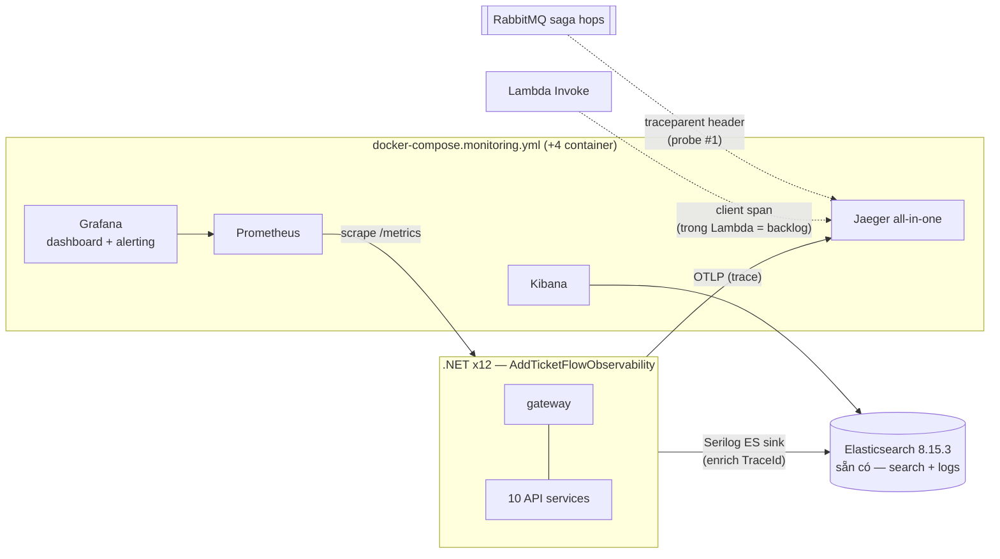

# Phase 10 — Kế hoạch chi tiết theo commit

> **Mục tiêu (từ scope mục 10):** (1) OpenTelemetry toàn service → **Jaeger** (trace), (2) metrics → **Prometheus** + dashboard **Grafana** (RED metrics + business metrics như "vé bán/phút"), (3) log tập trung **Serilog → Elasticsearch → Kibana**, (4) alert rule (circuit breaker mở, tỉ lệ lỗi payment cao). Đây là nơi **Ch16 (Observability)** sống thật.
> **DoD:** 1 lần mua vé → trace xuyên suốt mọi service trên Jaeger; dashboard + alert hoạt động.

> ⚠️ **Viết TRƯỚC khi code** (giống phase-2…phase-9). Hai sự thật cần nói thẳng ngay từ đầu:
> 1. **Scope mục 12 ghi "Observability sớm: gắn OpenTelemetry ngay từ Phase 3, Phase 10 chỉ là hoàn thiện" — điều này KHÔNG xảy ra.** Khảo sát code thật trước khi viết plan này: không có project `TicketFlow.Observability` (scope mục 8 vẽ nó nhưng chưa từng tạo), không một package OpenTelemetry/Serilog nào trong `Directory.Packages.props`, grep toàn `src/` cho `OpenTelemetry|Serilog|ActivitySource|Meter` ra **0 kết quả**. Mọi service log bằng `ILogger` console mặc định. Phase 10 là **làm từ đầu**, không phải "hoàn thiện" — ghi nhận trung thực thay vì giả vờ nguyên tắc đã được tuân thủ. Điểm cộng duy nhất có sẵn: ASP.NET Core/HttpClient vốn tự tạo `Activity` (chưa export đi đâu), và MassTransit 8.x có built-in `ActivitySource "MassTransit"` (chưa ai subscribe). Reconcile vào scope.md ở Commit 5.
> 2. **DoD "trace xuyên suốt mọi service" là bài toán context propagation, không phải bài toán cài package.** Luồng mua vé đi qua ít nhất 4 loại hop khác bản chất: HTTP sync (browser→gateway→YARP→service), gRPC (ordering→reservation), **async qua RabbitMQ/MassTransit** (toàn bộ saga — hop quyết định trace liền hay đứt), và **Lambda Invoke API** (ticketing→RenderTicketPdf). Mỗi loại propagate `traceparent` theo cách khác nhau (hoặc không) — phần khó của phase này nằm hết ở đây, và mỗi loại phải **probe thật trên chính stack này** trước khi tin docs.

---

## Bối cảnh: cái gì đã có, cái gì còn thiếu

- **Đã có (Phase 1-9), Phase 10 móc vào:**
  - `TicketFlow.Web.AddTicketFlowWeb()/UseTicketFlowWeb()` — hook point dùng chung của cả 10 API service: health check `/health`, `ExceptionHandlingMiddleware` (đang trả `traceId = context.TraceIdentifier` — là connection id của Kestrel dạng `0HN...`, KHÔNG phải W3C trace id; Phase 10 đổi sang `Activity.Current.TraceId` để id user thấy khớp Jaeger).
  - `TicketFlow.Messaging.AddTicketFlowMessaging()` — hook point bus của mọi service; MassTransit tự đăng ký health check khi `AddMassTransit`.
  - Elasticsearch 8.15.3 sẵn trong compose (search-service dùng) — tái dùng làm log store, **chưa có Kibana**.
  - 21 container hiện tại: 10 infra (`docker-compose.infra.yml`) + 11 .NET (10 API + gateway, `docker-compose.yml`).
  - Polly (Phase 5) bọc payment — nguồn metric/alert "circuit breaker mở" mà scope đòi.
- **Còn thiếu — gap chặn DoD (khảo sát code thật, không đoán):**
  - **Toàn bộ.** Không OTel, không Serilog, không Jaeger/Prometheus/Grafana/Kibana container, không `docker-compose.monitoring.yml`, không thư mục `infrastructure/monitoring/`.
  - **Gateway không gọi `AddTicketFlowWeb`** — không có cả `/health` lẫn exception middleware. Gateway là hop ĐẦU TIÊN của mọi trace mua vé; không instrument nó là trace mất gốc. Phase 10 phải sửa gap này.
  - Lambda handlers log bằng `ILambdaContext.Logger` (string nội suy, vào CloudWatch Logs của LocalStack) — không structured, không trace context.

---

## Quyết định kiến trúc cho Phase 10

### 1. Tạo `TicketFlow.Observability` (building block scope hứa từ đầu) — một extension `AddTicketFlowObservability(serviceName)` cho cả 12 process
- Gói toàn bộ setup OTel (trace + metric) + Serilog vào 1 project, mỗi service gọi đúng 1 dòng — cùng triết lý `AddTicketFlowWeb`/`AddTicketFlowMessaging`. 12 chỗ gắn: 10 API + gateway + (một phần) Functions. Không copy-paste 12 lần cấu hình exporter.
- Config qua appsettings (`Otlp:Endpoint`, docker vs localhost) — cùng convention `Aws:LambdaServiceUrl` Phase 9.

### 2. Trace: OTLP thẳng vào **Jaeger all-in-one** — KHÔNG dựng OpenTelemetry Collector riêng
- Jaeger all-in-one nhận OTLP native (gRPC 4317/HTTP 4318) từ lâu — thêm 1 container collector trung gian là thêm 1 hop + 1 config file cho zero giá trị ở local single-node. Backlog khi nào cần fan-out (trace → nhiều backend) hay tail-sampling thật.
- **Rủi ro số 1 (quyết định DoD): MassTransit 8.5.10 có propagate `traceparent` qua RabbitMQ message header và emit `ActivitySource "MassTransit"` đúng như docs nói không** — probe đầu tiên của phase, trước mọi code khác: publish 1 message có Activity đang mở → consumer đọc header + xem Activity parent. Nếu đúng: trace saga liền mạch chỉ cần `.AddSource("MassTransit")`. Nếu sai: phải tự viết publish/consume filter — biết sớm để plan lại.
> **[Cập nhật sau Commit 1]** Probe thật xác nhận **đúng, và tốt hơn cả kỳ vọng**: propagate hoàn toàn tự động qua header `MT-Activity-Id` (định dạng `traceparent`), không cần code thêm — chỉ `.AddSource("MassTransit")` là đủ cho Commit 2. Chi tiết đầy đủ + bonus finding (RabbitMQ.Client 7.x cũng tự phát `ActivitySource` riêng) ở phần verify Commit 1.
- **Rủi ro số 2: Kafka Rider (SaleRecorded → analytics) có propagate như RabbitMQ transport không** — cùng DiagnosticSource về lý thuyết, nhưng Rider là code path riêng; probe riêng, không suy diễn từ kết quả RabbitMQ.
> **[Cập nhật sau Commit 2]** Probe thật (producer+consumer 1 process, Kafka thật) xác nhận **đúng, cùng cơ chế `ActivitySource "MassTransit"` như RabbitMQ** — không cần code riêng cho Kafka Rider. Bug thật gặp lúc probe: subscribe `TopicEndpoint` vào topic chưa tồn tại crash bus ngay (đúng cảnh báo đã ghi sẵn trong code Analytics từ Phase 6) — phải tạo topic thủ công trước khi probe chạy được, không phải lỗi Kafka Rider. Xác nhận lại lần 2 trong trace thật (không chỉ tin probe cô lập) ở phần verify Commit 2.
- **Hop Lambda (ticketing→RenderTicketPdf):** AWSSDK dùng HttpClient bên dưới → `OpenTelemetry.Instrumentation.Http` tự bắt client span của lời Invoke (đủ để trace mua vé "xuyên suốt" tới tận biên Lambda — thấy được span invoke + duration + lỗi). **Instrument BÊN TRONG Lambda (span con nối tiếp trong chính function) = backlog** — cần nhét `traceparent` vào payload + OTel SDK export từ trong Lambda container ra Jaeger; làm được (executor join `ticketflow-network` sẵn) nhưng không thuộc DoD, không kéo vào phase.
> **[Cập nhật sau Commit 2]** Xác nhận thật: span client Lambda invoke tự nối vào đúng Activity ambient của MassTransit consume (`ticketing-issue-tickets process`) mà không cần code gì thêm — `AddHttpClientInstrumentation` (Commit 1) đã đủ, đúng dự đoán ở dòng trên.
- SignalR (reservation→browser): server-side span có sẵn qua ASP.NET Core instrumentation; browser-side = backlog (không có code frontend instrumentation trong scope Ch16).

### 3. Metrics: **Prometheus scrape** endpoint `/metrics` từng service (OpenTelemetry.Exporter.Prometheus.AspNetCore) — không đẩy qua OTLP
- Pull model là cách Prometheus chính thống + đơn giản nhất khi không có collector; mỗi service expose `/metrics`, `prometheus.yml` liệt kê 11 target tĩnh (Docker DNS theo tên container — ổn định, không cần service discovery).
- RED metrics: `http.server.request.duration` (ASP.NET Core instrumentation cho sẵn rate/errors/duration theo route). Business metric **"vé bán/phút"**: custom `Meter` trong Ordering — counter `ticketflow.tickets.sold` tăng ở `OrderCompleted` (nơi số ghế đã chắc chắn bán xong), Grafana `rate()` ra per-minute. Đặt ở Ordering vì nó là chủ vòng đời đơn — không đặt ở Analytics (ClickHouse đã là 1 read model doanh số rồi, metric này là tín hiệu vận hành, khác mục đích).
- **Rủi ro số 3: metric circuit-breaker của Polly 8** — scope đòi alert "circuit breaker mở"; Polly 8 có telemetry riêng (`Polly.Extensions`?) nhưng tên meter/instrument phải probe thật từ chính pipeline payment đang chạy, không đoán docs — nếu Polly không phát metric tử tế, fallback: tự bắt event `OnOpened` của CircuitBreakerStrategyOptions publish counter riêng (vẫn thoả DoD).

### 4. Logs: Serilog → Elasticsearch (container sẵn có) → **Kibana** (thêm mới)
- **Tái dùng ES 8.15.3 của search** thay vì dựng ES thứ hai — 1 node ES gánh 2 vai (search index + log store) là trade-off có chủ đích ở local learning stack (AWS thật thì tách); rủi ro thật: heap đang để 512m — nâng lên 1g trong compose khi bắt đầu đổ log, và cấu hình retention/ILM tối thiểu để log không nuốt disk.
- **Rủi ro số 4: chọn sink đúng đời** — `Serilog.Sinks.Elasticsearch` cũ đã ngừng phát triển, bản kế nhiệm chính chủ là `Elastic.Serilog.Sinks` (Elastic maintain, ECS-compliant, ghi vào data stream thay vì index thường). Probe với ES 8.15.3 + xác nhận license (Apache-2.0? — kiểm tra thật, dự án có kỷ luật né trap license từ MassTransit/MediatR/Duende/ImageSharp) trước khi chốt.
- Log enrich `TraceId`/`SpanId` từ `Activity.Current` — đây là mắt xích nối 3 trụ: thấy lỗi trong Kibana → copy TraceId → mở đúng trace trên Jaeger. Console sink giữ nguyên song song (docker logs vẫn đọc được như 9 phase qua — không phá workflow debug hiện tại).
- Lambda: giữ `ILambdaContext.Logger` (CloudWatch Logs của LocalStack) — kéo Serilog+ES sink vào Lambda là thêm dependency nặng cho 7 handler chỉ để log ít dòng; ghi nhận là trade-off, backlog cùng mục "instrument trong Lambda".

### 5. Alert: **Grafana unified alerting** — không dựng Alertmanager riêng
- Cùng logic né collector ở mục 2: Grafana có alerting engine tích hợp đủ cho 2 rule DoD (circuit breaker mở; error rate payment cao) — thêm container Alertmanager + config routing chỉ để học YAML của nó là gold-plating (scope mục 12 cảnh báo đích danh). Alert "bắn" = trạng thái Firing thấy được trong Grafana UI (không SMTP thật — notification channel thật ghi backlog, nhất quán với "notification log-only" của cả dự án).
- Provisioning-as-code: datasource + dashboard + alert rule đều là file YAML/JSON trong `infrastructure/monitoring/grafana/` mount vào container — tái lập được từ scratch giống realm-export.json (Keycloak) và init script LocalStack; không click-ops trong UI rồi mất khi recreate.

### 6. Compose: file mới `docker-compose.monitoring.yml` (scope mục 8 định sẵn tên) — 4 container mới, tổng 21 → 25
- `jaeger` (all-in-one, in-memory store — trace mất khi restart, chấp nhận cho learning như LocalStack Community), `prometheus`, `grafana`, `kibana` (8.15.x khớp major ES). Include vào `docker-compose.yml` root như `docker-compose.infra.yml` hiện tại.
- Config nằm `infrastructure/monitoring/` (prometheus.yml, grafana provisioning, ILM policy nếu cần) — đúng cây thư mục scope mục 8 vẽ sẵn.

### 7. Gateway vào khuôn: gọi `AddTicketFlowWeb`/`UseTicketFlowWeb` (health + exception middleware) + observability như mọi service
- Gap tồn tại từ Phase 7 (gateway tự wire tay, không qua building block) — Phase 10 là lý do nghiệp vụ đầu tiên bắt buộc sửa: hop đầu của trace không thể là service duy nhất không instrument. Kiểm tra hồi quy: YARP + CORS + SignalR negotiate không vỡ khi thêm middleware.

---

## Nhóm A — Trace (DoD phần 1)

### Commit 1 — `chore(observability): TicketFlow.Observability + OTel trace → Jaeger (hop sync)` ✅ DONE
- **Probe rủi ro số 1 làm TRƯỚC building block, kết quả tốt hơn dự tính.** Standalone probe (MassTransit + RabbitMQ.Client thật, không mock) publish 1 message trong 1 `Activity` thủ công rồi bắt `ActivityListener` cả 2 phía: MassTransit 8.5.10 **tự propagate W3C trace context hoàn toàn**, không cần code thêm gì — cơ chế thật là header `MT-Activity-Id` (đúng format `traceparent`: `00-traceid-spanid-flags`) tự đính kèm lúc publish, tự đọc lại lúc consume, tạo `Activity` con đúng parent. Bonus phát hiện thêm: RabbitMQ.Client 7.x tự nó cũng phát `ActivitySource` riêng (`RabbitMQ.Client.Publisher`/`.Subscriber`) cho đúng lớp publish/deliver ở tầng broker, cùng 1 trace id. Kết luận: Commit 2 chỉ cần thêm đúng 1 dòng `.AddSource("MassTransit")`, không phải tự nhét header thủ công như phương án dự phòng đã ghi ở mục 2 — giảm hẳn rủi ro/độ khó Commit 2.
- Tạo `TicketFlow.Observability` (`AddTicketFlowObservability(configuration, serviceName)`: `AddAspNetCoreInstrumentation` + `AddHttpClientInstrumentation` + `AddGrpcClientInstrumentation` + OTLP exporter thẳng Jaeger). **`OpenTelemetry.Instrumentation.GrpcNetClient` không có bản stable nào** — `dotnet add package` từ chối resolve bản ổn định, chỉ có `1.17.0-beta.1`; xác nhận đây là tình trạng lâu dài của chính package (không phải gap tạm thời do pin lúc này), chấp nhận bản beta vì không có lựa chọn thật nào khác — ghi rõ lý do trong `Directory.Packages.props`.
- `docker-compose.monitoring.yml` với `jaeger` (all-in-one, OTLP gRPC 4317 + HTTP 4318, `COLLECTOR_OTLP_ENABLED=true`) — xác nhận thật qua log container: Jaeger v1.76.0 tự bật OTLP receiver mặc định, healthcheck pass ngay.
- Wire `AddTicketFlowObservability` vào cả 11 process (10 API + gateway). **Gateway vào khuôn `AddTicketFlowWeb`/`UseTicketFlowWeb` lần đầu** (gap có từ Phase 7) — giữ nguyên thứ tự `UseCors()` trước `UseTicketFlowWeb()` (CORS phải đứng trước Auth, lý do đã ghi từ Phase 8 Commit 6), đánh đổi duy nhất: CORS middleware không còn nằm trong `try/catch` của `ExceptionHandlingMiddleware` (chấp nhận được — CORS middleware thực tế không throw).
- `ExceptionHandlingMiddleware.traceId` đổi từ `context.TraceIdentifier` (Kestrel connection id, dạng `0HN...`) sang `Activity.Current.TraceId` — verify thật: response lỗi 400 trả `traceId` 32-hex thật, dán thẳng vào Jaeger tìm ra đúng trace.

**Verify thật (2 trace thật trên Jaeger, không đoán từ code):**
- **Hop HTTP xuyên YARP:** `GET /catalog/events` qua gateway → 1 trace id (`79572c83...`) chứa `gateway` (server span, root) → `gateway` (client span gọi `catalog:8002`) → `catalog` (server span `/events/`) — đúng 1 trace liền mạch qua reverse proxy, không đứt.
- **Hop gRPC ordering→reservation:** mua vé thật (hold → order → `Confirmed`, xác nhận saga RabbitMQ vẫn chạy đúng, Commit 1 không phá luồng cũ) + gọi trực tiếp `POST /ordering/check-seats` (điểm gọi gRPC thật) → 1 trace id (`e34097b3...`) xuyên `gateway` → `ordering` (server) → `ordering` (gRPC client span, tên thật `ticketflow.reservation.v1.ReservationService/CheckSeatAvailability`) → `reservation` (gRPC server span, `grpc.status=0`) — cùng trace id ở cả 2 đầu client/server, chứng minh context propagate đúng qua gRPC, không phải 2 span độc lập trùng ngẫu nhiên.
- **Ranh giới RabbitMQ (đúng dự tính, chưa phải lỗi):** trace mua vé thật dừng lại đúng tại span `ordering` xử lý `POST /orders/` — không có span nào tiếp nối vào saga dù đơn vẫn `Confirmed` thật ở cuối. Xác nhận rõ đây là khoảng trống Commit 2 sẽ lấp (`.AddSource("MassTransit")`), không phải bug của Commit 1.
- Không có exception/error nào liên quan OTel trong log 11 service (chỉ 2 noise nền đã biết từ trước, không liên quan: Npgsql GSSAPI probe `libgssapi_krb5.so.2`, và Kafka `connection refused` thoáng qua lúc `analytics` khởi động trước khi `kafka` sẵn sàng — cả hai tự hết, không phải do Commit 1).
- `docker compose ps` 22 container (21 cũ + `ticketflow-jaeger`). Regression: **81/81** (76 unit/domain + 5 Reservation integration). `dotnet build` cả solution sạch.

### Commit 2 — `feat(observability): trace xuyên hop async — saga RabbitMQ, Kafka Rider, Lambda Invoke (DoD trace khép)` ✅ DONE
- Đúng như probe Commit 1 dự đoán: **chỉ 1 dòng code thật sự thay đổi** — `.AddSource("MassTransit")` trong `TicketFlow.Observability`. Không cần custom `ActivitySource`, không cần producer/consumer filter tự viết — dự phòng đó không dùng tới.
- **Probe thêm rủi ro số 2 (Kafka Rider) trước khi đụng code, cùng kỷ luật Commit 1:** standalone probe MassTransit Kafka Rider thật (producer + consumer 1 process, Kafka thật) — xác nhận **Kafka Rider propagate W3C trace context y hệt RabbitMQ transport**, cùng cơ chế `ActivitySource "MassTransit"`. Bug thật gặp khi probe: consumer subscribe `TopicEndpoint` vào topic chưa tồn tại crash bus ngay khi start (đúng y cảnh báo đã ghi trong code Analytics từ Phase 6) — phải tạo topic thủ công qua `kafka-topics.sh` trước khi probe chạy được. Kết luận: không cần xử lý gì thêm cho Kafka, `.AddSource("MassTransit")` phủ luôn cả 2 transport.
- **Sự cố môi trường thật giữa chừng (không phải bug code, nhưng chặn hẳn việc build/verify) — Docker Desktop crash do cạn RAM, sau đó lộ thêm 1 lớp lỗi Windows networking.** Rebuild song song 11 service .NET (RAM khả dụng lúc đó chỉ ~812MB) làm backend Docker Desktop chết giữa chừng (`error reading preface... file has already been closed`), toàn bộ 21 container "Exited 255" cùng lúc. Sau khi Docker Desktop tự hồi phục/restart, lộ thêm sự cố thứ hai: Windows tự đặt **dải port loại trừ động 8854–9553** (`netsh interface ipv4 show excludedportrange protocol=tcp`, tàn dư từ Hyper-V/WSL2 NAT sau crash) — trúng ngay 6 port host đang dùng (`9000`/`9001` MinIO, `9003` Reservation gRPC, `9010` ClickHouse, `9020` Keycloak, `9092` Kafka container-internal), lỗi bind `forbidden by its access permissions`. Fix đúng cần quyền admin (`net stop/start winnat`) không có sẵn trong phiên làm việc — workaround: remap phía HOST của 5 port đó sang dải `19000-19200` (port container bên trong không đổi, traffic giữa các container qua Docker network không hề bị ảnh hưởng), xoá hẳn publish `9092:9092` của Kafka vì không ai cần cổng đó từ host (`PLAINTEXT_HOST://localhost:29092` đã có sẵn cho việc đó). Ghi lại đầy đủ trong comment `docker-compose.infra.yml`/`docker-compose.yml` cho ai gặp lại.

**Verify thật (DoD phần 1 khép ở đây) — 3 trace thật trên Jaeger, không đoán từ code:**
- **Happy path — trace `067aff25...` (49 span, 8 service):** mua vé thật → order `Confirmed`. Đúng 1 trace id xuyên suốt `gateway → ordering (saga OrderSubmitted) → reservation (ConfirmSeats) → payment (ProcessPayment) → ticketing (IssueTickets)`. Bên trong span `ticketing-issue-tickets process`, tìm thấy đúng span invoke Lambda: `[ticketing] POST` (6035ms) với tag `url.full=http://ticketflow-localstack:4566/.../RenderTicketPdfFunction/invocations`, `status_code=200` — đúng như doc comment dự đoán: `AWSSDK.Lambda`'s HttpClient tự nối vào Activity ambient của MassTransit consume, không cần code thêm.
- **Kịch bản lỗi/compensation — trace `32bec420...` (56 span), cùng 1 trace id:** dừng LocalStack → mua vé → order `Cancelled` sau ~6s. 3 span `[ticketing] POST` bị lỗi thật, đánh dấu `otel.status_code=ERROR`, `error.type=name_resolution_error`, kèm exception log `HttpRequestException: Name or service not known`. Toàn bộ đường compensation (`TicketingFailed → RefundPayment → payment xử lý → PaymentRefunded → ReleaseSeats → reservation xử lý → SeatsReleased → OrderCancelledIntegrationEvent`) nằm **trong cùng 1 trace id** — không đứt, không tách trace mới. Restart LocalStack → 7 Lambda redeploy lại đủ (~90s) → đơn mới verify vẫn `Confirmed` bình thường.
- **Kafka Rider — xác nhận trong trace thật, không chỉ tin probe cô lập:** trong trace happy path, `[ordering] sale-recorded send` (`messaging.system=kafka`) và `[analytics] analytics-sale-recorded receive/process` cùng chung 1 trace id, cùng `messaging.masstransit.message_id` — khớp đúng kết luận probe.
- **Phát hiện môi trường thật, không phải lỗi Commit 2:** sau khi rebuild lại toàn bộ container, Redis reservation trống sạch (không có inventory nào), mọi seed event cũ đều hold thất bại — xác nhận đây là gap có sẵn từ trước (Reservation không có `CatalogEventPublishedConsumer` tự provision khi event publish, chỉ có endpoint `POST /events/{id}/inventory` gọi tay), không phải do thay đổi tracing. Ghi vào backlog, tạo event mới + provision tay để verify tiếp.
- Regression: **81/81** (76 unit/domain + 5 Reservation integration). `docker compose ps` 22 container khoẻ.

## Nhóm B — Metrics + dashboard

### Commit 3 — `feat(observability): Prometheus + Grafana — RED + "vé bán/phút"` ✅ DONE
- `AddTicketFlowObservability` thêm `.WithMetrics(...)`: `AddAspNetCoreInstrumentation()` (RED miễn phí — `http.server.request.duration` là histogram gộp sẵn rate/errors/duration theo route) + tham số `configureMetrics` mới (giống pattern `configure` của `AddTicketFlowMessaging`) để Ordering tự đăng ký `Meter` riêng. `UseTicketFlowObservability(app)` mới — map `/metrics` (`MapPrometheusScrapingEndpoint`), gọi ở cả 11 process cạnh `UseTicketFlowWeb()`.
- Counter nghiệp vụ `ticketflow.tickets.sold` sống trong `OrderCompletedConsumer` (Ordering) — đúng chỗ sở hữu vòng đời đơn, không phải Analytics (đã là read model doanh số riêng, mục đích khác). Tăng bằng `SeatIds.Count` sau khi ghi domain event, cùng chỗ với guard "unknown OrderId" đã có.
- `docker-compose.monitoring.yml` thêm `prometheus` (11 target tĩnh, `prometheus.yml`) + `grafana` (provisioning-as-code: datasource + dashboard JSON trong `infrastructure/monitoring/`).

**3 bug thật gặp khi dựng Prometheus/Grafana (không phải lỗi PromQL/dashboard logic):**
1. **Port 9090 (Prometheus) cũng trúng dải Windows loại trừ 8854-9553** — cùng lớp lỗi đã gặp ở Commit 2, remap host sang `19090:9090`.
2. **Docker không tạo được mountpoint lồng bên trong 1 bind mount `:ro`** — thử mount riêng `grafana/dashboards` vào `provisioning/dashboards/files` (bên trong 1 mount `:ro` khác) → lỗi "read-only file system" thật khi container khởi động. Fix: đặt file JSON dashboard trực tiếp trong `provisioning/dashboards/files/`, không mount lồng.
3. **Datasource UID không khớp làm mọi panel "Failed to load datasource" — Grafana crash hẳn khi cố sửa nửa vời.** Ban đầu không khai `uid` cho datasource trong provisioning YAML → Grafana tự sinh UID ngẫu nhiên, không khớp `"uid": "prometheus"` mà dashboard JSON tham chiếu cứng. Thêm `uid: prometheus` vào sau thì Grafana **crash lúc start** (`Datasource provisioning error: data source not found`) vì volume `grafana-data` cũ đã lưu bản ghi UID cũ — fix bằng cách xoá volume, để provisioning chạy lại sạch từ đầu (đúng tinh thần "mọi lần start là deploy mới" của LocalStack).

**Phát hiện thật đáng chú ý nhất — Prometheus (bản đi kèm) mặc định `metric_name_validation_scheme: utf8`, giữ nguyên dấu chấm trong tên metric OTel thay vì đổi sang underscore như quy ước Prometheus cũ.** Xác nhận qua `curl .../api/v1/status/config` và `curl .../api/v1/label/__name__/values`: metric thật lưu trong TSDB là `ticketflow.tickets.sold_total`, `http.server.request.duration_seconds_count`, và **cả tên label** cũng giữ dấu chấm (`http.response.status_code`, không phải `http_response_status_code`). Query PromQL kiểu cũ (`ticketflow_tickets_sold_total`) **không báo lỗi, chỉ âm thầm trả rỗng** — phải test cả 2 dạng thật trên chính Prometheus mới phát hiện. Toàn bộ query trong dashboard JSON dùng cú pháp quote `{"dotted.name", "dotted.label"=~"value"}` vì lý do này — ghi rõ trong comment `prometheus.yml`.

**Verify thật:**
- Prometheus targets: **11/11 UP** (`/api/v1/targets`).
- Mua 3 vé thật (3 order `Confirmed` riêng biệt) → `ticketflow_tickets_sold_total` (`.../metrics` của ordering) tăng đúng **3**, khớp chính xác số ghế đã bán, không lệch.
- RED thật: bắn 401×3 (không token) + 400×3 (body sai) + 404×3 (event không tồn tại) → Prometheus ghi đúng breakdown theo `job`+`http.response.status_code` (`catalog 404×3`, `ordering 400×3`, `gateway 401×3/400×3/404×3`) — xác nhận qua `increase()` thật, không đoán.
- **Panel Grafana:** browser trong sandbox này không render canvas (0 `<canvas>`, không thấy `/api/ds/query` — thử cả 2 bản Grafana `13.1.0` và `11.4.0`, cùng triệu chứng, nên không phải do version). Cô lập bằng cách gọi thẳng `/api/ds/query` có xác thực (bỏ qua trình duyệt hoàn toàn) — **backend Grafana trả đúng dữ liệu thật cho cả 4 panel, cả 11 service**, xác nhận toàn bộ pipeline datasource+PromQL đúng 100%; phần chưa xác nhận được là canvas render của chính công cụ trình duyệt sandbox, ghi thẳng thắn là giới hạn công cụ chứ không giả vờ đã thấy chart thật.
- Regression: **81/81**. `docker compose ps` **24 container** khoẻ (21 + jaeger + prometheus + grafana).

## Nhóm C — Logs tập trung

### Commit 4 — `feat(observability): Serilog → Elasticsearch → Kibana, log nối trace` ✅ DONE
- Probe rủi ro số 4 trước khi viết code thật (scratch console app + ES 8.15.3 sống): license `Elastic.Serilog.Sinks` xác nhận Apache-2.0 (kế nhiệm chính chủ của `Serilog.Sinks.Elasticsearch` đã deprecated — chính NuGet description của package cũ trỏ sang package mới). `Serilog`/`Serilog.Sinks.Console`/`Serilog.Extensions.Logging` cũng Apache-2.0 (Serilog org), `Serilog.Enrichers.Span` (RehanSaeed) MIT — không package nào dính trap license.
- **Bug thật tìm được ngay ở bước probe, trước khi đụng code production: `Elastic.Serilog.Sinks` bản mới nhất 9.0.0 crash cứng khi bootstrap chống lại ES 8.15.3 thật** (`mapper_parsing_exception: unknown parameter [synthetic_source_keep]` — template ECS 9.0.0 dùng 1 mapper param mà server 8.15.3 không hiểu, dù NuGet ghi rõ yêu cầu tối thiểu "Elastic Stack 8.15.0"). Hạ xuống `8.12.3` (template ECS 8.11.0) bootstrap sạch, verify lại bằng probe sống — pin bản này trong `Directory.Packages.props`, không phải bản mới nhất.
- **Enrich TraceId/SpanId xác nhận qua probe sống: chỉ cần `Enrich.WithSpan()` (Serilog.Enrichers.Span đọc `Activity.Current`), KHÔNG cần message-template placeholder nào** — formatter ECS tự map đúng vào field `trace.id`/`span.id` thật trong document (xác nhận bằng `curl` thẳng vào ES sau khi log), không rơi vào `labels.*` như lo ngại ban đầu.
- **Phát hiện thật thứ hai (cũng từ probe, trước khi code): ILM policy `logs` built-in của ES chỉ có hot/rollover phase, KHÔNG có delete phase — retention vô hạn mặc định, và chính policy này server đánh dấu `"deprecated": true`.** Ngược hẳn với "retention tối thiểu" mục 4 yêu cầu. Giải pháp: tự tạo ILM policy `ticketflow-logs-retention` (hot rollover 1d/1gb, xoá sau 3d) qua 1 container init một lần (`curlimages/curl`, `depends_on: elasticsearch healthy`), 11 process đều `depends_on: es-ilm-init: service_completed_successfully` (không strictly bắt buộc — xác nhận ES không validate ILM policy tồn tại lúc `PUT index template`, nhưng thiếu dependency thì retention chỉ gắn được sau khi ILM tự poll lại, mặc định ~10 phút, ăn eventual-consistency không cần thiết cho 1 lần dựng).
- `AddTicketFlowObservability` (IServiceCollection extension, không có `IHostBuilder` để hook `UseSerilog`) — set `Log.Logger` tĩnh 1 lần (cùng kiểu "1 dòng gọi, mọi service có" như trace/metrics), rồi `services.AddLogging(l => { l.ClearProviders(); l.AddSerilog(dispose: true); })`. Xác nhận qua probe DI sống: `ILogger<T>` resolve theo đường này vẫn round-trip đúng cả 2 sink (console + ES) kèm `trace.id`/`span.id` enrich.
- 1 data stream/service (`logs-ticketflow-<serviceName>-local`, không gộp chung) — cùng độ chi tiết per-service như Prometheus scrape job (mục 3); Kibana index pattern `logs-ticketflow-*` vẫn gộp xem chung được. Config `Elasticsearch:Uri` thêm vào appsettings 10 service còn lại + gateway (Search đã có sẵn từ Phase 6) — nhân tiện phát hiện và sửa 1 lệch nhỏ có sẵn từ Commit 3: `Search/appsettings.Development.json` vẫn trỏ ES cổng `9200` dù cổng host đã remap `19200` (chỉ lộ ra khi chạy service ngoài Docker, chưa từng bị Commit 3 phát hiện vì verify luôn qua compose).
- ES heap `512m` → `1g` (docker-compose.infra.yml) — 1 node ES giờ gánh 2 vai (search index + log ingest từ 11 process), đúng trade-off đã ghi ở mục 4. `kibana:8.15.3` (ghim khớp đúng version ES — Kibana tự chặn khi lệch version cluster), port `5601` (xác nhận không trúng dải Windows port-exclusion `8854-9553` trước khi thêm).

**Verify thật:**
- Rebuild sequential cả 11 service (tránh crash Docker Desktop như Commit 2/3) → build sạch, không service nào crash lúc bootstrap sink — xác nhận cả 11 data stream `logs-ticketflow-*-local` tự tạo đúng, đều gắn `ilm_policy: ticketflow-logs-retention`.
- Mua vé thật qua gateway (JWT thật từ Keycloak, customer1): tạo event mới + provision inventory tay (gặp lại đúng gap đã biết từ Commit 2 — Redis không persist qua restart nhưng Postgres nhớ "đã provision" nên không tạo lại được, phải dùng event mới) → hold ghế → đặt đơn → saga chạy hết `Confirmed`. Query Elasticsearch bằng `trace.id` từ log gateway → **1 TraceId duy nhất (`5fa28df51fca...`) xuất hiện ở 6 service: Payment, Ticketing, Gateway, Ordering, Reservation, Notification** — xác nhận log↔trace nối thật, không phải suy đoán từ code.
- Lấy đúng TraceId đó gọi thẳng Jaeger API `/api/traces/{traceId}` — **khớp 100%, 49 span, 8 service** (thêm cả analytics/recommendation không log trực tiếp nhưng có OTel span) — mắt xích log↔trace 2 chiều xác nhận thật, không chỉ 1 chiều.
- Ép lỗi payment thật (đặt đơn với `totalAmount` đuôi `.13` — deterministic-fail hook có sẵn từ Phase 5): dòng log `Warning` thật xuất hiện trong ES kèm `trace.id` (`3bf7613a...`), order compensation chạy đúng → `Cancelled`. Lấy đúng TraceId này mở lại trên Jaeger → khớp, 33 span, 4 service (reservation, ordering, payment, gateway) — đúng kịch bản DoD "lấy TraceId từ 1 dòng log lỗi thật mở đúng trace trên Jaeger".
- Search-service: chạy query tìm kiếm thật sau khi log đã đổ vào ES — trả đúng kết quả (gồm cả event mới tạo), xác nhận ES gánh 2 vai (search index `events` + 11 data stream log) không vỡ lẫn nhau.
- Console sink song song vẫn nguyên vẹn — `docker logs` đọc được y hệt 9 phase trước, không mất workflow debug.
- Regression: **81/81**. `docker compose ps` **25 container** khoẻ (24 cũ + kibana) + 1 container init one-shot `es-ilm-init` exit 0 (không tính vào running count, đúng dự tính).

## Nhóm D — Alert + finalize

### Commit 5 — `chore: finalize Phase 10 — alert rules, scope reconcile, DoD` ✅ DONE
- **Probe rủi ro số 3 (metric Polly) — real finding trước khi viết code:** `Polly.Core` một mình phát ra **KHÔNG metric nào** — xác nhận bằng `MeterListener` sống bắt mọi Meter được publish trong lúc chạy đúng pipeline y hệt `PaymentGatewayResiliencePipeline`, chỉ thấy `System.Runtime`/`dotnet.exceptions` (không liên quan Polly). Meter `"Polly"` chỉ xuất hiện khi thêm package **`Polly.Extensions`** và gọi `.ConfigureTelemetry(...)` trên pipeline builder. Dùng overload chỉ-metric (`ConfigureTelemetry(new TelemetryOptions())`, không truyền `ILoggerFactory`) — xác nhận phát cùng measurement, không kéo thêm 1 luồng log ồn ào chồng lên Serilog (Commit 4). Counter `resilience.polly.strategy.events` (tag `event.name`: `OnCircuitOpened`, `OnRetry`, ...) đủ cho cả 2 alert, không cần custom counter riêng.
- `Polly.Extensions` cùng dòng 8.7.0, cùng license BSD-3-Clause với `Polly.Core` — không trap license.
- Payment đăng ký `configureMetrics: m => m.AddMeter("Polly")` (đúng pattern `configureMetrics` escape-hatch Ordering đã dùng ở Commit 3).
- **2 alert rule provisioned qua file YAML** (`infrastructure/monitoring/grafana/provisioning/alerting/rules.yml`): **circuit breaker payment mở** (`increase(OnCircuitOpened[5m]) > 0`) + **error rate payment cao** (`rate(OnRetry[1m]) > 0.05`, `for: 1m`). Schema YAML không đoán — build và validate SỐNG qua chính Grafana Alerting Provisioning HTTP API (`POST /api/v1/provisioning/alert-rules` trên container đang chạy) rồi `export?format=yaml` để lấy đúng cấu trúc thật, sau đó mới ghi vào file.

**3 bug thật gặp khi ráp alert (không phải lỗi PromQL logic thô):**
1. **Metric name thiếu hậu tố `_total`** — cùng lớp lỗi UTF-8 naming đã gặp ở Commit 3 (`ticketflow.tickets.sold` → `ticketflow.tickets.sold_total`). `resilience.polly.strategy.events` (bare) query rỗng im lặng; tên thật trong TSDB là `resilience.polly.strategy.events_total`, xác nhận qua `/api/v1/label/__name__/values`.
2. **Thiếu `instant: true`** — Grafana mặc định query A chạy RANGE (nhiều điểm) theo `relativeTimeRange`, node threshold (C) từ chối thẳng: `"invalid format of evaluation results ... only reduced data can be alerted on"`. `sum(...)` trong PromQL không tự động làm query "reduced" theo nghĩa Grafana alerting — phải `instant: true` (hoặc thêm node reduce riêng). Bắt được lỗi này từ 1 lần Firing thật thất bại, sửa, verify lại.
3. **PUT sửa rule đã provisioned qua file bị chặn ("cannot change provenance from 'file' to '''")** — sau khi sửa YAML phải sửa TRỰC TIẾP file rồi restart Grafana để nó tự áp lại, không patch qua API (API chỉ dùng để probe schema ban đầu, không dùng để sửa rule đã do file sở hữu).

**Verify thật:**
- Đặt 2 đơn `.13` liên tiếp (cùng event, forced-fail deterministic từ Phase 5) → circuit breaker mở thật ngay từ đơn ĐẦU TIÊN (retry pipeline tự thử lại 1+3 lần trong ~1s, đủ chạm `MinimumThroughput=4` với 100% fail trong `SamplingDuration=10s`) → rule **"Payment circuit breaker open" chuyển `firing` thật**, xác nhận qua Grafana Prometheus-compat rules API.
- Tạo event mới 6 ghế, đặt liên tục 6 đơn `.13` cách nhau 15s (~90s) để duy trì `rate(OnRetry) > 0.05` đủ 2 chu kỳ evaluate (group `interval: 1m` + rule `for: 1m`) → rule **"Payment gateway error rate high" cũng chuyển `firing` thật** — cả 2 rule đều có bằng chứng Firing thật, không chỉ 1.
- Regression: **81/81**. `docker compose ps` vẫn **25 container** (Commit 5 không thêm container mới, chỉ thêm 1 file provisioning cho Grafana đã có sẵn).
- Scope reconcile: mục 12 sửa "Observability sớm từ Phase 3" thành ghi thật — dự tính không xảy ra, toàn bộ OTel/Serilog/Prometheus/Grafana chỉ bắt đầu ở Phase 10 đúng như tên phase, không chặn tiến độ các phase trước. Mục 5 (bảng hạ tầng) và mục 8 (cấu trúc monorepo) đã đúng từ đầu, không cần sửa.

---

## Sơ đồ Phase 10

---

## Kiểm chứng DoD cuối Phase 10

| DoD | Kiểm chứng |
|---|---|
| ✅ 1 lần mua vé → trace xuyên suốt mọi service trên Jaeger | Commit 2: 1 trace id duy nhất từ gateway xuyên saga RabbitMQ tới span Lambda invoke, cả happy path lẫn compensation |
| ✅ Dashboard hoạt động | Commit 3: RED + "vé bán/phút" nhảy số từ purchase thật; Commit 4: TraceId từ log lỗi thật (Elasticsearch) mở đúng trace trên Jaeger, cả 2 chiều |
| ✅ Alert hoạt động | Commit 5: ép breaker payment mở thật (2 đơn `.13` liên tiếp) → "Payment circuit breaker open" Firing thật; burst 6 đơn `.13` trong ~90s → "Payment gateway error rate high" cũng Firing thật — cả 2 rule provisioned từ file đều xác nhận Firing bằng bằng chứng thật, không chỉ provisioned |

**Phase 10 hoàn tất — cả 3 DoD đều ✅, mọi finding thật (bug, license, trade-off) đã ghi vào lịch sử từng commit ở trên, không có mục nào "coi như xong" mà chưa verify.**

## Hướng mở rộng (backlog — không thuộc Phase 10)
- **OTel bên trong Lambda** (traceparent qua payload + export từ executor container) + Serilog cho Functions — mục 2/4.
- **OpenTelemetry Collector** khi cần multi-backend/tail-sampling thật — mục 2.
- **Alert notification channel thật** (SMTP/Slack) — Grafana Firing là đủ cho DoD; nhất quán notification log-only.
- **Browser-side tracing** (frontend Next.js) + trace SignalR tới client — mục 2.
- **Tách ES search khỏi ES logs** khi lên hạ tầng thật — mục 4.
- **Persistent trace store** (Jaeger + backend thật thay in-memory) — cùng tiền lệ LocalStack/Keycloak dev không persist.
- **Reservation không tự provision inventory khi event publish** (phát hiện khi verify Commit 2) — không có `CatalogEventPublishedConsumer` nào bên Reservation, `POST /events/{id}/inventory` phải gọi tay/không qua gateway. Gap có từ trước Phase 10 (comment sẵn trong `InventoryService.cs` ghi "Phase 3 idea, chưa build"), không phải lỗi tracing.

## Thứ tự đọc trước khi code (scope mục 13)
Đọc **Ch16 (Observability)** — 3 trụ trace/metric/log + RED. Bổ sung ngoài sách: **OpenTelemetry .NET** (SDK vs instrumentation packages — nhịp version khác nhau, pin exact), **W3C Trace Context** (`traceparent` — nền của mọi câu hỏi propagation trong plan này), **MassTransit DiagnosticSource** (`ActivitySource "MassTransit"` — rủi ro #1), **Jaeger OTLP native**, **Prometheus pull model + naming convention**, **Grafana provisioning + unified alerting**, **Elastic.Serilog.Sinks vs Serilog.Sinks.Elasticsearch** (đời sink + license — rủi ro #4), **Polly 8 telemetry** (rủi ro #3).
