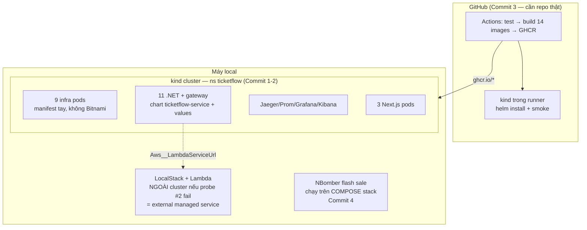

# Phase 11 — Kế hoạch chi tiết theo commit

> **Mục tiêu (từ scope mục 10):** (1) Dockerfile tối ưu multi-stage mọi service, (2) **Kubernetes** manifest/Helm deploy lên kind/minikube, (3) **GitHub Actions** build → test → push image → deploy, (4) load test tổng thể kịch bản **"mở bán vé hot" (flash sale)**, (5) tài liệu kiến trúc + **ADR** + review toàn hệ. Đây là nơi **Ch14 (Container hosting)** và **Ch17 (Wrap-up)** sống thật — phase cuối của dự án.
> **DoD:** `helm install` lên cluster chạy full stack; pipeline xanh; có docs kiến trúc.

> ⚠️ **Viết TRƯỚC khi code** (giống phase-2…phase-10). Bốn sự thật cần nói thẳng ngay từ đầu (khảo sát môi trường + code thật, không đoán):
> 1. **Scope item 1 ("Dockerfile tối ưu multi-stage mọi service") về cơ bản ĐÃ XONG từ các phase trước.** Cả 11 Dockerfile đều multi-stage chuẩn từ ngày đầu (restore layer tách khỏi source copy để cache, SDK build → aspnet runtime). Phase 11 không "làm" item này mà chỉ **audit + vá lỗ nhỏ nếu có** (`.dockerignore`, user non-root nếu đáng) — reconcile vào scope ở Commit 5, không giả vờ đây là việc mới.
> 2. **Repo này CHƯA có git remote** (`git remote -v` trống). GitHub Actions không chạy trên repo local — **Commit 3 có điều kiện tiên quyết là bạn tạo GitHub repo và push code lên** (việc publish repo là quyết định của bạn, plan không tự làm). Mọi commit khác không bị chặn bởi việc này.
> 3. **Toolchain K8s local chưa đủ:** `kubectl` client v1.34.1 có sẵn nhưng **không có cluster nào** (`kubectl config get-contexts` trống), **không có kind, không có minikube, không có helm**. Commit 1 bắt đầu bằng cài đặt + probe toolchain — và chọn giữa kind / minikube / Docker Desktop built-in K8s là quyết định phải probe thật trên máy này, không chọn theo docs.
> 4. **Tài nguyên máy là rủi ro thật, có tiền sử:** Docker Desktop đã **crash 2 lần** trong Phase 10 vì build 11 service song song (RAM còn ~800MB, CPU 100%). Full stack hiện tại là 25 container; bê nguyên sang K8s nghĩa là ~25+ pod **bên trong 1 container kind node**, cộng control plane. **Quy tắc cứng của phase này: không bao giờ chạy compose stack và K8s stack song song** — dừng compose trước khi `helm install`, và mọi thao tác nặng (build image, `kind load`) làm tuần tự như bài học sequential-build đã trả giá ở Phase 10.

---

## Bối cảnh: cái gì đã có, cái gì còn thiếu

- **Đã có (Phase 1-10), Phase 11 móc vào:**
  - 11 Dockerfile multi-stage hoạt động thật (image đã build/chạy hàng trăm lần qua compose). Compose 3 file (`docker-compose.yml` + `infra` + `monitoring`), 25 container khoẻ.
  - **Config đã sẵn sàng cho K8s hơn tưởng tượng:** mọi service đọc config qua `IConfiguration` (appsettings.json hardcode hostname compose như `postgres`, `rabbitmq`, `ticketflow-jaeger`) — ASP.NET Core config precedence cho phép **override toàn bộ bằng env var** (`ConnectionStrings__Default`, `Keycloak__Authority`, `Otlp__Endpoint`...) mà không sửa một dòng code/appsettings nào. Helm values → env là con đường chính.
  - Health check `/health` mọi service (`UseTicketFlowWeb`) → map thẳng vào liveness/readiness probe.
  - `TicketFlow.Reservation.LoadTests` (NBomber 6.5.0, Phase 2) — đã chứng minh chống oversell ở tầng Redis/reservation; flash-sale test của phase này là phiên bản **full-stack** (qua gateway + saga) của cùng câu hỏi.
  - Observability trọn bộ (Phase 10) — load test flash sale có sẵn thước đo thật: dashboard RED + "vé bán/phút" + Jaeger trace + Kibana log. Không cần dựng gì thêm để "nhìn" hệ thống dưới tải.
  - 10 plan doc (phase-1 → phase-10) chứa mọi quyết định kiến trúc lớn đã ra + lý do thật — nguồn nguyên liệu cho ADR ở Commit 5, việc của ADR là **trích xuất và chuẩn hóa quyết định ĐÃ RA**, không phát minh quyết định mới.
  - 3 app Next.js (`customer-web`, `organizer-dashboard`, `gate-scanner`) chạy `pnpm dev` trên host — **chưa dockerize** (Phase 8 đã hứa để Phase 11, giờ trả nợ).
- **Còn thiếu — gap chặn DoD:**
  - Không `infrastructure/k8s/`, không chart Helm nào, không cluster.
  - Không `.github/workflows/`, không remote repo.
  - Không kịch bản load test flash-sale (cái đang có chỉ đánh thẳng reservation-service, không qua gateway/saga/payment).
  - Không `docs/architecture.md`, không `docs/adr/`.
  - **LocalStack là mắt xích khó nhất khi vào K8s** (chi tiết mục 3 dưới) — Lambda executor hiện spawn sibling container qua `/var/run/docker.sock` của Docker host; bên trong kind node không có Docker daemon của host theo cách đó.

---

## Quyết định kiến trúc cho Phase 11

### 1. Cluster local: **kind** (lean), probe thật trước khi chốt — không AKS
- AKS trong scope ghi "(hoặc AKS)" — loại ngay: tốn tiền thật + cần account Azure, zero giá trị học thêm so với kind khi mục tiêu là hiểu manifest/Helm/kubectl (Ch14 là pattern, không phải vendor — cùng logic đổi Azure Functions → AWS Lambda ở Phase 9).
- **Lean kind vì:** chạy được y hệt trong GitHub Actions runner (Commit 3 tái dùng đúng cluster tech local đang dùng — 1 công cụ, 2 chỗ), nhẹ hơn minikube VM, phổ biến trong CI của chính các repo CNCF. Docker Desktop built-in K8s là phương án dự phòng số 1 nếu kind trục trặc trên máy này (đã bật sẵn được trong Docker Desktop, không cài thêm gì).
- **Rủi ro số 1 (probe đầu tiên của phase, trước mọi manifest):** kind trên Windows/Docker Desktop này tạo cluster thành công không, `kind load docker-image` (nạp 11 image local vào node, không cần registry) hoạt động không, và **NodePort/port-forward có dính dải Windows port-exclusion 8854-9553** đã cắn 7 lần ở Phase 10 không (NodePort range 30000-32767 nằm ngoài dải đã biết — nhưng phải xác nhận `netsh` lại tại thời điểm probe, dải này sinh động).
- Cài toolchain: kind + helm qua winget/choco — ghi version pin thật vào plan doc sau khi cài (kỷ luật pin version như mọi image/package).

### 2. Helm: **1 chart dùng chung cho 11 service .NET + values-per-service** — không 11 chart copy-paste, không Bitnami cho infra
- 11 service .NET giống hệt nhau về "hình dạng" triển khai: 1 image + 1 port + env vars + `/health` probe. Đúng chỗ cho **1 chart `ticketflow-service`** (Deployment/Service/ConfigMap template hóa) + 11 file values — sửa 1 template áp cho cả 11, cùng triết lý `AddTicketFlowWeb`/`AddTicketFlowObservability` phía code. Umbrella chart `ticketflow` include tất cả (DoD nói `helm install` — số ít).
- **Infra (Postgres/Redis/RabbitMQ/Kafka/Mongo/ES/ClickHouse/MinIO/Keycloak): tự viết manifest StatefulSet/Deployment đơn giản dùng image CHÍNH CHỦ** (đúng image + tag compose đang chạy) — **KHÔNG dùng Bitnami charts** dù đó là "cách phổ biến": Broadcom đã khai tử catalog Bitnami free (2025 — images cũ archive sang `bitnamilegacy`, bản mới thành sản phẩm thương mại "Bitnami Secure Images"). Đây đúng lớp trap license/availability đã né 4 lần (MassTransit 9, MediatR, Duende, ImageSharp) — không xây bài học Ch14 trên nền catalog vừa bị rút thảm. Trade-off ghi thật: manifest tay không có sẵn backup/HA/exporter như chart xịn — không cần cho learning single-node.
- Config service qua env trong values (mục Bối cảnh) — hostname đổi từ compose DNS (`postgres`) sang K8s Service DNS (`postgres.ticketflow.svc`); **bẫy đã biết trước: Keycloak issuer-mismatch (ăn ở Phase 7)** — token cấp qua browser mang issuer `localhost:8180`, service trong cluster validate bằng authority nội bộ; `ValidIssuers` (đã là mảng từ Phase 7) phải thêm issuer mới của môi trường K8s, đây là chỗ dễ cháy nhất khi verify mua vé thật trong cluster.
- Namespace riêng `ticketflow`; monitoring (Jaeger/Prometheus/Grafana/Kibana) vào cùng chart tổng — Prometheus scrape đổi từ static targets compose sang static targets K8s Service DNS (giữ tĩnh, không kéo Prometheus Operator/ServiceMonitor vào — gold-plating với 11 target cố định).

### 3. LocalStack + Lambda trong K8s — **rủi ro số 2, probe sớm, có fallback danh dự**
- Vấn đề thật: LocalStack Lambda executor spawn **sibling Docker container** qua `/var/run/docker.sock` mount + `LAMBDA_DOCKER_NETWORK=ticketflow-network` (Phase 9). Trong kind, "node" là 1 container chạy containerd — không có Docker daemon host-style cho LocalStack xài; mount docker.sock của host thật vào pod thì Lambda container sinh ra sẽ nằm NGOÀI cluster network, không thấy `rabbitmq.ticketflow.svc`.
- **Probe:** LocalStack có chế độ executor cho K8s không ở bản/plan đang dùng (unified image, Hobby plan) — đọc + thử thật, không tin docs suông.
- **Fallback đã quyết trước nếu probe fail (không phải thất bại, là kiến trúc hợp lệ):** LocalStack **đứng ngoài cluster**, chạy như docker compose service riêng — mô hình "external managed service" y như production thật gọi AWS thật (RDS/S3 không nằm trong cluster của bạn). Service trong cluster gọi ra qua `host.docker.internal:4566` (env `Aws__LambdaServiceUrl` — override được sẵn). Lambda containers vẫn spawn trên Docker host như Phase 9. Ghi ADR về trade-off này ở Commit 5.
- **Không kéo việc "OTel bên trong Lambda" (backlog Phase 10) vào phase này** — DoD không đòi.

### 4. CI/CD GitHub Actions: build → test → push GHCR → **deploy = helm install lên kind NGAY TRONG runner** + smoke test
- "Deploy" của một dự án học local không có cluster public — pattern chuẩn và trung thực nhất: job cuối của pipeline **dựng kind trong runner, `helm install` chart thật, chờ pods Ready, bắn smoke test** (health + 1 luồng đọc qua gateway). Pipeline xanh = build + test + image push + chart cài được thật từ số 0 — đúng tinh thần DoD "pipeline xanh" hơn là deploy giả vờ.
- Registry: **GHCR** (`ghcr.io/<owner>/ticketflow-*`) — free với public repo, login bằng `GITHUB_TOKEN` có sẵn, không thêm secret ngoài. 11 image build bằng matrix + docker/build-push-action, cache GHA.
- Test trong CI: regression 81 test hiện tại (unit/domain chạy thẳng; **5 Reservation integration test dùng Testcontainers** — GitHub runner có Docker sẵn, chạy được, nhưng phải xác nhận thật trong lần chạy đầu). Solution file là **`TicketFlow.slnx`** (format mới) — `dotnet test` với SDK 10 hỗ trợ, CI dùng đúng file này.
- **Điều kiện tiên quyết (bạn làm, không phải plan):** tạo GitHub repo + push. Pipeline chỉ xanh được trên GitHub thật — mọi thứ khác của Commit 3 (file YAML workflow) viết và lint local trước được.
- Frontend 3 app Next.js: dockerize (`output: "standalone"`) + đưa vào chart với replicas=1 — trả nợ Phase 8. CI build image frontend cùng matrix.

### 5. Load test flash sale: **NBomber, full-stack qua gateway, thước đo là chống oversell + dashboard Phase 10**
- Kịch bản "mở bán vé hot": tạo event N ghế (nhỏ, ví dụ 50) + M user ảo (M >> N, ví dụ 300 VU) cùng lúc: login/token sẵn → hold ghế → đặt đơn → saga chạy. **Pass/fail khách quan: tổng vé bán được ≤ N tuyệt đối** (câu hỏi oversell Phase 2, giờ hỏi lại xuyên cả saga/payment/ticketing thay vì chỉ Redis), cộng số liệu quan sát: p95 latency hold/order dưới tải, error rate, breaker payment có mở oan không.
- NBomber tiếp (không đổi sang k6): đã pin 6.5.0 từ Phase 2, C# tái dùng flow token/DTO thật, thêm 1 tool mới zero giá trị học (scope mục 11 ghi "k6 / NBomber" — chọn 1). Project mới `tests/TicketFlow.FlashSale.LoadTests` (tách khỏi Reservation.LoadTests vì target khác hẳn: URL gateway, không phải service nội bộ).
- **Chạy trên compose stack, KHÔNG trên kind** — quyết định có chủ đích: máy này (tiền sử crash) không gánh nổi cluster + load generator + 300 VU tin cậy; số liệu đo trên stack nghẹt thở là số liệu rác. Compose là môi trường "production-like" ổn định nhất của máy này. Ghi trade-off thật vào doc.
- Quan sát bằng chính Phase 10: dashboard RED + "vé bán/phút" nhảy thật dưới tải + trace mẫu của request chậm nhất — đây là lần đầu observability stack được "trả lương".

### 6. Docs kiến trúc + ADR (Ch17): `docs/architecture.md` + `docs/adr/NNN-*.md` — trích từ quyết định ĐÃ RA
- `architecture.md`: bức tranh hệ thống THẬT sau 11 phase (không phải bản vẽ ước mơ của scope.md ngày đầu) — context diagram, service map + DB-per-service thật, luồng PurchaseSaga, bảng công nghệ + version pin thật.
- ADR (một file một quyết định, format Nygard ngắn): các ứng viên đã có sẵn lý do ghi trong plan docs — Marten thay EventStoreDB; Kafka + RabbitMQ song song; MassTransit 8.x pin vì license; AWS Lambda/LocalStack thay Azure Functions; Next.js Multi-Zones thay Module Federation; BFF = Next.js server-side, không dựng BFF .NET; Jaeger all-in-one không Collector; ES 1 node 2 vai; LocalStack ngoài cluster (nếu fallback xảy ra); không Bitnami. Khoảng 10-12 ADR, mỗi cái ngắn — giá trị là truy vết được "vì sao", không phải độ dày.
- Scope reconcile TOÀN CỤC lần cuối (không chỉ Phase 11): quét scope.md đối chiếu hệ thống thật, sửa mọi mục còn lệch, tick DoD phase cuối. Dự án khép.

---

## Nhóm A — Kubernetes (DoD phần 1)

### Commit 1 — `feat(k8s): kind cluster + Helm chart hạ tầng (infra chạy trong cluster)` ✅ DONE
- **Không cài được qua choco** (máy không có quyền admin, `chocolatey.log` báo `UnauthorizedAccessException` trên `C:\ProgramData\chocolatey`) — tải binary thẳng: `kind v0.32.0` (`kind-windows-amd64` từ GitHub Releases) + `helm v4.2.3` (**thật sự có Helm 4** — không phải lỗi gõ nhầm v3; nhưng binary Windows KHÔNG nằm trong GitHub Release assets, chỉ có file `.asc` chữ ký — binary thật host ở `get.helm.sh/helm-v4.2.3-windows-amd64.zip`, phải biết chỗ tìm đúng). Cả 2 đặt vào `~/bin` (đã sẵn trong PATH, không cần quyền admin).
- **Docker Desktop crash lần 3 của dự án** ngay khi bắt đầu — daemon không phản hồi (`npipe` lỗi), process Docker biến mất hoàn toàn, RAM host lúc đó chỉ còn ~507MB (đúng vùng rủi ro đã ghi từ Phase 10). Khởi động lại `Docker Desktop.exe` bằng tay, chờ daemon sống lại — không phải lỗi kind/helm, là tiền sử máy đã biết.
- **Rủi ro số 1 xác nhận đầy đủ bằng thử nghiệm sống, không suy diễn:**
  - `kind create cluster` thành công, control-plane Ready sau ~15s.
  - `kind load docker-image` nạp ảnh local `:latest` vào node thành công (~21s/ảnh 147MB), xác nhận bằng `crictl images` bên trong node.
  - **NodePort KHÔNG tự thông ra host** với `kind create cluster` trần (không config) — phải khai báo `extraPortMappings` trong file cluster config NGAY LÚC TẠO cluster (không sửa được sau khi cluster đã chạy mà không tạo lại). Xác nhận bằng thử nghiệm thật: cùng 1 Service NodePort, KHÔNG thông trước khi thêm `extraPortMappings`, thông (`HTTP 200`) sau khi tạo lại cluster với `infrastructure/k8s/kind-config.yaml` map cổng `30080`.
  - Dải port Windows loại trừ **đã dịch chuyển** so với Phase 10 (giờ là `10761-11460`, không còn `8854-9553`) — xác nhận lại bằng `netsh` đúng lúc, không tin số cũ. Dải NodePort mặc định `30000-32767` vẫn sạch.
- **Bug thật gặp khi thử NodePort (không phải lỗi mạng):** deploy thử image `ticket-flow-catalog:latest` → `ImagePullBackOff` dù đã `kind load` — nguyên nhân: **tag `:latest` khiến Kubernetes mặc định `imagePullPolicy: Always`**, luôn cố pull từ registry bất kể ảnh đã có sẵn trên node. Sửa bằng khai báo tường minh `imagePullPolicy: IfNotPresent` — áp dụng cho MỌI container trong chart (không chỉ ảnh test), ghi vào mọi manifest 9 thành phần infra từ đầu.
- `infrastructure/k8s/ticketflow/` chart (Helm 4, `Chart.yaml` + `values.yaml` + `templates/`): Postgres, Redis, RabbitMQ, Kafka, MinIO, Elasticsearch (heap 1g như compose), MongoDB, ClickHouse, Keycloak — image/version/credential giữ nguyên y hệt `docker-compose.infra.yml`. PVC chỉ cho 5 datastore có volume trong compose (postgres/minio/es/mongo/clickhouse) — Redis/RabbitMQ/Kafka/Keycloak không PVC, đúng khớp compose (những service đó vốn cũng không có volume ở đó). Keycloak `realm-export.json` copy vào `files/` trong chính chart (Helm chart phải tự chứa để `helm package` được — không tham chiếu ra ngoài thư mục chart) — ghi rõ đây là bản sao có chủ đích, không phải trùng lặp vô tình, phải đồng bộ tay nếu realm đổi.
- **Bug thật thứ hai (rabbitmq và tiềm ẩn ở mọi probe khác):** `readinessProbe` exec bị timeout `"command timed out: rabbitmq-diagnostics -q ping timed out after 1s"` — mặc định `timeoutSeconds` của K8s là 1s, quá ngắn cho tool JVM dưới tải máy đang căng. Rà soát và thêm `timeoutSeconds: 10` cho TẤT CẢ 8 readinessProbe (không chỉ RabbitMQ) trước khi nó cũng lộ ra lỗi tương tự — chủ động sửa theo lớp, không vá từng cái một.
- **Thời gian pull ảnh thật rất chậm** trên máy này (Postgres/ES/ClickHouse/Keycloak đều >1 phút, Elasticsearch mất **~10 phút** dù mạng tới `docker.elastic.co` thông tốt — HTTP 401 phản hồi 2s, xác nhận qua `curl` thẳng vào registry từ trong node) — do 8-9 pod pull song song trên máy đã ghi nhận tiền sử thiếu RAM/CPU. Không phải lỗi cấu hình, là hệ quả tài nguyên máy — chấp nhận, ghi thật, không giả vờ nhanh.
- **Verify thật — cả 9 pod Running/Ready, exec xác nhận từng datastore trả lời thật (không phải chỉ "pod Running"):**
  - Postgres: `psql SELECT 1` → `1`.
  - Redis: `SET`/`GET` round-trip → `ok`.
  - RabbitMQ: `rabbitmqctl list_queues` → trả lời (vhost `/` rỗng, đúng vì chưa có gì).
  - MongoDB: `db.adminCommand('ping')` → `{ ok: 1 }`.
  - ClickHouse: `SELECT 1` → `1`.
  - Elasticsearch: `_cluster/health` → `"status":"green"`.
  - MinIO: `mc ready local` → `The cluster 'local' is ready`.
  - Kafka: tạo topic thật `k8s-probe-topic` qua `kafka-topics.sh` (gặp lại lỗi git-bash tự chuyển path Unix→Windows đã biết từ Phase 10, fix bằng `MSYS_NO_PATHCONV=1`) → tạo + list thành công.
  - Keycloak: image không có `curl` bên trong (đúng như compose đã ghi) → port-forward ra host, `curl` từ ngoài vào `.well-known/openid-configuration` → issuer/endpoint đúng realm `ticketflow`.
  - 5 PVC đều `Bound`, storage class `standard` (local-path-provisioner có sẵn từ lúc tạo cluster).

### Commit 2 — `feat(k8s): 11 service .NET + gateway + monitoring + 3 frontend vào cluster — mua vé thật bằng helm install` *(commit nặng nhất phase)*
- Chart `ticketflow-service` template + 11 values (env override hostnames, probe `/health`); monitoring 4 container (Prometheus static targets đổi sang svc DNS); dockerize 3 app Next.js (standalone) + Deployment.
- Probe rủi ro số 2 (LocalStack executor trong K8s) trước khi wire ticketing — fallback LocalStack ngoài cluster như mục 3 nếu fail.
- Xử lý Keycloak issuer cho môi trường K8s (`ValidIssuers` — bẫy Phase 7 tái xuất, mục 2).
- **Verify thật (DoD 1 khép ở đây):** từ máy host qua port-forward/NodePort gateway: login token thật → tạo event → provision → hold → order → saga chạy hết `Confirmed` → PDF vé tải được — **toàn bộ trong cluster, một lệnh `helm install` từ số 0**. Jaeger trong cluster thấy trace mua vé xuyên suốt (observability sống trong K8s luôn). Regression 81/81 không đổi (code .NET không đổi).

## Nhóm B — CI/CD (DoD phần 2)

### Commit 3 — `feat(ci): GitHub Actions — build → test → push GHCR → helm install kind trong runner + smoke`
- **Điều kiện tiên quyết: bạn tạo GitHub repo + push** (mục 4). Workflow: job test (dotnet test TicketFlow.slnx — xác nhận Testcontainers chạy trên runner), job build-push matrix 14 image (11 .NET + 3 frontend) lên GHCR, job deploy (kind + helm install + wait Ready + smoke: `/health` gateway + 1 GET catalog qua gateway).
- **Verify thật (DoD 2):** pipeline chạy XANH trên GitHub Actions thật — link run thật ghi vào doc; image kéo được từ GHCR bằng docker pull thật.

## Nhóm C — Load test (Ch17)

### Commit 4 — `test(load): flash sale — M user giành N ghế qua full stack, chống oversell + số liệu thật` ✅ DONE
- `tests/TicketFlow.FlashSale.LoadTests` (NBomber): kịch bản mục 5, chạy trên compose stack.
- **Verify thật:** tổng vé bán ≤ N tuyệt đối (query Postgres ordering + ClickHouse analytics đối chiếu); báo cáo NBomber (p95, error rate) + screenshot/số liệu dashboard "vé bán/phút" lúc chạy + 1 trace mẫu request chậm nhất — tất cả ghi vào doc như bằng chứng, không phải "chạy rồi, ổn". Kết quả chạy thật 2026-07-19: 300 VU, 50/50 order `Confirmed`, 250 response `409` đúng kỳ vọng, p95 1,984.51 ms, PostgreSQL/ClickHouse đều 50 ghế; xem [phase-11-flash-sale-evidence.md](phase-11-flash-sale-evidence.md).

## Nhóm D — Wrap-up (Ch17, khép dự án)

### Commit 5 — `docs: architecture.md + ADRs + scope reconcile toàn cục — finalize Phase 11 & dự án`
- `docs/architecture.md` + `docs/adr/` (mục 6, ~10-12 ADR trích từ quyết định thật).
- Audit Dockerfile (sự thật số 1): thêm `.dockerignore` nếu thiếu, ghi nhận multi-stage đã đạt từ trước vào scope reconcile.
- Scope reconcile toàn cục cuối cùng + tick DoD Phase 11 + đóng dự án (bảng tổng: 11 phase, chương nào sống ở đâu, backlog tồn đọng chuyển thành danh sách "hướng mở rộng" cuối cùng).

---

## Sơ đồ Phase 11

---

## Kiểm chứng DoD cuối Phase 11

| DoD | Kiểm chứng |
|---|---|
| `helm install` lên cluster chạy full stack | Commit 2: mua vé end-to-end thật (token → hold → order → Confirmed → PDF) hoàn toàn trong kind, từ 1 lệnh helm install |
| Pipeline xanh | Commit 3: run GitHub Actions thật xanh (link ghi vào doc), image pull được từ GHCR |
| Có docs kiến trúc | Commit 5: architecture.md + bộ ADR trích từ quyết định thật 11 phase |

## Rủi ro tổng hợp (đánh số để probe theo thứ tự)
1. **kind trên máy Windows này** (tạo cluster, load image, port) — probe Commit 1, fallback Docker Desktop K8s.
2. **LocalStack Lambda executor trong K8s** — probe Commit 2, fallback ngoài cluster (đã quyết trước, mục 3).
3. **Tài nguyên máy** (tiền sử crash ×2) — quy tắc cứng: compose và kind không chạy song song; thao tác nặng tuần tự.
4. **Testcontainers trên GitHub runner** (5 integration test) — xác nhận trong lần chạy pipeline đầu; fallback: tách job chạy riêng có docker service.
5. **Keycloak issuer-mismatch tái xuất trong K8s** — bẫy đã ăn Phase 7, xử lý chủ động bằng ValidIssuers ngay khi viết values, không đợi cháy.

## Hướng mở rộng (backlog — không thuộc Phase 11)
- Ingress controller + TLS thật (hiện port-forward/NodePort là đủ DoD).
- Prometheus Operator/ServiceMonitor, HPA autoscale theo RED metrics.
- ArgoCD/GitOps thay vì helm install trong CI.
- OTel bên trong Lambda + Serilog cho Functions (kế thừa backlog Phase 10).
- E2E Playwright hành trình mua vé (scope mục 11 — chưa từng làm ở phase nào, ghi thật là nợ tồn đọng toàn dự án).

## Thứ tự đọc trước khi code (scope mục 13)
Đọc **Ch14 (Container hosting)** — Docker/K8s/Helm concepts, và **Ch17 (Wrap-up)** — review kiến trúc. Bổ sung ngoài sách: **kind** docs (load image, config cluster, dùng trong CI), **Helm** (template/values/umbrella chart, library chart), **GitHub Actions** (matrix build, docker/build-push-action, GHCR auth bằng GITHUB_TOKEN, kind-action), **Next.js standalone output** (dockerize), **LocalStack Lambda executor modes** (rủi ro #2), **ADR format Nygard**.
