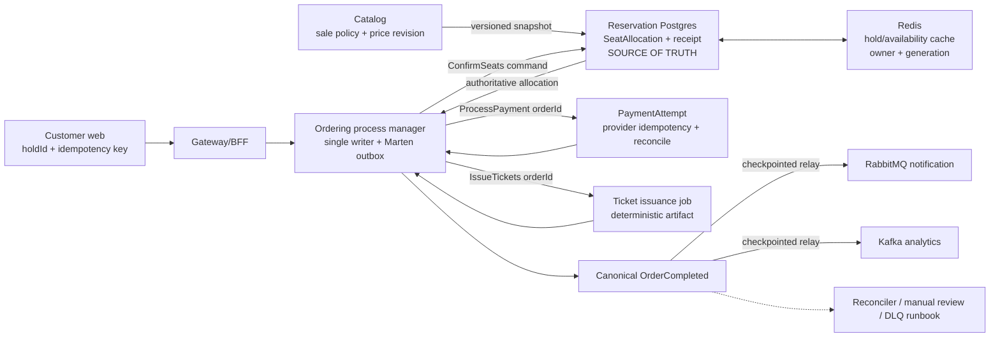

# Phase 12 — Kế hoạch chi tiết theo commit

> **Mục tiêu:** khắc phục các production blocker tìm thấy trong đợt review toàn hệ ngày 2026-07-19: checkout tin dữ liệu client, hold/order không ràng buộc cùng tập ghế, dual-write Redis/Postgres/broker/object-store/payment-provider, message đến trùng hoặc sai thứ tự, saga không có timeout/recovery, authorization không theo resource, và hạ tầng correctness-critical không bền vững.
>
> **DoD:** không thể đổi ghế/giá/tiền tệ từ client; cùng một business operation chỉ charge/confirm/issue/refund một lần dù message trùng hoặc process chết; compensation không thể đụng allocation của đơn khác; saga tự hồi phục hoặc đi tới trạng thái cần can thiệp có quan sát được; ticket và organizer resource được kiểm tra ownership; Redis/RabbitMQ/Kafka/Keycloak restart không làm mất correctness; CI chạy trên `main` và có test failure-boundary/concurrency/E2E thật.

> ⚠️ **Viết TRƯỚC khi code.** Bảy sự thật phải giữ xuyên suốt Phase 12:
> 1. **Đây là remediation phase, không phải feature phase.** Không thêm tính năng sản phẩm mới trước khi các invariant tiền/ghế/ownership ở Nhóm A-C khép.
> 2. **Không có “exactly once delivery” xuyên HTTP + Postgres + Redis + RabbitMQ + Kafka + payment provider.** Mục tiêu đúng là *effectively-once business outcome*: stable operation key, local transaction, inbox/outbox, conditional state transition và reconciliation.
> 3. **Redis không còn là source of truth cho ghế đã bán.** Redis chỉ tăng tốc hold/availability; allocation bền vững có owner + generation trong Postgres mới quyết định confirm/release/rebuild.
> 4. **Retry một external write không có idempotency key là bug.** Charge, refund, upload PDF, gửi email và publish sang transport khác đều phải có operation key + trạng thái `Pending/Unknown/Completed` + reconcile.
> 5. **Schema/message contract sẽ đổi theo kiểu expand → migrate → contract, không big-bang.** Consumer đọc được cả v1/v2 phải deploy trước producer v2; chỉ xóa field/behavior cũ sau khi backfill và kiểm chứng không còn message cũ.
> 6. **81 test .NET + frontend lint/build đang xanh nhưng chưa chứng minh các boundary này.** Không đánh dấu commit `DONE` nếu chỉ unit test xanh; mỗi commit dưới đây có failure/concurrency gate riêng.
> 7. **Plan là giả thuyết có thể bị phản biện, không phải mệnh lệnh thi công máy móc.** Người thực hiện có quyền và trách nhiệm chỉ ra giả định sai, thử probe và chọn cách làm khác khi code thật, tài liệu hoặc bằng chứng cho thấy phương án an toàn/tốt hơn. Khi lệch plan phải ghi lại bằng chứng, trade-off, invariant/DoD bị ảnh hưởng và cập nhật plan/ADR ngay trong commit liên quan; quyền phản biện không được dùng để hạ tiêu chuẩn correctness, bỏ gate kiểm chứng hoặc tự ý mở rộng scope.

---

## Bối cảnh: cái gì đang đúng, cái gì đang nguy hiểm

- **Đang có và tái sử dụng:**
  - Catalog đã có EF transactional outbox; Reservation có Lua atomic cho thao tác bên trong Redis; Ordering dùng Marten event store; participant giao tiếp qua MassTransit/RabbitMQ; Analytics dùng Kafka; frontend đã có BFF/Auth.js/SignalR.
  - 81 test .NET hiện tại xanh; `pnpm -r run lint` và `pnpm -r run build` xanh. Đây là regression baseline phải giữ.
  - Phase 10 đã có trace/metrics/log; Phase 11 đã có kind/Helm/load test. Phase 12 dùng chính observability và môi trường đó để chứng minh recovery, không dựng một stack kiểm thử song song mới.
- **Gap correctness cần đóng:**
  - `PlaceOrder` nhận seat IDs, amount và currency từ browser; Reservation confirm theo `HoldId`, còn saga ticket/compensate theo seat IDs client gửi.
  - Reservation confirm/unsell/inventory là nhiều write nối tiếp giữa Redis và Postgres, không có durable operation receipt hay owner để retry an toàn.
  - Payment kiểm tra DB trước khi gọi provider; hai message khác `MessageId` nhưng cùng `OrderId` có thể charge hai lần. Refund hiện chỉ đổi local status.
  - Order stream có nhiều writer độc lập, không expected version; milestone đến sai thứ tự có thể làm aggregate regress. Saga không timeout và đặt Kafka analytics trên critical path.
  - Ticket PDF upload trước DB; check-in là read-then-write; ticket API không kiểm tra customer owner/event/gate.
  - Catalog lifecycle event không có revision; Search/Notification có thể resurrect event đã cancel. Organizer onboarding và Identity registration là distributed workflow không bền vững.
  - Redis/RabbitMQ/Kafka/Keycloak trong chart hiện không có persistent storage; workflow CI theo dõi `master` trong khi nhánh thật là `main`.

---

## Quyết định kiến trúc cho Phase 12

### 1. Checkout contract v2: client gửi **ý định mua**, server quyết định ghế + giá
- Request v2 chỉ chứa `holdId`, `paymentMethod`, `idempotencyKey` và thông tin liên hệ không ảnh hưởng giá. `customerId` luôn lấy từ JWT; không nhận `seatIds`, `totalAmount`, `currency`, `eventId` như dữ liệu có thẩm quyền.
- Reservation trả `ConfirmedAllocation`/`HoldQuote` bền vững gồm `EventId`, exact `SeatIds`, `PriceSnapshotVersion`, `TotalAmount`, `Currency`, `OwnerUserId`, `ExpiresAt`. Ordering persist đúng snapshot này trước khi saga chạy.
- Catalog là owner của sale policy và price tier. Catalog phát snapshot có revision sang Reservation; hold mới chỉ tạo khi event `Published`, nằm trong sale window và snapshot hiện hành. Hold đã tạo được giữ giá tới `ExpiresAt`; cancel event vô hiệu ngay mọi hold chưa confirm.
- `Idempotency-Key` là business key bắt buộc. Cùng key + cùng payload trả lại kết quả cũ; cùng key + payload khác trả `409`, không tạo order thứ hai.

### 2. Postgres `SeatAllocation` là source of truth; Redis là acceleration layer có thể rebuild
- Bổ sung durable model tối thiểu: `SeatId`, `EventId`, `HoldId`, `OrderId?`, `OwnerUserId`, `State`, `Generation`, `ExpiresAt`, `PriceSnapshotVersion`, `Amount`, `Currency`, concurrency token.
- Bổ sung `ReservationOperation`/receipt unique theo `(OperationType, BusinessKey)` để redelivery trả lại **cùng outcome**, không suy diễn “hold không còn = lần trước thất bại”.
- Redis lưu owner + generation, không chỉ set seat ID. Mọi confirm/release Lua script là compare-and-set theo expected owner/generation. Reconciler có thể dựng lại available/held/sold view từ Postgres và phát hiện drift hai chiều.
- SignalR chỉ nhận event sau commit/outbox; notifier chết không được làm API/consumer báo mutation thất bại.

### 3. Một local transaction cho state + outbox; inbox chặn delivery trùng, business key chặn semantic duplicate
- Mỗi consumer ghi inbox, domain state và outbox trong **cùng datastore transaction** của service. Acknowledge message chỉ sau transaction đó commit.
- `MessageId` chỉ chặn redelivery cùng envelope. Mọi thao tác quan trọng còn có business key riêng: `OrderId` cho payment, `(OrderId, HoldId)` cho confirm/release, `OrderId` cho issue tickets, `(TicketId, GateOperationId)` cho check-in.
- Nếu MassTransit/Marten integration hiện tại không thể đảm bảo cùng transaction cho saga state + outbox, viết local Ordering outbox/dispatcher trong Postgres/Marten; **không chấp nhận in-memory outbox** như giải pháp durability.

### 4. Purchase process manager là writer duy nhất của Order lifecycle
- Loại mô hình nhiều audit consumer cùng append stream độc lập. Participant response đi vào một endpoint partition theo `OrderId`; process manager quyết định transition và append với expected stream version.
- Late/duplicate message được ghi nhận nhưng không làm state regress. Terminal state (`Confirmed`, `Cancelled`, `RefundFailed`, `ManualReview`) là monotonic.
- Admin confirm/cancel cũng đi qua process manager, không append trực tiếp vào stream và không chạy song song vô thức với saga.

### 5. Payment là durable state machine, không phải `try/catch` quanh `ChargeAsync`
- `PaymentAttempt` unique theo `OrderId`, trạng thái `Pending → Authorized | Declined | Unknown`; provider idempotency key = `OrderId`/stable attempt ID.
- Timeout/mất response sau khi provider có thể đã charge đi vào `Unknown`, không phát `PaymentFailed`, không release seat cho tới khi reconcile bằng provider lookup.
- Refund có API/provider reference thật và state `RefundPending → Refunded | RefundDeclined | RefundUnknown`; chỉ phát `PaymentRefunded` sau xác nhận hoặc reconcile.

### 6. Canonical business completion trước, fan-out analytics/notification sau
- Một `OrderCompleted` canonical fact được persist trong Ordering. RabbitMQ notification và Kafka `SaleRecorded` là hai relay độc lập có checkpoint/idempotency riêng.
- `CompletedAt` được tạo một lần và giữ ổn định; ingestion/revision timestamp tách riêng để ClickHouse dedup không làm sale chạy sang reporting window khác.
- Kafka, email hoặc Elasticsearch outage không được giữ một đơn đã paid + ticketed ở trạng thái chưa hoàn tất.

### 7. Lifecycle event có revision; projection chỉ tiến tới, không lùi
- Mọi Catalog event mang `AggregateVersion`, `OccurredAt`, `EventId`; cancellation tạo tombstone có revision thay vì dựa vào thứ tự arrival.
- Mongo/Elasticsearch chỉ apply revision mới hơn; old event mặc định revision `0` để phục vụ rolling migration nhưng không được overwrite document v2.
- Mọi response Elasticsearch phải kiểm tra `IsValidResponse`; transient failure throw để retry/DLQ hoạt động, not-found thật phải khác backend outage.

### 8. Authorization theo resource ở service sở hữu dữ liệu
- Gateway vẫn là lớp đầu, nhưng Catalog/Reservation/Ordering/Ticketing/Analytics tự validate JWT và resource ownership. Direct service port/network route không được bypass policy.
- Persist `OrganizerId/TenantId`, `CustomerId`, `EventId`, gate assignment và ticket revocation state. Cross-organizer/customer trả `404` hoặc `403` theo policy nhất quán.
- Internal call dùng client credential/audience riêng; production bổ sung network policy/mTLS theo khả năng môi trường, không dùng “tin Docker network” như security boundary.

### 9. Distributed onboarding/registration trở thành workflow có resume/reconcile
- Event onboarding có stable creation key và step state cho Venue → Event → SeatMap → Price → Inventory → Publish; retry resume bước dang dở, không tạo resource mới.
- Identity registration lưu `Pending/Completed/CompensationPending`, tìm lại Keycloak user theo stable normalized identity khi create outcome không chắc chắn, cleanup bằng token độc lập có timeout.
- Notification delivery và ticket artifact cũng theo cùng pattern operation record + provider/object key idempotent.

### 10. Rollout theo **expand → shadow/reconcile → cutover → contract**
- Thêm cột/table/index nullable và consumer hiểu v2 trước; backfill ownership/revision; chạy reconciler ở report-only; mới bật writer v2 bằng feature flag.
- Trong thời gian chuyển đổi, v1 checkout chỉ bật ở local/test và log cảnh báo; production cutover phải từ chối request còn gửi amount/seat IDs như authority.
- Không drop key/schema v1 cho tới khi queue cũ rỗng, dữ liệu reconcile bằng 0 và rollback window kết thúc.

---

## Nhóm A — Khóa invariant bằng test + schema/contract nền

### Commit 1 — `test(hardening): failure-boundary harness + regression cases cho tiền/ghế/message order` ⭐ ✅ DONE
- Thêm test fixture dùng Postgres + Redis + RabbitMQ/Marten thật; payment/object/email dùng counting fake có điều khiển barrier, timeout và “side effect thành công nhưng mất response”.
- Viết test đang **đỏ có chủ đích** cho các exploit/race đã tìm thấy:
  - hold seat A nhưng order/ticket seat B; payment failure không được release B;
  - amount `0`, currency giả, event Draft/Cancelled;
  - hai `ProcessPayment` khác `MessageId` cùng `OrderId` chỉ được gọi provider một lần;
  - crash sau từng boundary Redis → Postgres → outbox/publish;
  - stale `ReleaseSeats` của order A sau khi seat đã thuộc order B;
  - mọi permutation/duplicate của `SeatsConfirmed`, `PaymentProcessed`, `TicketsIssued`, `OrderCompleted`;
  - hai scan đồng thời chỉ một `Valid`;
  - Published/Rescheduled/Cancelled tới sai thứ tự không resurrect event.
- Test failure-boundary phải có tên theo invariant và comment đúng failpoint; tránh test bám chi tiết implementation khiến refactor vô nghĩa.
- **Gate:** lưu kết quả baseline đỏ/expected-failure trong doc/test category riêng; regression suite cũ vẫn 81/81 xanh. Từ Commit 3 trở đi từng test được chuyển sang pass, không `Skip` vĩnh viễn.

**Kết quả thực tế (2026-07-20):** thêm project explicit gate `tests/TicketFlow.Phase12.HardeningTests` (cố ý chưa đưa vào `TicketFlow.slnx`), không có test `Skip`. Trait `Phase12Harness` xanh **5/5** với Postgres 16 + Marten, Redis 7 và RabbitMQ 3 thật; trait `Phase12ExpectedFailure` chạy **27 case: 23 đỏ đúng blocker, 4 xanh là control case của các permutation hợp lệ**. Bảy test project regression cũ vẫn **81/81 xanh**. Counting fake dùng chung đã chứng minh barrier, timeout và trạng thái "side effect thành công nhưng mất response" cho payment/object/email. Danh sách case, lệnh chạy và promotion rule nằm tại [`docs/phase-12-hardening-baseline.md`](phase-12-hardening-baseline.md).

### Commit 2 — `feat(contracts,data): expand schema v2 — operation keys, ownership, revisions, currency` ✅ DONE
- Thêm message/request v2 và schema nullable/index trước, chưa cutover behavior:
  - checkout `IdempotencyKey`, hold quote/allocation result;
  - `Currency`, `PriceSnapshotVersion`, `AggregateVersion`, stable `CompletedAt` xuyên contracts;
  - Reservation allocation/operation receipt + owner/generation;
  - Payment attempt/refund state + gateway reference;
  - Ticket `CustomerId`, `EventId`, issuance state, revocation; Catalog `OrganizerId` + concurrency token;
  - inbox/outbox unique indexes và Recommendation unique `UserId`.
- Consumer đọc được v1/v2; unknown/missing revision = `0`; log metric đếm traffic/message v1 để biết khi nào contract được.
- Migration dùng expand-only, không backfill phỏng đoán owner nếu nguồn không đủ. Record không xác định owner phải vào report/manual-review, không tự gán.
- **Verify:** migration chạy từ database phase 11 và database trắng; rollback binary cũ vẫn đọc được schema mới; contract serialization compatibility test xanh.

**Kết quả thực tế (2026-07-20):** thêm `CheckoutIntentV2`, `HoldQuoteV2`, `ConfirmedAllocationV2` và các field optional cuối record cho contract đang dùng, nên payload v1 deserialize với revision/snapshot `0` và không làm caller cũ đổi chữ ký. `ticketflow.contract.v1_traffic_total` được ghi tại các consumer Ordering/Payment/Reservation/Ticketing/Search và các service đó đã đăng ký meter để Prometheus scrape.

Schema chỉ expand: Reservation có `seat_allocations` (owner nullable, generation, quote/price, `xmin` concurrency) và receipt unique `(OperationType, BusinessKey)`; Payment có `payment_attempts`/`payment_refunds`; Ticket có field ownership/issuance/revocation nullable; Catalog có `OrganizerId` nullable + `xmin`; Mongo tạo unique index `purchaseHistory.UserId` lúc startup. Không có writer v2, backfill hay gán owner tự động. Nếu index Mongo gặp dữ liệu trùng, startup fail rõ để manual review thay vì chọn/gộp một record ngầm.

**Điều chỉnh plan có bằng chứng:** Catalog/Payment/Ticketing đã có unique inbox/outbox trong migration trước nên không tạo lại index trùng; Reservation chưa có EF inbox/outbox transaction nên cố ý chưa thêm một index không được consumer dùng — phần này vẫn thuộc Commit 4. Phiên bản Npgsql hiện tại không có `UseXminAsConcurrencyToken`; dùng shadow `xmin`/`IsRowVersion` thay thế. EF cố sinh cột vật lý `xmin`, nhưng `xmin` là system column của PostgreSQL nên migration đã được hiệu chỉnh để không `ADD COLUMN`, tránh migration lỗi trên DB thật.

**Gate đã chạy:** hardening harness xanh **10/10**, gồm JSON v1/v2 serialization, database trắng migrate lên head, database ở migration cuối trước Phase 12 upgrade lên head và query bằng tập cột v1; `TicketFlow.slnx` regression xanh **81/81**. Migrations được sinh qua design-time factory riêng, do đó EF tooling không khởi động Redis/Lambda/MinIO/Elasticsearch/RabbitMQ.

---

## Nhóm B — Khép tiền + ghế trước khi sửa phần còn lại

### Commit 3 — `feat(checkout): server-authoritative hold quote, sale policy, price & currency` ⭐
- Catalog publish sale-policy/price snapshot có revision; Reservation consume idempotent và dùng snapshot để tạo immutable hold quote.
- API Ordering v2 chỉ nhận `HoldId + PaymentMethod + IdempotencyKey`; identity lấy từ claims; handler load/validate quote owner, event, expiry và exact seats từ server.
- Bỏ client amount/currency/seat IDs khỏi authority path. Trong compatibility window có thể parse field cũ nhưng **không sử dụng**; metric/log phát hiện client cũ.
- Analytics schema/query tách currency; nếu business chốt chỉ VND thì validate cứng ở Catalog/Reservation thay vì silently default.
- Event cancel đóng sale ngay; public Catalog chỉ trả event publish/saleable theo endpoint semantics.
- **Verify:** test tamper amount/currency/seat/event/owner đều fail trước side effect; mixed price tier tính đúng; stale price revision có policy rõ; Draft/Cancelled/past event không hold/order được.

### Commit 4 — `feat(reservation): durable SeatAllocation + idempotent confirm receipt + Redis rebuild` ⭐
- Persist allocation/receipt trước hoặc cùng logical operation; confirm redelivery trả lại exact confirmed seat IDs của lần đầu.
- Lua confirm kiểm tra `(HoldId, OwnerUserId, Generation, exact seat set)`; không xóa reverse index cuối cùng trước khi durable receipt có thể phục hồi outcome.
- EF inbox + outbox cùng transaction với durable seat state; SignalR publish từ outbox/non-critical notifier.
- Viết reconciler ba mode: `report`, `repair-cache`, `quarantine-conflict`. Startup không tự sửa conflict ownership mơ hồ.
- Redis bootstrap dựng lại inventory **gồm sold/held còn hạn**, không chỉ danh sách seat IDs; active hold hết hạn có rule rõ.
- **Verify:** kill process tại mọi failpoint Redis/DB/outbox/SignalR rồi redeliver cho cùng outcome; xóa toàn Redis rồi rebuild không oversell, availability khớp Postgres.

### Commit 5 — `fix(reservation): owner-scoped compensation + idempotent inventory provisioning`
- `ReleaseSeats`/`Unsell` bắt buộc expected `OrderId/HoldId/Generation`; conditional Lua + optimistic DB update chỉ release allocation còn thuộc operation đó.
- Stale/duplicate compensation trở thành no-op có metric, không chuyển seat của owner mới về Available.
- `EnsureInventory` idempotent: nếu Postgres đã có nhưng Redis thiếu thì reload/reconcile; concurrent provisioning dùng unique constraint và cùng result, không check-then-insert.
- Validate organizer/event/section/capacity trước allocate list; đặt hard limit request/seat count.
- **Verify:** delayed release sau resale, DB failure sau Redis mutation, concurrent provision và Redis-missing retry đều xanh; invariant `mỗi seat tối đa một active owner` được query/assert trực tiếp.

### Commit 6 — `feat(payment): idempotent charge/refund state machine + unknown reconciliation` ⭐
- Atomically insert/claim `PaymentAttempt` unique `OrderId` trước external call; partition/lock cùng order để hai consumer không charge song song.
- Provider interface nhận idempotency key và hỗ trợ lookup; fake gateway đếm call và mô phỏng response loss sau charge.
- Phân biệt `Declined`, transient retryable và `Unknown`; circuit/timeout không tự biến thành decline hoặc release seat.
- Implement provider `RefundAsync` idempotent và refund states; reconciliation worker có retry/backoff, alert/manual-review sau deadline.
- Chỉ phát `PaymentProcessed`, `PaymentFailed`, `PaymentRefunded` từ outbox sau durable state transition.
- **Verify:** 100 concurrent distinct messages cùng order tạo đúng một provider charge; crash sau provider success không charge lại; ambiguous outcome reconcile đúng; refund gọi provider đúng một lần.

---

## Nhóm C — Ordering/process manager: một writer, có timeout, có recovery

### Commit 7 — `feat(ordering): idempotent order initiation + durable Marten relay/outbox`
- Persist order stream, checkout operation record và đủ saga-initiation data trong cùng transaction. `OrderPlaced`/event mới phải có `HoldId`, authoritative allocation/quote reference, payment method và contact cần thiết để relay lại.
- Unique checkout idempotency key + unique hold-to-order; retry trả original `OrderId` nếu request hash giống, trả `409` nếu khác.
- Dispatcher publish từ durable outbox/checkpoint, không publish trực tiếp sau `SaveChanges`. Crash trước/sau broker ack đều an toàn.
- **Verify:** kill sau Marten commit trước publish; restart dispatcher khởi động đúng một process về business outcome; double-submit trả cùng order.

### Commit 8 — `refactor(ordering): single per-order milestone writer + expected stream version + inbox`
- Participant response và admin command vào một queue/partition theo `OrderId`; process manager là writer duy nhất của lifecycle stream.
- Append dùng expected version/fetch-for-writing; conflict reload + re-decide, không blind append. Domain transition table từ chối regression và late terminal event.
- Xóa/disable các independent audit consumer chỉ append milestone sau compatibility drain; projection guard vẫn giữ defense-in-depth nhưng không còn che write-model sai.
- Admin cancel ở từng state phát compensation đúng; force-confirm không bypass paid/seat/ticket invariant.
- **Verify:** chạy toàn bộ permutation/duplicate/fan-in song song trên RabbitMQ + Marten thật; stream luôn monotonic, projection rebuild ra cùng kết quả.

### Commit 9 — `feat(ordering): saga deadlines, canonical completion, transport relays & recovery tooling` ⭐
- Mỗi state `Awaiting*`/`Compensating*` có scheduled deadline và explicit transition: retry safely, compensate, `Unknown`, hoặc `ManualReview`; không state vô hạn im lặng.
- Đảm bảo saga/process state + outgoing command outbox commit trước broker send; missing-instance response được scheduled redelivery thay vì drop.
- Persist canonical `OrderCompleted` + stable `CompletedAt` trước; RabbitMQ notification và Kafka analytics relay độc lập với checkpoint/dedup.
- Thêm operator query/CLI/API tối thiểu để list stuck/unknown, inspect operation history, retry relay/reconcile an toàn; DLQ có alert và runbook redrive.
- **Verify:** participant silence, Rabbit/Kafka outage, process restart và duplicate timeout đều hội tụ; Kafka down không ngăn paid+ticketed order thành `Confirmed`; không phát analytics sale hai lần.

---

## Nhóm D — Ticketing, projection và các workflow còn lại

### Commit 10 — `feat(ticketing): durable issuance + owner-scoped access + atomic event check-in` ⭐
- Persist `TicketIssuanceJob` unique `OrderId` trước render; object key deterministic theo ticket/issuance version; transient Lambda/MinIO/DB error throw để retry, terminal failure chỉ sau policy/reconcile.
- Lưu `CustomerId`, `EventId`, QR credential/version, revocation state. Ticket list/PDF query scope theo JWT subject; admin override explicit.
- Check-in dùng atomic conditional update `WHERE CheckedInAt IS NULL AND EventId = expected AND RevokedAt IS NULL`; gate user phải được assign event/gate.
- Reconciliation dọn orphan PDF, hoàn tất row thiếu, không emit `TicketingFailed` chỉ vì unique race với issuer khác.
- **Verify:** partial multi-ticket render, duplicate issue, owner khác download, wrong-event scanner, refunded/revoked ticket và 100 scan đồng thời đều có kết quả xác định; đúng một scan `Valid`.

### Commit 11 — `feat(catalog,search,notification): optimistic lifecycle + revision-aware projections`
- Catalog dùng concurrency token/`xmin`, unique `(EventId, SectionId)` và section-name constraints; concurrent Publish/Cancel/Reschedule trả conflict/retry thay vì last-write-wins.
- Lifecycle contracts mang aggregate revision/tombstone; Search và Notification upsert cả cancel/reschedule khi document chưa tồn tại, chỉ nhận revision lớn hơn.
- Kiểm tra Elasticsearch response validity; outage/429/5xx đi retry/DLQ, không giả thành empty/not-found.
- Có replay/rebuild command từ Catalog canonical state; old v1 event revision 0 không overwrite v2.
- **Verify:** mọi permutation/duplicate và concurrent catalog command; cancel không bao giờ resurrect, reschedule mới nhất thắng, replay tạo cùng index/read model.

### Commit 12 — `feat(identity,recommendation): durable registration + concurrency-safe user history`
- Identity registration workflow `Pending/Completed/CompensationPending`, stable registration key, query Keycloak theo normalized username/email sau uncertain create; cleanup dùng independent bounded token và không mask original error.
- Keycloak user bắt đầu `emailVerified=false`, có verify required action; password policy + rate limit/abuse protection.
- Recommendation dùng `UserId` làm `_id` hoặc unique index; duplicate-key retry merge purchase đúng một lần.
- **Verify:** cancel request ở từng Keycloak step, lost create response, DB failure + cleanup failure, concurrent first purchases và email-squatting/weak-password cases.

### Commit 13 — `feat(workflows): event cancellation + resumable onboarding + notification delivery outbox`
- Event cancellation tạo durable workflow/campaign ID, đóng sale trước rồi xử lý từng order theo state: expire/release hold, stop pending process, refund paid order, revoke issued ticket và notify customer. Mỗi order operation idempotent, retry không refund/release hai lần.
- Chuyển Venue → Event → SeatMap → Section/Price → Reservation inventory → Publish khỏi chuỗi server action client thành backend workflow có `CreationKey`, persisted step, resume và compensation/cleanup rõ.
- Mỗi step idempotent; retry form không tạo event/venue mới. UI đọc workflow state và hiển thị bước thất bại có thể resume.
- Notification tạo delivery attempt/outbox trước; provider idempotency key; chỉ mark delivered sau provider confirmation. **Production bắt buộc cấu hình delivery provider thật** và lưu provider message/reference ID; stub chỉ được phép trong `Development`/test, không được mark delivery production là thành công.
- **Verify:** cancel event có hold/pending/paid/ticketed orders rồi kill/retry ở từng bước; cuối cùng sale đóng, refund/release/revoke đúng một lần. Inject failure ở mọi onboarding step rồi retry/resume; reminder crash trước/sau send không mất hoặc gửi trùng về business outcome. Chạy contract/integration test với provider sandbox hoặc fake server mô phỏng API thật, xác nhận production configuration thiếu provider phải fail readiness/startup thay vì rơi về stub.

---

## Nhóm E — Security boundary + frontend correctness

### Commit 14 — `fix(authz): tenant/resource ownership, service auth, media limits`
- Backfill/require `OrganizerId/TenantId` cho Event; scope mutation, analytics, poster, inventory và gate validation theo resource. Customer ownership áp dụng Ordering/Ticketing.
- Reservation/Ticketing/Catalog tự validate token; internal calls dùng service principal/audience riêng. Compose không expose service port rộng hơn nhu cầu; K8s thêm NetworkPolicy.
- Personalized recommendation lấy `sub` từ verified token; anonymous request chỉ dùng popular, không nhận arbitrary `userId`.
- Media upload có request-size, decoded pixel/dimension/decompression limits; ưu tiên streaming/direct object upload, validate content type bằng nội dung.
- **Verify:** authorization matrix anonymous/customer/organizer A/organizer B/admin/service-account trên mọi endpoint nhạy cảm; direct-service bypass và oversized image đều bị chặn.

### Commit 15 — `fix(web): checkout/live-seat/auth-session/timezone/polling contracts`
- Customer web dùng checkout v2; handle `409` bằng discriminated result, disable double submit và giữ stable idempotency key qua retry/navigation.
- SeatPicker loại selected seat vừa invalid; reconnect SignalR phải `JoinEvent` lại + fetch snapshot, initial failure có bounded retry/fallback polling.
- Access/refresh token giữ server-only; single-flight refresh, refresh failure buộc re-auth; namespace toàn bộ OAuth cookie hoặc tách hostname dev.
- `datetime-local` gửi IANA zone/offset; store/render theo UTC + event zone. Order polling tuần tự, abortable, sequence-aware; fetch luôn check status + runtime validate payload.
- Catalog availability outage hiển thị `temporarily unavailable`, không giả `0/0 sold out`.
- BFF/HTTP client có timeout, cancellation và error mapping nhất quán; search UI dùng `total/page` thật thay vì im lặng chỉ hiển thị page đầu.
- Generate shared schema/client hoặc thêm runtime validator; bỏ handwritten type đã drift.
- **Verify:** Playwright tamper/double-submit, conflict, live invalidation/reconnect, expired refresh, timezone Asia/Saigon↔UTC, stale polling và degraded dependency.

### Commit 16 — `fix(scanner): multi-zone routing, event/gate context & camera lifecycle`
- API/assets/manifest dùng `/scanner` base path/scope/start URL nhất quán; customer shell rewrite đúng BFF scanner route.
- Scanner gửi expected event/gate context, backend đối chiếu assignment; không cho organizer bất kỳ scan ticket của event khác.
- Chặn camera decode reentrancy, stop track/close `ImageBitmap` khi unmount/tab switch; xử lý offline rõ — nếu chưa có service worker thì không quảng cáo offline validation.
- **Verify:** production build multi-zone qua customer shell, manifest install path, wrong-event QR, parallel scan và mount/unmount camera loop không leak.

---

## Nhóm F — Durability hạ tầng, CI và finalize

### Commit 17 — `feat(ops): persistent stateful infra, migrations, readiness & production config` ⭐
- Redis AOF/PVC + rebuild runbook; RabbitMQ PVC/quorum durable queues; Kafka persistent logs/offsets; Keycloak dùng Postgres bền vững. Pin image tag/digest, không `latest`.
- Kafka topics/partition/retention được provision idempotent bằng Helm Job/IaC trước khi Analytics Ready; startup client vẫn có bounded retry/backoff cho broker/topic chưa sẵn sàng và không crash vĩnh viễn vì one-shot race. Không để mỗi application replica tự tạo topic cạnh tranh.
- Database migration chuyển khỏi app startup thành job có lock/ordering; scale nhiều replica không race schema.
- Tách `/health/live` và `/health/ready`; readiness kiểm tra datastore/broker/provider cần thiết nhưng có timeout và không tạo cascading load.
- Environment `Production` riêng; external secrets/rotation, TLS, least-privilege broker credential, NetworkPolicy, resource request/limit. Dev realm seeded credential không đi vào production release.
- LocalStack/functions được deploy/emulate đầy đủ trong CI hoặc khai báo external dependency có health gate; không trỏ mơ hồ `host.docker.internal` trong clean cluster.
- **Verify:** cài trên cluster trắng chứng minh topic tồn tại với đúng partition/retention trước khi Analytics Ready; broker khởi động chậm vẫn hồi phục qua retry. Delete/recreate từng Redis/RabbitMQ/Kafka/Keycloak pod giữa purchase; sau restart reconcile hội tụ, không oversell/mất user/message. Helm render security check không còn default credential/HTTP production path.

### Commit 18 — `test(ci): main branch gates + frontend/E2E/chaos suite — finalize Phase 12`
- Sửa workflow trigger `master` → `main`; job frontend dùng frozen lockfile + lint + typecheck + unit + Playwright multi-zone.
- CI stages theo chi phí: fast unit/contract → integration concurrency → E2E purchase/scanner → nightly/explicit chaos pod restart. Failure artifact lưu logs, traces, DB invariant query và seed để reproduce.
- Full-stack E2E: login → publish saleable event → hold → idempotent order → payment → ticket → PDF → one-time check-in; thêm cancel/refund và dependency outage path.
- Chạy flash-sale lại với invariant mới: sold allocation, confirmed order, authorized payment, issued ticket và analytics phải đối chiếu cùng business IDs, không chỉ đếm tổng `≤ capacity`.
- Viết `docs/phase-12-hardening-evidence.md`, cập nhật architecture/ADR/runbook và scope reconcile. Chỉ đánh dấu Phase 12 hoàn tất khi DoD matrix dưới có bằng chứng/link run thật.
- **Verify:** pipeline `main` xanh từ clean checkout; kill/retry/duplicate suite xanh lặp lại; working dashboards/alerts thấy stuck/unknown/reconcile backlog.

---

## Sơ đồ Phase 12 — source of truth và các relay

---

## Thứ tự triển khai bắt buộc và parallelism an toàn

1. **Gate 0 — Characterization:** Commit 1 trước mọi behavior change. Commit 2 chỉ expand schema/contracts.
2. **Gate 1 — Money/seat safety:** Commit 3 → 4 → 5 → 6. Có thể làm payment song song với Reservation sau Commit 2, nhưng **không cutover checkout** trước khi cả authoritative quote và idempotent payment đều sẵn sàng.
3. **Gate 2 — Workflow durability:** Commit 7 → 8 → 9 theo đúng thứ tự. Không thêm saga timeout trước khi command/compensation đã idempotent, nếu không timeout chỉ khuếch đại side effect.
4. **Gate 3 — Downstream/resource security:** Commit 10-14 có thể chia team theo service sau Gate 2; migration ownership/revision vẫn phải theo expand/backfill/enforce.
5. **Gate 4 — Clients + production:** Commit 15-17; frontend cutover chỉ sau API v2. Commit 18 là release gate, không phải commit “viết docs cho đẹp”.

### Quy tắc rollback
- Rollback binary không đồng nghĩa rollback migration phá dữ liệu. Phase 12 chỉ dùng additive migration cho tới bước contract cuối.
- Khi writer v2 có lỗi: tắt feature flag, giữ schema/receipt/revision; không chuyển lại sang tin amount/seat từ client.
- Khi reconciler phát hiện owner conflict: quarantine + alert/manual review; không tự “chọn bên thắng”.
- Payment `Unknown` và ticket issuance uncertain không compensation tự động cho tới khi provider/object state được reconcile.

---

## Ma trận traceability từ audit đến commit

| Nhóm lỗi đã review | Commit khép lỗi | Bằng chứng đóng bắt buộc |
|---|---|---|
| Hold/order khác seat; client đổi giá/currency; event không saleable | 1-4 | Tamper suite + authoritative hold quote/allocation |
| Reservation confirm Redis→DB→event; SignalR trên critical path | 1, 2, 4 | Kill từng failpoint, redelivery trả cùng receipt |
| Stale compensation/ABA; inventory DB→Redis; Redis mất dữ liệu | 1, 2, 4, 5, 17 | Owner/generation CAS + rebuild/restart suite |
| Double charge, ambiguous timeout, local-only refund | 1, 2, 6 | Counting provider + `Unknown` reconcile + provider refund |
| Order save→publish gap; duplicate checkout | 1, 2, 7, 15 | Crash/retry trả cùng `OrderId` và một process |
| Milestone reorder/duplicate; admin command race; stream không expected version | 1, 8 | Permutation suite trên RabbitMQ + Marten, stream monotonic |
| Saga early response, không timeout, Kafka chặn completion | 1, 7-9 | Participant/broker/Kafka outage hội tụ trong deadline |
| Ticket artifact→DB dual-write, IDOR, double scan, wrong event | 1, 2, 10, 16 | Issuance recovery + auth matrix + parallel scan |
| Catalog stale write; Search/Notification resurrect; ES failure bị nuốt | 1, 2, 11 | Revision/tombstone permutation + response failure tests |
| Event cancel không refund/release/revoke | 3, 9, 10, 13 | Event-wide cancellation workflow qua mọi order state |
| Keycloak→Postgres registration; Mongo first-upsert race | 1, 2, 12 | Uncertain-create cleanup/reconcile + concurrent upsert |
| Organizer onboarding và notification delivery dual-write | 1, 13 | Fail từng workflow step; production provider thật xác nhận idempotent delivery, không fallback stub |
| Tenant/resource auth, direct-service bypass, media DoS/privacy | 2, 10, 14 | Cross-role authorization matrix + size/pixel limits |
| Checkout/live seat/token refresh/timezone/polling/type drift | 3, 15 | Multi-browser Playwright + runtime contract validation |
| Scanner multi-zone/camera/event-gate context | 10, 14, 16 | Shell production build + gate auth + lifecycle test |
| Ephemeral Redis/Rabbit/Kafka/Keycloak; Kafka topic startup race; migration/readiness/secrets | 17 | Clean-cluster topic provisioning + broker-delay retry + pod-delete recovery + Helm security/readiness checks |
| CI sai nhánh, thiếu frontend/E2E/fault tests | 1, 18 | Clean `main` pipeline + chaos artifacts |

---

## Ma trận kiểm chứng DoD cuối Phase 12

| Invariant / DoD | Kiểm chứng bắt buộc |
|---|---|
| Client không đổi ghế/giá/currency | Tamper tests hold A/order B, amount 0, unsupported currency, khác owner đều bị chặn trước payment |
| Không oversell và không release nhầm owner | Concurrent hold/confirm + stale compensation sau resale; query Postgres chứng minh tối đa một active allocation/seat |
| Charge/refund effectively once | 100 distinct messages cùng `OrderId`, provider counting fake = đúng 1 charge/refund; response-loss reconcile thành công |
| Order stream monotonic | Mọi permutation/duplicate milestone trên RabbitMQ + Marten thật; replay projection bằng canonical state |
| Saga không treo vô hạn | Participant silence/Kafka down/broker restart đều tới Confirmed/Cancelled/ManualReview trong deadline và có alert |
| Ticket an toàn | Partial render recovery, owner IDOR bị chặn, wrong-event/refunded ticket bị từ chối, 100 scan chỉ 1 `Valid` |
| Projection không resurrect | Published/Rescheduled/Cancelled permutation + replay; revision/tombstone mới nhất thắng |
| Notification production giao thật | Production không có provider phải fail readiness/startup; provider sandbox trả reference ID; retry cùng operation không gửi trùng |
| Resource authorization | Matrix anonymous/customer/org A/org B/admin/service-account trên Catalog/Reservation/Ordering/Ticketing/Analytics/Media |
| Kafka topic không còn one-shot race | Helm/IaC provision idempotent trên cluster trắng; broker/topic khởi động chậm thì Analytics retry và cuối cùng Ready |
| Stateful restart không mất correctness | Xóa pod Redis/RabbitMQ/Kafka/Keycloak giữa E2E; recovery/reconcile không mất message/user/allocation |
| CI bảo vệ đúng nhánh | Push/PR `main` chạy backend + frontend + integration + E2E; nightly chaos có artifact và alert |

### Invariant query cần lưu cùng test artifact
- Mỗi `SeatId` có tối đa một allocation active; Redis owner/generation khớp Postgres sau reconcile.
- Mỗi `OrderId` có tối đa một authorized payment, một completed issuance và một canonical completion.
- `Confirmed order count`, `authorized payment count`, `issued ticket count`, `sold allocation count` đối chiếu bằng cùng business IDs; khác biệt phải bằng 0 hoặc nằm trong `Unknown/ManualReview` có deadline.
- Không projection nào có revision thấp hơn Catalog canonical revision; cancelled tombstone không bị active document revision cũ ghi đè.

---

## Rủi ro tổng hợp (probe theo thứ tự)

1. **Marten + MassTransit transaction boundary:** probe ở Commit 1-2. Nếu không share được transaction bền vững, dùng local Ordering outbox/dispatcher; không hạ tiêu chuẩn xuống in-memory outbox.
2. **Migration dữ liệu cũ thiếu owner/revision:** không backfill đoán. Tạo report, quarantine/manual mapping hoặc vô hiệu record không chứng minh được ownership.
3. **Provider idempotency/lookup thật có thể khác fake gateway:** adapter phải expose capability; provider không hỗ trợ thì dùng merchant reference unique + reconciliation, không retry mù.
4. **Redis rebuild khi còn active holds:** cần snapshot/version và cutover lock ngắn hoặc dual-read compare; không `FLUSHDB` rồi load trực tiếp trên production traffic.
5. **Queue cũ chứa contract v1:** consumer compatibility + queue drain metric bắt buộc trước contract cleanup.
6. **Timeout làm tăng compensation storm:** chỉ bật deadline sau khi participant/compensation effectively-once và có rate limit/backoff.
7. **K8s PVC single-node chỉ chứng minh restart, không chứng minh HA:** DoD Phase 12 là durability/recovery local; multi-zone managed HA thuộc backlog production platform.

---

## Hướng mở rộng (backlog — không thuộc Phase 12)

- Multi-region/active-active seat allocation, global clock/order guarantees và disaster recovery giữa region.
- PCI scope đầy đủ, tokenized payment method vault, 3DS/SCA và webhook signature của provider thật.
- Formal model/property-based testing cho saga/allocation state machine ngoài test permutation hiện tại.
- Automated customer-support console cho `ManualReview`, chargeback/dispute và partial event cancellation.
- Full GitOps/ArgoCD, managed Kafka/Rabbit/Postgres HA, backup restore drill ngoài kind single-node.
- Offline cryptographic ticket validation; Phase 12 vẫn chọn server-authoritative online validation.

## Thứ tự đọc trước khi code

Đọc lại **Phase 2** (Redis hold), **Phase 3** (outbox/inbox), **Phase 4** (Marten event stream), **Phase 5** (PurchaseSaga), **Phase 7** (auth hai tầng), **Phase 8** (BFF/SignalR/scanner), **Phase 11** (K8s/CI). Bổ sung: MassTransit transactional outbox/saga persistence semantics đúng version đang pin; Marten optimistic concurrency/subscriptions; PostgreSQL `xmin`/conditional update/advisory lock; Redis Lua compare-and-set; payment-provider idempotency + ambiguous outcome reconciliation; OAuth BFF/token handling; Kubernetes StatefulSet/PVC/quorum queue; chaos/fault-injection testing.
