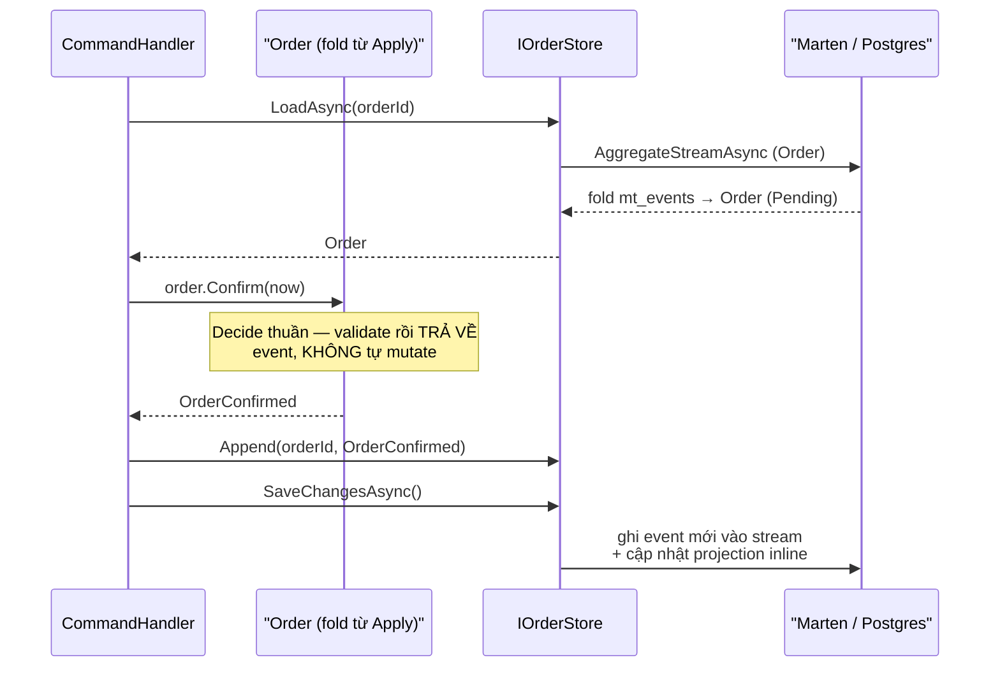
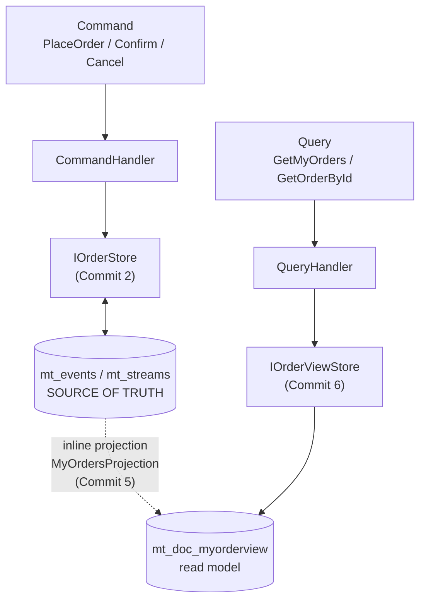
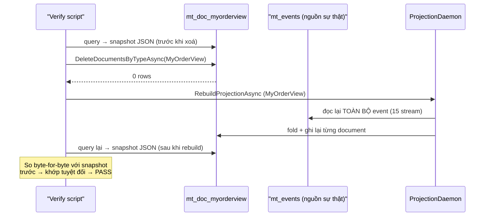

# Phase 4 — Kế hoạch chi tiết theo commit

> **Mục tiêu (từ scope mục 10):** tách read/write (CQRS), lưu lịch sử dạng event (Event Sourcing). Biến `ordering` từ skeleton gRPC-client thành service event-sourced đầy đủ.
> **DoD:** đặt 1 order sinh ra **stream event**; **xoá read model rồi replay từ event dựng lại được**.

> ⚠️ **Viết TRƯỚC khi code** (giống [phase-2](phase-2-plan.md)/[phase-3-plan.md](phase-3-plan.md)). Các mục "lệch kế hoạch / bug tự bắt được" và "verify thật" bổ sung dần khi thực thi. Version package chốt vào `Directory.Packages.props` lúc code.

---

## Bối cảnh: cái gì đã có, cái gì Phase 4 thêm

- **Ordering hiện tại là skeleton 1-project** (`TicketFlow.Ordering.Api`): chỉ có gRPC client gọi reservation + endpoint REST `/check-seats` (bridge Ch3, Phase 1). **Chưa có DB, chưa có tầng Domain/Application/Infrastructure.**
- **Đây là service ĐẦU TIÊN không dùng EF Core.** Catalog/Identity/Reservation đều state-based (lưu *trạng thái hiện tại* qua EF Core + Postgres/Redis). Ordering sẽ **event-sourced**: lưu *chuỗi sự kiện*, state = fold(events). Đây chính là điểm học Ch7.
- **Phase 4 thêm:** DB `ticketflow_ordering`, Marten (event store + projection), tầng Domain (Order aggregate event-sourced) / Application (command + query) / Infrastructure (Marten) / Api. Giữ nguyên endpoint `/check-seats` cũ (không đụng).
- **KHÔNG thuộc Phase 4:** orchestration giữ ghế → thanh toán → xác nhận (đó là **PurchaseSaga, Phase 5**). Phase 4 giữ Order **tự chứa**: PlaceOrder chỉ ghi lại *ý định đặt*, chưa gọi reservation để hold, chưa publish integration event lên bus. Tránh kéo saga vào sớm.

---

## Quyết định kiến trúc cho Phase 4

### 1. Event Sourcing — lưu event, không lưu state (điểm học Ch7, tương phản với 3 service trước)
- **State-based (Catalog...):** UPDATE 1 row → mất lịch sử, chỉ biết "hiện tại". **Event-sourced (Ordering):** append event vào stream, **không bao giờ UPDATE/DELETE event** → giữ toàn bộ lịch sử "chuyện gì đã xảy ra theo thứ tự".
- **Order aggregate = fold trái các event:** `Apply(OrderPlaced)`, `Apply(OrderConfirmed)`, `Apply(OrderCancelled)` — mỗi method biến đổi state hiện tại. Load 1 order = đọc stream + fold từ đầu (Marten `AggregateStreamAsync<Order>`). State không được lưu trực tiếp; nó là **kết quả tính toán** từ event.
- **Domain event ở Phase 4 KHÁC domain event Phase 1-3:** ở Catalog, domain event chỉ là thông báo phụ (`Raise(...)`, đang `Ignore(DomainEvents)` ở EF). Ở Ordering, **event CHÍNH LÀ dữ liệu được lưu** — chúng là source of truth, không phải phụ phẩm. Đây là khác biệt tư duy cốt lõi.

*"Decide" (`Confirm`/`Cancel` — quyết định, trả về event) tách bạch khỏi "Evolve" (`Apply` — mutator duy nhất, dùng để fold). Đây là pattern Decide/Evolve chuẩn của Event Sourcing.*

### 2. Marten làm event store — sạch license, tự quản schema (khác EF)
- **Marten 9.x, MIT license** (xác nhận qua nuspec, có target `net10.0`) — không vướng thương mại như MassTransit/MediatR. Marten là **event store + document DB + projection engine** trên Postgres, tất cả trong một.
- **Marten tự quản schema, KHÔNG dùng EF migrations:** khác Catalog/Reservation (migrate-on-startup qua `dotnet ef`). Marten dev-mode dùng `AutoCreate.CreateOrUpdate` tự dựng bảng `mt_events`/`mt_streams`/projection docs khi app chạy. Điểm học: **2 chiến lược schema management khác nhau trong cùng hệ thống** (polyglot persistence ở tầng công cụ, nối tiếp bài học Ch8 Phase 2).
- **DB riêng `ticketflow_ordering`** (giữ DB-per-service). Marten sống trong schema riêng của nó trong DB này.

### 3. MediatR — có chuyện license Y HỆT MassTransit, và có thể KHÔNG cần (phản biện scope)
- Scope mục 3 ghi *"MediatR: tách Command và Query"*. Nhưng: **MediatR v13.0.0+ đã chuyển giấy phép thương mại** (`license type="file"`, giống MassTransit v9). **v12.5.0 là bản Apache-2.0 miễn phí cuối cùng** (chỉ target `net6.0`/`netstandard2.0` — vẫn chạy trên net10.0 vì là lib nhỏ, nhưng đã đóng băng, không có target net10 riêng).
- **Phản biện:** CQRS **không đòi hỏi MediatR**. "Tách Command và Query" là tách **model đọc khỏi model ghi** (điểm học Ch6), KHÔNG phải "dùng thư viện mediator". Có thể inject handler thẳng vào endpoint, hoặc tự cuộn convention `ICommandHandler<TCmd,TRes>` / `IQueryHandler<TQry,TRes>` (~15 dòng, 0 package). Giá trị thật của MediatR là **pipeline behaviors** (validation/logging/transaction) — mà Phase 4 DoD **không cần**; khi cần cross-cutting thật thì là chuyện Phase 5 (saga/resiliency).
- **Đề xuất (khuyến nghị):** **tự cuộn dispatcher tối thiểu**, không kéo MediatR. Lý do: (a) v13+ thương mại, v12 đóng băng — tránh phụ thuộc chết; (b) đúng kỷ luật "không kéo package lớn cho nhu cầu hẹp" đã áp cho ASP.NET Identity (Phase 1) và Swashbuckle; (c) tự cuộn dạy rõ cơ chế dispatch hơn, đúng tinh thần học. Marten đã lo phần khó (ES + projection); mediator chỉ là lớp mỏng.
- **Phương án thay thế** (nếu muốn "chuẩn sách/industry"): pin **MediatR 12.5.0** (Apache-2.0 cuối), song song tiền lệ MassTransit v8.
- **✅ Đã duyệt (trước Commit 3): tự cuộn dispatcher.** Xem chi tiết implementation ở Commit 3.

### 4. CQRS = tách MODEL, không phải tách công cụ (điểm học Ch6)
- **Write model:** Order aggregate, dựng lại bằng fold stream event (`AggregateStreamAsync`) mỗi lần xử lý command. Đúng đắn (consistency), nhưng "chậm" — chấp nhận được vì write ít, cần chính xác.
- **Read model:** **projection** — Marten tự duy trì 1 document `MyOrderView` (đơn của tôi) cập nhật theo event. Query đọc thẳng document này (nhanh, không fold). Không bao giờ query bằng cách fold stream ở đường đọc.
- **Đây là bản chất CQRS:** 2 model cho 2 mục đích, cùng nguồn sự thật (event stream). Không phải "2 database" hay "2 microservice".

*2 port đọc/ghi tách biệt (`IOrderStore` fold stream; `IOrderViewStore` đọc document đã chiếu sẵn) — CQRS cụ thể hoá đến tận tầng port, không chỉ "có 2 loại handler".*

### 5. Projection: inline vs async — chọn inline cho Phase 4
- **Inline projection:** cập nhật read model **trong cùng transaction** với append event → read-after-write nhất quán ngay. Đơn giản, đủ cho Phase 4.
- **Async projection (daemon):** cập nhật read model ở background → eventual consistency, chịu tải cao hơn. Mạnh hơn nhưng phức tạp (cần chạy projection daemon). **Hoãn** — ghi chú là hướng mở rộng, Phase 4 dùng inline để giữ DoD rõ ràng và dễ verify.
- **Replay (DoD):** dù inline hay async, Marten cho **rebuild projection từ đầu** — xoá document read model, chạy lại projection over toàn bộ event stream → dựng lại y hệt. Đây chính là thứ DoD ép chứng minh, và là **siêu năng lực của Event Sourcing**: read model chỉ là cache có thể vứt đi và tái tạo.

### 6. Order lifecycle — đủ event để fold có ý nghĩa
- Events: **`OrderPlaced`** (customerId, eventId, seatIds, tổng tiền) → **`OrderConfirmed`** → hoặc **`OrderCancelled`**. Đủ 3 loại để `Apply` fold ra state khác nhau (`Pending`→`Confirmed`/`Cancelled`), đủ minh hoạ chuỗi. Không nhồi thêm event (payment/refund là Phase 5).
- **Optimistic concurrency:** Marten kiểm version stream khi append — 2 command đồng thời lên cùng order → 1 fail. Ghi chú, verify nhẹ (không phải trọng tâm như overselling Phase 2).

### 7. Quan hệ với reservation/saga — Phase 4 tự chứa
- PlaceOrder **KHÔNG** gọi reservation hold, **KHÔNG** publish lên bus. Chỉ ghi event vào stream Ordering. Việc nối "order → hold ghế → thanh toán → confirm/nhả" là **PurchaseSaga Phase 5**. Giữ endpoint `/check-seats` (gRPC client cũ) nguyên vẹn — nó độc lập, không dính CQRS.
- Không thêm gRPC server cho Ordering (chỉ giữ client sẵn có). Port REST **8004** giữ nguyên.

### 8. Kế thừa & hạ tầng
- Central Package Management, native OpenAPI + Scalar, exception middleware, health check (thêm Marten/Postgres health), `docker-compose.yml` (ordering thêm `depends_on: postgres healthy`), Dockerfile cập nhật COPY project mới, `.slnx`.
- **Health check:** thêm check Postgres/Marten cho ordering (trước giờ ordering không có DB nên không có DB health).

---

## Nhóm A — Domain event-sourced + Marten event store

### Commit 1 — `feat(ordering): event-sourced Order aggregate + domain events`
- Project mới `TicketFlow.Ordering.Domain` (ref `TicketFlow.Domain`). Mổ ordering từ skeleton thành có tầng Domain.
- `OrderStatus` enum (Pending/Confirmed/Cancelled).
- **Quyết định thêm khi code (không có trong bản nháp gốc):** field ban đầu định tên `EventId` (id của catalog event mà order đặt vé) — **đổi ngay thành `CatalogEventId`** để nhất quán với convention đã lập từ Phase 3 (tránh nhầm với khái niệm "event" nói chung trong ngữ cảnh Event Sourcing, nơi từ "event" đã bị dùng cho nghĩa khác — càng dễ nhầm hơn Catalog Phase 1-3).
- **Quyết định kiến trúc chốt khi code (đáng chú ý — lệch khỏi ấn tượng ban đầu của plan):** 3 event record (`OrderPlaced`, `OrderConfirmed`, `OrderCancelled`) là **record trần, KHÔNG kế thừa `TicketFlow.Domain.DomainEvent`**. Lý do: `DomainEvent` (EventId + OccurredOn) phục vụ pattern "buffer nội bộ rồi dispatch qua outbox" của Catalog/Reservation (state-based); ở đây event **CHÍNH LÀ dữ liệu Marten lưu**, đã có sẵn envelope riêng (id, timestamp, sequence, version theo stream) — kế thừa `DomainEvent` sẽ tạo 2 bộ metadata trùng lặp, gây nhầm "cái nào mới là timestamp thật". Đây là điểm khác biệt tư duy cụ thể hoá cho mục 1 phần "Quyết định kiến trúc".
- `Order : Entity<Guid>` (KHÔNG kế thừa `AggregateRoot<Guid>` — lý do tương tự: máy `Raise()`/`DomainEvents`/`ClearDomainEvents` của `AggregateRoot` là cách theo dõi "sự kiện mới" thứ 2, trùng lặp và gây nhầm lẫn với event stream Marten đã quản). Thiết kế:
  - `Apply(OrderPlaced/OrderConfirmed/OrderCancelled)` — **mutator DUY NHẤT**, dùng để fold.
  - `Order.Place(...)` — static, validate rồi **trả về event** (chưa có aggregate để gọi instance method).
  - `Confirm(now)`/`Cancel(reason, now)` — instance method, **quyết định thuần** (pure decision): validate trạng thái hiện tại rồi trả về event, **KHÔNG tự mutate** — tách bạch rạch ròi "quyết định" khỏi "áp dụng", đúng pattern Decide/Evolve của ES.
  - `Order.Load(IEnumerable<object> events)` — **thêm ngoài kế hoạch gốc**: factory fold toàn bộ lịch sử. Lý do thêm: cần một cách sạch để unit test fold mà không đụng reflection thủ công trong test, đồng thời Commit 3 có thể tái dùng nếu cần load aggregate ngoài đường Marten trực tiếp.
  - ⚠️ **Đính chính (phát hiện ở Commit 2):** câu mô tả gốc ở đây từng viết `AggregateStreamAsync` fold "qua reflection lên các overload Apply" — **sai**. Marten bản 9.x KHÔNG dùng reflection lúc runtime để dispatch `Apply`; nó dùng **source generator biên dịch thời gian build** (`JasperFx.Events.SourceGenerator`). Không có runtime fallback. Xem chi tiết ở phần verify Commit 2 bên dưới — đây là phát hiện quan trọng nhất của cả 2 commit đầu Phase 4.
- `Money` (VO) tạo riêng cho Ordering (`Orders/Money.cs`), **KHÔNG** tái dùng `TicketFlow.Catalog.Domain.Events.Money` dù cấu trúc giống hệt — Ordering không được reference `Catalog.Domain` (đúng nguyên tắc DB-per-service/no-cross-context-reference đã giữ xuyên suốt Phase 1-3). Trùng lặp ~15 dòng chấp nhận được, đổi lấy tính tự chủ bounded-context.
- **Verify thật:** `TicketFlow.Ordering.Domain.Tests` (xUnit, mẫu y hệt `Catalog.Domain.Tests`) — **8 test**, thuần domain, không DB: `Place` validate (seatIds rỗng → throw), `Place`→`Load` dựng đúng state `Pending` với dữ liệu khớp, fold `Placed`+`Confirmed`→`Confirmed`, fold `Placed`+`Cancelled`→`Cancelled`, `Confirm()` trả event mà **không mutate** aggregate gốc (assert `order.Status` vẫn `Pending` sau khi gọi `Confirm()`), guard chặn confirm-khi-đã-confirm / cancel-khi-đã-cancel / cancel-khi-đã-confirm. Chạy `dotnet test` → **8/8 pass**, 54ms.
- Build toàn solution: 0 Warning, 0 Error. Regression: `Catalog.Domain.Tests` 35/35 pass (không ảnh hưởng — commit này chỉ thêm project mới, cô lập).

### Commit 2 — `feat(ordering): Marten event store (Postgres)`
- **Lệch trình tự so với plan gốc:** plan viết "Project mới Infrastructure (ref Application)" như thể Application đã tồn tại — thực ra chưa (Nhóm B/Commit 3 mới định tạo Application). Xử lý: tạo `TicketFlow.Ordering.Application` **tối thiểu** ngay trong commit này (chỉ có `Abstractions/IOrderStore.cs` + `ServiceCollectionExtensions.AddOrderingApplication` đăng ký `TimeProvider.System`), rồi Infrastructure ref vào đó — đúng thứ tự Domain→Application→Infrastructure đã giữ xuyên suốt Phase 1-3, chỉ là gộp "ports" và "adapter" vào cùng 1 commit vì port phải tồn tại trước khi adapter implement được. Commit 3 sẽ **bổ sung** command handlers/DTOs vào Application đã có sẵn, không tạo lại.
- Pin `Marten` **9.15.2** vào `Directory.Packages.props` (MIT, xác nhận net10.0 target qua nuspec).
- `IOrderStore` (Application): `LoadAsync`/`StartStream`/`Append`/`SaveChangesAsync` — mô phỏng đúng shape `IDocumentSession` của Marten (buffer rồi commit), cùng tinh thần `IUnitOfWork` đã dùng cho EF Core ở service khác.
- `MartenOrderStore : IOrderStore` (Infrastructure): `LoadAsync` → `session.Events.AggregateStreamAsync<Order>(...)` (live aggregation — fold toàn bộ event mỗi lần load, không cần đăng ký projection riêng cho việc này).
- `AddOrderingInfrastructure`: `AddMarten(options => { options.Connection(...); options.AutoCreateSchemaObjects = AutoCreate.CreateOrUpdate; })` (dev-only, cùng tinh thần migrate-on-startup của EF); đăng ký `IOrderStore`; health check.
- **🐛 Bug thật #1 — namespace `AutoCreate` đoán sai:** thử `using Weasel.Core;` (theo hiểu biết cũ về Marten) → `CS0103`. Viết throwaway console app reference thẳng gói `Marten` qua NuGet (không qua project — để mọi transitive dependency tự resolve đúng), dùng reflection load `typeof(StoreOptions).GetProperty("AutoCreateSchemaObjects").PropertyType.FullName` → tìm ra đúng: **`JasperFx.AutoCreate`**. Hệ sinh thái Marten bản mới đã tổ chức lại nhiều type nền tảng dưới namespace `JasperFx` (JasperFx.Core, JasperFx.Events...), khác tài liệu/ấn tượng cũ.
- **🐛 Bug thật #2 (nghiêm trọng hơn, phát hiện qua verify runtime, không phải build) — health check âm thầm tạo sai loại bảng:** `MartenHealthCheck` bản đầu dùng `session.Query<Order>().Take(1)...` — chạy được, `/health` trả `200 Healthy`, **nhưng** `psql` cho thấy Marten tạo bảng `mt_doc_order` thay vì `mt_events`/`mt_streams`. Nguyên nhân: `session.Query<T>()` là API **document store** (LINQ trên document đã lưu), hoàn toàn khác API **event store** (`session.Events...`) — gọi nhầm khiến Marten hiểu `Order` là 1 document type thường cần bảng riêng, âm thầm tạo schema sai không hề báo lỗi. **Sửa:** đổi health check dùng `session.Events.QueryAllRawEvents().Take(1)...` — đúng API event store, không tạo bảng document. Dọn bảng `mt_doc_order` sai qua `DROP TABLE`. **Bài học:** `Order` (event-sourced) không bao giờ được gọi qua `session.Query<Order>()` — chỉ được dựng lại qua fold stream; đây là ranh giới API dễ nhầm nhất khi mới dùng Marten.
- **🐛 Bug thật #3 (nghiêm trọng nhất, xung đột thật với triết lý Clean Architecture) — source generator phải chạy trên assembly Domain:** verify thật bằng scratch console app gọi `StartStream`→`SaveChangesAsync`→`LoadAsync` → ném `JasperFx.Events.Projections.InvalidProjectionException: No source-generated dispatcher found... there is no runtime fallback`. Marten 9.x **không** dispatch `Apply(...)` bằng reflection lúc chạy (khác hiểu biết/kế hoạch ban đầu) — nó dùng **source generator biên dịch thời gian build** (`JasperFx.Events.SourceGenerator`), và generator này **phải chạy trên chính assembly định nghĩa aggregate** (`TicketFlow.Ordering.Domain`, nơi `Order` sống), không phải assembly nào gọi Marten runtime (`Infrastructure`).
  - **Xung đột kiến trúc thật:** Domain xuyên suốt Phase 1-4 luôn "sạch", không phụ thuộc framework nào. Marten đòi hỏi ngược lại.
  - **Giải quyết (đúng pattern đã có sẵn trong repo):** thêm `PackageReference Marten` vào **`TicketFlow.Ordering.Domain.csproj`** nhưng **chỉ lấy analyzer** (`IncludeAssets="analyzers"`, `PrivateAssets="all"`) — y hệt cách `Microsoft.EntityFrameworkCore.Design` được thêm analyzer-only vào các `*.Api` project (Phase 1). Domain **vẫn zero runtime dependency** lên Marten — `Order.cs` không có dòng `using Marten;` nào, không implement interface Marten nào; chỉ có **build-time tooling** chạm vào assembly để sinh code.
  - **Lớp thứ 2 của cùng vấn đề:** chỉ đưa `analyzers` là chưa đủ — code sinh ra (`...Evolver.g.cs`) tham chiếu thẳng type `JasperFx.Events.*`, cần **runtime assembly thật** để biên dịch được (không chỉ analyzer). Thêm `PackageReference Include="JasperFx.Events"` (pin 2.27.0, MIT, net10.0, **không kéo theo Postgres/Npgsql/Marten proper** — đây là lib lõi event-sourcing transport-agnostic mà Marten xây trên đó) làm dependency runtime thật cho Domain. Đây là ranh giới chấp nhận được: Domain phụ thuộc *khái niệm event sourcing* (JasperFx.Events), không phụ thuộc *Marten-cụ-thể-trên-Postgres*.
- **Verify thật cuối cùng (không mock), qua scratch console app gọi thẳng `MartenOrderStore` với Postgres local thật:**
  1. `Order.Place(...)` → `StartStream` → `SaveChangesAsync` → `LoadAsync` ngay sau → đúng `Status: Pending`, đúng `SeatIds`, đúng `Total` (khớp dữ liệu đưa vào).
  2. `order.Confirm(now)` → `Append` → `SaveChangesAsync` → `LoadAsync` lại → đúng `Status: Confirmed` (fold **2 event** đúng thứ tự).
  3. `LoadAsync` với `orderId` không tồn tại → trả `null` (không throw) — đúng hợp đồng `IOrderStore.LoadAsync`.
  4. → **PASS** cả 3 kịch bản.
  5. `psql` xác nhận đúng bảng event-store thật: `mt_events`, `mt_streams`, `mt_event_progression`, `mt_high_water_skips`, `mt_doc_deadletterevent` — **không còn** `mt_doc_order`. `SELECT` trực tiếp `mt_events` thấy đúng `type: order_placed`/`order_confirmed`, đúng `version` 1/2 cùng `stream_id`.
  6. Docker thật: tạo DB `ticketflow_ordering` thủ công trước (`CREATE DATABASE` — khác EF Core, Marten **không** tự tạo database, chỉ tự tạo *schema objects* trong DB đã tồn tại sẵn; đây là điểm khác biệt thật giữa 2 chiến lược schema management, đúng như quyết định kiến trúc mục 2 đã dự đoán, giờ có bằng chứng cụ thể). Cập nhật Dockerfile (thêm COPY layer cho 3 project mới) + `docker-compose.yml` (`ordering` thêm `depends_on: postgres healthy`). Rebuild image → `docker compose up -d ordering` → log sạch, không lỗi → `ordering /health` → `200 Healthy` trong container thật.
  7. Regression: full smoke test gateway (catalog/identity/reservation `200`, `ordering/check-seats` gRPC cũ vẫn `200` — không đụng), `notification`/`search`/`ordering` `/health` đều `200`, `docker compose ps` đủ **11 container**. `Catalog.Domain.Tests` 35/35, `Ordering.Domain.Tests` 8/8 — không regression.
- **Verify thật:** app start → Marten tự tạo bảng `mt_events`/`mt_streams` trong `ticketflow_ordering` (psql xác nhận); append thử 1 event → `mt_events` có row; `AggregateStreamAsync` fold lại đúng.

---

## Nhóm B — CQRS write side (commands)

### Commit 3 — `feat(ordering): command side — PlaceOrder/Confirm/Cancel`
- **Dispatcher đã chốt: tự cuộn.** `ICommandHandler<TCommand, TResult>` — interface generic ~3 dòng, **thuần convention đặt tên, không phải mediator runtime**. Không có `ISender.Send(command)` resolve handler theo type lúc chạy; endpoint (Commit 4) sẽ inject thẳng class handler cụ thể (`PlaceOrderCommandHandler`...) qua DI, giống hệt cách `EventService` được inject thẳng ở Catalog. Đạt đủ giá trị dạy CQRS (Command type + Handler type tách biệt, tách khỏi Query ở Commit 6) mà không cần cơ chế dispatch runtime của MediatR — đúng lý do đã chọn không dùng MediatR (giá trị thật của nó là pipeline behaviors, Phase 4 không cần).
- 3 cặp Command + Handler (mỗi cặp 1 file, `Orders/`): `PlaceOrderCommand`/`PlaceOrderCommandHandler`, `ConfirmOrderCommand`/`ConfirmOrderCommandHandler`, `CancelOrderCommand`/`CancelOrderCommandHandler`. `OrderResponse` (DTO) + `OrderResponseMapper` (helper `internal static` dùng chung, tránh lặp map 3 lần).
- **Pattern nhất quán cho Confirm/Cancel:** `LoadAsync` → gọi method quyết định thuần trên aggregate (`order.Confirm(now)`/`order.Cancel(reason, now)`, đã có từ Commit 1, không mutate) → `Append` event trả về → `SaveChangesAsync` → gọi lại `order.Apply(event)` **trên chính instance vừa load** để phản ánh state mới vào response DTO, tránh phải load lại từ Marten lần nữa. Tận dụng đúng thiết kế "Apply là mutator duy nhất" đã lập từ Commit 1.
- `AddOrderingApplication` đăng ký 3 handler dạng **concrete type** (không đăng ký qua interface `ICommandHandler<,>` — không cần, vì không có runtime dispatch theo interface).
- **Verify thật (2 lớp, đúng tinh thần "test nhanh + verify hạ tầng thật" đã dùng cho Catalog/Ordering.Domain):**
  1. **Unit test handler** (project mới `TicketFlow.Ordering.Application.Tests`, mẫu y hệt `Catalog.Domain.Tests`/`Ordering.Domain.Tests`) — `FakeOrderStore` (in-memory, implement `IOrderStore`) cô lập logic handler khỏi Marten thật (Marten đã verify thật ở Commit 2, không cần verify lại ở đây). **10 test**: Place trả đúng `OrderResponse` + đúng 1 event staged; Place không seat → throw; Place không currency → mặc định VND; Confirm order Pending → đúng 2 event tích luỹ theo thứ tự (`OrderPlaced` rồi `OrderConfirmed`) + trả `Confirmed`; Confirm order không tồn tại / đã confirm → throw; tương tự đủ cho Cancel (gồm case order đã Confirmed thì không cancel được). `dotnet test` → **10/10 pass**, 73ms.
  2. **Verify thật qua Postgres/Marten thật** (scratch console app, đã xoá sau khi xong): wire `AddOrderingApplication`+`AddOrderingInfrastructure` bằng DI thật, resolve 3 handler, chạy kịch bản Place→Confirm (order 1) và Place→Cancel (order 2) qua **đúng đường handler**, không gọi thẳng `MartenOrderStore` như Commit 2 — chứng minh toàn bộ chuỗi Command→Handler→IOrderStore→Marten→Postgres hoạt động. Cả 2 luồng terminal (Confirmed/Cancelled) đều đúng; guard "không cancel được order đã Confirmed" giữ đúng xuyên suốt cả đường handler thật (không chỉ đúng ở unit test với fake). `psql` xác nhận `mt_events` có đúng 2 row/stream, đúng `version` 1→2, đúng `type` (`order_placed`→`order_confirmed`, `order_placed`→`order_cancelled`).
  3. Build toàn solution: 0 Warning, 0 Error. Regression: `Catalog.Domain.Tests` 35/35, `Ordering.Domain.Tests` 8/8 — không ảnh hưởng.

### Commit 4 — `feat(ordering): command endpoints (REST)`
- `Endpoints/OrderEndpoints.cs`: `POST /orders` (bind thẳng `PlaceOrderCommand` làm request body — cùng cách Catalog dùng `CreateEventRequest` thẳng làm body, không cần DTO Api-layer riêng), `POST /orders/{id}/confirm` (route id → `ConfirmOrderCommand`, không cần body), `POST /orders/{id}/cancel` (route id + body `CancelOrderRequest(Reason)` ghép thành `CancelOrderCommand` — cần DTO riêng vì `CancelOrderCommand` có `OrderId` từ route, không thể bind thẳng cả command từ body được).
- Endpoint inject thẳng **handler cụ thể** (`PlaceOrderCommandHandler`...) qua DI minimal API — đúng thiết kế "dispatcher = convention, không phải mediator runtime" đã chốt ở Commit 3.
- Lỗi nghiệp vụ (`InvalidOperationException`/`ArgumentException` từ Domain/Application) map qua `ExceptionHandlingMiddleware` có sẵn → `400`, đúng convention đã dùng cho Catalog (không phải `404` riêng cho "not found" — nhất quán toàn hệ thống, chưa đổi ở Phase 4).
- **🐛 Bug thật nghiêm trọng — `Guid.Empty` không được Marten coi là "stream không tồn tại":** verify thật qua gateway (không phải unit test — `FakeOrderStore` ở Commit 3 không thể bắt được bug này vì nó chỉ là Dictionary lookup, tự nhiên trả `null` cho key không tồn tại; bug này **chỉ lộ ra khi chạm Marten thật**). Kịch bản phát hiện: gọi `POST /orders/00000000-0000-0000-0000-000000000000/confirm` (định test case "order không tồn tại") nhưng nhận về `400 "Only a pending order can be confirmed (current status: Cancelled)"` thay vì `"not found"`. `psql` xác nhận **không có row nào** với `stream_id = Guid.Empty` ở cả `mt_events` lẫn `mt_streams` — nhưng status "Cancelled" trùng khớp **chính xác** với event cuối cùng (theo `seq_id` toàn cục) vừa ghi vào hệ thống lúc đó (`order_cancelled` của 1 order khác hoàn toàn). Kết luận: `AggregateStreamAsync<Order>(Guid.Empty)` **không lọc theo stream_id** khi id là `Guid.Empty` — nó fold lẫn event từ **stream khác**, âm thầm trả về dữ liệu sai thay vì `null` hay lỗi. Đây là **rò rỉ dữ liệu chéo giữa các aggregate** nếu 1 client (bug frontend, biến chưa khởi tạo, hay dò tấn công) gửi id rỗng — không chỉ là bug logic, còn là vấn đề bảo mật/tính đúng đắn dữ liệu.
  - **Xác minh nguyên nhân bằng loại trừ:** test lại với 1 Guid ngẫu nhiên không tồn tại (`aaaaaaaa-...`) → đúng `"not found"` như kỳ vọng, lặp lại ổn định — chỉ riêng `Guid.Empty` mới gây lỗi. Test thẳng container `ordering` (bỏ qua gateway) → bug vẫn y hệt → loại trừ khả năng do YARP.
  - **Sửa tận gốc ở `MartenOrderStore.LoadAsync`:** chặn `Guid.Empty` **trước khi** gọi vào Marten, trả `null` ngay — đúng hợp đồng `IOrderStore.LoadAsync` ("null nếu stream không tồn tại"), sửa tại đúng ranh giới nơi hành vi Marten gặp hợp đồng của port, để **mọi caller trong tương lai** đều được bảo vệ tự động, không phải nhớ tự guard ở từng handler.
  - **Verify lại sau khi sửa:** `Guid.Empty` → đúng `400 "Order '...' was not found."`; Guid ngẫu nhiên vẫn đúng not-found; luồng hợp lệ Place→Confirm vẫn `200`/`Confirmed` bình thường — không phá vỡ gì.
- **Verify thật qua gateway (toàn bộ, không mock):**
  1. Place order 1 (2 ghế) → `201`, `status: Pending`. Confirm order 1 → `200`, `status: Confirmed`. `psql` `mt_events` xác nhận đúng **2 event** (`order_placed` version 1, `order_confirmed` version 2) cùng 1 `stream_id`, đúng thứ tự.
  2. Place order 2 (1 ghế) → Cancel order 2 → `200`, `status: Cancelled`.
  3. Cancel order 1 (đã Confirmed) → `400`, đúng message guard "Only a pending order can be cancelled (current status: Confirmed)" — guard giữ đúng qua toàn bộ đường thật (route → command → handler → aggregate → Marten).
  4. Order thứ 3, Place→Confirm lại lần nữa sau khi sửa bug — vẫn đúng `200`/`Confirmed`.
  5. Regression: `docker compose ps` đủ **11 container**; full smoke test gateway (catalog/identity/reservation `200`, `ordering/check-seats` gRPC cũ vẫn `200`); `Catalog.Domain.Tests` 35/35, `Ordering.Domain.Tests` 8/8, `Ordering.Application.Tests` 10/10 — không regression.
- **Bài học rút ra:** bug `Guid.Empty` là ví dụ cụ thể cho lý do dự án luôn verify qua HTTP/Docker thật thay vì chỉ tin vào unit test — fake store (Dictionary) không thể tái hiện quirk thật của Marten; chỉ chạm hạ tầng thật mới lộ ra.

---

## Nhóm C — CQRS read side (projection + queries)

### Commit 5 — `feat(ordering): MyOrders projection (read model)`
- `MyOrderView` (Application, `Orders/MyOrderView.cs`) — **record dữ liệu thuần, không có method `Apply`**. Khác `Order`: ở đây fold event không tự thân aggregate làm, mà 1 class **Projection riêng** (`MyOrdersProjection`, Infrastructure) làm — đúng tách bạch CQRS: Application định nghĩa **hình dạng** read model cần, Infrastructure định nghĩa **cách** nó được điền dữ liệu.
- `MyOrdersProjection : SingleStreamProjection<MyOrderView, Guid>` (Infrastructure) — **cố tình KHÔNG** dùng `Projections.Snapshot<Order>()` (sẽ biến write-side aggregate thành document luôn, xoá sạch ranh giới CQRS). `Create(OrderPlaced)` khởi tạo view mới (`Status: Pending`); `Apply(OrderConfirmed, current)`/`Apply(OrderCancelled, current)` trả **bản ghi mới** qua `with` expression (record immutable, không mutate).
- Đăng ký `options.Projections.Add<MyOrdersProjection>(ProjectionLifecycle.Inline)` trong `AddOrderingInfrastructure` — **Inline** = read model cập nhật **cùng transaction** với event append → read-after-write nhất quán ngay, đơn giản nhất cho DoD Phase 4. Async/daemon projection (eventual consistency, throughput cao hơn) để backlog.
- **🐛 Chuỗi 3 bug liên tiếp khi wiring projection — mỗi bug lộ ra 1 lớp mới của cùng cơ chế source-generator đã học ở Commit 2, không phải lặp lại y hệt:**
  1. **Namespace `ProjectionLifecycle` đoán sai** (thử `Marten.Events.Projections` trước) — dùng lại kỹ thuật probe reflection (console app thật reference gói `Marten`, dò `StoreOptions.Projections` → `ProjectionOptions.Add<T>` → lấy đúng type tham số) → tìm ra `JasperFx.Events.Projections.ProjectionLifecycle`. Cùng hệ sinh thái JasperFx đã gặp ở Commit 2, nhưng lần này đúng chỗ khác.
  2. **`InvalidProjectionException` y hệt thông báo Commit 2** ("no source-generated dispatcher... ensure analyzer runs in the assembly that defines `MyOrderView`") → áp lại đúng fix Commit 2 (Marten analyzer-only + `JasperFx.Events` runtime) vào **Application** (nơi `MyOrderView` sống) → build được nhưng **runtime vẫn lỗi y hệt**. → Đọc kỹ lại toàn bộ message lần nữa (không dừng ở câu đầu) mới thấy dòng bị bỏ sót lần trước: *"A self-aggregating type... does NOT need to be `partial`; a **projection subclass** that uses convention methods **DOES need to be declared `partial`**."* `MyOrdersProjection` là projection subclass (kế thừa `SingleStreamProjection<>`), khác `Order` (self-aggregating, không kế thừa gì đặc biệt) — thêm `partial` vào `MyOrdersProjection` mới thật sự sửa được. **Bài học: message lỗi của JasperFx đủ chi tiết để tự chẩn đoán đúng, nhưng phải đọc hết, không dừng ở phần trông giống lỗi đã gặp trước đó.**
  3. **Lỗi mới sau khi hết lỗi generator** — `ArgumentNullException` sâu trong `SingleStreamProjection.validateDocumentIdentity`/`TypeNameExtensions.NameInCode`, không rõ ràng. Nguyên nhân thật: Marten cần 1 property làm document identity, tự nhận diện qua convention **`Id`** hoặc **`{TênClass}Id`** — `MyOrderView.OrderId` khớp **cả 2 quy ước đều sai** (không phải `Id` trần, cũng không phải `MyOrderViewId`). Cân nhắc dùng `[Identity]` attribute để giữ tên `OrderId` mô tả rõ hơn, nhưng **từ chối** vì attribute đó nằm trong assembly Marten runtime đầy đủ, sẽ phá vỡ ranh giới "Application chỉ có analyzer-only + JasperFx.Events" đã giữ cho `Order`. **Đổi tên `OrderId` → `Id`** — giải pháp không tốn thêm dependency, đúng convention phổ biến nhất của Marten.
- **Verify thật (không mock), 2 lớp:**
  1. Scratch console app (đã xoá sau khi xong) wire `AddOrderingInfrastructure` thật, dùng thẳng `IDocumentSession`/`IQuerySession` (không qua `IOrderStore`, để test đúng tầng Marten+projection, không lẫn với command handler) — `StartStream`+`SaveChangesAsync` (OrderPlaced) → `querySession.LoadAsync<MyOrderView>(id)` → đúng `Status: Pending`, đúng `SeatIds`/`Total`. `Append`+`SaveChangesAsync` (OrderConfirmed) → load lại → đúng `Status: Confirmed`, `ConfirmedAt` có giá trị — **PASS**, chứng minh read-after-write nhất quán thật (không phải suy đoán từ code).
  2. `psql`: `\dt public.*` xác nhận bảng mới `mt_doc_myorderview` (JSONB document store của Marten, khác `mt_events`/`mt_streams`). `SELECT data FROM mt_doc_myorderview` → JSON đầy đủ, đúng field, đúng giá trị.
  3. Docker thật: rebuild image, `docker compose up -d ordering` → log sạch. Place→Confirm qua **gateway thật** → `psql` xác nhận `data->>'Status' = 'Confirmed'` cho đúng order vừa test.
  4. Regression: `docker compose ps` đủ 11 container; full smoke test gateway 4/4 route `200`; `Catalog.Domain.Tests` 35/35, `Ordering.Domain.Tests` 8/8, `Ordering.Application.Tests` 10/10 — không ảnh hưởng.

### Commit 6 — `feat(ordering): query side — GetMyOrders/GetOrderById`
- `IQueryHandler<TQuery,TResult>` — song song `ICommandHandler` (Commit 3), cùng triết lý: convention đặt tên thuần, không dispatch runtime.
- **Port đọc riêng biệt: `IOrderViewStore`** (KHÔNG dùng lại `IOrderStore`) — đây là điểm cụ thể hoá CQRS ở tầng port, không chỉ ở tầng "có 2 loại handler". `IOrderStore` (Commit 2) đọc bằng cách fold event stream (ghi); `IOrderViewStore` đọc thẳng document đã được `MyOrdersProjection` (Commit 5) chiếu sẵn — 2 cơ chế đọc hoàn toàn khác nhau cho 2 mục đích khác nhau.
- `MartenOrderViewStore : IOrderViewStore` (Infrastructure) dùng `IQuerySession` (không phải `IDocumentSession` — đường đọc không cần khả năng ghi): `GetByIdAsync` → `session.LoadAsync<MyOrderView>(id)`; `GetByCustomerAsync` → `session.Query<MyOrderView>().Where(...)`. **Lưu ý:** `session.Query<MyOrderView>()` ở đây là dùng **đúng** — khác hẳn bug Commit 2 (`session.Query<Order>()` sai vì Order không phải document, chỉ nên fold qua event store). `MyOrderView` **là** document thật (đã đăng ký qua `SingleStreamProjection`), nên `Query<>` là API chính xác cho nó.
- `GetOrderByIdQuery`/`GetMyOrdersQuery` + handler tương ứng — trả thẳng `MyOrderView` (không map sang `OrderResponse`, vì `MyOrderView` đã có đủ field kể cả timestamp mà `OrderResponse` không có — đúng tinh thần "read model tối ưu cho việc đọc", không gò về khuôn response của command).
- Endpoint: `GET /orders/{id}` (404 nếu không có — khác 400 "not found" của command side, vì đây thuần là truy vấn không tồn tại chứ không phải business-rule violation, hợp lý dùng đúng semantic HTTP 404); `GET /orders?customerId=...` (query string, minimal API tự bind).
- **Không phát sinh bug source-generator mới** — khác Commit 2/5, `MartenOrderViewStore` chỉ gọi API đọc document sẵn có (`LoadAsync`/`Query`), không khai báo convention method `Apply`/`Create` nào mới cần dispatch, nên không cần đụng gì thêm tới cấu hình analyzer.
- **Verify thật qua gateway (không mock):**
  1. Đặt 3 order cho **cùng 1 customerId** — để Pending, Confirm 1, Cancel 1 (3 trạng thái khác nhau). `GET /orders?customerId=` → trả đúng **cả 3**, đúng `status` từng order (`Pending`/`Confirmed`/`Cancelled`), đúng timestamp tương ứng (`confirmedAt`/`cancelledAt` chỉ có giá trị đúng nơi cần).
  2. `GET /orders/{id}` cho order Confirmed → `200`, đủ field đúng. Cho id không tồn tại → `404`.
  3. **Đối chiếu write-side:** `psql` `mt_events` cho cả 3 `stream_id` → khớp chính xác: order 1 có 1 event (`order_placed`), order 2 có 2 event (`order_placed`→`order_confirmed`), order 3 có 2 event (`order_placed`→`order_cancelled`) — đúng số event ứng với trạng thái read model trả về.
  4. Test phòng ngừa `Guid.Empty` trên `GET /orders/{id}` (rút kinh nghiệm từ bug Commit 4) → đúng `404`, **không lặp lại bug rò rỉ dữ liệu chéo** — vì `IQuerySession.LoadAsync<T>` là lookup theo primary key thông thường trên bảng document, khác hẳn cơ chế `AggregateStreamAsync` của event store (nơi bug thật sự nằm).
  5. Regression: `docker compose ps` đủ 11 container; full smoke test gateway 4/4 route `200`; `Catalog.Domain.Tests` 35/35, `Ordering.Domain.Tests` 8/8, `Ordering.Application.Tests` 10/10 — không ảnh hưởng.

---

## Nhóm D — Chứng minh replay + chốt

### Commit 7 — `test(ordering): replay — xoá read model, rebuild từ event`
- **Không có code sản phẩm mới** — đúng bản chất commit `test(...)` (cùng tinh thần Phase 3 Commit 7 "outbox durability"): verify runtime 1 năng lực đã có sẵn nhờ thiết kế Marten từ Commit 2/5, không viết thêm logic nghiệp vụ. Cân nhắc thêm 1 endpoint admin `POST /orders/_admin/rebuild-projection` để demo lặp lại được, nhưng **không làm** — chưa có nhu cầu vận hành thật nào đòi hỏi expose khả năng này qua HTTP ở Phase 4; để dành nếu Phase sau cần (ops/admin tooling), tránh scope creep.
- **API rebuild thật của Marten** (tìm ra qua probe reflection, không đoán — cùng kỹ thuật đã dùng ở Commit 2/5 vì tài liệu không đủ chi tiết cho version 9.15.2):
  - Xoá read model: `documentStore.Advanced.Clean.DeleteDocumentsByTypeAsync(typeof(MyOrderView), ct)` — chỉ xoá bảng document (`mt_doc_myorderview`), **không đụng** `mt_events`/`mt_streams`.
  - Rebuild toàn bộ: `var daemon = await documentStore.BuildProjectionDaemonAsync(); await daemon.RebuildProjectionAsync<MyOrderView>(ct);` — rebuild **mọi stream** khớp projection đó, không phải rebuild từng order lẻ (có API `RebuildSingleStreamAsync<T>(streamId)` riêng cho 1 stream, nhưng DoD cần rebuild toàn bộ read model).

*Bằng chứng thật mạnh hơn kịch bản gốc: rebuild tác động lên **toàn bộ** 15 stream tích luỹ từ đầu Phase 4 (không chỉ 3 order vừa test), `mt_events` (27 row) hoàn toàn không đổi trước/sau — đúng siêu năng lực "read model là cache toàn cục, xoá sạch dựng lại được bất cứ lúc nào".*
- **Verify thật (không mock), qua scratch console app dùng thẳng `IDocumentStore` (đã xoá sau khi xong):**
  1. Đặt 3 order **mới hoàn toàn**, đủ 3 trạng thái (Pending/Confirmed/Cancelled) — qua thẳng `session.Events.StartStream`/`Append` (không qua command handler, để cô lập đúng thứ đang test: cơ chế projection, không phải command orchestration đã verify ở Commit 3/4).
  2. **Snapshot read model TRƯỚC khi xoá**: query cả 3 `MyOrderView`, serialize JSON lưu lại để so sánh byte-for-byte sau này (không chỉ "assert field nào đó đúng" — so **toàn bộ document**, chặt hơn).
  3. Gọi `DeleteDocumentsByTypeAsync` → query lại → **0 row** (xác nhận xoá thật, không phải tưởng tượng).
  4. Gọi `RebuildProjectionAsync<MyOrderView>()` → query lại → **snapshot sau khớp chính xác byte-for-byte với snapshot trước** (so sánh JSON string từng document) → **PASS**.
  5. **Phát hiện thật mạnh hơn dự kiến ban đầu:** `DeleteDocumentsByTypeAsync`/`RebuildProjectionAsync` tác động lên **TOÀN BỘ** bảng document, không chỉ 3 order vừa tạo trong lần chạy này. `psql` xác nhận: `mt_streams` có **15** stream (tích luỹ từ mọi order tạo xuyên suốt Phase 4, Commit 1-7), sau rebuild `mt_doc_myorderview` cũng có đúng **15** row — nghĩa là **toàn bộ lịch sử order từ đầu Phase 4** được khôi phục lại, không chỉ phần vừa test. Đây là bằng chứng mạnh hơn cả kịch bản gốc trong plan (chỉ định verify N order mới đặt) — chứng minh đúng thật sự "read model là cache toàn cục, có thể xoá sạch và dựng lại từ đầu bất cứ lúc nào."
  6. `mt_events` đếm được **27** row xuyên suốt — không đổi trước/sau bước xoá+rebuild, xác nhận event store hoàn toàn không bị đụng tới (đúng vai trò "chỉ đọc, không bao giờ ghi" của thao tác rebuild).
  7. Regression: build toàn solution 0 Warning/0 Error; full smoke test gateway 4/4 route `200`; `Catalog.Domain.Tests` 35/35, `Ordering.Domain.Tests` 8/8, `Ordering.Application.Tests` 10/10 — không ảnh hưởng.
- **Kết luận DoD:** đã chứng minh đầy đủ "xoá read model rồi replay từ event dựng lại được" — bằng dữ liệu thật, quy mô toàn bộ lịch sử, không phải suy đoán từ code hay chỉ test 1 nhóm nhỏ vừa tạo.

### Commit 8 — `chore: finalize Phase 4 — slnx, docker-compose, DoD checklist`
- **Verify thật:**
  1. `dotnet sln TicketFlow.slnx list` → đủ **28 project**, gồm 6 project mới của Ordering (`Api`, `Application`, `Application.Tests`, `Domain`, `Domain.Tests`, `Infrastructure`).
  2. `dotnet build` toàn solution: 0 Warning, 0 Error.
  3. `docker-compose.yml`: xác nhận `ordering` đã có `depends_on: postgres (healthy)` từ Commit 2 (không cần thêm mới — kiểm tra lại để chắc chắn, không giả định).
  4. `docker compose ps` → đủ **11 container**.
  5. Full smoke test: catalog/identity/ordering(`check-seats`)/reservation qua gateway đều `200`; `ordering`/`notification`/`search` `/health` đều `200`.
  6. Toàn bộ test suite: `Catalog.Domain.Tests` 35/35, `Ordering.Domain.Tests` 8/8, `Ordering.Application.Tests` 10/10.
- Tick DoD Phase 4 trong `scope.md`, sửa luôn mục 3 (bỏ "MediatR", ghi rõ "tự cuộn dispatcher" + lý do — MediatR v13+ đã thương mại, đồng bộ với ghi chú tương tự đã làm cho MassTransit Phase 3).

---

## Kiểm chứng DoD cuối Phase 4

| DoD | Kiểm chứng |
|---|---|
| Đặt 1 order sinh ra stream event | Commit 4: `POST /orders` qua gateway thật → `psql mt_events` thấy `order_placed` trong stream mới, version 1 |
| Nhiều event fold ra state đúng | Commit 4: place→confirm → 2 event 1 stream (`order_placed`→`order_confirmed`) → response đúng `Confirmed` |
| Read/write tách (CQRS) | Commit 5-6: write fold aggregate qua `IOrderStore`; read đọc thẳng projection `MyOrderView` qua `IOrderViewStore` riêng biệt, không fold |
| Xoá read model → replay dựng lại | Commit 7: `DeleteDocumentsByTypeAsync` xoá sạch → `RebuildProjectionAsync<MyOrderView>()` → **toàn bộ 15 stream lịch sử** khôi phục byte-for-byte đúng, `mt_events` (27 row) không đổi |

## Hướng mở rộng (backlog — không thuộc Phase 4)
- **Async projection (daemon):** chuyển `MyOrders` sang async khi cần chịu tải / nhiều projection (Phase 6 analytics).
- **Publish integration event khi OrderPlaced/Confirmed:** nối Ordering vào bus (Phase 3 messaging) để **PurchaseSaga Phase 5** điều phối hold→pay→confirm.
- **MediatR pipeline behaviors:** nếu về sau cần validation/logging/transaction cross-cutting và chọn MediatR — cân nhắc pin v12.5.0 (Apache-2.0 cuối) hoặc tự cuộn decorator.

## Thứ tự đọc sách trước khi code (scope mục 13)
Đọc **Ch6 (CQRS)** — tách command/query, read model vs write model, vì sao tách; và **Ch7 (Event Sourcing)** — event store, stream, aggregate qua fold, projection, replay/rebuild, optimistic concurrency, so sánh state-based vs event-sourced. Bổ sung ngoài sách: **Marten docs** — event store (`StartStream`/`AggregateStreamAsync`), **projections** (inline vs async/daemon, self-aggregate), projection **rebuild**, schema management (`AutoCreate`). Đọc lướt **so sánh với state-based** (3 service EF Core trước) để thấy rõ đánh đổi.
