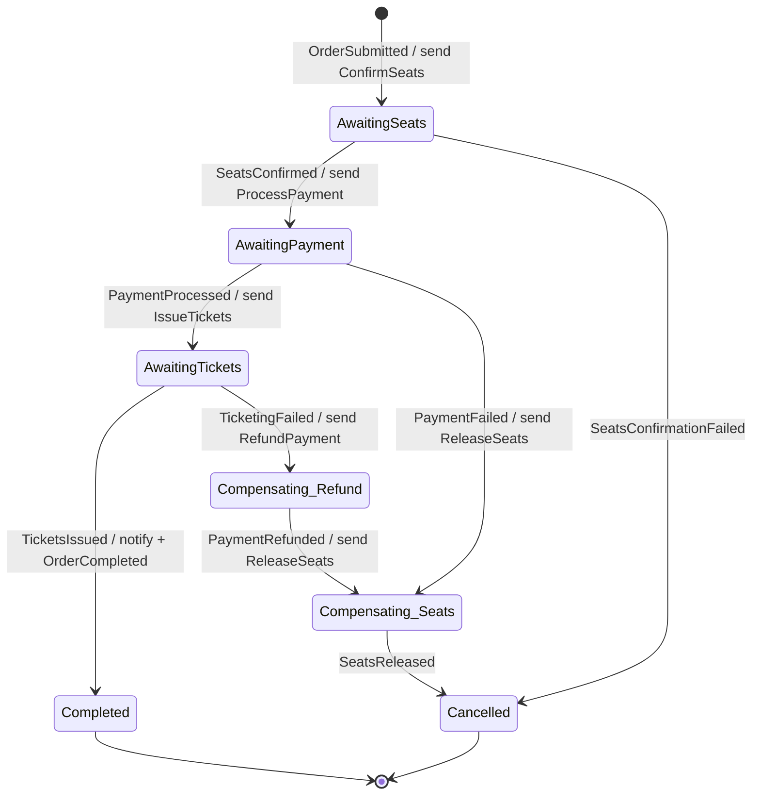

# Phase 5 — Kế hoạch chi tiết theo commit

> **Mục tiêu (từ scope mục 10):** luồng nghiệp vụ đinh (mua vé end-to-end) + chịu lỗi. Đây là nơi **Ch6/Ch7/Ch9/Ch10 hội tụ** — saga điều phối reservation → payment → ticketing → notification, có compensation khi lỗi.
> **DoD:** mua vé end-to-end thành công; **ép lỗi từng bước → hệ tự bù trừ (nhả ghế/hoàn tiền) đúng**.

> ⚠️ **Viết TRƯỚC khi code** (giống [phase-2](phase-2-plan.md)/[phase-3](phase-3-plan.md)/[phase-4-plan.md](phase-4-plan.md)). Version package + "lệch kế hoạch / bug tự bắt được" bổ sung dần khi thực thi. Đây là **phase lớn nhất** (~2.5 tuần, 11 commit) — nhiều mảnh ghép mới nhất từ đầu dự án.

---

## Bối cảnh: cái gì đã có, cái gì Phase 5 thêm

- **Đã có, sẽ được nối lại:**
  - `reservation` (Phase 2): hold/confirm/release ghế qua Redis Lua atomic + REST. Có sẵn `ReservationService.ConfirmAsync`/`ReleaseAsync` (Application) — Phase 5 **không viết lại logic Lua**, chỉ thêm **message consumer** gọi vào.
  - `ordering` (Phase 4): event-sourced qua Marten, có `Order` aggregate + `PlaceOrder`/read model `MyOrderView`. Phase 5 **mở rộng** Order với các milestone event của saga và biến `ordering` thành **host của PurchaseSaga**.
  - `BuildingBlocks.Messaging` (Phase 3): MassTransit + RabbitMQ + Outbox + `serviceName`-prefixed queue. Phase 5 dùng lại để saga gửi command / nhận event.
  - Marten (Phase 4) — dùng lại làm **saga state repository** (MassTransit.Marten), cùng Postgres với event store của ordering.
- **Phase 5 thêm mới:**
  - **MinIO** vào `docker-compose.infra.yml` (S3-compatible, lưu PDF vé).
  - `payment-service` (giả lập cổng thanh toán, **Polly** bọc lời gọi "cổng ngoài" giả) — DB `ticketflow_payment`.
  - `ticketing-service` (sinh QR + PDF → MinIO) — DB `ticketflow_ticketing`.
  - **PurchaseSaga** (MassTransit state machine) trong `ordering` — điều phối toàn luồng + compensation.
  - Message contracts mới (command + event của saga) vào `Contracts.Messaging`.

---

## Quyết định kiến trúc cho Phase 5

### 1. Orchestration saga (state machine), KHÔNG choreography (điểm học Ch9)
- **Orchestration:** 1 coordinator trung tâm (PurchaseSaga trong `ordering`) *ra lệnh* cho từng service và *phản ứng* với kết quả. Nhìn 1 chỗ là thấy toàn bộ luồng + mọi nhánh compensation.
- **Choreography** (đối trọng): mỗi service tự phản ứng với event, không có coordinator — phân tán, khó theo dõi compensation cho luồng nhiều bước. Scope chọn **orchestration** (mục 7 ghi "PurchaseSaga (MassTransit state machine)") — đúng cho luồng đinh phức tạp có bù trừ.
- Đây là điểm học Ch9 cốt lõi: saga = distributed transaction *không có* 2-phase-commit, thay bằng **chuỗi bước + bù trừ ngược khi lỗi**.

### 2. Giao tiếp saga ↔ participant = ASYNC command + event qua RabbitMQ, KHÔNG sync gRPC/REST
- Saga **gửi command** (`ConfirmSeats`, `ProcessPayment`, `IssueTickets`, và bù trừ `ReleaseSeats`, `RefundPayment`) → mỗi participant có **consumer** xử lý rồi **publish event kết quả** (`SeatsConfirmed`/`SeatsConfirmationFailed`, `PaymentProcessed`/`PaymentFailed`, `TicketsIssued`/`TicketingFailed`) → saga transition theo event.
- **Vì sao không sync (gRPC/REST) bên trong saga:** gọi sync khoá luồng, mất tính resilient (1 service chậm → saga treo), sai idiom MassTransit saga. Async command/event cho retry, redelivery, decoupling — đúng bản chất Ch9/Ch10.
- **Không đụng** gRPC `CheckSeatAvailability` (Phase 1/2) và REST hold (Phase 2) — chúng vẫn client-facing (khách chọn/xem ghế trước khi đặt). Saga dùng **đường message riêng**.
- **Hệ quả port:** `payment`/`ticketing` **không cần gRPC server** (khác bảng scope mục 4 ghi 9005/9006) — chỉ cần HTTP cho health + vài query endpoint + MassTransit consumer. Đề xuất bỏ cột gRPC của 2 service này khi reconcile scope.

### 3. Quan hệ Saga ↔ Order event-sourced (điểm tích hợp Ch7 + Ch9 — quyết định quan trọng nhất)
- **Saga instance** (`PurchaseState : SagaStateMachineInstance`) = **coordinator điều phối**, giữ `CurrentState` + dữ liệu tạm cần cho bù trừ (`HoldId`, `EventId`, `SeatIds`, `Amount`, `PaymentId`, `TicketPdfUrls`). Persist qua **Marten saga repository** (cùng Postgres với event store ordering). Correlated bằng **`OrderId`**.
- **Order aggregate** (Marten event stream, Phase 4) = **bản ghi nghiệp vụ bền vững**. Ở mỗi milestone thành công, saga **append domain event tương ứng vào stream của Order** (`SeatsConfirmed`, `PaymentAuthorized`, `TicketsIssued`, `OrderCompleted`; nhánh lỗi: `PaymentFailed`, `Refunded`, `SeatsReleased`, `OrderCancelled`) → Order phản ánh **đúng state diagram scope mục 7**, và `MyOrderView` read model tự cập nhật.
- **Phân vai rạch ròi:** saga lo *điều phối* (gửi lệnh, xử lý timeout/retry, giữ state tạm); Order event stream lo *lịch sử nghiệp vụ* (audit + read model). Khi saga kết thúc (Completed/Cancelled), MassTransit finalize saga instance (xoá), **nhưng Order event stream còn mãi** — đúng tinh thần "saga là nhạc trưởng nhất thời, event stream là bản ghi vĩnh viễn".
- **⚠️ Đây là chỗ Phase 4 tiến hoá:** `OrderConfirmed`/`OrderCancelled` thủ công của Phase 4 (Commit 3-4) được **thay bằng lifecycle do saga lái**. Endpoint confirm/cancel thủ công cũ: hoặc bỏ, hoặc giữ làm admin-override. Sẽ chốt cụ thể ở Commit 5.

### 4. `PlaceOrder` giờ KHỞI ĐỘNG saga (tích hợp với Phase 4)
- Luồng thật (scope mục 7): khách **hold ghế trước** (reservation REST, Phase 2 — nhận `holdId`), rồi **"bấm thanh toán"** → gọi `POST /ordering/orders` (PlaceOrder **mở rộng**: mang thêm `HoldId`, `Amount`, `PaymentMethod`).
- PlaceOrder → append `OrderPlaced` (mở rộng field) → publish `OrderSubmitted` event → saga `Initially(When(OrderSubmitted))` tạo instance, bắt đầu bước B1 `ConfirmSeats`.
- **Không** hold ghế bên trong saga — hold đã xong trước đó; saga chỉ *chốt* (confirm) hold đang giữ. Nếu hold hết TTL trước khi khách bấm thanh toán → Redis tự nhả (Phase 2) → `ConfirmSeats` fail → saga vào nhánh cancel. Đây là 1 trong 3 kịch bản lỗi của DoD, **không cần code mới** để "nhả hold hết hạn".

### 5. Resiliency = Polly bọc lời gọi "cổng ngoài" giả trong payment-service (điểm học Ch10)
- **Polly 8.x** (`ResiliencePipeline` API mới, free BSD-3). `payment-service` có 1 `FakePaymentGatewayClient` mô phỏng gọi cổng thanh toán ngoài (có thể ép fail/timeout/chập chờn theo input để test). Lời gọi này **bọc Polly**: **retry** (lỗi transient) + **circuit breaker** (cổng sập liên tục → mở mạch, fail nhanh) + **timeout**.
- Đây là nơi Ch10 sống thật: không phải bọc Polly khắp nơi, mà **đúng chỗ ranh giới gọi hệ thống ngoài không đáng tin** (payment gateway). Ghi rõ để không rải Polly bừa.
- **Timeout của hold** (kịch bản lỗi thứ 3) do **Redis TTL** lo sẵn (Phase 2) — không phải Polly timeout. Phân biệt rõ 2 loại timeout.

### 6. Idempotency = bật MassTransit Inbox (nợ kỹ thuật từ Phase 3, giờ trả)
- Bus giao **at-least-once** → command có thể tới 2 lần. Giờ payment/ticketing **ghi state thật** (charge tiền, phát vé) → xử lý trùng = **charge 2 lần / phát 2 vé** = hậu quả thật, không như consumer chỉ-log của Phase 3.
- Bật **MassTransit EF Core/Marten Inbox** ở payment + ticketing (đúng như ghi chú "Hướng mở rộng" Phase 3 đã hẹn: *"bật inbox khi consumer bắt đầu ghi state"*). Cộng thêm **idempotency key nghiệp vụ** (dedup theo `OrderId`/`PaymentId`) để chắc chắn 2 lớp.
- Compensation cũng phải idempotent: `RefundPayment` gọi 2 lần chỉ hoàn 1 lần; `ReleaseSeats` gọi 2 lần chỉ nhả 1 lần (reservation Phase 2 đã idempotent sẵn — release nhầm holdId là no-op).

### 7. Ticketing: QR + PDF → MinIO
- **QR:** `QRCoder` (MIT, free) — mỗi ghế 1 QR chứa mã vé (ký/hash để chống giả, verify ở cổng — phần scan cổng là **Phase 8**, Phase 5 chỉ phát + lưu).
- **PDF:** `QuestPDF` — nuspec ghi MIT nhưng bản mới yêu cầu set `QuestPDF.Settings.License = LicenseType.Community` lúc khởi động (Community **free** cho phi-thương-mại/doanh thu <$1M — đúng dự án học). Ghi chú như đã làm cho MassTransit/MediatR: đây là package có điều khoản license cần biết, nhưng **hợp lệ & miễn phí** cho ngữ cảnh này. Xác minh setup lúc code (Commit 3).
- **MinIO:** SDK `Minio` 7.x (hoặc `AWSSDK.S3` cho tính S3-generic). Đề xuất **Minio SDK** cho trực tiếp. MinIO thêm vào infra (Commit 1). Ticketing upload PDF → trả về URL/object key, đính vào `TicketsIssued` event.

### 8. Ports + reconcile scope (cần chốt)
- **Va chạm thật:** Phase 3 đã lấy **8005** (notification) + **8006** (search), nhưng scope mục 4 gán payment=8005, ticketing=8006 → bảng port scope **đã lệch thực tế** từ Phase 3.
- **Đề xuất (chờ bạn duyệt ở Commit 11):** giữ nguyên notification 8005 / search 8006 (đang chạy), gán **payment 8007**, **ticketing 8008** (HTTP; không gRPC — xem mục 2). Reconcile bảng port scope 1 lần cho khớp thực tế. *(Đây là quyết định port thuần, sẽ hỏi lại khi finalize — mặc định plan đi theo đề xuất này.)*

### 9. Kế thừa & hạ tầng
- Central Package Management, native OpenAPI + Scalar (service có HTTP), EF Core snake_case (payment/ticketing dùng EF Core state-based — chúng **không** event-sourced, khác ordering), `Ignore(DomainEvents)` + ctor rỗng, `Guard`/`ValueObject`, exception middleware, health check, migrate-on-startup, cập nhật `.slnx` + Dockerfile + `docker-compose.yml` mỗi khi thêm project/service.
- **payment/ticketing state-based (EF Core), KHÔNG event-sourced** — chúng là service CRUD nghiệp vụ đơn giản (bản ghi charge, bản ghi vé); event sourcing chỉ đáng cho `ordering` (aggregate có lifecycle phức tạp). Tránh vàng hoá — không phải service nào cũng cần Marten.

---

## Nhóm A — Infra + participant skeletons + contracts

### Commit 1 — `feat(infra): MinIO + saga message contracts`
- `docker-compose.infra.yml`: thêm `minio` (API 9000 + console 9001, root user/pass, volume). Khởi tạo bucket `tickets` (init container hoặc lazy-create trong ticketing lúc start).
- `Contracts.Messaging`: thêm **command** (`ConfirmSeats`, `ReleaseSeats`, `ProcessPayment`, `RefundPayment`, `IssueTickets`) + **event** (`SeatsConfirmed`/`SeatsConfirmationFailed`, `PaymentProcessed`/`PaymentFailed`, `TicketsIssued`/`TicketingFailed`, `OrderSubmitted`, `OrderCompleted`, `OrderCancelledIntegrationEvent`), đặt dưới `Ordering/`, `Payment/`, `Ticketing/`, `Reservation/`. Tất cả mang `OrderId` để correlate.
- **Verify:** build; MinIO console mở được ở `:9001`, tạo bucket `tickets` thành công (mc/console hoặc SDK ping).

### Commit 2 — `feat(payment): service skeleton + Polly-wrapped fake gateway`
- Service mới `payment` (port **8007**, DB `ticketflow_payment`, EF Core state-based). `Payment` entity (OrderId, Amount, Status, GatewayRef, timestamps).
- `FakePaymentGatewayClient` (mô phỏng cổng ngoài — ép fail/timeout/chập chờn theo input: ví dụ `Amount` tận cùng `.13` → luôn fail, để test deterministic) **bọc Polly** `ResiliencePipeline` (retry + circuit breaker + timeout).
- Consumer stub `ProcessPayment`/`RefundPayment` (chưa publish event — Commit 7). Health check DB.
- **Verify thật:** app start, migrate DB, `/health` 200; unit test Polly pipeline (fake gateway fail N lần → retry → circuit mở đúng ngưỡng).

### Commit 3 — `feat(ticketing): service skeleton + QR/PDF → MinIO`
- Service mới `ticketing` (port **8008**, DB `ticketflow_ticketing`, EF Core). `Ticket` entity (OrderId, SeatId, QrPayload, PdfObjectKey, IssuedAt).
- `QRCoder` sinh QR/ghế; `QuestPDF` render PDF (set `LicenseType.Community` lúc start — verify điều khoản); `Minio` SDK upload PDF → bucket `tickets`, trả object key/URL.
- Consumer stub `IssueTickets` (chưa publish event — Commit 8). Health check DB + MinIO reachable.
- **Verify thật:** sinh 1 PDF mẫu + upload → `mc ls`/console thấy object trong bucket `tickets`; tải về mở được, có QR đúng.

---

## Nhóm B — PurchaseSaga (trái tim Phase 5)

### Commit 4 — `feat(ordering): PurchaseSaga state machine (happy path)`
- `PurchaseState : SagaStateMachineInstance` (CorrelationId=OrderId, CurrentState, HoldId, EventId, SeatIds, Amount, PaymentId, TicketPdfUrls). Persist qua **MassTransit.Marten saga repository** (pin `MassTransit.Marten` 8.5.10).
- `PurchaseSaga : MassTransitStateMachine<PurchaseState>` — happy path: `OrderSubmitted` → send `ConfirmSeats` → on `SeatsConfirmed` → send `ProcessPayment` → on `PaymentProcessed` → send `IssueTickets` → on `TicketsIssued` → send `NotifyOrderCompleted` + publish `OrderCompleted` → Finalize.
- **Chưa** nối participant thật (Nhóm C) — verify saga bằng participant **giả** (test harness MassTransit) đi hết happy path.
- **Verify thật:** MassTransit `TestHarness` (in-memory) — feed `OrderSubmitted` → assert saga đi đúng chuỗi state → kết thúc `Completed`; saga state persist/rehydrate đúng qua Marten (integration test với Postgres thật).

### Commit 5 — `feat(ordering): Order milestone events + PlaceOrder starts saga`
- Mở rộng `Order` (Phase 4): thêm event `SeatsConfirmed`/`PaymentAuthorized`/`TicketsIssued`/`OrderCompleted` + nhánh lỗi `PaymentFailed`/`Refunded`/`SeatsReleased` (+ `OrderCancelled` đã có) + `Apply` tương ứng. `MyOrdersProjection` cập nhật `Status` theo milestone mới.
- `PlaceOrderCommand` mở rộng: `HoldId`, `Amount`, `PaymentMethod`. `PlaceOrderCommandHandler` sau khi `StartStream(OrderPlaced)` → publish `OrderSubmitted` (qua Outbox) khởi động saga.
- Saga ở mỗi milestone: append event tương ứng vào Order stream (qua `IOrderStore`/command nội bộ ordering).
- **Chốt số phận endpoint confirm/cancel thủ công Phase 4:** bỏ khỏi luồng khách (saga lái), giữ lại (nếu cần) chỉ như admin-override — ghi rõ khi code.
- **Verify thật qua gateway:** place order (participant vẫn giả ở commit này hoặc dùng harness) → `psql mt_events` thấy chuỗi milestone event; `MyOrderView.Status` tiến đúng theo saga.

---

## Nhóm C — Nối participant thật vào saga

### Commit 6 — `feat(reservation): ConfirmSeats/ReleaseSeats command consumers`
- Consumer `ConfirmSeats` → gọi `ReservationService.ConfirmAsync` (Phase 2, **không viết lại Lua**) → publish `SeatsConfirmed` (kèm seatIds) hoặc `SeatsConfirmationFailed` (hold hết hạn/không tồn tại). Consumer `ReleaseSeats` → `ReleaseAsync` → publish kết quả (dùng cho compensation).
- Reservation giờ ref `TicketFlow.Messaging` + đăng ký consumer (`serviceName: "reservation"`).
- **Verify thật:** hold ghế thật (REST) → gửi `ConfirmSeats` qua bus → `psql`/Redis xác nhận ghế `Sold`; hold hết TTL rồi mới confirm → `SeatsConfirmationFailed`.

### Commit 7 — `feat(payment): ProcessPayment/RefundPayment + resiliency + idempotency`
- Consumer `ProcessPayment` → gọi `FakePaymentGatewayClient` (Polly) → ghi `Payment` (Postgres) → publish `PaymentProcessed`(PaymentId) / `PaymentFailed`(reason). Consumer `RefundPayment` → hoàn tiền idempotent → `PaymentRefunded`.
- Bật **MassTransit Inbox** (payment DbContext) + idempotency key theo `OrderId` — xử lý `ProcessPayment` 2 lần chỉ charge 1 lần.
- **Verify thật:** gửi `ProcessPayment` bình thường → `PaymentProcessed` + row Postgres; gửi lại y hệt (trùng) → **không** charge lần 2; gửi với Amount ép-fail → Polly retry đúng số lần → cuối cùng `PaymentFailed`.

### Commit 8 — `feat(ticketing): IssueTickets + QR/PDF/MinIO + idempotency`
- Consumer `IssueTickets` → sinh QR/ghế → render PDF → upload MinIO → ghi `Ticket` (Postgres) → publish `TicketsIssued`(pdfUrls) / `TicketingFailed`. Bật Inbox + dedup theo `OrderId` (phát vé 2 lần = no-op, trả về vé đã phát).
- **Verify thật:** gửi `IssueTickets` → `TicketsIssued` + PDF trong MinIO + row Postgres; gửi lại trùng → không tạo PDF/vé mới; ép lỗi (MinIO down) → `TicketingFailed`.

---

## Nhóm D — Compensation + failure tests + chốt

### Commit 9 — `feat(ordering): saga compensation branches + notify`
- Nhánh bù trừ trong saga (đúng bảng compensation scope mục 7):
  - `PaymentFailed` → send `ReleaseSeats` → on release done → append `SeatsReleased`+`OrderCancelled`, publish `OrderCancelledIntegrationEvent`, Finalize.
  - `TicketingFailed` → send `RefundPayment` → on `PaymentRefunded` → send `ReleaseSeats` → append `Refunded`+`SeatsReleased`+`OrderCancelled`, Finalize.
  - `SeatsConfirmationFailed` (hold hết hạn) → append `OrderCancelled` ngay (chưa charge, chưa cần refund/release).
- Happy path cuối: send `NotifyOrderCompleted` → `notification` consume → log/gửi "vé của bạn" (tái dùng notification Phase 3).
- **Verify thật:** đi từng nhánh bằng participant thật + ép lỗi.

### Commit 10 — `test(saga): 3 kịch bản lỗi — DoD compensation` ⭐
- **Đây là bằng chứng DoD phần 2.** Verify runtime thật (Docker, không mock), 3 kịch bản scope mục 7:
  1. **Payment fail:** hold → place order (Amount ép-fail) → saga: ConfirmSeats OK → ProcessPayment fail → **ReleaseSeats** → ghế về `Available` (Redis+Postgres), Order `Cancelled`. Xác nhận **không charge**, ghế **được nhả**.
  2. **Ticketing fail:** hold → place (ép MinIO/ticketing lỗi) → saga: Confirm OK → Payment OK → IssueTickets fail → **RefundPayment** (Postgres payment `Refunded`) → **ReleaseSeats** → Order `Cancelled`. Xác nhận **tiền được hoàn**, ghế nhả.
  3. **Hold hết TTL trước thanh toán:** hold TTL ngắn → chờ hết hạn → place order → ConfirmSeats fail (hold không còn) → Order `Cancelled` ngay, không charge. Redis tự nhả (không cần code).
- Cân nhắc Testcontainers cho 1-2 kịch bản (như Phase 2 Commit 10) — quyết định lúc code (saga end-to-end cần nhiều container, có thể verify thủ công qua Docker là đủ).

### Commit 11 — `chore: finalize Phase 5 — routes, DoD checklist, reconcile ports`
- `.slnx` đủ project mới; `docker compose ps` đủ container (thêm payment, ticketing, minio); gateway route `payment`/`ticketing` (nếu phơi query endpoint xem trạng thái thanh toán/vé).
- **Reconcile scope port table** (đã hỏi & duyệt): payment 8007, ticketing 8008 (không gRPC), notification/search giữ 8005/8006. Tick DoD Phase 5.
- Happy path end-to-end 1 lần cuối qua gateway; cập nhật doc này.

---

## Sơ đồ PurchaseSaga (state machine)

*Saga (coordinator) chạy state machine này; mỗi transition thành công cũng append domain event tương ứng vào **event stream của Order** (Phase 4) — nên Order phản ánh đúng lifecycle, `MyOrderView` cập nhật, và stream tồn tại vĩnh viễn kể cả sau khi saga instance bị finalize.*

---

## Kiểm chứng DoD cuối Phase 5

| DoD | Kiểm chứng |
|---|---|
| Mua vé end-to-end thành công | Commit 9/11: hold → place → saga Confirm→Payment→Tickets→Notify → Order `Completed`, PDF trong MinIO, `MyOrderView` = Completed |
| Payment fail → tự bù trừ | Commit 10 KB1: ProcessPayment fail → ReleaseSeats → ghế `Available`, Order `Cancelled`, không charge |
| Ticketing fail → hoàn tiền + nhả ghế | Commit 10 KB2: IssueTickets fail → RefundPayment → ReleaseSeats → Order `Cancelled` |
| Hold hết hạn → ghế trở lại còn trống | Commit 10 KB3: Redis TTL tự nhả → ConfirmSeats fail → Order `Cancelled` (không code mới) |
| Idempotent | Commit 7/8: gửi trùng ProcessPayment/IssueTickets → không charge/phát vé lần 2 (Inbox + key nghiệp vụ) |
| Resiliency | Commit 2/7: Polly retry + circuit breaker quanh fake payment gateway |

## Hướng mở rộng (backlog — không thuộc Phase 5)
- **Scan vé tại cổng** (`gate-scanner` validate QR): Phase 8 (frontend + scanner).
- **Cổng thanh toán thật** (Stripe/VNPay...): thay `FakePaymentGatewayClient`; interface đã tách sẵn để đổi adapter.
- **Saga timeout/scheduling** (MassTransit `Schedule`) cho bước treo lâu (payment không phản hồi) — thêm khi cần siết SLA.
- **Bulkhead isolation** (Ch10) — nếu 1 participant chậm làm nghẽn pool: thêm Polly bulkhead, chưa cần ở quy mô học.

## Thứ tự đọc sách trước khi code (scope mục 13)
Đọc **Ch9 (Saga)** — orchestration vs choreography, distributed transaction không 2PC, compensation/rollback ngược, state machine. Và **Ch10 (Resiliency)** — retry, circuit breaker, timeout, bulkhead, idempotency, graceful degradation. Bổ sung ngoài sách: **MassTransit State Machine Saga** (Automatonymous API: `Initially`/`During`/`When`/`TransitionTo`), **saga persistence** (Marten saga repo), **MassTransit Inbox/Outbox** cho idempotency; **Polly v8** (`ResiliencePipeline`, khác v7 `Policy`); tài liệu **QuestPDF** (Community license), **QRCoder**, **MinIO .NET SDK**.
