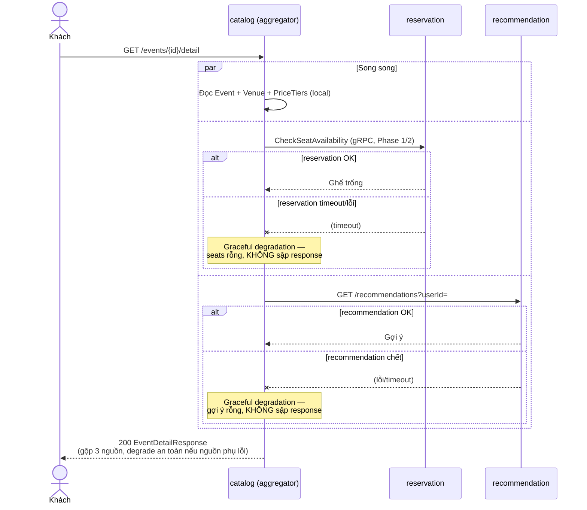
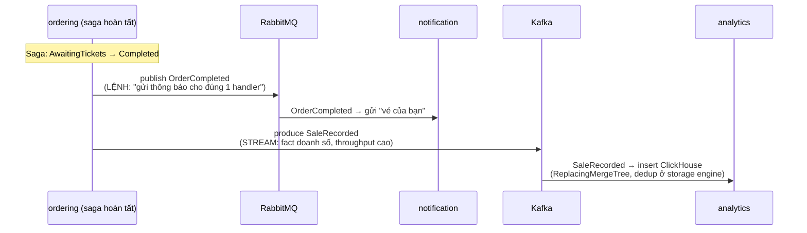

# Phase 6 — Kế hoạch chi tiết theo commit

> **Mục tiêu (từ scope mục 10):** dữ liệu đọc phong phú + phân tích. Đây là nơi **Ch5 (Aggregator)** + **Ch8 (polyglot persistence)** sống thật, và là chỗ **Kafka cuối cùng được bật** (đúng hẹn từ Phase 3) để tương phản với RabbitMQ (Ch4).
> **DoD:** ✅ tìm sự kiện qua Elasticsearch; ✅ trang chi tiết 1 request trả dữ liệu gộp nhiều nguồn; ✅ dashboard doanh số query ClickHouse.

> ⚠️ **Viết TRƯỚC khi code** (giống [phase-2](phase-2-plan.md)/[phase-3](phase-3-plan.md)/[phase-4](phase-4-plan.md)/[phase-5](phase-5-plan.md)). Version package + "lệch kế hoạch / bug tự bắt được" bổ sung dần khi thực thi. Phase này gồm **4 mảng gần như độc lập** (search, recommendation, aggregator, analytics) — mỗi mảng dựng & verify được riêng, nên rủi ro thấp hơn Phase 5 dù thêm nhiều hạ tầng mới nhất từ đầu dự án (3 datastore mới + 1 transport mới).

---

## Bối cảnh: cái gì đã có, cái gì Phase 6 thêm

- **Đã có, sẽ được nối/nâng cấp:**
  - `search` (Phase 3): **skeleton** — chỉ có `CatalogEventPublishedConsumer` log-only, chưa ES, chưa endpoint. Phase 6 biến nó thành thật.
  - `notification` (Phase 3+5): consume `CatalogEventPublished` + `NotifyOrderCompleted` (log-only) — không đụng ở Phase 6, chỉ tham chiếu làm mẫu consumer.
  - `catalog` (Phase 1/3): `Event` aggregate + đã publish `CatalogEventPublished` qua **Outbox** khi `EventPublished` domain event dispatch. Phase 6 **mở rộng** contract này + thêm 2 integration event mới (reschedule/cancel).
  - `ordering` (Phase 4/5): publish `OrderCompleted` (RabbitMQ) khi saga xong. Phase 6 dùng điểm này để **feed analytics** (Kafka) + **feed recommendation** (purchase history).
  - `reservation` (Phase 2/5): có gRPC `CheckSeatAvailability` + REST availability — aggregator tái dùng, **không viết lại**.
  - `BuildingBlocks.Messaging` (Phase 3): `AddTicketFlowMessaging` (RabbitMQ) **thiết kế sẵn để thêm Kafka Rider không phá vỡ** — giờ trả nợ đó.
  - **Kafka** đã chạy sẵn trong `docker-compose.infra.yml` từ Phase 0 (KRaft, `kafka:9092` nội bộ / `localhost:29092` host) — **không cần đụng Kafka infra**, chỉ nối vào MassTransit.
- **Phase 6 thêm mới (hạ tầng):**
  - **Elasticsearch 8** vào `docker-compose.infra.yml` (single-node, security off cho dev) — full-text search sự kiện.
  - **MongoDB 7** — read model recommendation.
  - **ClickHouse** — kho cột cho analytics.
- **Phase 6 thêm mới (service/tính năng):**
  - `search` nâng cấp: index thật vào ES + REST search endpoint (theo artist/venue/city/ngày + full-text title).
  - `recommendation-service` (**mới**, Mongo) — gợi ý đơn giản từ purchase history thật.
  - `analytics-service` (**mới**, ClickHouse) — consume stream doanh số qua **Kafka Rider** → ClickHouse + query tổng hợp.
  - **Aggregator endpoint** (Ch5) — gộp catalog + ghế trống + gợi ý cho trang chi tiết sự kiện.
  - Contract mới: `CatalogEventRescheduled`/`CatalogEventCancelled` (giữ index đồng bộ), `SaleRecorded` (feed analytics qua Kafka).

---

## Quyết định kiến trúc cho Phase 6

### 1. Bốn mảng độc lập — làm tuần tự, mỗi mảng verify được riêng
- Khác Phase 5 (một saga xuyên suốt, các commit phụ thuộc chặt), Phase 6 là **4 tính năng gần như rời nhau**: Search (ES), Recommendation (Mongo), Aggregator (composition), Analytics (Kafka+ClickHouse). Thứ tự chọn theo **độ phụ thuộc dữ liệu**: Search & Recommendation trước (tự đứng được), Aggregator sau (cần Recommendation đã tồn tại để gộp), Analytics cuối (rủi ro cao nhất — Kafka Rider mới toanh, để cuối tránh chặn các mảng khác).
- Mỗi mảng = 1 nhóm commit, verify thật độc lập (không phải chờ cả phase xong mới test được).

### 2. Search: ES là READ MODEL, source of truth vẫn ở catalog — giữ đồng bộ bằng event
- **ES không phải DB gốc** — chỉ là chỉ mục đọc tối ưu full-text. Nếu ES mất sạch, rebuild lại từ catalog được (giống MyOrderView rebuild từ event stream, Phase 4). Không bao giờ ghi thẳng vào ES như system-of-record.
- **🔑 Quyết định: enrich `CatalogEventPublished` thay vì search gọi ngược catalog.** Contract hiện tại chỉ có `CatalogEventId/Title/VenueId/StartsAt/PublishedAt` — **thiếu `Artist` và tên/thành phố venue** mà search cần ("tìm theo nghệ sĩ/venue/thành phố", scope mục 4). 2 lựa chọn:
  - (a) search consume event xong **gọi REST/gRPC ngược về catalog** để lấy artist + venue → thêm coupling đồng bộ, đánh mất tính "consumer act without callback" mà chính doc comment của `CatalogEventPublished` cam kết.
  - (b) **catalog denormalize** artist + venue name + city vào event khi publish (catalog **có sẵn** cả `Event.Artist` lẫn `Venue` aggregate để đọc) → consumer tự đủ dữ liệu index, đúng idiom pub/sub.
  - **Chọn (b).** Enrich là thêm field (backward-compatible — notification bỏ qua field thừa vẫn chạy). Đây cũng là 1 điểm học Ch4/Ch8 thật: event mang đủ dữ liệu để read-side tự chủ.
- **Giữ index đồng bộ khi sự kiện đổi:** catalog hiện chỉ publish integration event lúc **Publish**. Reschedule/Cancel chỉ raise domain event **in-process**, chưa có integration event → ES sẽ "chết cứng" ở dữ liệu cũ. Thêm `CatalogEventRescheduled`/`CatalogEventCancelled` (catalog publish qua Outbox) → search update/remove doc. Đây là bài học thật: **read model phải nghe MỌI thay đổi của nguồn**, không chỉ lúc tạo.
- **Client:** `Elastic.Clients.Elasticsearch` 8.x (client chính thức, thay NEST cũ). **Probe lúc code:** xác nhận license client (Apache-2.0, khác server ES vốn Elastic License 2.0 — nhưng self-host học tập thì OK) + target net10. Index idempotent theo `CatalogEventId` (upsert theo doc id — consume trùng ghi đè cùng doc, không nhân bản).

### 3. Kafka Rider bật ở đây — nhưng scope CHẶT: chỉ 1 stream analytics, tương phản rõ với RabbitMQ
- **Đúng hẹn Phase 3** (đã phản biện & duyệt: hoãn Kafka tới khi có consumer thật cần ngữ nghĩa stream). Analytics doanh số **chính là** use case đó: event log throughput cao, nhiều consumer, replay được.
- **KHÔNG Kafka-hoá mọi thứ.** RabbitMQ vẫn giữ nguyên vai trò **lệnh/saga** (ConfirmSeats, ProcessPayment... — Phase 5). Kafka chỉ chở **1 stream sự kiện phân tích** (`SaleRecorded`). Đây đúng là bài học Ch4 "chọn đúng công cụ cho đúng kiểu giao tiếp" — phải thấy **cả hai** transport sống cạnh nhau, đúng mục đích khác nhau (scope mục 5 "Vì sao cả Kafka lẫn RabbitMQ").
- **🐛 Rủi ro cao nhất phase — probe TRƯỚC khi code (giống MassTransit.Marten Phase 5):** `MassTransit.Kafka` Rider phải còn trong **dòng 8.5.x free** (9.x đã thương mại) + chạy net10. Dùng reflection probe API Rider (`AddRider`/`AddProducer`/`AddConsumer` topic) như đã làm với Marten/Minio. **Fallback nếu Rider quá hạn chế:** `Confluent.Kafka` client thô (Apache-2.0) — chấp nhận mất tính nhất quán với `AddTicketFlowMessaging` nhưng đảm bảo chạy được. Ghi rõ lựa chọn cuối lúc code.
- **Ai produce `SaleRecorded`?** `ordering` — ngay điểm saga publish `OrderCompleted` (RabbitMQ, cho notification), produce thêm `SaleRecorded` **lên Kafka topic** (fact denormalized: `OrderId`, `EventId`, `SeatCount`, `Amount`, `CompletedAt`). Cùng 1 thời điểm nghiệp vụ, 2 transport, 2 mục đích — minh hoạ tương phản rõ nhất.

### 4. Analytics idempotency KHÁC Phase 5: dedup ở schema ClickHouse, không dùng EF Inbox
- Kafka cũng **at-least-once** → `SaleRecorded` có thể tới 2 lần → **cộng dồn doanh số 2 lần** (hậu quả thật). Nhưng ClickHouse là kho **append-oriented** (không update-in-place như Postgres), và MassTransit EF Inbox (Phase 5) **không áp dụng** cho ClickHouse.
- **Chọn dedup ở tầng schema:** ClickHouse `ReplacingMergeTree` khoá theo `OrderId` → bản ghi trùng tự collapse khi merge. Đây là điểm học ClickHouse thật (Ch16): idempotency là **thuộc tính storage engine**, không phải middleware. Query analytics dùng `FINAL` hoặc aggregate chấp nhận eventual-dedup — chốt lúc code.
- Tương phản đẹp với Phase 5 (EF Inbox cho Postgres) — cùng bài toán at-least-once, 2 lời giải khác nhau theo đặc tính datastore.

### 5. Recommendation: "theo thể loại" BẤT KHẢ THI với dữ liệu hiện có — làm theo artist/venue/popular
- **Phản biện scope thẳng:** scope ghi "gợi ý theo **thể loại**/lịch sử". Nhưng `catalog.Event` **không có field thể loại/genre** (chỉ `Title/Description/Artist/VenueId/Schedule`). Gợi ý theo thể loại là **vaporware** — không có dữ liệu.
- **Làm được thật từ dữ liệu đang có:** consume `OrderCompleted` → build purchase history (user → đã mua event nào, artist nào, venue nào) trong Mongo. Gợi ý đơn giản, không ML:
  - "Sự kiện khác của **cùng nghệ sĩ**" bạn từng mua.
  - "Sự kiện khác tại **venue** bạn từng đến."
  - "Sự kiện **phổ biến**" (nhiều lượt mua nhất) — fallback cho user chưa có lịch sử (cold start).
- Điểm học **không phải** thuật toán gợi ý mà là: **service + Mongo làm read model + event-driven** (build view từ stream OrderCompleted, giống MyOrderView build từ event). Giữ dead-simple, đúng "tránh vàng hoá" (scope mục cuối).
- **Client:** `MongoDB.Driver` (Apache-2.0, không bẫy license). Upsert purchase-history doc theo `userId` (idempotent, consume trùng OrderCompleted không nhân đôi).

### 6. Aggregator (Ch5): DROP "review", gộp 3 nguồn THẬT + fan-out song song + graceful degradation
- **Phản biện scope: bỏ "review" khỏi aggregator Phase 6.** Scope ghi "catalog + ghế trống + review + gợi ý". Nhưng **không có review-service, không có dữ liệu review** ở bất kỳ đâu trong hệ. Xây cả một review capability chỉ để có nguồn thứ 4 là **scope creep** — Ch5 (Aggregator) minh hoạ trọn vẹn với **3 nguồn thật**: catalog (chi tiết event) + reservation (ghế trống, gRPC/REST đã có) + recommendation (gợi ý, vừa xây). Review → **backlog** (cần cả service riêng, không phải điểm của Ch5).
- **Fan-out song song** (`Task.WhenAll`) 3 nguồn — đúng bản chất Ch5 (gộp nhiều nguồn thành 1 response, không gọi tuần tự chậm).
- **Graceful degradation (nối Ch10):** nếu recommendation chết → vẫn trả catalog + seats (gợi ý rỗng), không sập cả trang. Aggregator **không** để 1 nguồn phụ kéo sập response chính. Đây là điểm học thật, verify bằng cách tắt recommendation container rồi gọi endpoint.
- **🔑 Quyết định cần chốt — aggregator đặt ở đâu?** Bảng service scope (mục 4) **không liệt kê** aggregator-service. 2 lựa chọn (mặc định plan đi theo (a), sẽ hỏi lại ở Commit 5):
  - **(a) Endpoint trong `catalog`** (`GET /events/{id}/detail`) fan-out sang reservation (gRPC, đã có) + recommendation (REST). Ưu: không thêm service ngoài bảng scope; catalog là chủ tự nhiên của "trang chi tiết sự kiện". Nhược: catalog (vốn write-side DDD) mọc thêm outbound HTTP/gRPC client → hơi lấn bounded context.
  - **(b) `aggregator-service` riêng, mỏng.** Ưu: minh hoạ Ch5 "aggregator là 1 component độc lập" sạch nhất, không bẩn catalog. Nhược: thêm service ngoài bảng scope (phải reconcile scope như Phase 5 đã làm với payment/ticketing).
  - **Đề xuất (a)** cho kỷ luật YAGNI (không thêm service khi 1 endpoint đủ) + đúng "trang chi tiết là catalog-centric"; ghi rõ trade-off. BFF/gateway-level aggregation là chuyện **Phase 7** (Ch11), không preempt ở đây.

### 7. Polyglot persistence (Ch8) hiện thực đúng nghĩa — mỗi store cho đúng loại query
- Phase 6 là chỗ **Ch8 "database strategies" sống thật nhất**: đến giờ mới thấy đủ Postgres (catalog/ordering/payment/ticketing) + Redis (reservation) + **ES** (search full-text) + **Mongo** (recommendation doc linh hoạt) + **ClickHouse** (analytics cột). Mỗi store chọn vì **đặc tính query**, không phải theo thói quen:
  - ES: full-text + filter đa chiều (artist/city/date-range) — Postgres `LIKE` không kham nổi.
  - Mongo: doc gợi ý theo user, schema linh hoạt, không cần join.
  - ClickHouse: aggregate doanh số throughput cao trên cột — Postgres OLTP không tối ưu cho OLAP.
- **DB-per-service giữ nguyên** — không service nào đọc thẳng DB service khác; đồng bộ qua event (search/recommendation/analytics đều build read model từ integration event, không query chéo DB).

### 8. Kế thừa & hạ tầng
- Central Package Management; native OpenAPI + Scalar cho service có HTTP; health check cho **từng datastore mới** (ES ping, Mongo ping, ClickHouse ping — tự cuộn như RedisHealthCheck/MartenHealthCheck Phase 2/4, không kéo package nặng); index/collection/table **setup-on-startup** (tương đương migrate-on-startup); cập nhật `.slnx` + Dockerfile + `docker-compose.yml` mỗi service mới.
- **serviceName-prefixed queue** (Phase 3): recommendation + analytics + search consumer đều truyền serviceName riêng vào `AddTicketFlowMessaging`.
- **Search/recommendation/analytics đều state-based read model** (không event-sourced) — chúng là projection thuần từ event, không có aggregate lifecycle phức tạp. Đúng nguyên tắc Phase 5 mục 9 (chỉ ordering đáng event-source).

---

## Nhóm A — Search + Elasticsearch

### Commit 1 — `feat(infra): Elasticsearch + enrich catalog integration events`
- `docker-compose.infra.yml`: thêm `elasticsearch:8.15.3` (`discovery.type=single-node`, `xpack.security.enabled=false` cho dev, heap giới hạn 512MB, healthcheck `curl :9200/_cluster/health` grep `green|yellow`). Volume `es-data` riêng.
- **Enrich `CatalogEventPublished`**: thêm `Artist`, `VenueName`, `City`. `EventService.PublishAsync` giờ **load thêm `Venue`** (trước đây không cần, chỉ dùng `Event`) để denormalize `venue.Name`/`venue.Address.City` vào event lúc publish — đúng thời điểm catalog có sẵn cả 2 aggregate trong tay. Backward-compatible: consumer cũ (`search`/`notification`, Phase 3) chỉ đọc `Title`/`CatalogEventId` nên không bị ảnh hưởng.
- **Thêm 2 contract mới** `Contracts.Messaging/Catalog/`: `CatalogEventRescheduled(CatalogEventId, StartsAt, EndsAt)`, `CatalogEventCancelled(CatalogEventId)`.
- **🔧 Làm rõ cơ chế publish (khác cách plan gốc diễn đạt "nối vào dispatch domain event"):** Catalog **không có** cơ chế tự động dịch domain event → integration event — `EventConfiguration.cs` có `builder.Ignore(e => e.DomainEvents)`, nghĩa là `EventRescheduled`/`EventCancelled` (domain event, raise qua `Raise()`) **đi vào hư không**, EF Core bỏ qua hoàn toàn, không hề có dispatcher nào đọc chúng. Cách publish integration event **duy nhất** đang tồn tại (từ `PublishAsync`, Phase 3) là: **gọi tay** `integrationEventPublisher.PublishAsync(...)` ngay trong `EventService`, **trước** `SaveChangesAsync()` (để Outbox interceptor gom vào cùng transaction). Đã áp dụng **đúng pattern này** cho `RescheduleAsync`/`CancelAsync` — không phải "nối vào" một dispatcher có sẵn (không có), mà thêm lời gọi thủ công y hệt `PublishAsync` đã làm.
- **Verify thật, đầy đủ qua RabbitMQ + REST (không mock):**
  1. `docker compose up elasticsearch` → `curl :9200/_cluster/health` → `"status":"green"`.
  2. Tạo venue + event + seatmap + section + price-tier + publish thật qua gateway → 2 consumer cũ (`search`/`notification`) vẫn nhận đúng, không lỗi (xác nhận backward-compat).
  3. Scratch app (đã xoá sau khi xong) bind receive-endpoint tạm, bắt **đúng payload thật** của `CatalogEventPublished` cho 1 event mới (venue "My Dinh National Stadium", city "Ha Noi", artist "Ngot Band") → xác nhận cả 3 field enrich đúng 100%: `Artist=Ngot Band VenueName=My Dinh National Stadium City=Ha Noi`.
  4. Reschedule + Cancel event đã publish trước đó (qua REST thật) → scratch app xác nhận nhận đúng `CatalogEventRescheduled` (StartsAt/EndsAt mới) và `CatalogEventCancelled` (đúng `CatalogEventId`) — cả 2 message **thật lần đầu tồn tại**, trước đây domain event tương ứng chưa từng ra khỏi process.
  5. **Lưu ý xác minh riêng, không phải bug:** lần chạy đầu tiên timing quá gấp (chờ 4s trước khi gọi REST) khiến scratch consumer **chưa kịp bind queue** (MassTransit cần vài giây để connect + declare + bind sau `StartAsync`) → 0 message nhận được dù publish thành công thật. Không phải lỗi hệ thống — sửa bằng cách chờ đủ ~10s trước khi trigger REST. Bài học thực nghiệm: **luôn chờ bus thật sự sẵn sàng** trước khi tin "0 received" là silent failure.
  6. **Dọn dẹp phát hiện thêm:** `rabbitmqctl list_queues` lộ ra **3 hàng đợi scratch còn sót từ Phase 5** (`scratch-commit6/7/8-verify`, tổng 41 message chưa tiêu thụ) — quên xoá sau khi verify các commit trước. Đã dọn sạch cùng lúc.
- (Chưa index vào ES — search consumer thật ở Commit 2.)

### Commit 2 — `feat(search): index events into ES + search query endpoint`
- **Không tạo project Domain cho search** — quyết định thật lúc code, đúng gợi ý mục 8: `SearchDocument` là record phẳng, không invariant nào để bảo vệ, không có lifecycle như aggregate. Cấu trúc gọn còn 3 project: `TicketFlow.Search.Application` (port `IEventSearchIndex` + `SearchDocument`/`SearchEventsQuery`/`SearchEventsResult`), `TicketFlow.Search.Infrastructure` (`ElasticEventSearchIndex`, `ElasticsearchHealthCheck`, `ElasticsearchIndexSetup`), `TicketFlow.Search.Api` (3 consumer thật + REST endpoint).
- **`IEventSearchIndex` tách `UpsertAsync` khỏi `UpdateStartsAtAsync`** — không phải 1 method chung: `CatalogEventRescheduled` chỉ mang `CatalogEventId`/`StartsAt`/`EndsAt`, không có Title/Artist/VenueName/City để làm full re-index. `UpdateStartsAtAsync` dùng ES **partial update** (`_update` API, `UpdateAsync<TDoc,TPartial>` với anonymous object) — merge đúng field, không đụng field khác.
- **`CatalogEventCancelledConsumer` xoá hẳn doc** (chốt theo hướng nghiêng của plan) — event đã Cancelled không còn mua được, không có lý do giữ trong kết quả tìm; catalog vẫn là bản ghi bền, search chỉ là read model rebuild được.
- **🔧 Probe API `Elastic.Clients.Elasticsearch` 8.19.23 trước khi code** (đúng kỷ luật đã làm với Marten/Minio Phase 5): dựng scratch app thật, chạy against ES thật đang sống — xác nhận đúng cú pháp `IndexAsync` (upsert-by-id: `Result.Created` lần đầu, `Result.Updated` lần lặp — không tạo doc mới), `Indices.CreateAsync` với `Mappings(m => m.Properties(new Properties {...}))`, `UpdateAsync<TDoc,TPartial>` (partial update), `SearchAsync` với `Bool` query (`Must`/`Filter`), `DeleteAsync`, `PingAsync`. **1 bug thật tự bắt được ngay trong lúc probe:** dùng `.Suffix("keyword")` trên field `Artist` (đã map thẳng là `KeywordProperty`, không có sub-field `.keyword` như `title`) → query chạy nhưng **0 kết quả im lặng** (không lỗi) — sửa bằng cách bỏ `.Suffix()`, filter thẳng trên field. Bài học: field đã `keyword` thì không cần `.keyword` sub-field, khác `text` (cần sub-field để filter chính xác).
- **Verify thật, đầy đủ qua RabbitMQ + REST + ES trực tiếp (không mock):**
  1. `ElasticsearchIndexSetup.EnsureCreatedAsync` chạy lúc startup → `curl :9200/events/_mapping` xác nhận đúng mapping (`artist`/`city`/`venueName`/`status`/`eventId` = `keyword`, `title` = `text`, `startsAt` = `date`).
  2. Publish 3 event thật qua catalog REST (đa dạng artist/city/ngày: Blackpink/HCM/03-2027, Son Tung M-TP/Hanoi/04-2027, Ngot Band/Hanoi/02-2027) → filter riêng từng chiều đều đúng: `?artist=Blackpink` → 1 kết quả; `?city=Ha Noi` → 2 kết quả; `?q=Tung` (full-text) → đúng 1; `?city=Ha Noi&from=2027-03-01` → chỉ còn Son Tung (loại đúng Ngot Band tháng 2); không filter → cả 3.
  3. Reschedule Ngot Band → `startsAt` trong kết quả tìm đổi đúng ngày mới (partial update thật, không phải re-index).
  4. Cancel Blackpink → biến mất khỏi kết quả tìm (`{"items":[],"total":0}` khi filter đúng artist đó), nhưng vẫn còn 2 event khác — xác nhận **DeleteAsync trên đúng document, không ảnh hưởng doc khác**.
  5. `docker stop ticketflow-elasticsearch` → `GET /health` → `503 Unhealthy` thật; khởi động lại → `200 Healthy`.
  6. **Idempotent (redelivery thật, không phải "gọi API 2 lần"):** publish trực tiếp qua RabbitMQ (scratch app, đã xoá) **cùng `CatalogEventId`** của Son Tung nhưng Title khác ("REPUBLISHED...") — mô phỏng đúng kịch bản message bị redeliver — xác nhận: tổng số doc **vẫn 2, không thành 3**, và title bị **ghi đè** đúng theo bản mới nhất → chứng minh upsert thật, không phải "bỏ qua trùng" hay "cộng dồn".
  7. **🐛 Bug thật phát hiện qua Docker, không phải unit test — `page`/`pageSize` khai `int` trần (không default) khiến ASP.NET Core coi là query param bắt buộc:** gọi `GET /events?artist=Blackpink` (không kèm `page`/`pageSize`, đúng cách dùng thông thường) → `400 Bad Request` ngay, không vào tới handler. Sửa: chuyển `int page, int pageSize` thành tham số **có default value** (`int page = 1, int pageSize = 20`) trong chữ ký minimal API — ASP.NET Core coi tham số có default là optional, tự fallback đúng khi thiếu trên query string. Xác nhận lại: mọi request không kèm paging đều trả `200` với `page=1/pageSize=20` ngầm định.
- Regression cuối: **15 container** Up (thêm elasticsearch); gateway smoke test 4/4 `200`; `search` `/health` `200`; toàn bộ test suite **79/79, 0 regression** (Commit 2 không thêm/sửa unit test nào — search không có Domain layer để test, và Application/Infrastructure của nó được verify runtime thật qua Docker thay vì mock).

---

## Nhóm B — Recommendation + MongoDB

### Commit 3 — `feat(infra): MongoDB + recommendation skeleton + consume OrderCompleted`
- `docker-compose.infra.yml`: thêm `mongodb` (7, healthcheck `mongosh --eval ping`).
- `recommendation-service` (mới): Domain/Application/Infrastructure/Api mỏng. `PurchaseHistory` read model (userId → danh sách eventId/artist/venueId đã mua) trong Mongo.
- `OrderCompletedConsumer`: consume `OrderCompleted` (RabbitMQ, đã có Phase 5) → upsert purchase-history doc theo `userId` (idempotent). Cần `OrderCompleted` mang đủ `EventId` (đã có) — nếu thiếu artist/venue để gợi ý, **quyết định lúc code**: hoặc enrich `OrderCompleted`, hoặc recommendation tra ES/catalog (nghiêng về enrich, đúng idiom mục 2).
- **Verify thật:** Mongo healthy; chạy 1 luồng mua vé thật (Phase 5 happy path) → `OrderCompleted` → `mongosh` xác nhận purchase-history doc đúng; mua lần 2 cùng user → doc cập nhật, không nhân đôi.

### Commit 4 — `feat(recommendation): simple recommendations query endpoint`
- Logic gợi ý (đơn giản, không ML): same-artist / same-venue từ purchase history + popular (top mua nhiều) cho cold-start. Cần "catalog events theo artist/venue" — qua ES (Commit 2 đã index) hoặc read model riêng; **chốt lúc code** (nghiêng về hỏi ES — tránh recommendation giữ bản sao catalog).
- **REST endpoint** `GET /recommendations?userId=` → list event gợi ý (rỗng-an-toàn nếu user chưa có lịch sử → trả popular).
- **Verify thật:** user có lịch sử mua artist A → gợi ý event khác của A; user mới → trả popular; verify qua gateway/REST thật.

---

## Nhóm C — Aggregator (Ch5)

### Commit 5 — `feat(catalog): event-detail aggregator endpoint`
- **Chốt quyết định mục 6 (hỏi lại):** mặc định endpoint trong `catalog` `GET /events/{id}/detail`.
- Fan-out **song song** (`Task.WhenAll`): catalog (event + venue + price tiers, local) + reservation (ghế trống — tái dùng gRPC `CheckSeatAvailability`/REST availability, **không viết lại**) + recommendation (`GET /recommendations`). Gộp thành 1 `EventDetailResponse`.
- **Graceful degradation:** mỗi nguồn phụ (seats, recommendation) bọc try/timeout — chết thì trả phần rỗng + vẫn trả catalog. Không để 1 nguồn kéo sập cả response.
- Catalog.Api thêm gRPC client reservation + HTTP client recommendation (đăng ký typed client + timeout).
- **Verify thật:** `GET /events/{id}/detail` qua gateway → 1 response gộp đủ 3 nguồn; **tắt recommendation container** → vẫn trả catalog+seats (gợi ý rỗng), không lỗi 500; tắt reservation → vẫn trả catalog (seats rỗng/last-known).

---

## Nhóm D — Analytics + Kafka Rider + ClickHouse

### Commit 6 — `feat(infra): ClickHouse + Kafka Rider + ordering produces SaleRecorded`
- **🐛 Probe TRƯỚC:** `MassTransit.Kafka` Rider 8.5.x + net10 — reflection probe `AddRider`/`AddProducer`/topic consumer API (như Marten Phase 5). Fallback `Confluent.Kafka` nếu Rider hạn chế. Ghi lựa chọn cuối.
- `docker-compose.infra.yml`: thêm `clickhouse` (healthcheck `wget :8123/ping`).
- **Mở rộng `AddTicketFlowMessaging`** thêm Kafka Rider (giữ RabbitMQ nguyên) — API optional, không phá service cũ (giống cách thêm `configureRabbitMq` ở Phase 5 Commit 7).
- Contract `SaleRecorded(OrderId, EventId, SeatCount, Amount, CompletedAt)`. `ordering` produce lên **Kafka topic** ngay điểm publish `OrderCompleted` (RabbitMQ) — 2 transport, 2 mục đích.
- **Verify thật:** ClickHouse healthy; Kafka Rider `Bus/Rider started`; chạy luồng mua vé thật → dùng Kafka console consumer (hoặc scratch app) xác nhận `SaleRecorded` **thật** trên topic.

### Commit 7 — `feat(analytics): consume Kafka sales stream → ClickHouse + revenue dashboard`
- `analytics-service` (mới): Kafka Rider consumer `SaleRecorded` → insert vào ClickHouse `sales` (`ReplacingMergeTree` khoá `OrderId` — dedup at-least-once ở tầng storage engine, mục 4).
- Setup table on startup. Health check ClickHouse + Kafka.
- **REST query endpoint** (dashboard doanh số): `GET /analytics/revenue?eventId=&from=&to=` → tổng doanh số + số vé group theo event/ngày (aggregate ClickHouse).
- **Verify thật:** chạy vài luồng mua vé thật → `clickhouse-client` xác nhận row `sales`; `GET /analytics/revenue` trả đúng tổng; **produce `SaleRecorded` trùng `OrderId`** (scratch app) → sau merge, doanh số **không cộng dồn 2 lần** (ReplacingMergeTree hoạt động).

---

## Nhóm E — Finalize

### Commit 8 — `chore: finalize Phase 6 — routes, DoD checklist, scope reconcile`
- Gateway route `search`/`recommendation`/`analytics` (các query endpoint client-facing) qua YARP.
- `.slnx` đủ project mới; `docker compose ps` đủ container (thêm ES, Mongo, ClickHouse, recommendation, analytics + aggregator nếu chọn service riêng) — ~**19-20 container**.
- **Reconcile scope**: nếu chọn aggregator-service riêng (mục 6b) → thêm vào bảng service scope; ghi rõ genre-recommendation → artist/venue/popular (mục 5); review drop khỏi aggregator (mục 6). Tick DoD Phase 6.
- Verify end-to-end 1 lần cuối cả 3 DoD qua gateway; cập nhật doc này + `scope.md`.

---

## Sơ đồ Phase 6

### Aggregator fan-out + graceful degradation (Ch5, Commit 5)

Khác PurchaseSaga (Phase 5, tuần tự từng bước có bù trừ), aggregator gọi **song song** nhiều nguồn cho **1 request đọc** — không có bước nào "chờ bước trước xong", và lỗi ở nguồn phụ **không được** kéo sập response chính.

*Nguồn chính (catalog, local) luôn có mặt. Nguồn phụ (reservation, recommendation) là "best-effort" — chết thì trả phần rỗng, không throw. Đây là bài học Ch5 + Ch10 hội tụ: aggregator không chỉ gộp dữ liệu, mà còn phải chịu lỗi từng phần.*

### Kafka vs RabbitMQ — 2 transport, 2 mục đích, cùng 1 thời điểm nghiệp vụ (Ch4, Commit 6/7)

Đúng thời điểm PurchaseSaga (Phase 5) hoàn tất, `ordering` gửi đi **2 message khác nhau, qua 2 transport khác nhau**, cho **2 mục đích khác nhau** — đây là chỗ "vì sao cả Kafka lẫn RabbitMQ" (scope mục 5) trở nên cụ thể, không còn là lý thuyết.

*RabbitMQ (Phase 3/5) = command/work queue: routing linh hoạt, ack/nack, đúng 1 consumer group nhận đúng 1 lần (dù nhiều consumer thì mỗi consumer 1 queue riêng). Kafka (bật ở đây, Phase 6) = event log: nhiều consumer độc lập cùng đọc, replay được, đúng cho ngữ nghĩa "stream phân tích thông lượng cao" mà `analytics` cần — thứ RabbitMQ không được thiết kế cho.*

---

## Kiểm chứng DoD cuối Phase 6

| DoD | Kiểm chứng |
|---|---|
| Tìm sự kiện qua Elasticsearch | Commit 2: `GET /search/events?q=&artist=&city=&from=&to=` trả đúng theo full-text + filter; reschedule/cancel phản ánh đúng |
| Trang chi tiết 1 request gộp nhiều nguồn | Commit 5: `GET /events/{id}/detail` = catalog + ghế trống + gợi ý trong 1 response (fan-out song song); tắt 1 nguồn phụ vẫn trả (graceful degradation) |
| Dashboard doanh số query ClickHouse | Commit 7: mua vé thật → `SaleRecorded` qua Kafka → ClickHouse; `GET /analytics/revenue` trả tổng đúng, dedup at-least-once |
| Kafka bật + tương phản RabbitMQ (Ch4) | Commit 6/7: Kafka Rider chở stream analytics, RabbitMQ vẫn chở command/saga — 2 transport sống cạnh nhau đúng mục đích |
| Polyglot persistence (Ch8) | ES + Mongo + ClickHouse cùng chạy, mỗi store cho đúng loại query; DB-per-service, đồng bộ qua event |

## Hướng mở rộng (backlog — không thuộc Phase 6)
- **Review-service** (nguồn thứ 4 cho aggregator) — cần cả service + domain review/rating riêng, không phải điểm Ch5.
- **Recommendation nâng cao** (collaborative filtering thật, hoặc thêm genre vào catalog Event rồi gợi ý theo thể loại) — hiện làm artist/venue/popular vì dữ liệu.
- **ES rebuild pipeline** (re-index toàn bộ catalog khi mapping đổi) — hiện chỉ index incremental theo event.
- **Analytics real-time dashboard** (materialized view ClickHouse, streaming aggregate) — hiện query on-demand.
- **Kafka schema registry / Avro** — hiện JSON qua Rider, đủ cho học.

## Thứ tự đọc trước khi code (scope mục 13)
Đọc **Ch5 (Aggregator)** — gộp nhiều nguồn thành 1 response, fan-out song song, xử lý nguồn lỗi (nối Ch10 graceful degradation). Và **Ch8 (Database strategies)** — DB-per-service, polyglot persistence, chọn store theo loại query. Bổ sung ngoài sách: **Elasticsearch 8 .NET client** (`Elastic.Clients.Elasticsearch`, index/mapping/query DSL); **MongoDB.Driver** (upsert, read model); **ClickHouse** (`ReplacingMergeTree`, aggregate, dedup ở storage engine); **MassTransit Kafka Rider** (`AddRider`/producer/consumer topic, khác bus RabbitMQ) — đọc kỹ so sánh **Kafka vs RabbitMQ** (Ch4) để hiểu vì sao Phase 6 mới bật Kafka và chỉ cho analytics.
