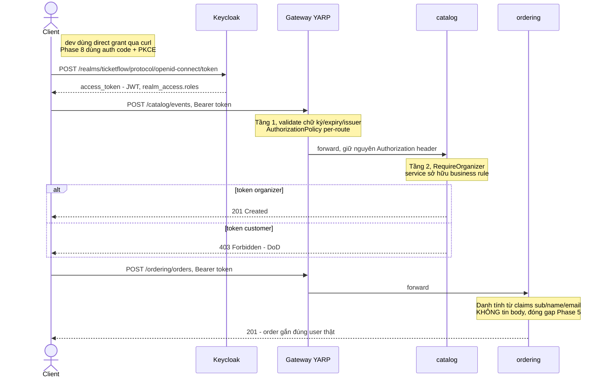
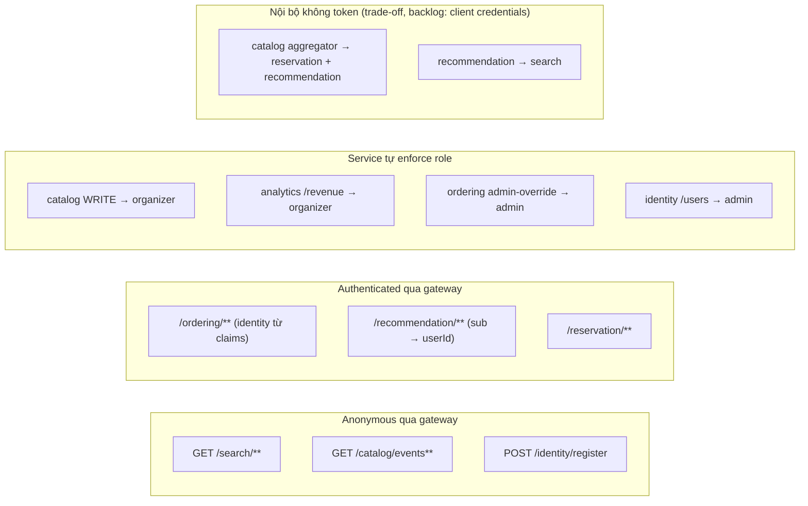

# Phase 7 — Kế hoạch chi tiết theo commit

> **Mục tiêu (từ scope mục 10):** hoàn thiện gateway + bảo mật thật. Đây là nơi **Ch13 (Security — OAuth2/OIDC, JWT, role-based authz)** sống thật, và **Ch11 (Gateway/BFF)** được chốt phần gateway (phần BFF xem quyết định mục 4 — đề xuất dời).
> **DoD:** login qua Keycloak → gọi API có token; endpoint organizer chặn user thường.

> ⚠️ **Viết TRƯỚC khi code** (giống [phase-2](phase-2-plan.md)…[phase-6](phase-6-plan.md)). Version package + "lệch kế hoạch / bug tự bắt được" bổ sung dần khi thực thi. Phase này **ngắn hơn Phase 5/6** về code mới (không service mới, không datastore mới) nhưng **đụng vào mọi service hiện có** (auth xuyên suốt) — rủi ro chính là **cấu hình** (issuer/claim mapping), không phải logic.

---

## Bối cảnh: cái gì đã có, cái gì Phase 7 thay/thêm

- **Đã có, sẽ bị thay thế:**
  - `identity-service` (Phase 1): user store riêng (Postgres, PBKDF2 hash), `POST /register`, `GET /users`, và **`POST /dev-token`** — JWT ký HMAC bằng static key từ config. `DevTokenGenerator` **tự ghi chú trong doc comment từ ngày viết**: "This whole class gets thrown away in Phase 7 when real OAuth2/OIDC (Keycloak/Duende) replaces it". Giờ trả nợ đó.
  - `Role` enum sẵn có: `Customer`/`Organizer`/`Admin` — map thẳng thành 3 realm role Keycloak.
- **Đã có, sẽ được nâng cấp:**
  - `gateway` (Phase 1/6): YARP, 7 route config-based (`catalog`/`identity`/`ordering`/`reservation`/`search`/`recommendation`/`analytics`), **chưa có bất kỳ auth nào** — mọi request đi thẳng. Phase 7 thêm JWT validation + authorization policy per-route.
  - `TicketFlow.Web` building block: đã là chỗ đặt cross-cutting web concern (`ExceptionHandlingMiddleware`, health) — auth wiring dùng chung (`AddTicketFlowAuth`) đặt vào đây, mọi service hưởng cùng 1 chỗ, đúng pattern `AddTicketFlowMessaging`.
  - `ordering`/`recommendation`: đang **tin request body/query param** cho danh tính (`PlaceOrderCommand.CustomerId/CustomerName/CustomerEmail` là "plain trusted request fields" — gap đã ghi rõ trong doc comment từ Phase 5; `GET /recommendations?userId=` cũng tự khai). Phase 7 đóng gap này ở ordering: **danh tính lấy từ JWT claims**, không tin body nữa.
- **Phase 7 thêm mới (hạ tầng):**
  - **Keycloak** vào `docker-compose.infra.yml` — OAuth2/OIDC authority, realm `ticketflow` import từ JSON (reproducible), port host **8180** (8080 đã là gateway).
- **Phase 7 KHÔNG thêm:** service mới, datastore mới, frontend. (BFF/GraphQL — xem quyết định mục 4/5.)

---

## Quyết định kiến trúc cho Phase 7

### 1. Keycloak, KHÔNG phải Duende IdentityServer
- **Duende = bẫy license** đúng loại dự án này đã né 2 lần (MassTransit 9.x, MediatR): free chỉ cho dev/testing/công ty <1M USD doanh thu, còn lại thương mại. Codebase convention: không package có bẫy license.
- **Keycloak = Apache-2.0, chạy như 1 container** — khớp cách mọi hạ tầng khác của dự án đang sống (Postgres/Redis/RabbitMQ/Kafka/ES/Mongo/ClickHouse đều là container trong `docker-compose.infra.yml`). Không cần viết code .NET nào để có OAuth2/OIDC server đầy đủ chuẩn.
- Chạy `start-dev` + `--import-realm` từ `infrastructure/keycloak/realm-export.json` (mount volume). **Dev dùng H2 nội bộ, chấp nhận mất data khi recreate container** — vì realm (roles/clients/users seed) tái tạo từ JSON mỗi lần start, reproducible là đủ cho học; production thật sẽ trỏ Postgres riêng (ghi backlog, không làm).

### 2. Số phận `identity-service`: Keycloak là AUTHORITY, identity giữ vai USER DIRECTORY (mỏng đi, không chết)
- **AuthN (mật khẩu, token, session) chuyển 100% sang Keycloak.** `DevTokenGenerator` + `POST /dev-token` **xoá hẳn** (đúng lời hứa trong doc comment). PBKDF2 hasher + password hash column trở thành dead code — xoá luôn phần authenticate, user không còn mật khẩu ở identity-service.
- **identity-service còn lại gì:** user directory/profile (`GET /users`, `GET /users/{id}` — Ordering/Notification tương lai cần tra display name/email theo userId) + **đăng ký**: `POST /register` giờ tạo user ở **cả 2 nơi** — Keycloak (qua Admin REST API, kèm password + role) và bảng users local (profile). Giữ **cùng userId** 2 bên (tạo Guid trước, truyền vào Keycloak làm user id) để claims `sub` khớp thẳng với dữ liệu các service khác đang giữ.
- **Vì sao không xoá hẳn identity-service:** bảng scope (mục 4) vẫn cần "user, role" directory; và các service khác (ordering event stream, recommendation purchase history) đang lưu `UserId` — cần 1 chỗ tra ngược ra người thật. Vì sao không dùng Keycloak Admin API làm directory luôn: coupling mọi service vào Keycloak API + Admin API không phải để serve high-read traffic. **🔑 Sẽ hỏi lại ở Commit 3** nếu lúc code thấy 2-nơi-ghi (dual write) quá phiền so với giá trị.
- **Users seed trong realm-export.json** (1 customer, 1 organizer, 1 admin, password dev đơn giản) để verify được ngay từ Commit 1 không cần flow đăng ký.

### 3. AuthN/AuthZ đặt ở ĐÂU: gateway validate + service enforce (2 tầng, mỗi tầng đúng vai)
- **Gateway (YARP):** validate JWT (chữ ký, expiry, issuer/audience) cho **mọi route trừ nhóm public** — chặn sớm request rác trước khi vào mạng nội bộ. YARP gắn `AuthorizationPolicy` per-route; token forward nguyên vẹn xuống service (YARP giữ `Authorization` header mặc định).
- **Route public (anonymous qua gateway):** `GET /search/**`, `GET /catalog/events**` (browse/search/chi tiết là trải nghiệm chưa-đăng-nhập), `POST /identity/register` + các endpoint token của Keycloak (đương nhiên). Còn lại yêu cầu token hợp lệ.
- **Service (chỉ nơi có business rule về role):** service tự validate JWT + enforce policy bằng `AddTicketFlowAuth` (TicketFlow.Web) — KHÔNG phải mọi service, chỉ:
  - `catalog`: mọi endpoint **ghi** (POST venues/events, publish/cancel/reschedule, seatmap, price-tiers) → policy `organizer` (admin kế thừa). GET giữ anonymous.
  - `analytics`: `GET /revenue` → `organizer` (dashboard doanh số là của organizer, scope mục 4).
  - `ordering`: mọi endpoint → authenticated; **danh tính lấy từ claims** (`sub`/`email`/`name`) thay vì tin body — đóng gap Phase 5. 2 endpoint admin-override confirm/cancel → policy `admin`.
- **Service KHÔNG enforce (giữ anonymous ở tầng service):** `search`/`recommendation`/`reservation` — vì có **caller nội bộ service-to-service không mang user token**: catalog aggregator (Commit 5 Phase 6) gọi reservation + recommendation; recommendation gọi search. Bật auth ở đây sẽ gãy aggregator ngay. Cách đúng chuẩn là client-credentials flow cho S2S — **quá dày cho DoD phase này, ghi backlog**; trade-off "mạng nội bộ Docker là trusted zone" ghi rõ trong doc comment. Gateway vẫn chặn các đường này từ ngoài (trừ nhóm public).
- **Đây là điểm học Ch13 thật:** authN tập trung (authority + gateway), authZ phân tán (service nào sở hữu rule role thì service đó enforce) — không phải "bật [Authorize] khắp nơi cho có".

### 4. BFF per frontend: DỜI SANG PHASE 8 — phản biện scope thẳng
- Scope ghi "BFF riêng cho từng frontend" ở Phase 7. Nhưng **cả 4 frontend chưa tồn tại** (Phase 8) — dựng 4 BFF bây giờ là viết composition layer cho client chưa có nhu cầu thật nào để compose. Đúng loại vaporware đã cắt 2 lần (genre-recommendation không có field genre; review-source không có review-service).
- **BFF đúng nghĩa Ch11 chỉ có thể thiết kế khi client thật định hình nhu cầu** (customer-web cần gộp gì, scanner cần endpoint tối giản nào). Phase 8 dựng frontend nào → dựng BFF cho frontend đó, có aggregator endpoint thật của Phase 6 làm nguyên liệu.
- Phase 7 giữ **1 gateway duy nhất, làm thật đậm phần security** — YARP route + authn policy chính là nền mọi BFF sau này kế thừa. Sẽ ghi rõ vào scope.md khi reconcile (commit cuối).

### 5. GraphQL federation (scope ghi "tùy chọn"): DROP
- Không có client nào tiêu thụ GraphQL (chưa có frontend), thêm HotChocolate là thêm dependency lớn cho zero user. Scope tự đánh dấu "tùy chọn" — chọn không. Backlog nếu Phase 8 customer-web thật sự cần.

### 6. ⚠️ Rủi ro cấu hình lớn nhất phase — issuer mismatch giữa host và Docker network
- Token xin từ **host** (curl/frontend dev): `http://localhost:8180/realms/ticketflow` → claim `iss` = `localhost:8180`. Service **trong Docker** validate với authority `http://keycloak:8180/realms/ticketflow` → issuer không khớp → 401 **dù token hoàn toàn hợp lệ**. Đây là cái bẫy kinh điển của Keycloak-trong-compose, và là ứng viên số 1 cho "bug thật" của phase.
- **Hướng xử lý dự kiến (chốt lúc probe Commit 1):** `TokenValidationParameters.ValidIssuers` = cả 2 URL (dev-only, ghi rõ lý do), hoặc `KC_HOSTNAME` cố định. **Probe thật trước khi wire vào service** — xin token thật từ host, validate thật từ trong container, nhìn claim `iss` thật rồi mới quyết.
- Rủi ro cấu hình thứ 2: **realm roles của Keycloak nằm trong claim lồng `realm_access.roles`**, không phải claim `role` phẳng mà `ClaimsPrincipal.IsInRole()` của .NET đọc. Phải chọn: mapper phía Keycloak (client scope flatten roles) hoặc claim transformation phía .NET (trong `AddTicketFlowAuth`). Probe cùng lúc với issuer.

### 7. Kế thừa & không đụng
- Toàn bộ messaging (RabbitMQ/Kafka), saga, datastore của Phase 1-6: **không đổi**. Auth là tầng HTTP, không chạm message contract nào.
- `TicketFlow.Web` là điểm mở rộng duy nhất dùng chung; các service chỉ thêm 1-2 dòng `AddTicketFlowAuth`/policy — không service nào cần project mới.

---

## Nhóm A — Keycloak authority

### Commit 1 — `feat(infra): Keycloak + realm ticketflow + probe token thật` ✅ DONE

- `docker-compose.infra.yml`: `keycloak` image pin **`quay.io/keycloak/keycloak:26.7`**, `start-dev --import-realm`, port host **8180**, management/health port host **9020** (9000 đã là port host của MinIO — cùng loại xung đột với ClickHouse native port trước đây), mount `infrastructure/keycloak/realm-export.json` read-only.
- `realm-export.json`: realm `ticketflow`; 3 realm role; client `ticketflow-api` (bearer-only, audience) + `ticketflow-dev` (public, Direct Access Grants); 3 user seed. Đúng như plan ban đầu, cộng thêm phần sửa ở bug bên dưới.

**🐛 Bug thật #1 — healthcheck `curl` không tồn tại trong image.** `quay.io/keycloak/keycloak:26.7` là image tối giản (UBI micro-based), **không có `curl`/`wget`/`which`** — chỉ có `bash`. Healthcheck ban đầu viết `curl -sf http://localhost:9000/health/ready` fail mãi dù server log xác nhận start thành công (confirm bằng `docker exec ... curl --version` → `exec: "curl": executable file not found in $PATH`). Fix: dùng thủ thuật `bash` `/dev/tcp` để tự tay dựng HTTP GET request thô, `grep` tìm `200 OK` trong response — không cần binary HTTP client nào:
```
test: ["CMD-SHELL", "exec 3<>/dev/tcp/localhost/9000 && echo -e 'GET /health/ready HTTP/1.1\r\nHost: localhost\r\nConnection: close\r\n\r\n' >&3 && grep -q '200 OK' <&3"]
```
Xác nhận `/bin/sh` trong image này thực chất symlink sang `bash` (`readlink -f /bin/sh` → `/usr/bin/bash`) nên `CMD-SHELL` (chạy qua `/bin/sh -c`) vẫn hiểu cú pháp `/dev/tcp`. Container hiện báo `healthy` đúng ~70-80s sau start (30 retries × interval 10s là dư).

**🐛 Bug thật #2 — 3 client scope built-in (`profile`/`email`/`roles`) bị import bỏ qua âm thầm.** Realm-export.json tối giản viết tay **không tự có sẵn** các client scope chuẩn của Keycloak (`profile`/`email`/`roles`) — chúng chỉ tồn tại nếu (a) export từ 1 realm đã boot đầy đủ, hoặc (b) tự định nghĩa tường minh. Vì `ticketflow-dev.defaultClientScopes` tham chiếu 3 tên này mà không có định nghĩa tương ứng trong `clientScopes` top-level, Keycloak **log warning và bỏ qua từng cái một** lúc import (`Referenced client scope 'X' doesn't exist. Ignoring`) — im lặng, build vẫn "thành công", chỉ phát hiện qua đọc log kỹ. Hậu quả nếu không phát hiện: token thiếu hẳn `email`/`name`, và **quan trọng nhất — thiếu `realm_access.roles`** (vì mapper realm-role mặc định sống trong scope `roles`), tức là toàn bộ phase mất tác dụng ngay từ token đầu tiên.
Fix: tự định nghĩa cả 3 scope trong `clientScopes` với protocol mapper chuẩn (`oidc-full-name-mapper` cho profile; `oidc-usermodel-property-mapper` × 2 cho email/email_verified; `oidc-usermodel-realm-role-mapper` claim `realm_access.roles` cho roles). Re-import (`docker rm -f` + `up -d` — dev dùng H2 nội bộ, không volume riêng nên recreate = realm sạch từ JSON) → log không còn dòng "Ignoring" nào.

**Probe thật (rủi ro số 1 — mục 6), kết quả:**
- Token xin qua `curl POST http://localhost:8180/.../token` (direct grant, host) → `iss = "http://localhost:8180/realms/ticketflow"` — đúng như dự đoán, vì issuer = URL client dùng để xin token, không phụ thuộc ai validate.
- Chạy container .NET 10 SDK tối giản trong `ticketflow-network` (script `dotnet run` mount từ scratchpad, không phải code production), fetch metadata/JWKS qua `http://keycloak:8180/.../openid-configuration` (chỉ hostname internal mới resolve được — `localhost` trong container đó là chính nó, không phải Keycloak).
- **Scenario A — `ValidIssuer` = issuer trong discovery doc (`keycloak:8180`)** → **FAIL thật** (`SecurityTokenInvalidIssuerException`, issuer token = `localhost:8180` ≠ `keycloak:8180`). Xác nhận rủi ro không phải lý thuyết.
- **Scenario B — `ValidIssuers` = mảng gồm cả `localhost:8180` lẫn `keycloak:8180`** → **PASS**, claims đọc đúng đầy đủ. **Chốt phương án**: `AddTicketFlowAuth` (Commit 2) set `Authority = "http://keycloak:8180/realms/ticketflow"` (để fetch JWKS đúng từ trong Docker network) nhưng **override `TokenValidationParameters.ValidIssuers`** = 2 giá trị tường minh (dev-only, ghi rõ lý do trong code comment) thay vì để mặc định issuer = authority.
- **Role claim xác nhận đúng dự đoán mục 6**: `realm_access = {"roles": ["customer"]}` — 1 object lồng, không phải claim `role` phẳng. **Chốt phương án**: `IClaimsTransformation` phía .NET (đặt trong `AddTicketFlowAuth`) unpack `realm_access.roles` thành các `ClaimTypes.Role` riêng lẻ để `IsInRole()`/`[Authorize(Roles=...)]` hoạt động bình thường — không cần đụng Keycloak-side mapper thêm.
- **Ghi chú phụ phát hiện được lúc probe**: `JwtSecurityTokenHandler` mặc định remap 1 số claim sang URI kiểu cũ (`email` → `http://schemas.xmlsoap.org/ws/2005/05/identity/claims/emailaddress`) qua `DefaultInboundClaimTypeMap`. Cần tắt bằng `MapInboundClaims = false` trên `JwtBearerOptions` ở Commit 2 để giữ tên claim gốc (`email`, `sub`, `name`) — nếu không, code đọc `User.FindFirst("email")` sẽ ra `null`.

**Verify thật:** container `healthy`; log import sạch (0 dòng "Ignoring"); `curl` token endpoint thành công cho cả 3 seed user (`customer1`/`organizer1`/`admin1`), decode JWT xác nhận đúng role tương ứng (`realm_access.roles` = `["customer"]`/`["organizer"]`/`["admin"]`); `docker ps` = đủ **20 container**, tất cả healthy (kể cả Keycloak).

> Sự cố môi trường không liên quan Commit 1: phát hiện 1 project clone cũ, bỏ hoang tại `C:\Users\Kingc\OneDrive\Desktop\TicketFlow` (git dừng ở Phase 1, không remote) có 6 container đang chạy giữ đúng `container_name` cố định trùng với project này (`ticketflow-kafka` conflict khi `up -d`). Đã dừng+xoá đúng 6 container đó sau khi xác nhận qua `docker inspect`/`git log` và hỏi lại — không đụng file/volume nào trong thư mục OneDrive đó.

## Nhóm B — Services enforce

### Commit 2 — `feat(web): AddTicketFlowAuth + catalog/analytics phân quyền organizer` ✅ DONE

- `TicketFlow.Web`: [`AddTicketFlowAuth(configuration)`](../src/BuildingBlocks/TicketFlow.Web/AuthenticationExtensions.cs) — `AddAuthentication().AddJwtBearer(...)` đọc `Keycloak:Authority`/`Keycloak:Audience`/`Keycloak:ValidIssuers` từ config, áp đúng phương án chốt ở Commit 1 (`Authority` trỏ `keycloak:8180` để fetch JWKS trong network, `ValidIssuers` chấp cả `localhost:8180` lẫn `keycloak:8180`, `MapInboundClaims = false` để giữ tên claim gốc). [`RealmRoleClaimsTransformation`](../src/BuildingBlocks/TicketFlow.Web/RealmRoleClaimsTransformation.cs) (`IClaimsTransformation`) unpack `realm_access.roles` (JSON lồng) thành `ClaimTypes.Role` riêng lẻ. 3 policy: `RequireOrganizer` (`RequireRole("organizer", "admin")` — OR semantics có sẵn của .NET, admin tự động qua), `RequireAdmin`, `RequireAuthenticated`. `UseTicketFlowWeb` gọi `UseAuthentication/UseAuthorization` **có điều kiện** — check `IAuthenticationSchemeProvider` đã đăng ký chưa (service nào không gọi `AddTicketFlowAuth` thì `UseAuthorization()` sẽ throw lúc khởi động nếu gọi vô điều kiện).
- `catalog`: 6 endpoint ghi (`POST /venues`, `POST /events`, `PUT /events/{id}`, `POST /events/{id}/publish|cancel|price-tiers`, `POST /events/{id}/seatmap`, `POST /events/{id}/seatmap/sections`) → `.RequireAuthorization("RequireOrganizer")`. Tất cả GET giữ anonymous. `analytics`: `GET /revenue` → `RequireOrganizer`.

**🐛 Bug thật — `Microsoft.AspNetCore.Authentication.JwtBearer` KHÔNG nằm trong shared framework.** Giả định ban đầu (namespace `Microsoft.AspNetCore.*` nên chắc có sẵn qua `FrameworkReference`) sai — build thật ra lỗi `CS0234` ngay khi thêm `using`. Đây là 1 trong số ít gói `Microsoft.AspNetCore.*` vẫn cần `PackageReference` riêng dù chạy trên ASP.NET Core. Thêm `Microsoft.AspNetCore.Authentication.JwtBearer` version `10.0.9` (khớp các gói ASP.NET Core khác đã pin) vào `Directory.Packages.props` + `TicketFlow.Web.csproj`.

**Verify thật (nửa sau của DoD, khớp chính xác dự đoán):**
- Trực tiếp catalog (`:8002`) và analytics (`:8010`): organizer token → `201`/`200`; **customer token → `403`**; không token → `401`; `GET /venues` không token vẫn `200`. Admin token cũng `200` trên `/revenue` (xác nhận `RequireOrganizer` cho admin qua đúng như thiết kế OR).
- Qua gateway (`:8080`, gateway **chưa** có auth riêng — Commit 4 mới thêm): cùng ma trận organizer `201` / customer `403` / GET không token `200` — chứng minh service tự đứng được, header `Authorization` được YARP forward nguyên vẹn mặc định, không cần cấu hình gì thêm ở gateway cho việc này.
- Regression: **79/79** (`dotnet test` toàn solution, trừ `TicketFlow.Reservation.LoadTests` — NBomber throughput test, không phải correctness suite) — không có test nào hỏng dù build lại 2 image, xác nhận thay đổi auth không đụng logic nghiệp vụ nào.

### Commit 3 — `feat(identity): Keycloak nhận authN, identity thành user directory` ✅ DONE

- Xoá hẳn `DevTokenGenerator.cs`, `AuthEndpoints.cs` (`POST /dev-token`), `AuthenticateAsync`, `IPasswordHasher`/`Pbkdf2PasswordHasher` — đúng lời hứa doc comment từ Phase 1. `User.PasswordHash` xoá khỏi domain, migration `DropPasswordHash` drop cột thật (không giữ cột chết).
- `POST /register`: [`KeycloakAdminClient`](../src/Services/Identity/TicketFlow.Identity.Infrastructure/Keycloak/KeycloakAdminClient.cs) (`HttpClient` + client-credentials qua client mới `ticketflow-identity-admin`) tạo user Keycloak **trước**, `UserService.RegisterAsync` lưu profile local **sau** bằng đúng id Keycloak trả về; rollback (`DeleteUserAsync`) nếu bước lưu local throw. `GET /users*` → `RequireAdmin`.
- **🔑 Checkpoint đã tự giải quyết, không cần hỏi lại:** sau khi probe thật Admin API (xem 3 bug bên dưới), dual-write hoá ra chỉ là 2-3 lệnh HTTP tuần tự + 1 try/catch — không đủ phiền để đổi hướng bỏ `POST /register`. Giữ nguyên thiết kế ban đầu của plan, chỉ đảo ngược thứ tự tạo (Keycloak trước, không phải Guid tự sinh trước) vì lý do ở bug #1.

**🐛 Bug thật #1 — Keycloak KHÔNG tôn trọng `id` do client truyền vào lúc tạo user.** Giả định ban đầu của plan (tự sinh Guid rồi truyền cho Keycloak để 2 bên cùng id) sai — `POST /admin/realms/{realm}/users` với body có `"id": "<guid-tự-chọn>"` vẫn trả `201` nhưng Keycloak **tự gán UUID riêng**, chỉ lấy được qua header `Location` của response. Đảo ngược thứ tự: tạo ở Keycloak trước → parse id thật từ `Location` → dùng đúng id đó cho row local. Đây là lý do `User.Register` đổi chữ ký nhận `Guid id` từ ngoài thay vì tự `Guid.NewGuid()`.

**🐛 Bug thật #2 — mảng `credentials` trong body `POST /users` bị Keycloak Admin API âm thầm bỏ qua.** Khác với `realm-export.json` (import lúc bootstrap — kênh khác, có tôn trọng `credentials`), gọi `POST /users` runtime với `credentials` kèm trong body tạo user **thành công (201) nhưng mật khẩu không được set** (`disableableCredentialTypes` rỗng sau khi tạo) — user tồn tại nhưng không login được, lỗi chỉ hiện ra lúc login (`invalid_grant: Account is not fully set up`), không có cảnh báo gì lúc tạo. Fix: set mật khẩu qua endpoint riêng `PUT /users/{id}/reset-password` sau khi tạo.

**🐛 Bug thật #3 — Declarative User Profile của Keycloak coi `firstName`+`lastName` là bắt buộc theo mặc định.** Domain model của identity-service chỉ có 1 field `DisplayName` (không tách first/last) — tạo user thiếu `lastName` cũng `201` bình thường nhưng login fail với cùng lỗi mập mờ ở bug #2 (`Account is not fully set up`), vì hồ sơ chưa "đủ" theo User Profile schema của realm. Fix triệt để: nhúng cấu hình User Profile (chỉ bắt buộc `username`/`email`/`firstName`, bỏ `lastName`) vào `realm-export.json` qua khối `components` (`org.keycloak.userprofile.UserProfileProvider`) — khớp domain model thật, tái tạo được từ JSON như mọi phần khác của realm. `DisplayName` map thẳng vào `firstName`.

**🐛 Bug thật #4 (nhỏ) — role `manage-users` không đủ quyền đọc role realm.** Service account `ticketflow-identity-admin` chỉ gán `manage-users` (theo đúng dự tính ban đầu của plan) bị `403` khi gọi `GET /roles/{name}` (bước cần thiết để lấy `RoleRepresentation` trước khi gán role cho user mới) — phải thêm `view-realm` vào `clientRoles` của service account trong `realm-export.json`.

**Verify thật:**
- `POST /register` → `201`, id trả về khớp chính xác id Keycloak thật (`GET /admin/realms/ticketflow/users?email=...`).
- Login ngay bằng Keycloak token endpoint với email/password vừa đăng ký → token mang đúng role `customer` + `name`/`email` claim đúng.
- `GET /users` (admin token) → thấy user mới trong danh sách; customer token → `403`; không token → `401`.
- **Race condition thật** (2 request `POST /register` cùng email, đồng thời): 1 thành công (`201`), 1 fail (`500`) — nhưng phát hiện ra request thua bị **chính Keycloak chặn** (`409` ngay ở bước tạo, do Keycloak tự enforce unique username) chứ không rơi vào nhánh compensation cục bộ (local save fail) như dự tính test ban đầu — nghĩa là Keycloak tự làm luôn vai trò "lưới an toàn thứ 2" cho race vượt qua pre-check phía app. Kết quả cuối: đúng 1 user Keycloak duy nhất với email đó, không có bản ghi mồ côi. **Nhánh compensation cụ thể (Keycloak tạo thành công NHƯNG SaveChanges local fail) đúng về logic qua code review (try/catch đơn giản, đã build/chạy không lỗi) nhưng chưa tự kích hoạt được bằng 1 test hạ tầng thật riêng biệt trong lần verify này** — ghi nhận trung thực thay vì nhận vơ đã test đủ.
- Regression: **79/79**, không hỏng gì. `docker ps` đủ 20 container, tất cả healthy (kể cả `identity` sau khi migrate + `keycloak` sau khi re-import realm).

## Nhóm C — Gateway enforce

### Commit 4 — `feat(gateway): JWT validation + authorization policy per-route + ordering lấy danh tính từ claims` ✅ DONE

- Gateway: `AddTicketFlowAuth` (`TicketFlow.Web` — thêm `ProjectReference`, cần sửa `Dockerfile` gateway để COPY thêm `src/BuildingBlocks/`, trước đó gateway "trơ" không có project reference nào nên Dockerfile chỉ copy đúng thư mục nó) + YARP `AuthorizationPolicy` per-route. Route `catalog`/`identity` tách làm 2 (đọc vs ghi) vì YARP match theo path+method, không match theo policy trong service: `catalog-read-route` (Methods=GET, policy `anonymous`) + `catalog-write-route` (mọi method khác, `RequireAuthenticated`); `identity-register-route` (`POST /identity/register`, `anonymous`) + `identity-route` (còn lại, `RequireAuthenticated`). `search` giữ `anonymous`; `ordering`/`reservation`/`recommendation`/`analytics` → `RequireAuthenticated`. YARP tự xếp hạng route cụ thể hơn (có `Methods` hoặc path literal dài hơn) lên trước route catch-all cùng prefix — xác nhận đúng qua test thật (GET công khai + POST 401 trên cùng `/catalog/**`), không cần khai báo `Order` tường minh. Không proxy token endpoint qua gateway — client gọi thẳng Keycloak `:8180` (giữ đúng hướng nghiêng ban đầu của plan).
- `ordering`: `AddTicketFlowAuth`, toàn bộ endpoint (kể cả `POST /check-seats`) → `RequireAuthorization("RequireAuthenticated")` ở mức `MapGroup`; 2 endpoint admin-override (`confirm`/`cancel`) chồng thêm `RequireAdmin`. `PlaceOrderCommand` (application layer) **giữ nguyên shape** — chỉ đổi DTO tầng API: `PlaceOrderRequest` mới bỏ hẳn `CustomerId`/`CustomerName`/`CustomerEmail`, endpoint tự lấy từ `ClaimsPrincipal` (`sub`/`name`/`email`) rồi mới dựng `PlaceOrderCommand` đầy đủ để gọi handler — nhờ vậy `PlaceOrderCommandHandlerTests` không cần sửa gì.
- `recommendation`: route gateway → `RequireAuthenticated`; **quyết định cuối: KHÔNG viết custom YARP transform inject `sub` vào query `userId`** — chưa có consumer ngoài thật nào (Phase 8 chưa tồn tại), viết transform cho tính năng chưa ai gọi là đúng loại over-engineering đã cắt nhiều lần (BFF, GraphQL, client-credentials S2S). Ghi backlog cùng nhóm 3 mục đó. Service vẫn anonymous, S2S từ aggregator không đổi gì (đã xác nhận: aggregator gọi thẳng hostname nội bộ `reservation:8003`/`recommendation:8009`, không hề đi qua gateway — auth mới ở gateway không ảnh hưởng S2S).

**🐛 Bug thật — access token của Keycloak 26.7 KHÔNG có claim `sub` theo mặc định.** Phát hiện giữa lúc build luồng mua vé thật: token của `customer1` thiếu hẳn `sub` (chỉ `iss`/`aud`/`azp`/`realm_access`/`email`/`name`...). Loại trừ nguyên nhân do config tự viết bằng cách test token của **`admin-cli` — client hệ thống của Keycloak, hoàn toàn không đụng tới** — cũng thiếu `sub` y hệt, xác nhận đây là hành vi mặc định thật của bản Keycloak 26.7 dùng trong stack này (access token ≠ id_token; id_token vẫn có `sub` đầy đủ vì đó là claim bắt buộc theo OIDC core spec cho id_token, còn access token thì Keycloak không tự thêm nếu không có mapper tường minh). Fix: thêm 1 `protocolMapper` (`oidc-usermodel-property-mapper`, `user.attribute: id` → `claim.name: sub`, `access.token.claim: true`) vào scope `ticketflow-audience` (đã gắn sẵn cho `ticketflow-dev`) trong `realm-export.json`. Probe xác nhận đúng bằng Admin API trước khi bake vào JSON, rồi recreate Keycloak từ JSON để xác nhận qua import sạch (không chỉ patch runtime) — gặp thêm 1 lỗi phụ lúc đó: mô tả quá dài làm cột H2 `DESCRIPTION VARCHAR(255)` tràn, phải rút gọn text.

**Verify thật — mua vé end-to-end 100% qua gateway, không gọi thẳng service nào:**
- Organizer token: tạo venue → event → seatmap → section → price-tier → publish — toàn bộ qua `:8080/catalog/**`.
- Customer token: provision inventory + lấy seat khả dụng + hold seat qua `:8080/reservation/**`, rồi `POST :8080/ordering/orders` **không có `CustomerId` trong body** → `201`, response `customerId` = `f5ab0fc1-4c3a-402b-b3cc-0d2b663e6131` — **khớp chính xác** claim `sub` giải mã từ token của customer1. Đợi saga chạy → `GET` lại order → `status: "Confirmed"` (toàn chuỗi payment/ticketing vẫn chạy đúng sau thay đổi identity).
- Không token: `POST /ordering/orders` → `401` tại gateway (trước khi chạm service). Token customer: `POST /catalog/events` qua gateway → `403` (2 tầng cùng chặn, đúng như Commit 2 nhưng giờ gateway cũng tự chặn được, không chỉ dựa vào service). `GET /search/events` và `GET /catalog/events` không token vẫn `200`.
- Regression: **79/79**, không hỏng gì (đúng dự đoán — `PlaceOrderCommand` application-layer không đổi shape). `docker ps` đủ 20 container, tất cả healthy.

## Nhóm D — Finalize

### Commit 5 — `chore: finalize Phase 7 — DoD checklist, scope reconcile`
- Reconcile `scope.md`: chốt Keycloak (bỏ "hoặc Duende"); BFF per-frontend **dời Phase 8** (ghi rõ lý do mục 4); GraphQL federation drop → backlog; identity-service đổi mô tả trách nhiệm ("User directory/profile; authN đã chuyển Keycloak"); bảng hạ tầng thêm Keycloak.
- `docker compose ps` đủ **20 container** (19 + keycloak). Verify end-to-end DoD lần cuối. Tick DoD, cập nhật doc này.

---

## Sơ đồ Phase 7

### Luồng token + 2 tầng enforce (Ch13)



### Bản đồ enforce toàn hệ (ai chặn gì)



---

## Kiểm chứng DoD cuối Phase 7

| DoD | Kiểm chứng |
|---|---|
| Login qua Keycloak → gọi API có token | Commit 1 (token thật) + Commit 4 (mua vé end-to-end qua gateway bằng token, danh tính từ claims) |
| Endpoint organizer chặn user thường | Commit 2: customer token → 403 trên catalog write + analytics revenue; xác nhận lại 2 tầng ở Commit 4 |

## Hướng mở rộng (backlog — không thuộc Phase 7)
- **BFF per frontend** — dời Phase 8, dựng cùng frontend tương ứng (mục 4).
- **GraphQL federation** cho customer BFF — chỉ khi Phase 8 thật sự cần.
- **Client-credentials cho S2S** (aggregator → reservation/recommendation, recommendation → search) — thay trade-off trusted-network hiện tại.
- **Keycloak production-grade**: Postgres backing, `start` mode + hostname/TLS thật, không import realm mỗi lần boot.
- **Refresh token/logout flow phía client** — chuyện của frontend Phase 8.
- **Ownership check ở ordering** (`GET /orders/{id}` chỉ chủ đơn xem được — hiện chỉ authenticated là xem được, cần so `sub` với `CustomerId`).

## Thứ tự đọc trước khi code (scope mục 13)
Đọc **Ch11 (API Gateway & BFF)** — gateway vs BFF, tại sao BFF theo client, edge concerns (authn tại gateway). Và **Ch13 (Security)** — OAuth2/OIDC flows (authorization code + PKCE vs client credentials vs direct grant), JWT structure/validation, role-based authorization. Bổ sung ngoài sách: **Keycloak** docs (realm/client/role, import-export, Admin REST API, health endpoints), **Microsoft.AspNetCore.Authentication.JwtBearer** (authority/metadata discovery, TokenValidationParameters, claim transformation), **YARP authorization** (per-route `AuthorizationPolicy`), và đọc kỹ bẫy **issuer mismatch trong Docker network** (mục 6 — rủi ro số 1 của phase).
