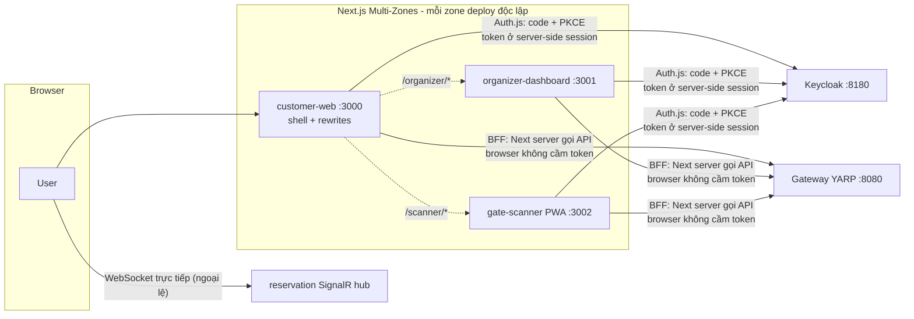
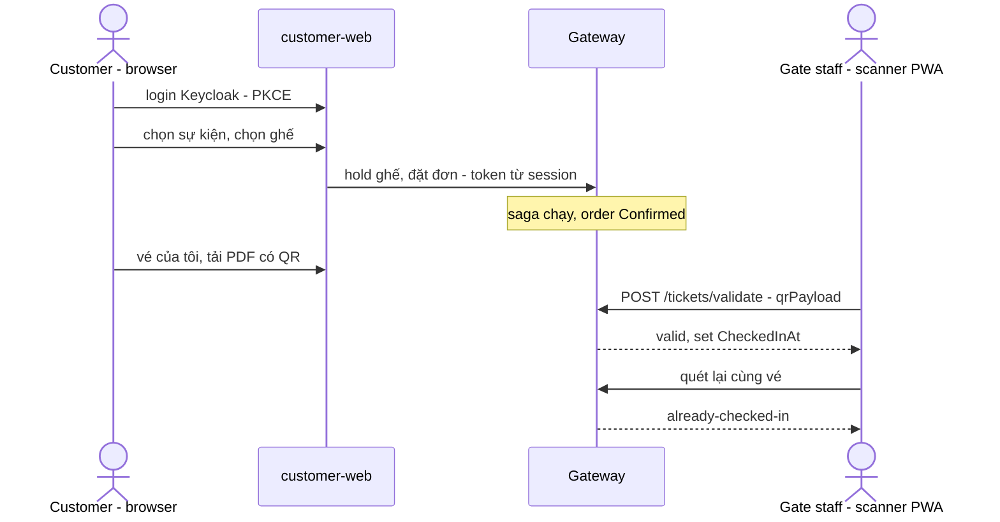

# Phase 8 — Kế hoạch chi tiết theo commit

> **Mục tiêu (từ scope mục 10):** 4 frontend Next.js (customer-web, organizer-dashboard, gate-scanner PWA, admin-panel), shared `ui`/`types` package, sơ đồ ghế real-time (SignalR). Đây là nơi **Ch12 (Micro-frontends)** sống thật, và phần **BFF của Ch11** (dời từ Phase 7) được chốt.
> **DoD:** hành trình mua vé hoàn chỉnh trên UI thật; scanner validate được vé đã mua.

> ⚠️ **Viết TRƯỚC khi code** (giống phase-2…phase-7). Phase này khác mọi phase trước ở một điểm cơ bản: **lần đầu có code ngoài .NET** (TypeScript/Next.js), và DoD phụ thuộc vào **backend gap có thật** — ticketing hiện **không có HTTP API nào** (chỉ có consumer), nghĩa là "xem vé" lẫn "scanner validate vé" đều chưa có gì để UI gọi. Nhóm A của phase này là trả các món nợ backend đó trước khi chạm vào frontend.

---

## Bối cảnh: cái gì đã có, cái gì còn thiếu

- **Đã có (Phase 1-7), frontend chỉ việc gọi:**
  - Gateway `:8080` với JWT validation per-route + Keycloak authority (Phase 7). Route công khai: `GET /catalog/**`, `GET /search/**`, `POST /identity/register`. Còn lại cần token.
  - Luồng mua vé đầy đủ qua REST: browse/search → event detail (aggregator gộp seats + recommendations) → hold ghế (reservation) → đặt đơn (ordering, danh tính từ claims) → saga tự chạy payment/ticketing → order `Confirmed`.
  - Keycloak realm `ticketflow` reproducible từ JSON, 3 role, seed users, Direct Access Grants (dev) + Standard Flow đã bật sẵn cho client `ticketflow-dev` (`redirectUris: http://localhost:3000/*` — có sẵn từ Commit 1 Phase 7, đúng dự tính cho phase này).
- **Còn thiếu — backend gap chặn DoD (phát hiện khi khảo sát code thật):**
  - **Ticketing không có HTTP endpoint nào.** Chỉ có `IssueTicketsConsumer` (RabbitMQ). Không có "vé của đơn này", không có link PDF, không có validate. Gateway cũng chưa có route `/ticketing`. QR payload hiện là chuỗi unsigned `{OrderId}:{SeatId}` — doc comment trong `IssueTicketsConsumer` tự hẹn từ Phase 5: *"gate-scanning verification is Phase 8"*. Giờ trả nợ.
  - **`Ticket` là immutable fact** (`Entity`, không có state mutation) — check-in cần thêm trạng thái `CheckedInAt` + rule "không check-in 2 lần" + migration.
  - **`GET /orders` nhận `customerId` từ query param** — "vé của tôi" trên UI phải lấy từ claim `sub`, không để user tự khai. Ownership check (`GET /orders/{id}` chỉ chủ đơn xem được) cũng nằm trong backlog Phase 7.
  - **Real-time seat map chưa có gì:** reservation không có pub/sub, không SignalR hub ở bất kỳ service nào.
  - **`apps/`, `packages/` chưa tồn tại** — monorepo frontend dựng từ đầu.

---

## Quyết định kiến trúc cho Phase 8

### 1. Composition: Next.js Multi-Zones, KHÔNG phải Module Federation — phản biện scope thẳng
- Scope ghi "shell + Module Federation". Nhưng **`@module-federation/nextjs-mf` đã bị chính team Module Federation ngừng hỗ trợ** (Next.js support dropped, App Router chưa bao giờ được hỗ trợ) — đi tiếp đường này là build trên nền đã chết, đúng loại bẫy đã né 3 lần (MassTransit 9.x, MediatR, Duende). **⚠️ Probe xác nhận hiện trạng thật của package trước khi chốt hẳn ở Commit 3** — nếu tình hình 2026 khác, cân nhắc lại.
- **Multi-Zones là cách composition chính chủ của Next.js**: mỗi app deploy độc lập, 1 app làm shell rewrite theo path prefix (`/organizer/*` → organizer-dashboard, `/scanner/*` → gate-scanner). Vẫn dạy đúng bài Ch12 — **independent deployability + composition tại edge** — chỉ khác cơ chế (HTTP rewrite thay vì runtime JS federation). Trade-off ghi thật: không share runtime bundle giữa các app (mỗi zone tự chở React của mình) — chấp nhận, vì shared code đã có tầng `packages/` lo ở build time.

### 2. BFF (Ch11, dời từ Phase 7): Next.js server-side CHÍNH LÀ BFF — không dựng service BFF .NET riêng
- Mỗi app Next.js có sẵn tầng server (Server Components + Route Handlers). Token nằm trong **session server-side (cookie httpOnly)** — browser không bao giờ cầm access token; Next server gọi gateway thay mặt client, mỗi app tự do gộp/cắt dữ liệu theo nhu cầu màn hình của nó. Đó **chính là định nghĩa BFF của Ch11** — dựng thêm 4 service .NET trung gian chỉ để làm đúng việc Next.js đã làm sẵn là double-BFF vô nghĩa.
- Ngoại lệ duy nhất browser gọi thẳng (không qua Next server): **SignalR** (WebSocket cần kết nối trực tiếp, mục 5) và **tải PDF vé** (stream qua ticketing API — mục 4).

### 3. Auth phía frontend: Auth.js (next-auth v5) + Keycloak provider, Authorization Code + PKCE
- Đúng flow "thật" đã hứa từ Phase 7 (Direct Access Grants chỉ để dev/curl). Auth.js lo code exchange, session cookie, **refresh token rotation** — đóng luôn backlog "refresh token/logout flow" của Phase 7.
- Realm cần sửa: thêm client **confidential** cho từng app (`ticketflow-customer-web`, `ticketflow-organizer-dashboard`, `ticketflow-gate-scanner` — client-per-app đúng khuyến nghị Keycloak, mỗi app 1 redirect URI port riêng 3000/3001/3002). `ticketflow-dev` giữ nguyên cho curl/scripts.
- **⚠️ Rủi ro cấu hình số 1 của phase (họ hàng với issuer-mismatch Phase 7):** Auth.js chạy trong Next server trên **host** → issuer/token endpoint là `localhost:8180`; access token đó gọi gateway (Docker) → đã xử lý bằng `ValidIssuers` kép từ Phase 7, **nhưng phải probe lại toàn chuỗi** (login → session → refresh → gọi API qua gateway) bằng app tối giản TRƯỚC khi viết UI thật — đúng kỷ luật probe-first.

### 4. Ticketing API: validate = server lookup, QR vẫn unsigned; PDF stream qua API, không presigned URL
- **Validate/check-in:** scanner gửi nguyên QR payload (`OrderId:SeatId`) → server tra DB → tồn tại + chưa check-in → set `CheckedInAt`. Server-authoritative nên **chưa cần ký QR** (kẻ giả payload phải đoán trúng cặp Guid có thật) — HMAC signing giữ nguyên backlog Phase 5, không nghĩa vụ mới. Policy: `RequireOrganizer` (chưa tạo role `gate-staff` riêng — backlog, YAGNI khi chưa có mô hình nhân sự thật).
- **PDF vé: stream qua ticketing API** (`GET /tickets/{id}/pdf` đọc MinIO rồi trả `application/pdf`), KHÔNG dùng presigned URL — presigned URL sinh trong Docker network sẽ mang hostname `minio:9000` mà browser không resolve được, **đúng cùng lớp bẫy issuer-mismatch của Keycloak** đã ăn ở Phase 7. Stream qua API né hẳn lớp bẫy đó + được authorize bằng token luôn.

### 5. Real-time seat map: SignalR hub đặt TRONG reservation, broadcast khi hold/release/confirm
- Hub `SeatMapHub` nằm ngay reservation-service (nơi sở hữu sự thật về trạng thái ghế) — không dựng service real-time riêng. `ReservationService.HoldAsync/ReleaseAsync/ConfirmAsync` broadcast qua `IHubContext` sau khi thao tác Redis thành công. Client join group theo `eventId`.
- **Hold hết TTL tự expire trong Redis thì KHÔNG có broadcast** (không có code path nào chạy lúc đó). Phương án đúng là Redis keyspace notifications — **ghi backlog**; UI chấp nhận eventual consistency (refetch khi user thao tác). Ghi rõ trade-off trong code comment.
- **⚠️ Rủi ro số 2: SignalR qua YARP** (WebSocket upgrade + route `RequireAuthenticated` với token qua query string `access_token` — SignalR client không gửi được header khi WebSocket). Probe thật trước khi wire UI. Phương án dự phòng nếu kẹt: SSE hoặc polling — nhưng thử WebSocket trước.

### 6. Monorepo & stack: pnpm workspaces, KHÔNG Turborepo (chưa cần); TypeScript + Tailwind; types viết tay
- `apps/*` + `packages/*` bằng **pnpm workspaces** trần — 3 app + 2 package chưa đủ đau để cần build orchestrator/caching layer (đúng kỷ luật "không dep nặng cho nhu cầu hẹp"). Turborepo ghi backlog, thêm khi `pnpm -r build` bắt đầu làm khổ.
- `packages/types`: TS type cho các DTO backend **viết tay, tối thiểu, theo nhu cầu màn hình** — không OpenAPI codegen (thêm toolchain cho ~15 type là quá tay; backlog nếu drift thành vấn đề thật). `packages/ui`: components dùng chung (Tailwind), bắt đầu rỗng, chỉ thêm khi ≥2 app cùng cần — không thiết kế trước design system.
- Version Next.js/React/Auth.js: **pin lúc code sau khi probe** (đúng lệ pin version mọi phase).

### 7. admin-panel: CẮT khỏi Phase 8 — phản biện scope
- Scope ghi đúng 1 chữ "`admin-panel.`" — không có feature nào được mô tả. Surface backend thật cho admin hiện chỉ có `GET /users` (identity) + 2 endpoint admin-override (ordering) — chưa đủ một sản phẩm; DoD không cần nó. Dựng app thứ 4 cho 3 endpoint là vaporware đúng nghĩa (lần cắt thứ 4 của dự án). **Backlog**, dựng khi có yêu cầu quản trị thật. Sẽ ghi vào scope.md khi reconcile.

### 8. Frontends KHÔNG vào Docker Compose ở phase này
- Chạy `pnpm dev` trên host (hot reload, DX chuẩn). Docker hóa frontend để **Phase 11** (K8s/Helm cần image thật) — 20 container hiện tại giữ nguyên, không phình thêm 3 Node container chỉ để dev chậm hơn.

---

## Nhóm A — Backend gaps (móng cho UI)

### Commit 1 — `feat(ticketing): HTTP API — vé theo đơn, PDF stream, check-in validate` ✅ DONE

- Domain: `Ticket.CheckedInAt` (nullable) + `CheckIn(now)` — throw nếu đã check-in. Migration `AddTicketCheckIn` (thêm cột + unique index trên `qr_payload`, tận dụng luôn cho lookup ở validate). 2 unit test domain rule mới (6/6 domain test qua).
- `ITicketRepository` thêm `GetByIdAsync`/`GetByQrPayloadAsync` (tracked, không `AsNoTracking` — validate cần `SaveChangesAsync` sau `CheckIn()`). `ITicketObjectStorage` thêm `DownloadAsync` (Minio `GetObjectAsync` + `WithCallbackStream` vào `MemoryStream`).
- Endpoints mới (`TicketEndpoints.cs`, service tự enforce — tầng 2 đúng mô hình Phase 7):
  - `GET /orders/{orderId}/tickets` → `RequireAuthenticated`.
  - `GET /tickets/{id}/pdf` → `RequireAuthenticated`, `Results.File` stream bytes từ MinIO qua API (đúng quyết định mục 4 — né bẫy presigned-URL-hostname-nội-bộ).
  - `POST /tickets/validate` body `{ qrPayload }` → `RequireOrganizer` — trả `Valid` / `AlreadyCheckedIn` / `NotFound` (200 cho cả 3 case, không phải lỗi HTTP — đây là kết quả nghiệp vụ hợp lệ, không phải exception).
- `AddTicketFlowAuth` + section `Keycloak` vào ticketing appsettings (project reference `TicketFlow.Web` + Dockerfile COPY `BuildingBlocks/` đã có sẵn từ trước — không cần sửa như Gateway ở Phase 7 Commit 4). Gateway: thêm `ticketing-route`/`ticketing-cluster` → `RequireAuthenticated`, port `8008`.

**Sự cố môi trường (không phải bug code):** đầu phiên làm việc, phát hiện phần lớn container đã "Exited 12 giờ trước" (khả năng do Docker Desktop restart nền — cùng loại sự cố đã gặp nhiều lần trong dự án). Thêm 1 lớp phức tạp: `docker-compose.yml` gốc có `include: infrastructure/docker/docker-compose.infra.yml`, nhưng phiên làm việc trước từng chạy `docker-compose.infra.yml` độc lập từ thư mục con (`cd infrastructure/docker && docker compose ...`) — 2 project name khác nhau ("ticket-flow" vs "docker") cùng trỏ tới `container_name: ticketflow-keycloak` cố định, gây conflict khi `up -d` từ root. Fix: xoá container exited đó (an toàn — Keycloak dev không có volume nên không mất gì), rồi `docker compose -f docker-compose.yml up -d` từ root, dùng consistent 1 project duy nhất từ giờ trở đi.

**Verify thật — dùng ticket sinh ra từ 1 đơn mua thật (không tạo dữ liệu giả):**
- Mua vé end-to-end qua gateway (venue→event→...→order `Confirmed`, đúng chuỗi Phase 7 Commit 4) → `GET /ticketing/orders/{orderId}/tickets` trả đúng 1 ticket thật, `checkedInAt: null`.
- Tải PDF qua gateway bằng token → `200`, `content-type: application/pdf`, file thật đọc được (`PDF document, version 1.4, 1 page(s)` — xác nhận không phải bytes rỗng/hỏng).
- Validate ma trận đầy đủ: organizer quét lần 1 → `Valid` + `checkedInAt` set; quét lại cùng vé → `AlreadyCheckedIn` (cùng giá trị `checkedInAt`, không bị ghi đè — xác nhận `CheckIn()` throw đúng, không silently update); customer token → `403`; không token → `401` (chặn tại gateway trước khi chạm service); QR bịa → `NotFound` (không phải lỗi 404/500, response nghiệp vụ bình thường 200).
- Regression: **81/81** (79 gốc + 2 test check-in mới) — không hỏng gì. `docker ps` đủ 20 container, tất cả healthy.

### Commit 2 — `feat(ordering,keycloak): my-orders + ownership từ claims; realm client cho 3 app` ✅ DONE

- `GET /orders` bỏ query param `customerId` → lấy từ claim `sub`. `GET /orders/{id}`: so `sub` với `order.CustomerId`; khác → **404** (không phải 403 — trả 403 sẽ vô tình xác nhận đơn đó tồn tại và thuộc người khác, chính nó đã là 1 rò rỉ thông tin nhỏ); admin (`IsInRole("admin")`) bypass check, xem được mọi đơn. Đóng backlog ownership Phase 7.
- `realm-export.json`: 3 client confidential mới — `ticketflow-customer-web`/`ticketflow-organizer-dashboard`/`ticketflow-gate-scanner`, mỗi app 1 client riêng (đúng khuyến nghị client-per-app của Keycloak), redirect URI `http://localhost:300{0,1,2}/api/auth/callback/keycloak` (convention path callback mặc định của Auth.js/NextAuth), Authorization Code (`standardFlowEnabled`), không Direct Access Grants. Recreate Keycloak, verify import sạch, xác nhận cả 3 client hiện đúng cấu hình qua Admin API.

**Lưu ý môi trường (không phải bug):** recreate Keycloak ở bước thêm client làm **toàn bộ user đổi UUID** (`sub` mới) — order thật đã tạo trong lần verify Commit 1 (trước khi recreate) không còn khớp `sub` hiện tại của `customer1` nữa, khiến lần test đầu tiên trả `[]`/`404` dù không có gì sai. Đặt lại 1 đơn mới dưới đúng Keycloak instance hiện tại để verify cho sạch — nhắc lại đúng bản chất "dev dùng H2 nội bộ, chấp nhận mất/đổi data khi recreate" đã ghi từ Commit 1 Phase 7, giờ lộ rõ thêm hệ quả: `sub` không phải hằng số ổn định qua các lần recreate realm, nên bất kỳ dữ liệu nào lưu `CustomerId` từ trước phải test lại với token mới sau mỗi lần recreate.

**Verify thật:**
- `GET /orders` (customer1, không query param) → thấy đúng đơn vừa đặt của chính mình.
- `GET /orders/{id}` đúng chủ (customer1) → `200`. Đăng ký thêm 1 customer thứ 2 thật qua `POST /identity/register`, dùng token của họ gọi `GET /orders/{id}` lên đơn của customer1 → `404` (không lộ thông tin). Admin token → `200` (bypass đúng thiết kế). Customer2 tự `GET /orders` → `[]` (đúng, họ chưa mua gì). Không token → `401`.
- 3 client mới xác nhận đúng cấu hình qua Admin API (`publicClient: false`, `standardFlowEnabled: true`, đúng `redirectUris`/`webOrigins` từng port).
- Regression: **81/81**, không hỏng gì. `docker ps` đủ 20 container.

### Commit 3 — `chore(web): monorepo pnpm + probe composition & auth chain` ✅ DONE

- Dựng `apps/` + `packages/` (`pnpm-workspace.yaml`, `packages/types`, `packages/ui` skeleton rỗng, `tsconfig.base.json`). Scaffold 3 app Next.js (`customer-web` :3000, `organizer-dashboard` :3001, `gate-scanner` :3002) qua `create-next-app` — TypeScript, Tailwind, App Router, `src/`. Version pin thật sau probe: **Next.js 16.2.10, React 19.2.4, TypeScript 5.9.3, next-auth 5.0.0-beta.31**.

**🐛 Probe #1 — Module Federation cho Next.js: xác nhận đúng dự đoán, còn nặng hơn.** `npm view @module-federation/nextjs-mf` cho thấy package **vẫn được publish đều** (bản mới nhất cách 2 ngày, không hề "bị bỏ rơi" theo nghĩa ngừng phát hành) — nhưng đọc kỹ README + [issue #3153](https://github.com/module-federation/core/issues/3153) của chính team: **"Next.js support is in maintenance mode"**, dự kiến **EOL giữa-cuối 2026**, **App Router không có commitment phát triển nào** (chỉ Pages Router được backport fix nhỏ), lý do chính thức nêu rõ "Next.js is a hostile framework and Vercel is an adversary of federation", và team **khuyên chuyển hẳn sang Modern.js/Remix/TanStack**. Xác nhận chắc chắn quyết định Multi-Zones (mục 1) — không chỉ "an toàn hơn" mà là lựa chọn duy nhất còn được maintain cho App Router.

**🐛 Probe #2 — chuỗi Auth.js + Keycloak PKCE qua gateway: chạy thật thành công, phát hiện 2 vấn đề dọc đường.**
- **Bug thật #1 — `declare module` không có `import`/`export` ở top-level bị TS coi là ghi đè module, không phải augment.** File `next-auth.d.ts` (thêm field `accessToken` vào `Session`) chỉ chứa `declare module "next-auth" { ... }`, không có `import`/`export` nào khác trong file → TypeScript coi cả file là **global script**, khiến `declare module "next-auth"` **thay thế toàn bộ type của module thật** thay vì merge vào nó — lỗi build cực khó hiểu: `Type 'typeof import("next-auth")' has no call signatures` ngay tại chỗ gọi `NextAuth(...)`. Fix: thêm `export {};` ở đầu file để buộc TS coi file là module thật, kích hoạt đúng cơ chế declaration merging.
- **Phát hiện môi trường (không phải bug):** thứ 2 hoá ra không cần xử lý gì thêm — vì frontend chạy trên **host** (không Dockerize phase này, mục 8), cả browser lẫn Next.js server đều gọi Keycloak qua cùng 1 URL host-facing `http://localhost:8180`, **không có vụ lệch issuer host-vs-Docker-network như Phase 7** (nỗi lo ban đầu của mục 3 hoá ra không áp dụng ở tầng frontend — chỉ áp dụng khi có 2 phía nằm ở 2 mạng khác nhau, ở đây cả 2 phía đều là host). Token phát ra mang `iss = localhost:8180`, khớp thẳng 1 trong 2 giá trị `ValidIssuers` gateway đã cấu hình sẵn từ Phase 7 — không cần sửa gì ở backend.
- **Vấn đề công cụ (không phải bug code):** click qua Browser automation tool **không trigger được form submit** — kể cả trên form HTML thuần server-rendered của chính Keycloak (không phải vấn đề React hydration). Workaround: `document.querySelector('form').submit()` qua JS trực tiếp — chỉ dùng để test, không phải cách người dùng thật tương tác (người dùng thật click chuột bình thường vẫn hoạt động, đây thuần là hạn chế của tool tự động hoá).
- **Sự cố .gitignore (bắt được lúc rà `git status`):** rule `.NET` cũ `**/[Pp]ackages/*` (ignore NuGet packages folder) vô tình **nuốt luôn** `packages/` npm workspace mới — `git status` không hề hiện `packages/` dù đã tạo file thật bên trong. Fix bằng negation pattern `!/packages/` + `!/packages/**`, giữ lại `/packages/**/node_modules/` phòng khi sau này có package tự cài dep riêng.

**Verify thật:**
- `pnpm build` sạch cho `customer-web` (0 lỗi TS sau fix declaration-merging).
- `pnpm dev` cả 3 app cùng lên đúng port (`curl` xác nhận `200` trên `:3000`/`:3001`/`:3002`).
- **Round-trip login/logout thật với Keycloak** trên app probe (`customer-web`): click "Sign in" → redirect `localhost:8180` → điền `customer1`/`customer123` → redirect ngược về `localhost:3000` → session hiện đúng `customer1@ticketflow.dev` + `accessToken` thật.
- **Trang `/probe` gọi thật qua gateway bằng access token từ session:** `GET /catalog/venues` (public) → `200`; `GET /ordering/orders` (authenticated, header `Authorization` lấy từ session) → `200`, trả về **đúng order thật của customer1** (order đã verify ở Commit 2) — chứng minh token do Auth.js lấy được chấp nhận bởi JWT validation + ownership check phía backend, không cần sửa gì cả 2 bên.
- Sign out → session bị xoá, quay lại "Not signed in" — round-trip đầy đủ.

## Nhóm B — customer-web (DoD 1)

### Commit 4 — `feat(customer-web): auth + browse/search + event detail` ✅ DONE

- `packages/types` lần đầu có nội dung thật: 8 interface khớp chính xác field/camelCase của các C# record đang dùng (`SearchDocument`, `SearchEventsResult`, `EventResponse`, `VenueResponse`, `SeatAvailabilityResponse`, `RecommendedEventSummary`, `EventDetailResponse`, `PriceTierResponse`). `next.config.ts` thêm `transpilePackages` — package workspace chỉ có TS nguồn, không có bước build riêng, Next cần biết để transpile thay vì coi như node_modules đã build sẵn.
- `layout.tsx` giờ là chỗ đặt header dùng chung (link Home + sign-in/out) thay vì toàn bộ trang chủ là probe login như Commit 3; xoá hẳn `/probe`.
- **Trang chủ (`/`)**: chỉ gọi `GET /search/events` (Elasticsearch-backed, hỗ trợ `q`/`city`) — **quyết định đơn giản hoá**: bỏ ý định gọi thêm `GET /catalog/events` song song như plan ban đầu phác thảo, vì catalog list chỉ là cùng dữ liệu thiếu bộ lọc tìm kiếm, gọi cả 2 là fetch trùng dữ liệu không có lý do. Server Component, fetch thẳng gateway, không cần session.
- **Trang chi tiết (`/events/[id]`)**: gọi đúng 1 request `GET /catalog/events/{id}/detail` (aggregator Phase 6) — render gộp event + venue + seat availability + recommendations. Có truyền `userId` (lấy từ `session.userId`, tức claim `sub`) khi đã đăng nhập để gợi ý cá nhân hoá; ẩn danh vẫn hoạt động (aggregator tự fallback sang popular-events, đúng thiết kế Phase 6).

**🐛 Bug thật — `declare module` không `import`/`export` bị TS coi là ghi đè thay vì merge (lặp lại y hệt bug Commit 3, nhắc lại vì dễ tái phạm).** Không phải lỗi mới, nhưng đáng ghi chú: mọi lần thêm field vào `Session`/`JWT` qua `next-auth.d.ts` đều phải nhớ giữ `export {}` ở đầu file.

**🐛 Vấn đề thật nhỏ — gán `T | undefined` cho field optional (`id?: string`) vẫn bị TS strict-mode từ chối.** `session.userId = token.sub` (với `token.sub: string | undefined`) báo lỗi `Type 'string | undefined' is not assignable to type 'string'` dù field khai `userId?: string`. Thử intersect với `DefaultSession["user"]` cũng không hết. Fix cuối: narrowing bằng `if (token.sub) session.userId = token.sub;` thay vì gán trực tiếp — đơn giản, đúng ý nghĩa, không cần truy tìm chính xác flag TS nào gây ra hành vi này.

**Verify thật — dùng dữ liệu backend thật, không giả lập:**
- Tạo venue/event/seatmap/price-tier/publish/inventory thật qua organizer token → event lên `GET /search/events` sau publish (đúng luồng `CatalogEventPublished` → Search consumer từ Phase 6).
- Mở `localhost:3000` **không đăng nhập** → thấy đủ danh sách sự kiện (kể cả event vừa tạo). Gõ `?q=Midnight` → lọc đúng còn 1 kết quả.
- Click vào event → trang chi tiết render đúng: tên/nghệ sĩ/venue/địa chỉ/thời gian/mô tả, price tier `450,000 VND` khớp giá đã tạo, `8 of 8 seats available` khớp inventory đã provision, mục "You might also like" hiện gợi ý (popular fallback vì chưa có lịch sử mua).
- Đăng nhập bằng `customer1` (round-trip Keycloak đầy đủ, giống Commit 3) → header đổi đúng thành email + nút Sign out; browse/detail vẫn hoạt động bình thường khi đã đăng nhập (userId được truyền cho aggregator, không lỗi).
- `pnpm build` sạch 0 lỗi TS.

### Commit 5 — `feat(customer-web): chọn ghế → hold → đặt đơn → vé của tôi`
- Seat map render từ availability, chọn ghế → `POST /reservation/holds` → countdown TTL → `POST /ordering/orders` (body không có danh tính — Phase 7) → poll trạng thái đơn đến `Confirmed` → trang "vé của tôi" (orders từ claims + tickets + link PDF từ Commit 1/2).
- **Verify thật (DoD 1 khép ở đây):** hành trình mua vé hoàn chỉnh trên browser thật, không chạm curl bước nào; PDF vé mở được.

## Nhóm C — real-time + organizer

### Commit 6 — `feat(reservation,customer-web): SignalR seat map real-time`
- `SeatMapHub` + broadcast hold/release/confirm (mục 5). Gateway route WebSocket (kết quả probe rủi ro số 2). Client: 2 browser cùng mở 1 event — browser A hold ghế, browser B thấy ghế xám đi không cần refresh.
- **Verify thật:** đúng kịch bản 2-browser trên; hold expire → ghi nhận trade-off không-broadcast đúng như thiết kế (refetch thấy ghế trống lại).

### Commit 7 — `feat(organizer-dashboard): tạo sự kiện + seatmap + doanh số`
- Login role organizer; form venue/event/seatmap/section/price-tier/publish (đúng chuỗi verify Commit 4 Phase 7 nhưng trên UI); dashboard doanh số từ `GET /analytics/revenue`. Customer login vào app này phải bị chặn ở UI lẫn API (403 từ backend đã có sẵn).
- **Verify thật:** organizer tạo event mới trên UI → xuất hiện ở customer-web (qua search index) + mua được vé event đó.

## Nhóm D — scanner + finalize

### Commit 8 — `feat(gate-scanner): PWA quét QR check-in (DoD 2)`
- PWA installable (manifest, không cần offline caching — backlog), camera + đọc QR (**probe `BarcodeDetector` API trước, fallback thư viện JS nếu thiếu** — pin lúc code), login organizer → quét → `POST /tickets/validate` → màn hình xanh (valid) / vàng (already-checked-in) / đỏ (not-found).
- **Verify thật (DoD 2 khép ở đây):** quét QR từ PDF vé mua thật ở Commit 5 → valid; quét lại → already-checked-in; QR bịa → not-found.

### Commit 9 — `chore: finalize Phase 8 — Multi-Zones shell, scope reconcile, DoD`
- Ghép Multi-Zones: customer-web làm shell, rewrite `/organizer/*` + `/scanner/*` (chốt hình dạng cuối theo probe Commit 3). Scope reconcile: admin-panel → backlog (mục 7), Module Federation → Multi-Zones (mục 1), BFF = Next.js server-side (mục 2), SignalR đã có. Tick DoD, cập nhật doc này.

---

## Sơ đồ Phase 8

### Kiến trúc composition + BFF

### Luồng DoD

---

## Kiểm chứng DoD cuối Phase 8

| DoD | Kiểm chứng |
|---|---|
| Hành trình mua vé hoàn chỉnh trên UI thật | Commit 5: browse → login → chọn ghế → hold → đặt → Confirmed → PDF vé, 100% trên browser |
| Scanner validate được vé đã mua | Commit 8: quét QR vé thật → valid → quét lại → already-checked-in |

## Hướng mở rộng (backlog — không thuộc Phase 8)
- **admin-panel** — dựng khi có yêu cầu quản trị thật (mục 7).
- **Ký QR (HMAC/JWS)** — validate hiện server-authoritative là đủ; ký khi cần offline validation.
- **Role `gate-staff` riêng** thay vì mượn organizer cho validate.
- **Broadcast hold-expiry** qua Redis keyspace notifications (mục 5).
- **Turborepo / OpenAPI codegen cho types** — khi monorepo/drift thành nỗi đau thật.
- **Docker hóa frontends** — Phase 11 (K8s).
- **Offline caching cho scanner PWA**; **client-credentials S2S** (kế thừa backlog Phase 7).

## Thứ tự đọc trước khi code (scope mục 13)
Đọc **Ch12 (Micro-frontends)** — composition models, independent deployability, shared dependencies trade-off. Xem lại **Ch11 phần BFF** (đối chiếu quyết định mục 2). Bổ sung ngoài sách: **Next.js Multi-Zones** docs, **Auth.js v5 + Keycloak provider** (PKCE, refresh rotation, session strategy), **SignalR** (hub, group, WebSocket qua reverse proxy, `access_token` query string), **BarcodeDetector API** (browser support hiện tại), và pnpm workspaces.
