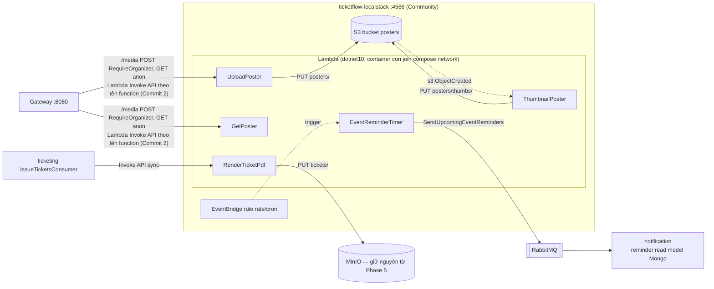

# Phase 9 — Kế hoạch chi tiết theo commit

> **Mục tiêu (từ scope mục 10):** 3 function serverless — (1) thumbnail poster khi upload (event-triggered), (2) render PDF vé tách khỏi ticketing-service, (3) cron nhắc "sự kiện của bạn diễn ra sau 24h". Đây là nơi **Ch15 (Serverless)** sống thật.
> **DoD:** upload poster → tự sinh thumbnail; cron nhắc lịch bắn notification.

> ⚠️ **Viết TRƯỚC khi code** (giống phase-2…phase-8). Hai sự thật cần nói thẳng ngay từ đầu:
> 1. **Đổi Azure Functions (scope gốc) → AWS Lambda** — phản biện scope có chủ đích, không phải trôi dạt: sách dạy Ch15 bằng Azure Functions, nhưng pattern của chương (FaaS, trigger/binding, event-driven compute, function-as-deployment-unit) là khái niệm chung không thuộc về vendor nào; AWS là stack phổ biến hơn hẳn trên thị trường việc làm, và **Phase 9 chưa có dòng code nào** nên chi phí đổi = sửa đúng file plan này. Sách vẫn đọc để lấy pattern; phần vendor-specific tự bù bằng docs AWS. Ghi vào scope.md khi reconcile (Commit 5).
> 2. **"Serverless" chạy local qua LocalStack là mô phỏng, không phải AWS thật** — cái học được thật là programming model (Lambda handler, S3 event notification, EventBridge schedule, invoke API) và workflow deploy (`dotnet lambda package`, `awslocal`); elasticity/billing/cold-start thật cần AWS thật (backlog). LocalStack **Community edition** (bản Pro trả phí — đúng kỷ luật né bẫy license): đủ Lambda/S3/EventBridge cho phase này, nhưng hành vi có thể lệch AWS thật ở góc cạnh — mọi kết luận đều phải qua verify thật trên chính LocalStack, không đoán từ docs AWS.

---

## Bối cảnh: cái gì đã có, cái gì còn thiếu

- **Đã có (Phase 1-8), function chỉ việc móc vào:**
  - MinIO chạy sẵn trong compose (bucket `tickets` do ticketing tự tạo). PDF vé thật đã sinh và lưu ở đây từ Phase 5 — **không đụng vào**, Phase 9 không migrate storage đang chạy tốt.
  - Render PDF hiện nằm **trong** ticketing-service: `IssueTicketsConsumer` gọi `ITicketPdfRenderer` (QuestPDF + QRCoder trong `Ticketing.Infrastructure`) rồi upload MinIO — đúng chỗ scope muốn "tách ra function".
  - Notification-service tồn tại nhưng **log-only** — 2 consumer chỉ ghi log, **chưa có persistence nào** dù scope ghi MongoDB cho nó từ đầu.
  - Contract sẵn có đủ nguyên liệu cho reminder: `CatalogEventPublished` mang `Title/StartsAt/Artist/VenueName` (+ `CatalogEventRescheduled` mang `StartsAt` mới, `CatalogEventCancelled`); `OrderCompleted` mang `OrderId/UserId/EventId`; `NotifyOrderCompleted` mang `CustomerName/CustomerEmail` (nhưng **không có EventId** — xem mục 6).
- **Còn thiếu — gap chặn DoD (phát hiện khi khảo sát code thật):**
  - **media-service không tồn tại.** Scope liệt kê (port 8011, "serverless") nhưng chưa từng dựng — không có chỗ upload poster, không bucket poster, catalog `Event` không có `PosterUrl`. DoD 1 cần dựng cả đường upload, không chỉ function thumbnail.
  - **Không có runtime serverless nào trong compose** — chưa có LocalStack, chưa có Lambda nào, chưa có workflow build/deploy function.
  - **Notification chưa có dữ liệu để nhắc lịch** — cần read model (lần đầu notification có DB thật).

---

## Quyết định kiến trúc cho Phase 9

### 1. Runtime: AWS Lambda (.NET 8 managed runtime) trên **LocalStack Community**, 1 container thêm vào compose
- LocalStack chạy như 1 service compose (`ticketflow-localstack`, port 4566) → **21 container**. Lambda thực thi bằng cách LocalStack tự spawn container con qua Docker socket (`/var/run/docker.sock` mount) — trên Docker Desktop Windows đây là **rủi ro số 1, phải probe trước tiên**: socket mount hoạt động không, và `LAMBDA_DOCKER_NETWORK` có cho lambda container join network của compose để với tới MinIO/RabbitMQ/notification không.
- .NET Lambda theo workflow chính chủ AWS: class library + `Amazon.Lambda.Core`/`Amazon.Lambda.S3Events`, đóng gói bằng `dotnet lambda package` (Amazon.Lambda.Tools), tạo resource bằng `awslocal` trong **init script** mount vào `/etc/localstack/init/ready.d/` — hạ tầng function tái lập được từ script, cùng tinh thần realm-export.json của Keycloak. Pin version (LocalStack image, Amazon.Lambda.*) lúc code sau probe.
- Loại phương án khác, ghi lý do: **Azure Functions + Azurite** (plan gốc — bị thay vì mục tiêu nghề nghiệp, xem đầu file); **SAM local** (chỉ invoke tay, không có event wiring thật — mất bài học event-triggered); **AWS thật** (tốn tiền + cần credentials, phá kỷ luật local-first Docker của cả dự án).

### 2. Bao nhiêu Lambda? BA function riêng biệt (đúng ngữ nghĩa Lambda), MỘT project .NET
- Khác plan Azure cũ (1 function app): Lambda vốn dĩ là **mỗi function một deployment unit** — `create-function` 3 lần là 3 unit độc lập thật, không phải trade-off phải nuốt. Nhưng code sống chung 1 project `src/Functions/TicketFlow.Functions/` (3 handler class) để build/package 1 lần — tách project khi nào 2 function cần dependency xung đột nhau, chưa tới.

### 3. Poster: bucket `posters` trên **LocalStack S3** (không phải MinIO) — vì S3 event notification là chính bài học
- Đường DoD 1: `POST /media/posters` qua gateway (`RequireOrganizer`) → **UploadPoster Lambda** ghi S3 `posters/` → **S3 event notification** (`s3:ObjectCreated:*`, canonical AWS pattern) trigger **ThumbnailPoster Lambda** → resize → ghi `posters/thumbs/`. `GET /media/**` (anonymous) stream qua Lambda — **không presigned URL**, đúng bẫy hostname-nội-bộ đã ăn từ Phase 7/8.
- Vì sao không dùng MinIO cho poster: MinIO không trigger được Lambda của LocalStack một cách chính danh (webhook MinIO → Lambda function URL là franken-pattern, mất bài học S3 notification). Trade-off ghi thật: stack tạm có **2 object store** (MinIO cho tickets — di sản Phase 5 đang chạy tốt, LocalStack S3 cho posters — nơi bài học serverless cần S3 thật); AWS thật thì chỉ có S3, hợp nhất ghi backlog. **LocalStack Community không persist data qua restart** (persistence là tính năng Pro) — poster mất khi restart container, chấp nhận được cho learning phase, cùng tiền lệ "Keycloak dev H2 mất data khi recreate" đã ghi từ Phase 7.
- **[Cập nhật sau Commit 2 — rủi ro số 2 kết luận khác dự tính ban đầu]** Cả 2 phương án nêu ra lúc lập plan (Function URL, LocalStack API Gateway) đều giả định gateway cần 1 URL HTTP cố định để route tới. Probe thật lộ ra vấn đề gốc không lường trước: Function URL của LocalStack sinh hostname **ngẫu nhiên** mỗi lần tạo và **không sống sót qua restart** (Community không persist) — không có URL nào đủ ổn định để gateway hardcode vào `appsettings.json`. Nghiệm đúng hoá ra đơn giản hơn cả 2 phương án đã liệt kê: gateway gọi thẳng qua **Lambda Invoke API theo TÊN function** (ổn định, không đổi qua restart) — chính là cách mục 4 đã chọn cho `RenderTicketPdf`, giờ dùng chung cho cả UploadPoster/GetPoster. Chi tiết đầy đủ trong phase-9-plan.md Commit 2.
- **"Transcode" trong scope thực chất là resize ảnh.** Poster là ảnh tĩnh; không có video ở bất kỳ đâu trong domain — transcode video là vaporware, không làm.
- Thư viện resize: **SkiaSharp** (MIT) — chốt sau probe thật trong chính container Lambda (resize 800×600 → 200×150 thành công, `SkiaSharp.NativeAssets.Linux.NoDependencies` tự mang đủ native lib, không thiếu system dependency). ImageSharp 3.x vẫn Split-License dù learning project không chạm ngưỡng doanh thu — giữ đúng kỷ luật né license phức tạp của cả dự án.
- Catalog `Event.PosterUrl` + hiển thị poster trên frontend: **backlog** — DoD chỉ cần "upload → thumbnail".

### 4. PDF vé: ticketing gọi Lambda **đồng bộ qua Invoke API** (`AmazonLambdaClient.InvokeAsync`, RequestResponse) — giữ nguyên ngữ nghĩa saga
- `RenderTicketPdf` Lambda nhận `TicketPdfModel` + `objectKey` (**ticketing vẫn là chủ naming convention**), render QuestPDF/QRCoder, **tự upload MinIO** (bytes không round-trip), trả về key. QuestPDF/QRCoder **xoá khỏi `Ticketing.Infrastructure`** — dependency slimming là cái được thật của bài tách.
- Vì sao đồng bộ: saga hiện hoàn thành đơn với `TicketPdfUrls` đã tồn tại thật — chuyển async là đổi ngữ nghĩa `OrderCompleted` (đơn Confirmed trước khi PDF tồn tại → "View PDF" race 404 trên UI), thay đổi hành vi người dùng thấy được chỉ để đổi cơ chế trigger. Invoke đồng bộ là first-class API của Lambda, không phải đi vòng. Lỗi Lambda → consumer throw → MassTransit retry sẵn có từ Phase 5 lo.
- `ITicketPdfRenderer` (port) đổi thành `Task<string> RenderAndStoreAsync(model, objectKey, ct)`; adapter mới `LambdaTicketRenderClient` (AWSSDK.Lambda, endpoint trỏ LocalStack). Port nội bộ, đổi được.

### 5. Cron reminder: **EventBridge schedule rule** (rate/cron) trigger Lambda **thin** — logic nằm ở notification-service
- EventBridge rule (24h prod / 1 phút dev — configurable qua init script) trigger `EventReminderTimer` Lambda; Lambda chỉ làm một việc: publish `SendUpcomingEventReminders` lên RabbitMQ (MassTransit — project Functions tham chiếu `BuildingBlocks.Messaging` sẵn có; lambda container phải join được compose network, đã nằm trong rủi ro số 1). **Toàn bộ logic "ai cần nhắc" nằm trong notification-service** — nơi sở hữu dữ liệu người nhận, function là trigger, service là domain; nhét query + gửi vào Lambda là tuồn domain logic ra ngoài bounded context.
- **Rủi ro số 3:** EventBridge schedule → Lambda trong LocalStack Community phải probe bắn thật theo chu kỳ, không tin docs.

### 6. Reminder read model trong notification (lần đầu có Mongo thật, đúng DB scope hứa)
- Consume `CatalogEventPublished`/`CatalogEventRescheduled`/`CatalogEventCancelled` (lịch) + `NotifyOrderCompleted` (người mua — **thêm `EventId` vào contract**: additive, backward-compatible, saga có sẵn trong state, tiền lệ Phase 6 đã thêm field vào `CatalogEventPublished`). Consumer `SendUpcomingEventRemindersConsumer` query "event bắt đầu trong cửa sổ X giờ, người mua chưa nhắc" → log notification (giả lập gửi, như mọi notification hiện tại) → đánh dấu đã nhắc (**idempotent** — chạy 2 lần không nhắc 2 lần).
- **Verify không đợi 24h thật:** cửa sổ + lịch đều configurable; dev dùng rate 1 phút + seed event `StartsAt` trong cửa sổ — "không chứng minh điều âm bằng chờ thời gian thật" (nguyên tắc từ Phase 8 Commit 6).

### 7. Auth: gateway enforce, Lambda tin Docker network — nhất quán mô hình 2 tầng Phase 7
- `POST /media/posters` → `RequireOrganizer` tại gateway; `GET /media/**` anonymous. `RenderTicketPdf` và `EventReminderTimer` **không route qua gateway** — chỉ gọi được từ Docker network (cùng trust boundary có chủ đích như các service-tier endpoint khác của dự án).

---

## Nhóm A — Móng runtime

### Commit 1 — `chore(functions): LocalStack + Lambda .NET hello — probe toàn chuỗi trigger` ✅ DONE

- Compose thêm `ticketflow-localstack` (docker.sock mount, `LAMBDA_DOCKER_NETWORK: ticketflow-network`, init script mount `../localstack/init:/etc/localstack/init/ready.d:ro`, + mount riêng `../../src/Functions:/functions:ro` để init script đọc được zip build từ host). Scaffold `src/Functions/TicketFlow.Functions/` (class-library Lambda, `AWSProjectType=Lambda`, `Amazon.Lambda.Core` + `Amazon.Lambda.Serialization.SystemTextJson`) với 2 hàm probe: `HelloFunction` (invoke tay) và `HelloTimerFunction` (EventBridge rate 1 phút). Workflow deploy: `dotnet lambda package` chạy trên HOST (không có .NET SDK trong container LocalStack) → zip xuất hiện qua mount → `infrastructure/localstack/init/01-deploy-functions.sh` (idempotent, chạy tự động mỗi lần LocalStack start) tạo IAM role giả + 2 function + EventBridge rule/target/permission qua `awslocal`.

**🐛 Sự cố môi trường thật (không phải bug code, nhưng đổi cả kiến trúc lệnh trong plan) — LocalStack không còn image Community miễn phí không cần tài khoản.** Kể từ tháng 3/2026 LocalStack gộp Community+Pro thành 1 image, **bắt buộc tài khoản + `LOCALSTACK_AUTH_TOKEN`** kể cả tier miễn phí "Hobby". Đây là lý do dừng lại hỏi hướng xử lý trước khi code Commit 1 — tạo tài khoản là hành động tôi không được tự làm thay user. User tự đăng ký, đưa token qua chat → lưu vào `.env` (gitignored) ở root, Docker Compose tự đọc khi `docker compose up`. Không có gì khác trong plan phải đổi — Lambda service vẫn nằm trong tier Hobby miễn phí, chỉ Layers/Kafka event source mapping mới khoá Pro (phase này không dùng cả 2).

**🐛 Bug thật nghiêm trọng nhất — handler `void` làm crash Runtime Interface Emulator, gây vòng lặp invoke bất tận.** `HelloTimerFunction` bản đầu tiên có chữ ký `void Handler(JsonElement, ILambdaContext)` — deploy xong, gọi `awslocal lambda invoke` một lần, rồi quan sát thấy log tick lặp lại **mỗi ~2 giây liên tục hàng phút**, tưởng là bug retry policy của EventBridge. Cô lập nguyên nhân thật bằng cách loại từng biến số: (1) xoá hẳn EventBridge rule/target → vòng lặp **vẫn tiếp diễn**, loại bỏ khả năng do EventBridge retry; (2) gọi trực tiếp `awslocal lambda invoke` một lần duy nhất (không qua EventBridge) → **vẫn lặp** → chứng minh vòng lặp không liên quan gì tới nguồn trigger; (3) đọc log thật của container executor đã "Exited" → lộ ra `panic: runtime error: invalid memory address or nil pointer dereference` bên trong chính `aws-lambda-runtime-interface-emulator` (Go, phần lõi RIE đóng gói sẵn trong base image `public.ecr.aws/lambda/dotnet:10`) — container crash rồi bị LocalStack tự khởi động lại, khởi động lại thì lại crash, tạo thành vòng lặp nhìn giống hệt "invoke liên tục" từ bên ngoài. Đổi `void Handler(...)` → `string Handler(...)` (trả về message thay vì không trả gì) → hết crash, hết lặp, vẫn giữ `JsonElement` làm input (test riêng xác nhận input type KHÔNG phải nguyên nhân — chỉ return type `void` mới gây crash). **Quy tắc rút ra cho toàn bộ dự án từ giờ: mọi Lambda handler phải trả về giá trị thật, không dùng `void`** — ghi làm quy ước bắt buộc, không phải gợi ý.
- Đây là bug thật đáng tin cậy để công khai vì lý do dotnet10 vừa được AWS Lambda hỗ trợ chính thức từ tháng 1/2026 (xác nhận qua tra cứu thật, không đoán) — RIE cho runtime này còn rất mới, hợp lý khi có edge case chưa chín.

**Verify thật (3 rủi ro nêu ở đầu phase đều ngã ngũ ở đây):**
- **Rủi ro #1 (docker.sock + `LAMBDA_DOCKER_NETWORK` trên Docker Desktop Windows):** xác nhận qua chính log tạo container của LocalStack (`'network': 'ticketflow-network'` trong debug log) — container executor Lambda thật sự join đúng network. Xác nhận độc lập bằng container `alpine` chạy tay trên `ticketflow-network`: `nc -zv rabbitmq 5672` và `nc -zv minio 9000` đều `open`. Không đợi tới Commit 3/4 mới biết — ngã ngũ ngay ở đây.
- **.NET 10 managed runtime:** `awslocal lambda create-function --runtime dotnet10` được chấp nhận thẳng, LocalStack pull thật `public.ecr.aws/lambda/dotnet:10` (không phải giả lập riêng của LocalStack — dùng đúng base image AWS thật), khớp xác nhận trước đó qua tra cứu rằng AWS Lambda đã hỗ trợ .NET 10 từ 01/2026.
- `awslocal lambda invoke --function-name HelloFunction` trả đúng response thật (`"Hello, world! ..."`), log xuất hiện đúng trong CloudWatch Logs (`awslocal logs describe-log-groups` → `/aws/lambda/HelloFunction`).
- EventBridge rule `rate(1 minute)` sau khi fix bug void: theo dõi thật ~3 phút, đúng nhịp (không lặp), mỗi tick 1 request id riêng biệt, 1 container executor ổn định (không bị tạo lại liên tục).
- **Restart resilience:** `docker compose stop/rm localstack` rồi `up -d` lại → init script tự chạy lại sạch (log `[functions] deploying...` xuất hiện lại), 2 function tồn tại trở lại, invoke thành công ngay, EventBridge tick lại đúng nhịp — đúng kỳ vọng "LocalStack Community không persist qua restart, nhưng init script tái lập từ đầu mỗi lần".
- Regression: **81/81** (76 unit/domain + 5 Reservation integration test — không đổi vì Commit 1 không đụng code service nào có sẵn, chỉ thêm project mới). `dotnet build` cả solution sạch. `docker ps` đủ 21 container ổn định (không tính các container executor Lambda tạm thời, xuất hiện/biến mất theo `LAMBDA_KEEPALIVE_MS`).

## Nhóm B — DoD 1: poster

### Commit 2 — `feat(media): upload poster qua gateway + S3 notification → thumbnail Lambda (DoD 1)` ✅ DONE

- 3 Lambda mới trong cùng project `TicketFlow.Functions`: `UploadPosterFunction`, `GetPosterFunction`, `ThumbnailPosterFunction`. Bucket S3 `posters` (LocalStack), object gốc ghi dưới `originals/`, thumbnail dưới `thumbs/` — tách prefix rõ ràng để bucket notification (`s3:ObjectCreated:*`, filter prefix `originals/`) không tự kích hoạt lại chính nó khi `ThumbnailPosterFunction` ghi thumbnail vào cùng bucket.
- **Gateway KHÔNG route qua YARP tới Lambda** — đổi hẳn so với dự tính ban đầu, xem bug thật bên dưới. `MediaEndpoints.cs` là 2 minimal-API endpoint mới (`POST /media/posters` `RequireOrganizer`, `GET /media/{**key}` anonymous) gọi thẳng `AWSSDK.Lambda`'s `InvokeAsync` theo **tên function** (`UploadPosterFunction`/`GetPosterFunction`) — đúng pattern đã chốt sẵn ở mục 4 cho ticketing→`RenderTicketPdf`, giờ dùng luôn cho cả media. `ThumbnailPosterFunction` không có endpoint gọi trực tiếp — chỉ trigger qua S3 notification.
- Chọn **SkiaSharp** (không ImageSharp) — tra cứu thật xác nhận ImageSharp 3.x vẫn Split-License (min. Apache-2.0 dưới $1M doanh thu/năm — với learning project thì thực ra vẫn miễn phí, nhưng giữ đúng kỷ luật né license phức tạp đã áp dụng suốt dự án). `SkiaSharp.NativeAssets.Linux.NoDependencies` build sẵn cho đúng bài toán: môi trường Lambda tối giản thiếu system lib (fontconfig...) mà SkiaSharp thường cần — gói `.NoDependencies` tự static-link, né đúng lớp lỗi "thiếu .so" mà môi trường serverless hay gặp.

**🐛 Bug thật, đổi cả kiến trúc mục 3 — Lambda Function URL không dùng được để gateway route tới vì hostname random, không sống sót qua restart.** Thử phương án gốc trước: tạo `create-function-url-config`, LocalStack trả về hostname dạng `<random-id>.lambda-url.us-east-1.localhost.localstack.cloud:4566`. Probe 2 bước:
  1. Gọi thẳng hostname đó từ container khác trên `ticketflow-network` → connection refused — hostname `*.localhost.localstack.cloud` là bản ghi DNS công khai trỏ CỨNG về `127.0.0.1`, chỉ đúng trên chính máy chạy LocalStack, không đúng từ container khác (loopback của container khác, không phải của LocalStack).
  2. Dùng mẹo override header `Host` khi connect thẳng vào `ticketflow-localstack:4566` (địa chỉ container thật) → route ĐÚNG tới Lambda (xác nhận qua log: LocalStack build đúng payload kiểu API Gateway v2 gửi cho hàm) — nhưng đây chỉ giải quyết được vấn đề DNS, KHÔNG giải quyết được vấn đề gốc: **`<random-id>` đổi mỗi lần `create-function-url-config` chạy lại, và LocalStack Community không persist qua restart** → gateway (file `appsettings.json` tĩnh) không có cách nào biết trước giá trị này để hardcode.
  - **Fix = đổi kiến trúc, không phải vá lỗi:** bỏ hẳn Function URL cho `UploadPosterFunction`/`GetPosterFunction`, gateway gọi thẳng qua **Lambda Invoke API theo tên function** (tên ổn định, không đổi qua restart) — đúng pattern mục 4 (ticketing→RenderTicketPdf) vốn đã chọn sẵn cho lý do khác (giữ ngữ nghĩa saga đồng bộ); giờ hoá ra còn là lựa chọn ĐÚNG duy nhất cho bài toán "gateway cần địa chỉ ổn định". Xoá luôn dependency `Amazon.Lambda.APIGatewayEvents` (chỉ cần khi expose HTTP trực tiếp) — 2 hàm Upload/Get đổi sang nhận/trả record C# thuần, không còn "vỏ" HTTP request/response nào cả.
  - Bài học ghi rõ: đây là giới hạn thật của LocalStack Community trong Docker Compose cục bộ, không phải giới hạn của AWS thật (trên AWS thật, Function URL là 1 địa chỉ cố định gắn với function, deploy 1 lần là ổn định mãi) — nhưng đúng bản chất "học pattern, không giả vờ hơn" đã ghi ở đầu phase.

**Verify thật (DoD 1 khép ở đây) — dùng ảnh PNG thật 800×600, không giả lập:**
- Upload qua `POST /media/posters` với token `organizer1` thật, qua gateway thật (không gọi thẳng LocalStack) → `201`, trả đúng `{key, thumbnailKey}`. Vài giây sau, `awslocal s3 ls s3://posters/ --recursive` xác nhận thumbnail **tự xuất hiện** — không có bước gọi thumbnail thủ công nào.
- Tải cả 2 file qua `GET /media/originals/...` và `GET /media/thumbs/...` (không token) → cả 2 `200`, `content-type: image/png`. Mở bằng Pillow xác nhận kích thước thật: gốc `800×600`, thumbnail đúng `200×150` (tỉ lệ giữ nguyên, đúng công thức resize).
- Customer token → `403`; không token → `401` (cả 2 test trên `POST /media/posters`).
- Upload 1 file text thuần (`.txt`) giả làm ảnh → `400` sạch (`"Uploaded file is not a recognized image"`), xác nhận qua `s3 ls` **không có object rác nào được tạo** — validate bằng magic byte thật (PNG/JPEG signature), không tin `Content-Type` client tự khai.
- Kiểm tra chống vòng lặp vô hạn: sau toàn bộ test, bucket chỉ có đúng 1 cặp `originals/*`+`thumbs/*` mỗi lần upload — không có `thumbs/thumbs/...` hay chuỗi đệ quy nào, xác nhận filter prefix `originals/` hoạt động đúng.
- **Restart resilience** (init script `02-deploy-media.sh`, chạy sau `01-deploy-functions.sh`): tear down toàn bộ LocalStack + build lại `function.zip` mới nhất → `docker compose up -d localstack` → cả 2 script tự chạy sạch, 5 function (`Hello*` + `UploadPoster`/`GetPoster`/`ThumbnailPoster`) tồn tại lại, bucket + notification config tái lập đúng — test lại toàn bộ luồng ngay sau restart, kết quả giống hệt trước khi restart.
- Regression: **81/81** (76 unit/domain + 5 Reservation integration — không đổi, chỉ Gateway + Functions bị chạm, không service nghiệp vụ nào khác). `dotnet build` cả solution sạch. `docker ps` đủ 21 container ổn định (không tính executor Lambda tạm thời + `testcontainers-ryuk` do chính lần chạy integration test sinh ra).

## Nhóm C — tách PDF

### Commit 3 — `feat(ticketing,functions): tách render PDF vé ra Lambda` ✅ DONE
- `RenderTicketPdfFunction` Lambda (QuestPDF/QRCoder — di chuyển nguyên logic từ `QuestPdfTicketRenderer` đã xoá — tự upload MinIO bucket `tickets`, trả về `objectKey`); `IssueTicketsConsumer` gọi qua `LambdaTicketRenderClient` (AWSSDK.Lambda Invoke API theo tên function → LocalStack, cùng pattern `MediaEndpoints.cs` đã dùng ở Commit 2). **Xoá QuestPDF/QRCoder khỏi `Ticketing.Infrastructure.csproj`**, chuyển sang `TicketFlow.Functions.csproj`.
- `ITicketPdfRenderer.Render(model): byte[]` (đồng bộ, trả bytes) đổi thành `RenderAndStoreAsync(model, objectKey, ct): Task<string>` — bytes không round-trip qua Invoke API nữa, chỉ objectKey đi qua lại. Hệ quả kéo theo: `ITicketObjectStorage.UploadAsync` **xoá luôn** (dead code thật — Lambda giờ là writer duy nhất của bucket `tickets`, tự làm `EnsureBucketExistsAsync` của chính nó thay vì dựa vào `MinioTicketObjectStorage`); `ITicketObjectStorage` giờ chỉ còn `DownloadAsync` cho endpoint tải vé.
- Env vars (`MINIO_ENDPOINT=minio:9000`, `MINIO_ACCESS_KEY`, `MINIO_SECRET_KEY`, `MINIO_BUCKET_NAME=tickets`) truyền qua `--environment Variables={...}` trong init script `03-deploy-ticketing.sh` — LocalStack không tự inject credentials MinIO như nó làm với S3 (AWS-native) ở Commit 2, phải khai rõ.

**Verify thật (mua vé end-to-end qua Gateway thật, không gọi thẳng service):**
- Order `dc919448-...` → `Confirmed` trong ~2s; `s3://tickets/dc919448-.../a02b02b4-....pdf` (MinIO, 53105 bytes) xuất hiện đúng lúc — khớp chính xác với log `RenderTicketPdf: ... -> MinIO bucket 'tickets'` trong `ticketflow-localstack` cùng timestamp. Tải PDF thật, `pypdf` đọc được text: đúng `OrderId`/`EventId`/`SeatId`/`CustomerName` (khớp JWT claim `name` của `customer1`)/`TicketId`, có 1 ảnh QR nhúng — không phải file rác.
- **Kịch bản lỗi, kết quả THẬT khác dự tính ban đầu trong plan (đã sửa câu verify phía trên cho khớp):** dừng `ticketflow-localstack` → mua vé → order đi thẳng tới `Cancelled` trong ~6.5s, **không có vòng lặp retry nào cả**, không phải "saga retry rồi bật lại hoàn tất" như dự tính lúc lập plan. Lý do thật: `IssueTicketsConsumer` có sẵn `try/catch` bọc toàn bộ thân hàm từ Phase 5 Commit 8/9 (bắt mọi exception, publish `TicketingFailed`, không `throw` lại) — lỗi `HttpRequestException: Name or service not known (ticketflow-localstack:4566)` từ `LambdaTicketRenderClient` bị catch bắt ngay, MassTransit transport-level redelivery **không bao giờ được kích hoạt** cho kiểu lỗi này (khác PostgreSQL/RabbitMQ transient error mà MassTransit tự retry). Saga chạy đúng full compensation path có sẵn: `TicketingFailed` → `RefundPayment` → `PaymentRefunded` → `ReleaseSeats` → `SeatsReleased` → `Cancelled`, ghế trả về `Available` thật (xác nhận qua availability endpoint). Đây là hành vi **nhất quán với thiết kế đã có từ Phase 5** (Lambda không tạo ra failure mode mới, chỉ là một nguồn lỗi khác đi qua đúng con đường compensation cũ) — không phải bug, nhưng câu verify gốc trong plan đoán sai cơ chế nên sửa lại đây cho đúng thực tế.
- Bật lại LocalStack → 6 Lambda (kể cả `RenderTicketPdfFunction`) redeploy sạch trong ~6s; đơn bị `Cancelled` ở trên **không tự hồi phục** (đúng kỳ vọng — saga đã finalize ở nhánh compensation, không còn message nào để MassTransit redeliver). Đặt đơn mới cho cùng ghế sau khi phục hồi → `Confirmed` sạch, PDF render bình thường — hệ thống khoẻ lại hoàn toàn.
- **Gap phát hiện thêm (có thật nhưng không thuộc phạm vi Commit 3 — không sửa ở đây):** `MyOrderView`/`GetOrderByIdQueryHandler` không expose PDF object key nào trong response (`MyOrdersProjection.Apply(OrderTicketsIssued, ...)` chỉ cập nhật `Status`, bỏ qua `TicketPdfUrls`) — lỗ hổng read-model có từ trước, không phải do lần tách Lambda này gây ra. Ghi vào backlog.
- Regression: **81/81** (76 unit/domain + 5 Reservation integration — không service nào khác bị đụng, không cần sửa test nào vì `TicketFlow.Ticketing.Domain.Tests` không đụng tới renderer). `dotnet build` cả solution sạch.

## Nhóm D — DoD 2: cron reminder + finalize

### Commit 4 — `feat(notification,functions): reminder read model + EventBridge cron (DoD 2)` ✅ DONE
- Thêm `EventId` vào `NotifyOrderCompleted` (additive, saga đã có `CatalogEventId` sẵn trong state — chỉ thêm ở publish site). Notification tách từ flat 1-project thành đúng Ports & Adapters như mọi service khác của dự án: `TicketFlow.Notification.Application` (port `IEventReminderReadModel` + `ReminderOptions`), `TicketFlow.Notification.Infrastructure` (`MongoEventReminderReadModel` — 2 collection Mongo `eventSchedules` (_id=CatalogEventId) + `reminderRecipients` (_id=OrderId), cùng `MongoSerializationConfig`/`MongoHealthCheck` sao y pattern Recommendation Phase 6 Commit 3). 5 consumer trong `TicketFlow.Notification.Api`: `CatalogEventPublishedConsumer`/`NotifyOrderCompletedConsumer` (đã có, nối thêm ghi read model), `CatalogEventRescheduledConsumer`/`CatalogEventCancelledConsumer` (mới), `SendUpcomingEventRemindersConsumer` (mới — toàn bộ logic "ai cần nhắc" nằm ở đây, window configurable qua `Reminder:WindowHours`, mặc định 24h).
- **Quyết định kỹ thuật đáng chú ý:** dates lưu Mongo dưới dạng `DateTime` UTC thuần, không phải `DateTimeOffset` — driver mặc định serialize `DateTimeOffset` thành mảng `[ticks, offsetMinutes]`, không phải kiểu BSON date gốc, nên `$gte`/`$lte` range query (bắt buộc cho câu hỏi "event nào bắt đầu trong N giờ tới") không có gì đảm bảo đúng thứ tự thời gian trên dạng mảng đó — né chủ động thay vì probe rồi mới phát hiện lỗi.
- `EventReminderTimerFunction` (Lambda, `src/Functions/TicketFlow.Functions/`) đứng riêng khỏi ASP.NET Core: không có `IServiceCollection`/`IHost` sẵn có (project là `AWSProjectType=Lambda`, class library thuần), nên tự dựng 1 `Microsoft.Extensions.Hosting` generic host tối giản để tái dùng `AddTicketFlowMessaging` (cùng retry/endpoint-naming config như mọi service khác) thay vì tự viết raw MassTransit bus. Host dựng 1 lần, lưu `static readonly` — cùng pattern `S3ClientFactory`/`MinioClientFactory` đã dùng ở Commit 2/3. Env var RabbitMQ dùng convention `RabbitMq__Host` (double-underscore, ASP.NET Core config binding đọc được ngay).
- Init script `04-deploy-notification.sh`: deploy `EventReminderTimerFunction` + EventBridge rule `rate(1 minute)` (dev), configurable qua `EVENT_REMINDER_SCHEDULE` env var trước `docker compose up` (prod dùng `rate(24 hours)`).

**Verify thật (DoD 2 khép ở đây) — 2 kịch bản, cả 2 dùng event/purchase thật, không seed giả:**
- **Test A (in-window, idempotent):** event "Commit4 Verify - In Window" `StartsAt` = now+2h, mua vé thật → order `Confirmed` → tick đầu tiên log đúng thật: `[notification] nhắc Customer One <customer1@ticketflow.dev> — sự kiện 'Commit4 Verify - In Window' (Test Artist A @ Phu Tho Stadium) bắt đầu lúc 07/18/2026 03:06:17 +00:00, order f42e23a8-...` — khớp chính xác tên/email/tựa/nghệ sĩ/địa điểm/giờ/orderId. Tick tiếp theo (chờ thật 95s) **không log lần 2**, và bằng chứng thật hơn cả log: `RemindedAt` trong Mongo **không đổi giá trị** giữa 2 lần kiểm tra — đây mới là bằng chứng idempotent thật, không chỉ "không thấy log trùng".
- **Test B (ngoài cửa sổ → reschedule vào cửa sổ):** event "Commit4 Verify - Out Of Window" `StartsAt` = now+48h (ngoài 24h), mua vé thật → order `Confirmed`, `reminderRecipients` doc tồn tại `RemindedAt: null` → chờ 1 tick thật, **không bị nhắc** (đúng — window filter thật sự loại nó, không phải "chưa kịp chạy"). Reschedule qua `PUT /catalog/events/{id}` (`StartsAt` mới = now+2h) → xác nhận `eventSchedules.StartsAt` trong Mongo đổi đúng giá trị mới → tick tiếp theo, **giờ mới bị nhắc**, `RemindedAt` chuyển từ null sang có giá trị — chứng minh đúng "hành vi đổi theo reschedule" DoD yêu cầu.
- Regression: **81/81** (76 unit/domain + 5 Reservation integration). `dotnet build` cả solution sạch. `docker logs ticketflow-notification` suốt cửa sổ verify không có exception/error nào.

### Commit 5 — `chore: finalize Phase 9 — Azure→AWS reconcile, DoD` ✅ DONE
- `scope.md` reconcile (3 chỗ): mục 5 (bảng hạ tầng) đổi dòng **Azure Functions → AWS Lambda + LocalStack**, ghi lý do nghề nghiệp + "pattern FaaS là khái niệm chung, không thuộc vendor" + nhắc rõ LocalStack là mô phỏng local; mục 4 (bảng service) sửa dòng **media-service**: không phải service HTTP :8011 như bảng gốc — là Lambda gateway gọi qua Invoke API; mục "Cấu trúc thư mục" xoá `Services/Media/` (không tồn tại — media nằm trong `Functions/`), sửa comment `Functions/` từ "Azure Functions" sang "AWS Lambda (LocalStack)".
- `scope.md` mục "Phase 9" (lộ trình theo phase): tick DoD ✅✅, thêm đoạn "Hoàn thành 2026-07-18" theo đúng format các phase trước (Phase 7/8) — liệt kê verify thật + 1 quyết định lệch scope (Azure→AWS) + bug thật đáng chú ý nhất (Lambda `void` handler crash RIE, LocalStack Function URL không ổn định).
- File plan này (`phase-9-plan.md`): đã cập nhật real-time qua từng Commit 1-4 (không đợi tới đây) — Commit 5 chỉ còn việc tick DoD cuối file + rà lại toàn bộ 1 lượt cho khớp trạng thái cuối.

---

## Sơ đồ Phase 9

---

## Kiểm chứng DoD cuối Phase 9

| DoD | Kiểm chứng |
|---|---|
| ✅ Upload poster → tự sinh thumbnail | Commit 2: upload thật qua gateway → S3 notification → thumbnail thật trong S3 |
| ✅ Cron nhắc lịch bắn notification | Commit 4: EventBridge tick thật → command → notification log đúng người/sự kiện, idempotent |

**Phase 9 hoàn thành 2026-07-18** — 5/5 commit xong, cả 5 đều verify bằng Docker/LocalStack thật (không dừng ở `dotnet build`). Regression giữ nguyên 81/81 xuyên suốt (không service nghiệp vụ nào có sẵn bị hỏng), riêng Notification đổi từ flat 1-project thành đúng Ports & Adapters ở Commit 4 (nhất quán kiến trúc với các service khác). Reconcile về `scope.md` đã ghi ở Commit 5 phía trên.

## Hướng mở rộng (backlog — không thuộc Phase 9)
- **Deploy AWS thật** (Lambda + S3 + EventBridge Scheduler) — local chỉ mô phỏng; cold-start/billing/IAM thật học ở đó.
- **Hợp nhất object store** (MinIO tickets → S3) khi lên AWS thật (mục 3).
- **Catalog `Event.PosterUrl` + hiển thị poster trên customer-web/organizer-dashboard** (mục 3).
- **Gửi email thật** (SES/SMTP) — notification vẫn log-only có chủ đích từ Phase 5.
- **Amazon MQ event source mapping** (RabbitMQ trigger Lambda thật) nếu có ngày lên AWS thật — thay Invoke đồng bộ ở mục 4.
- **Ký QR (HMAC/JWS)** — kế thừa backlog Phase 5/8, Lambda render là chỗ tự nhiên để thêm khi làm.
- **`MyOrderView` không expose PDF object key** (phát hiện khi verify Commit 3) — `MyOrdersProjection.Apply(OrderTicketsIssued, ...)` bỏ qua `TicketPdfUrls`, đơn `Confirmed` không tự lộ ra đường dẫn PDF qua `GET /ordering/orders/{id}`; hiện phải suy ra key qua convention `{orderId}/{seatId}.pdf` hoặc gọi `GET /tickets/{id}/pdf` bên ticketing riêng. Có từ trước Phase 9, không phải lỗi do tách Lambda.

## Thứ tự đọc trước khi code (scope mục 13)
Đọc **Ch15 (Serverless)** — lấy pattern FaaS/trigger/binding (sách dùng Azure Functions, pattern là chung — đối chiếu quyết định đổi vendor ở đầu file). Bổ sung ngoài sách: **AWS Lambda .NET** (handler class library, `Amazon.Lambda.Tools`, managed runtime dotnet10 — xác nhận AWS hỗ trợ chính thức từ 01/2026, không phải dotnet8 như dự đoán ban đầu), **LocalStack** (Community limits, `LAMBDA_DOCKER_NETWORK`, init hooks `ready.d/`, persistence không có ở Community), **S3 event notifications**, **EventBridge schedule expressions** (rate/cron), **Lambda function URL vs API Gateway (Invoke API thắng, Commit 2/3)**, license **ImageSharp 3.x vs SkiaSharp**, và MassTransit publish từ app không phải ASP.NET host (generic host tối giản, Commit 4).
