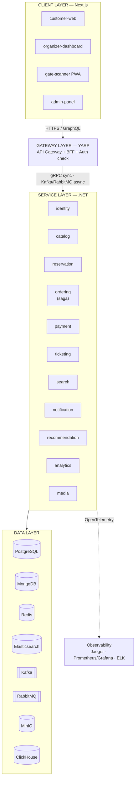
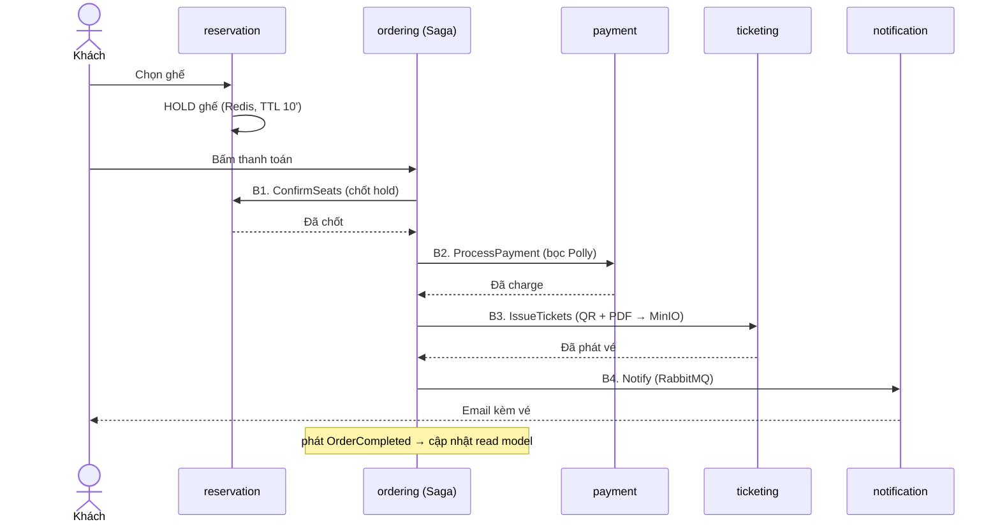
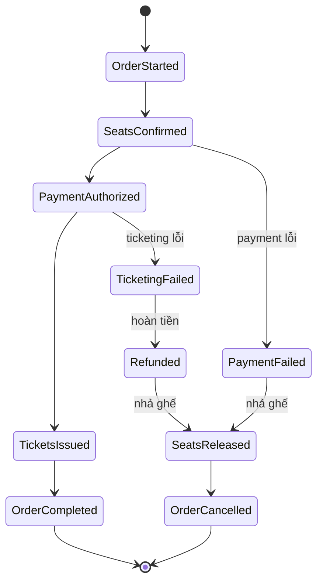

# 🎟️ TicketFlow — Scope & Kế hoạch chi tiết

Nền tảng bán vé sự kiện (concert / thể thao) xây bằng **.NET microservices**. Mục tiêu học tập: đi hết **17 chương** sách *Microservices Design Patterns in .NET (Trevoir Williams, 2nd Ed.)* và **toàn bộ công nghệ** trong project `D:\code\grab`, nhưng trên một domain mới do mình tự thiết kế kiến trúc từ đầu.

> **Cách dùng file này:** đây là "bản đồ" tổng thể. Mỗi phase là một milestone chạy được. Không nhảy phase — mỗi phase dựa trên phase trước. Khi làm xong 1 phase, tick vào "Definition of Done" của nó.

---

## 1. Tại sao domain "bán vé"?

Domain này **tự nhiên** đòi hỏi mọi pattern trong sách, không phải nhét gượng:

- **Saga + concurrency**: nhiều người giành 1 ghế cùng lúc → chống overselling là bài toán distributed systems thật.
- **Event Sourcing**: vòng đời vé/đơn hàng (đặt → giữ chỗ → thanh toán → phát vé → check-in / hủy / hoàn tiền) là chuỗi event bất biến hoàn hảo.
- **CQRS**: đọc ("vé của tôi", "sơ đồ ghế còn trống") và ghi (đặt vé) có yêu cầu rất khác nhau.
- Là câu **system design interview kinh điển** ("design Ticketmaster") → học và luyện phỏng vấn cùng lúc.

---

## 2. Nguyên tắc thiết kế

1. **Database-per-service** — không service nào đụng DB của service khác. Giao tiếp qua API hoặc event.
2. **Domain-Driven Design** — mỗi service là một bounded context, có ngôn ngữ chung (ubiquitous language) riêng.
3. **Async-first** — mặc định giao tiếp bất đồng bộ qua message; chỉ dùng sync (gRPC/REST) khi thật sự cần trả lời ngay trong request.
4. **Event-driven + Outbox** — mọi thay đổi state phát ra domain event, publish tin cậy bằng **Transactional Outbox** (không mất event khi DB commit nhưng broker chết).
5. **Resilient by default** — mọi lời gọi mạng bọc Polly (retry + circuit breaker + timeout), mọi handler idempotent.
6. **Observable by default** — mọi service gắn OpenTelemetry (trace + metric + log) ngay từ đầu, không để tới cuối.

---

## 3. Kiến trúc tổng thể



> Runtime: Docker Compose (local) → Kubernetes (Ch14).

---

## 4. Bounded Contexts / Services

| Service | Trách nhiệm | DB chính | Store phụ | Port (HTTP/gRPC) |
|---|---|---|---|---|
| **gateway** | Định tuyến, BFF, xác thực token | — | — | 8080 |
| **identity-service** | Auth, user, role (customer/organizer/admin) | PostgreSQL | Redis (session) | 8001 / 9001 |
| **catalog-service** | Sự kiện, venue, sơ đồ ghế, hạng giá | PostgreSQL | — | 8002 / 9002 |
| **reservation-service** | Giữ chỗ (hold có TTL), tình trạng ghế, chống overselling | Redis (lock/hold) | PostgreSQL (chốt) | 8003 / 9003 |
| **ordering-service** | Vòng đời đơn hàng, **host Saga** (event-sourced + CQRS) | PostgreSQL (Marten) | — | 8004 / 9004 |
| **payment-service** | Thanh toán, ví, hoàn tiền (resiliency) | PostgreSQL | — | 8005 / 9005 |
| **ticketing-service** | Phát vé, sinh QR/PDF, validate tại cổng | PostgreSQL | MinIO (PDF) | 8006 / 9006 |
| **search-service** | Tìm sự kiện theo nghệ sĩ/venue/ngày/thành phố | Elasticsearch | — | 8007 |
| **notification-service** | Email/SMS/push (vé, nhắc lịch) | MongoDB | RabbitMQ | 8008 |
| **recommendation-service** | "Sự kiện gợi ý cho bạn" | MongoDB | Redis | 8009 |
| **analytics-service** | Doanh số, lượt xem, dashboard organizer | ClickHouse | — | 8010 |
| **media-service** | Poster, ảnh nghệ sĩ, thumbnail (serverless) | MinIO | — | 8011 |

Frontends (micro-frontends — Ch12):

| App | Vai trò | Tech | Port |
|---|---|---|---|
| customer-web | Duyệt, tìm, mua vé | Next.js 15 + shadcn | 3000 |
| organizer-dashboard | Tạo sự kiện, sơ đồ ghế, xem doanh số | Next.js | 3001 |
| gate-scanner | Quét QR check-in tại cổng | Next.js PWA | 3002 |
| admin-panel | Quản trị nền tảng | Next.js | 3003 |

---

## 5. Hạ tầng dùng chung & lý do chọn

| Công nghệ | Dùng cho | Chương liên quan |
|---|---|---|
| **PostgreSQL 16** | System of record cho catalog/identity/ordering/payment/ticketing | Ch8 |
| **MongoDB 7** | Read model & dữ liệu linh hoạt (notification, recommendation) | Ch8 |
| **Redis 7** | Distributed lock giữ ghế, cache, pub/sub real-time | Ch8, Ch10 |
| **Elasticsearch 8** | Full-text search sự kiện | Ch8 |
| **Kafka** | **Event bus** domain event + feed event-sourcing + nạp analytics (throughput cao, replay được) | Ch4, Ch7 |
| **RabbitMQ** | **Command/work queue** + transport cho MassTransit Saga (routing, ack, retry) | Ch4, Ch9 |
| **MinIO** | Lưu poster, PDF vé (S3-compatible) | Ch15 |
| **ClickHouse** | Kho analytics dạng cột, query tổng hợp nhanh | Ch16 |
| **OpenTelemetry + Jaeger** | Distributed tracing | Ch16 |
| **Prometheus + Grafana** | Metrics + dashboard + alert | Ch16 |
| **ELK (Serilog→ES→Kibana)** | Log tập trung | Ch16 |
| **Docker + K8s** | Đóng gói & orchestration | Ch14 |
| **Azure Functions** | Serverless (transcode ảnh, sinh PDF, nhắc lịch) | Ch15 |
| **GitHub Actions** | CI/CD | Ch14, Ch17 |

> **Vì sao cả Kafka lẫn RabbitMQ?** Đây chính là bài học Ch4: chọn đúng công cụ cho đúng kiểu giao tiếp.
> - **Kafka** = luồng *sự kiện* (integration event, event-sourcing log, analytics) — nhiều consumer, replay được, throughput cao.
> - **RabbitMQ** = luồng *lệnh* (gửi 1 job cho đúng 1 handler: "gửi email này", các bước command của Saga) — routing linh hoạt, ack/nack.
> MassTransit chạy Saga trên RabbitMQ và dùng **Kafka Rider** cho stream event.

---

## 6. Bản đồ 17 Chương → Feature TicketFlow

| Chương | Pattern / chủ đề | Áp vào đâu trong TicketFlow |
|---|---|---|
| **Ch1** Big picture | Phân rã service, tư duy microservices | Thiết kế toàn kiến trúc, dựng skeleton + Docker Compose |
| **Ch2** DDD | Bounded context, Aggregate, Value Object, Domain Event | Mô hình hóa Event/Order/Ticket/Seat; định ranh giới service |
| **Ch3** Synchronous comm | REST + gRPC | Gateway→service (REST); ordering→reservation xác nhận ghế (gRPC) |
| **Ch4** Asynchronous comm | Message bus, Outbox | Domain event qua Kafka; job qua RabbitMQ; Outbox chống mất event |
| **Ch5** Aggregator | Gộp nhiều nguồn thành 1 response | Trang chi tiết sự kiện = catalog + ghế còn trống + review + gợi ý |
| **Ch6** CQRS | Tách read/write | ordering-service: write (đặt vé) vs read ("vé của tôi") |
| **Ch7** Event Sourcing | Event store, projection, replay | Order & Ticket lưu dạng event (Marten); build read model từ event |
| **Ch8** Database strategies | DB-per-service, polyglot persistence | Mỗi service DB riêng: Postgres/Mongo/Redis/ES/ClickHouse |
| **Ch9** **Saga** | Distributed transaction + compensation | **PurchaseSaga**: giữ ghế→thanh toán→phát vé→thông báo |
| **Ch10** Resiliency | Retry, Circuit Breaker, Timeout, Bulkhead | Payment bọc Polly; idempotency; graceful degradation |
| **Ch11** API & BFF Gateway | Gateway, BFF per client | YARP gateway + BFF riêng cho customer/organizer/scanner |
| **Ch12** Micro-frontends | Composition ở frontend | 4 app Next.js, shell + Module Federation, shared UI package |
| **Ch13** Security | AuthN/AuthZ, OAuth2/OIDC, JWT | Keycloak/Duende IdentityServer; role-based; token ở gateway |
| **Ch14** Container hosting | Docker, Kubernetes, Helm | Dockerfile mỗi service; K8s manifest/Helm; deploy kind/minikube |
| **Ch15** Serverless | FaaS, event-triggered | Function: transcode poster, sinh PDF vé, cron nhắc lịch sự kiện |
| **Ch16** Observability | Trace/Metric/Log | OpenTelemetry toàn hệ; Jaeger + Prometheus/Grafana + ELK |
| **Ch17** Wrap-up | Ghép nối, review kiến trúc | Load test overselling, demo end-to-end, viết docs kiến trúc |

---

## 7. Luồng nghiệp vụ đinh — PurchaseSaga (mua vé)

Đây là trái tim của cả hệ thống, nơi Ch6/Ch7/Ch9/Ch10 hội tụ.

**Happy path:**



**Compensation (khi lỗi):**
| Lỗi ở bước | Hành động bù trừ |
|---|---|
| Payment fail | Release ghế → `OrderCancelled` |
| Ticketing fail | Refund payment → release ghế → `OrderCancelled` |
| Hết TTL trước khi thanh toán | Redis tự nhả hold → ghế trở lại "còn trống" |

**Event-sourced stream của 1 order:**



---

## 8. Cấu trúc monorepo

```
ticketflow/
├── src/
│   ├── BuildingBlocks/                # Thư viện dùng chung (KHÔNG phải shared DB)
│   │   ├── TicketFlow.Domain/         # Result, Entity, AggregateRoot, DomainEvent base
│   │   ├── TicketFlow.Messaging/      # Abstraction MassTransit, Outbox, contracts
│   │   ├── TicketFlow.Observability/  # Setup OpenTelemetry + Serilog dùng chung
│   │   └── TicketFlow.Web/            # Middleware, auth handler, exception filter
│   ├── Services/
│   │   ├── Identity/
│   │   ├── Catalog/
│   │   ├── Reservation/
│   │   ├── Ordering/                  # chứa Saga + event store
│   │   ├── Payment/
│   │   ├── Ticketing/
│   │   ├── Search/
│   │   ├── Notification/
│   │   ├── Recommendation/
│   │   ├── Analytics/
│   │   └── Media/
│   ├── Gateway/                       # YARP + BFF
│   └── Functions/                     # Azure Functions (serverless)
├── contracts/                         # Event/message contracts (shared package)
├── apps/                              # Frontends Next.js (customer/organizer/scanner/admin)
├── packages/                          # ui, types, config dùng chung cho frontend
├── infrastructure/
│   ├── docker/                        # docker-compose.infra.yml, .monitoring.yml
│   ├── k8s/                           # manifests / Helm charts
│   └── monitoring/                    # prometheus, grafana, jaeger, elk config
├── .github/workflows/                 # CI/CD
├── TicketFlow.sln
└── scope.md                           # file này
```

Mỗi service theo **Clean/Vertical Slice**: `Api / Application / Domain / Infrastructure`.

---

## 9. Cross-cutting (làm 1 lần, dùng mọi nơi — trong BuildingBlocks)

- **MediatR** — dispatch command/query (nền cho CQRS).
- **Transactional Outbox** — publish event tin cậy.
- **OpenTelemetry** — trace/metric/log tự động.
- **Polly** — resilience policies dùng chung.
- **Result pattern** — không throw để điều khiển luồng nghiệp vụ.
- **Idempotency middleware** — chống xử lý trùng message.
- **Correlation ID** — xuyên suốt request qua mọi service.

---

## 10. KẾ HOẠCH STEP-BY-STEP THEO PHASE

> Mỗi phase kết thúc bằng một hệ **chạy được** và một **Definition of Done (DoD)**. Ước lượng công sức tính theo ~4h/ngày; cứ coi là linh hoạt.

### Phase 0 — Nền móng & tooling *(Ch1)* — ~1 tuần
**Mục tiêu:** dựng khung để bắt đầu, hiểu bức tranh lớn.
1. Tạo repo monorepo + `TicketFlow.sln` + cấu trúc thư mục ở mục 8.
2. Viết `docker-compose.infra.yml`: Postgres, Redis, RabbitMQ, Kafka (chỉ những cái cần trước).
3. Tạo `BuildingBlocks` skeleton (Domain, Web).
4. Dựng 1 service mẫu (`catalog`) trả về "hello" + health check + Swagger.
5. Dựng `gateway` (YARP) route tới catalog.
- **DoD:** `docker compose up` + gọi qua gateway → catalog trả 200; hiểu sơ đồ kiến trúc mục 3.

### Phase 1 — Domain modeling & CRUD services *(Ch2, Ch3, Ch8)* — ~2 tuần
**Mục tiêu:** DDD tactical patterns + giao tiếp sync + DB-per-service.
1. Mô hình `catalog`: Event, Venue, SeatMap, Section, PriceTier (Aggregate + Value Object).
2. `identity-service`: user/role, EF Core + Postgres (auth để Phase 7 hoàn thiện, giờ dùng token giả).
3. Định nghĩa domain event (chưa publish, mới raise nội bộ).
4. Thêm gRPC: `ordering` (skeleton) gọi `reservation` (skeleton) kiểm tra ghế — luyện sync comm.
5. Migration + seed data (vài sự kiện mẫu).
- **DoD:** ✅ CRUD sự kiện qua gateway; ✅ mỗi service DB riêng; ✅ 1 lời gọi gRPC nội bộ chạy được. **Hoàn thành 2026-07-13** — verify qua `docker compose up`, xem [docs/phase-1-plan.md](docs/phase-1-plan.md) để biết chi tiết từng commit và các lệch kế hoạch có lý do.

### Phase 2 — Reservation & bài toán overselling *(Ch8 + Redis)* — ~1.5 tuần
**Mục tiêu:** giải quyết concurrency — điểm nhấn distributed systems.
1. `reservation-service`: model tình trạng ghế (available/held/sold).
2. Giữ ghế bằng **Lua script nguyên tử trên Redis** (`SET NX EX` cho từng ghế trong 1 script — atomic all-or-nothing, không dùng RedLock vì đây không phải bài toán khóa tài nguyên chia sẻ giữa nhiều node mà là "giành quyền sở hữu" từng key, `SET NX` đã đủ) + key TTL 10 phút.
3. Chốt/nhả ghế; xử lý hết hạn hold tự động (TTL Redis tự dọn).
4. **Load test**: NBomber mô phỏng 1000 request giành 100 ghế qua HTTP thật → chứng minh không oversell; Testcontainers test giành 1000 request/1 ghế trong Redis thật → chứng minh đúng 1 người thắng.
- **DoD:** ✅ NBomber load test qua gateway, đúng số ghế được bán = số ghế cung cấp, phần còn lại nhận 409 "hết chỗ"; ✅ Testcontainers test 1000 concurrent hold/1 ghế → đúng 1 thắng. **Hoàn thành 2026-07-13** — verify qua `docker compose up` + smoke test 4 route gateway (catalog/identity/ordering/reservation đều 200), xem [docs/phase-2-plan.md](docs/phase-2-plan.md) để biết chi tiết từng commit và các lệch kế hoạch có lý do.

### Phase 3 — Async messaging & event-driven *(Ch4)* — ~1.5 tuần
**Mục tiêu:** chuyển từ gọi trực tiếp sang event.
1. Cài MassTransit (RabbitMQ) + Kafka Rider trong `BuildingBlocks.Messaging`.
2. Triển khai **Transactional Outbox**.
3. `catalog` publish `EventPublished`; `search` (skeleton) consume để chuẩn bị index.
4. `notification-service` consume event → ghi log "sẽ gửi".
- **DoD:** tạo sự kiện ở catalog → event chảy qua bus → notification nhận được; tắt broker giữa chừng, bật lại → event không mất (Outbox).

### Phase 4 — CQRS + Event Sourcing (Ordering) *(Ch6, Ch7)* — ~2 tuần
**Mục tiêu:** tách read/write, lưu lịch sử dạng event.
1. Cài **Marten** (event store trên Postgres) cho `ordering`.
2. Order là aggregate event-sourced: apply event để dựng lại state.
3. MediatR: tách Command (PlaceOrder) và Query (GetMyOrders).
4. **Projection** → read model "đơn/vé của tôi".
- **DoD:** đặt 1 order sinh ra stream event; xóa read model rồi **replay** từ event dựng lại được.

### Phase 5 — PurchaseSaga + Payment + Ticketing + Resiliency *(Ch9, Ch10)* — ~2.5 tuần
**Mục tiêu:** luồng nghiệp vụ đinh + chịu lỗi.
1. `payment-service` (giả lập cổng thanh toán) + `ticketing-service` (QR + PDF → MinIO).
2. Viết **PurchaseSaga** (MassTransit state machine) đúng luồng mục 7.
3. Cài **Polly** cho payment: retry + circuit breaker + timeout.
4. Cài đặt **compensation** đầy đủ; đảm bảo mọi handler idempotent.
5. Test kịch bản lỗi: payment fail, ticketing fail, timeout hold.
- **DoD:** mua vé end-to-end thành công; ép lỗi từng bước → hệ tự bù trừ (nhả ghế/hoàn tiền) đúng.

### Phase 6 — Search, Aggregator, Recommendation, Analytics *(Ch5 + ES/ClickHouse)* — ~2 tuần
1. `search-service`: index sự kiện vào **Elasticsearch**, cập nhật theo event.
2. **Aggregator**: endpoint trang chi tiết gộp catalog + ghế trống + review + gợi ý.
3. `recommendation-service`: gợi ý đơn giản (theo thể loại/lịch sử) — Mongo/Redis.
4. `analytics-service`: consume event doanh số/lượt xem → **ClickHouse**; query tổng hợp.
- **DoD:** tìm sự kiện qua ES; trang chi tiết 1 request trả dữ liệu gộp; dashboard doanh số query ClickHouse.

### Phase 7 — Gateway, BFF & Security *(Ch11, Ch13)* — ~2 tuần
1. Hoàn thiện **YARP gateway** + BFF riêng cho từng frontend.
2. Dựng **Keycloak** (hoặc Duende IdentityServer) — OAuth2/OIDC.
3. JWT validation ở gateway; phân quyền role (customer/organizer/admin).
4. (Tùy chọn) GraphQL federation cho customer BFF.
- **DoD:** login qua Keycloak → gọi API có token; endpoint organizer chặn user thường.

### Phase 8 — Micro-frontends *(Ch12)* — ~2.5 tuần
1. `customer-web` (Next.js): tìm → chọn ghế → mua → xem vé.
2. `organizer-dashboard`: tạo sự kiện, thiết kế sơ đồ ghế, xem analytics.
3. `gate-scanner` (PWA): quét QR check-in.
4. `admin-panel`. Shared `ui`/`types` package; sơ đồ ghế real-time (SignalR).
- **DoD:** hành trình mua vé hoàn chỉnh trên UI thật; scanner validate được vé đã mua.

### Phase 9 — Serverless *(Ch15)* — ~1 tuần
1. Function transcode/thumbnail poster khi upload MinIO (event-triggered).
2. Function render PDF vé (tách khỏi ticketing service).
3. Function theo lịch: nhắc "sự kiện của bạn diễn ra sau 24h".
- **DoD:** upload poster → tự sinh thumbnail; cron nhắc lịch bắn notification.

### Phase 10 — Observability *(Ch16)* — ~1.5 tuần
1. Chuẩn hóa OpenTelemetry toàn service → **Jaeger** (trace).
2. Metrics → **Prometheus**, dashboard **Grafana** (RED metrics + business metrics như "vé bán/phút").
3. Log tập trung: Serilog → **Elasticsearch** → **Kibana**.
4. Alert rule (ví dụ: circuit breaker mở, tỉ lệ lỗi payment cao).
- **DoD:** 1 lần mua vé → trace xuyên suốt mọi service trên Jaeger; dashboard + alert hoạt động.

### Phase 11 — Container hosting, CI/CD & Wrap-up *(Ch14, Ch17)* — ~2 tuần
1. Dockerfile tối ưu (multi-stage) mọi service.
2. **Kubernetes** manifest/Helm; deploy lên kind/minikube (hoặc AKS).
3. **GitHub Actions**: build → test → push image → deploy.
4. Load test tổng thể kịch bản "mở bán vé hot" (flash sale).
5. Viết tài liệu kiến trúc + ADR (architecture decision records) + review lại toàn hệ.
- **DoD:** `helm install` lên cluster chạy full stack; pipeline xanh; có docs kiến trúc.

---

## 11. Chiến lược testing

- **Unit test**: domain logic (aggregate, saga state transitions).
- **Integration test**: Testcontainers (Postgres/Redis/RabbitMQ thật trong container).
- **Contract test**: message/event contracts giữa các service.
- **Load test**: k6 / NBomber — trọng tâm là overselling (Phase 2) và flash sale (Phase 11).
- **E2E**: Playwright cho hành trình mua vé trên frontend.

---

## 12. Rủi ro & lưu ý

- **Scope lớn** → bám nguyên tắc "mỗi phase phải chạy được", đừng làm song song nhiều phase.
- **Đừng vàng hóa (gold-plating)**: payment/ML gợi ý chỉ cần *đủ để học pattern*, không cần production-grade.
- **Observability sớm**: gắn OpenTelemetry ngay từ Phase 3, Phase 10 chỉ là hoàn thiện — nếu để tới cuối sẽ rất khó debug các phase trước.
- **Marten vs EventStoreDB**: chọn **Marten** (chạy trên Postgres sẵn có) để bớt 1 hạ tầng; ghi chú EventStoreDB là lựa chọn thay thế nếu muốn tìm hiểu event store chuyên dụng.

---

## 13. Thứ tự đọc sách ↔ code

Đọc chương **ngay trước** khi bắt tay phase tương ứng (theo cột "Chương" ở mục 6 và mục 10). Cách hiệu quả nhất: đọc chương → code phase → quay lại đối chiếu chỗ mình làm khác sách và tự hỏi "tại sao".

| Tuần (tương đối) | Phase | Chương đọc trước |
|---|---|---|
| 1 | Phase 0 | Ch1 |
| 2–3 | Phase 1 | Ch2, Ch3, Ch8 |
| 4 | Phase 2 | Ch8 |
| 5 | Phase 3 | Ch4 |
| 6–7 | Phase 4 | Ch6, Ch7 |
| 8–9 | Phase 5 | Ch9, Ch10 |
| 10–11 | Phase 6 | Ch5 |
| 12–13 | Phase 7 | Ch11, Ch13 |
| 14–15 | Phase 8 | Ch12 |
| 16 | Phase 9 | Ch15 |
| 17 | Phase 10 | Ch16 |
| 18–19 | Phase 11 | Ch14, Ch17 |

> Tổng ~4–5 tháng ở nhịp 4h/ngày. Có thể cắt ngắn: **Phase 0→5 là "xương sống"** (đủ demo được luồng mua vé + Saga + event sourcing) — nếu cần dừng sớm để chuyển hướng, dừng sau Phase 5 vẫn là một portfolio mạnh.
